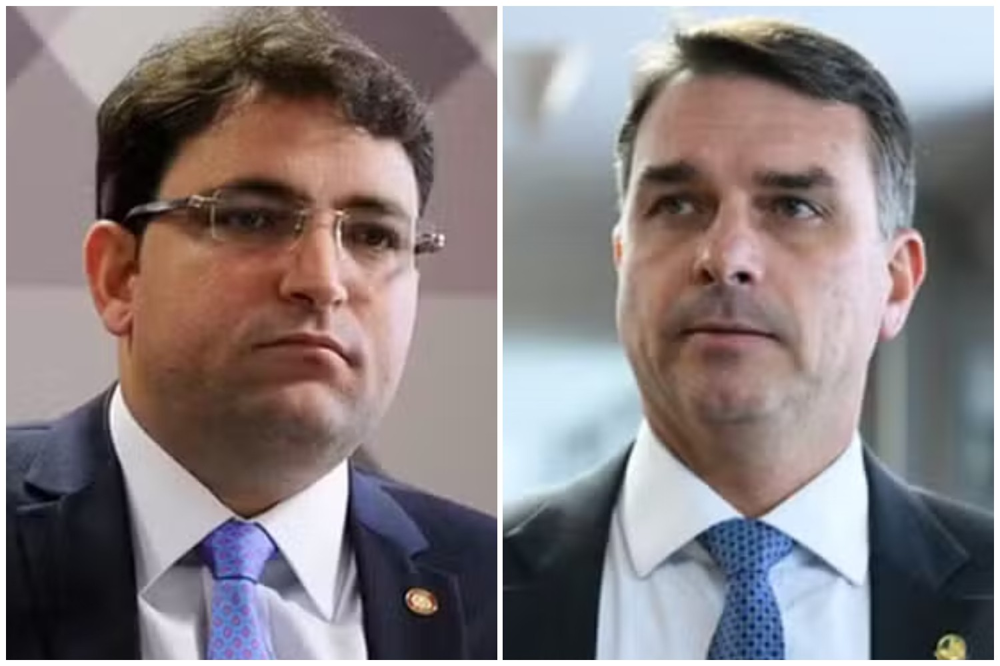
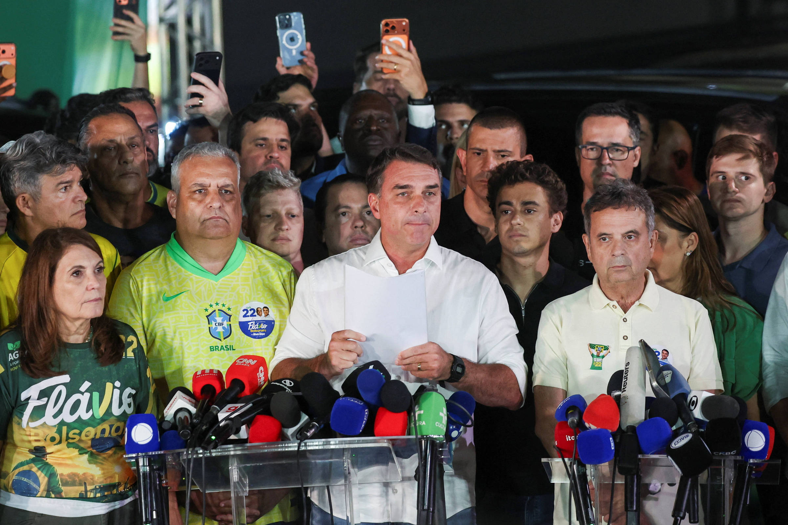
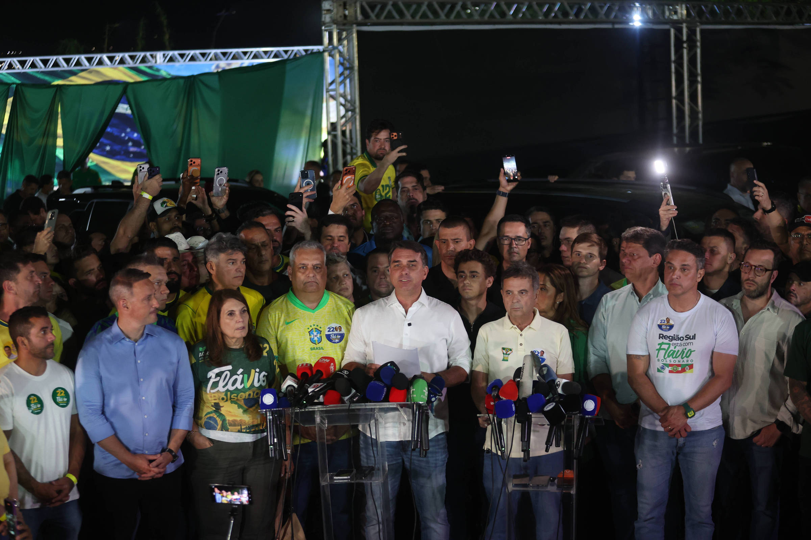
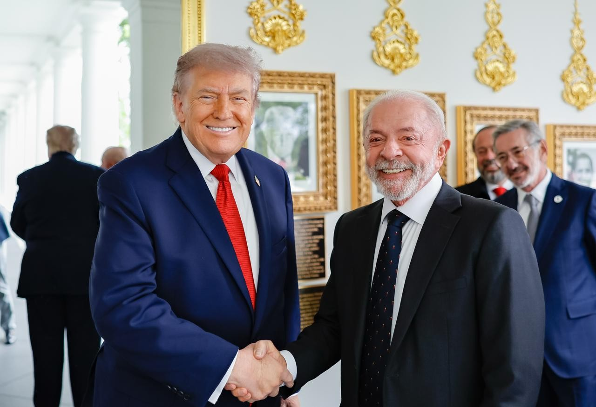
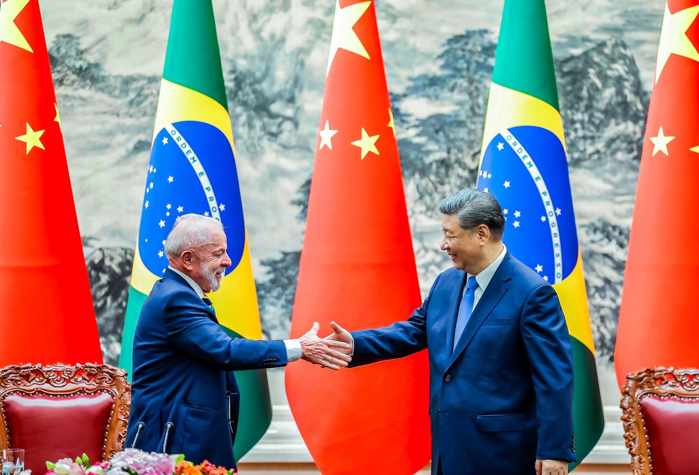
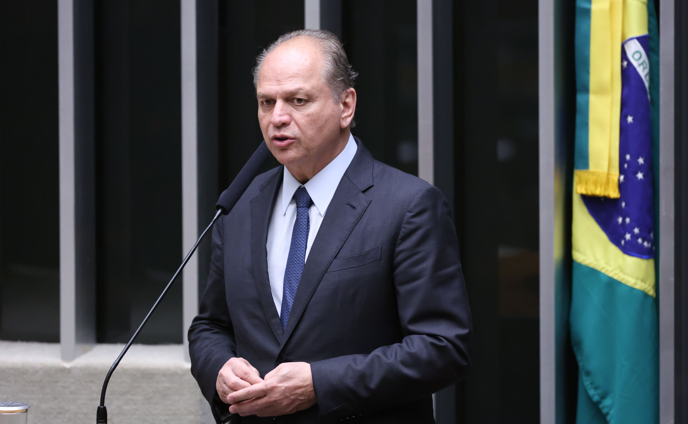
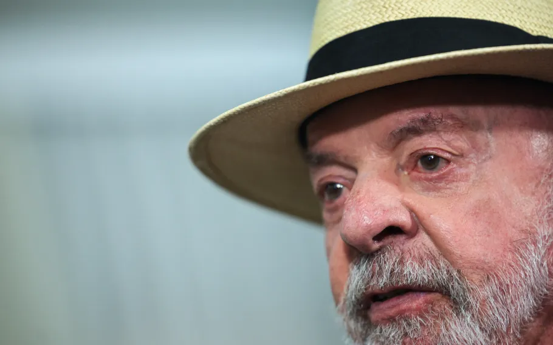
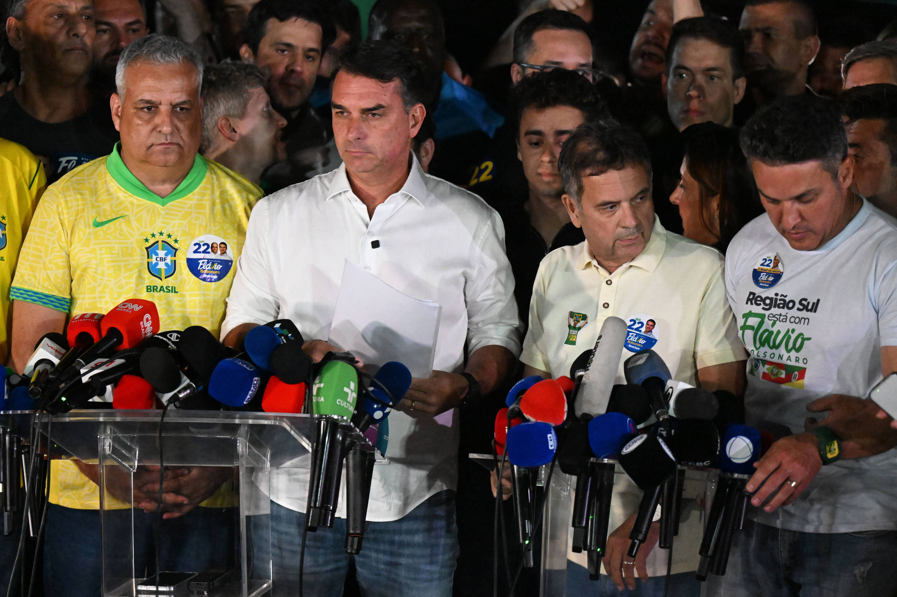

# Heimdall News — terça-feira, 27 de outubro de 2026

10 assuntos · 18 veículos e fontes

_O vídeo deste briefing ainda não foi postado._

## Assuntos do dia

1. Moraes manda Flávio Bolsonaro entregar o passaporte e o proíbe de deixar o país; oposição fala em perseguição, e governistas, em risco de fuga
2. Flávio desiste de pedir a anulação e anuncia ação por abuso de poder contra a chapa de Lula; Nikolas diz que chance de anular é “praticamente nula” e pede que apoiadores não vão às ruas
3. PL reconhece a vitória de Lula, mas cobra esclarecimentos; Flávio diz que vai liderar a oposição e Sóstenes desiste da presidência da Câmara
4. Trump diz, sem provas, que eleição “pareceu fraudada”; Amorim e Boulos respondem, e Eduardo Bolsonaro pede que estrangeiros não reconheçam o resultado
5. Xi Jinping, Kast e a maioria dos líderes da região parabenizam Lula; Milei é o único presidente sul-americano em silêncio
6. Lula recebe Motta e Alcolumbre; PT vai apoiar a recondução dos dois e governistas querem acelerar votações ainda em 2026
7. Centrão recalcula e admite compor com Lula 4; PSD fala em relação republicana, PSDB fará oposição, e Lula prepara troca de ministros
8. Bolsa cai 13,88% e dólar sobe 8,21% no primeiro pregão após a reeleição; mercado e entidades cobram compromisso fiscal
9. Episódios após a eleição: morre engenheiro agredido depois de ato pró-Lula em Santos; polícia investiga homem acorrentado em ato pró-Flávio; deputados do PL falam em demitir eleitores de Lula e em separar o Sul
10. Só 34,3 mil votos (0,03%) foram registrados depois das 17h, segundo os logs do TSE; Lula venceu por 4,43 milhões

---

## 1. Moraes manda Flávio Bolsonaro entregar o passaporte e o proíbe de deixar o país; oposição fala em perseguição, e governistas, em risco de fuga

_Imagem: [G1](https://g1.globo.com/politica/noticia/2026/10/26/moraes-determina-que-flavio-bolsonaro-entregue-passaporte.ghtml)_

_Cobertura (10): Imprensa mais à esquerda — Brasil de Fato, CartaCapital; Imprensa de centro / grandes veículos — Estadão, Folha, G1, JOTA, Poder360; Imprensa mais à direita — Gazeta do Povo, Revista Oeste; Outras fontes — Instagram (via Google News)_

### O que aconteceu

A ordem foi dada na noite de domingo (25), num inquérito em que Flávio e o advogado Willer Tomaz são investigados por lavagem de dinheiro em suposto esquema com empresas de Tomaz e bets; os dois negam irregularidades. [[1]](https://g1.globo.com/politica/noticia/2026/10/26/moraes-determina-que-flavio-bolsonaro-entregue-passaporte.ghtml)

A PF intimou Flávio na segunda (26), ao sair da casa onde Jair Bolsonaro cumpre prisão domiciliar. [[2]](https://www.estadao.com.br/politica/eleicoes/bancada-de-oposicao-na-camara-pede-explicacoes-sobre-pedido-da-pf-para-flavio-entregar-passaporte-nprp/)

Na sexta (23), Eduardo Bolsonaro disse num podcast nos EUA que defendia que o irmão deixasse o país se perdesse; deputados governistas pediram à PGR e ao STF a apreensão do passaporte. [[3]](https://www.brasildefato.com.br/2026/10/26/deputados-pedem-retencao-do-passaporte-de-flavio-bolsonaro-apos-derrota/) [[4]](https://www.gazetadopovo.com.br/republica/deputados-governistas-pedem-apreensao-passaporte-flavio-bolsonaro/)

Flávio mantém o foro no STF até o fim do mandato de senador, em 2027. [[1]](https://g1.globo.com/politica/noticia/2026/10/26/moraes-determina-que-flavio-bolsonaro-entregue-passaporte.ghtml)

### Como cada campo político se posicionou

**Pró-governo**

- **Duda Salabert (PSOL-MG), deputada**: Disse que Flávio poderia tentar fugir para não responder aos inquéritos e pediu sua prisão. [[4]](https://www.gazetadopovo.com.br/republica/deputados-governistas-pedem-apreensao-passaporte-flavio-bolsonaro/)
  > ““O próximo passo desse bandido é tentar fugir do Brasil para não enfrentar os vários inquéritos em seu nome. Precisa ser preso logo”, disse Duda Salabert.” — [Gazeta do Povo](https://www.gazetadopovo.com.br/republica/deputados-governistas-pedem-apreensao-passaporte-flavio-bolsonaro/)

**Centro pró-governo**

- **Otoni de Paula (PSD-RJ), deputado**: Protocolou representação na PGR pedindo a entrega do passaporte e a proibição de saída do país. [[4]](https://www.gazetadopovo.com.br/republica/deputados-governistas-pedem-apreensao-passaporte-flavio-bolsonaro/)
  > “Já Otoni de Paula anunciou que protocolou uma representação na Procuradoria-Geral da República (PGR) com pedido de medidas cautelares” — [Gazeta do Povo](https://www.gazetadopovo.com.br/republica/deputados-governistas-pedem-apreensao-passaporte-flavio-bolsonaro/)

**Oposição ao governo**

- **Flávio Bolsonaro (PL-RJ), senador**: Disse que vai cumprir a ordem, mas chamou a medida de tentativa de intimidação. [[5]](https://www.cartacapital.com.br/politica/flavio-bolsonaro-diz-que-foi-intimado-a-entregar-passaporte-e-acusa-pf-de-intimidacao/)
  > ““Vou entregar meus passaportes e vou me defender dessa aberração, que é uma clara tentativa de me intimidar. Mas ninguém vai me calar”, declarou.” — [CartaCapital](https://www.cartacapital.com.br/politica/flavio-bolsonaro-diz-que-foi-intimado-a-entregar-passaporte-e-acusa-pf-de-intimidacao/)
- **Cabo Gilberto (PL-PB), líder da oposição na Câmara**: Cobrou explicações públicas e provas sobre risco de saída do país. [[2]](https://www.estadao.com.br/politica/eleicoes/bancada-de-oposicao-na-camara-pede-explicacoes-sobre-pedido-da-pf-para-flavio-entregar-passaporte-nprp/)
  > “O deputado exige esclarecimentos públicos sobre as razões para a medida e provas concretas a respeito da saída do país de Flávio Bolsonaro.” — [Estadão](https://www.estadao.com.br/politica/eleicoes/bancada-de-oposicao-na-camara-pede-explicacoes-sobre-pedido-da-pf-para-flavio-entregar-passaporte-nprp/)

**Outros / não classificável**

- **Gazeta do Povo (editorial)**: Chamou a apreensão de “vingança pura dos vencedores contra os derrotados”, sem base em risco de fuga. [[6]](https://revistaoeste.com/imprensa/vinganca-pura-gazeta-do-povo-critica-apreensao-do-passaporte-de-flavio/)
  > “o jornal Gazeta do Povo define a apreensão do passaporte do senador Flávio Bolsonaro (PL-RJ) como “vingança pura dos vencedores contra os derrotados”” — [Revista Oeste](https://revistaoeste.com/imprensa/vinganca-pura-gazeta-do-povo-critica-apreensao-do-passaporte-de-flavio/)
- **Max Telesca, advogado (Brasil de Fato)**: Disse que há razões para entender que Flávio poderia deixar o país, como Eduardo. [[7]](https://www.brasildefato.com.br/2026/10/26/conduta-de-flavio-bolsonaro-se-assemelha-a-de-seu-pai-e-justica-acerta-ao-reter-passaporte-afirma-advogado/)
  > “Então, há, sim, razões para entender que o Flávio Bolsonaro poderia fazer o mesmo”, argumenta.” — [Brasil de Fato](https://www.brasildefato.com.br/2026/10/26/conduta-de-flavio-bolsonaro-se-assemelha-a-de-seu-pai-e-justica-acerta-ao-reter-passaporte-afirma-advogado/)

_Sem posicionamento encontrado: Centro, Centro-oposição, Independente — Missão / MBL._

Referências:

1. [Moraes determina que Flávio Bolsonaro entregue passaporte e proíbe que ele deixe o país](https://g1.globo.com/politica/noticia/2026/10/26/moraes-determina-que-flavio-bolsonaro-entregue-passaporte.ghtml) — G1, 26/10 17:17
2. [Bancada de oposição na Câmara pede explicações sobre pedido da PF para Flávio entregar passaporte](https://www.estadao.com.br/politica/eleicoes/bancada-de-oposicao-na-camara-pede-explicacoes-sobre-pedido-da-pf-para-flavio-entregar-passaporte-nprp/) — Estadão, 26/10 21:01
3. [Deputados pedem retenção do passaporte de Flávio Bolsonaro após derrota](https://www.brasildefato.com.br/2026/10/26/deputados-pedem-retencao-do-passaporte-de-flavio-bolsonaro-apos-derrota/) — Brasil de Fato, 26/10 10:35
4. [Deputados governistas pedem apreensão do passaporte de Flávio Bolsonaro](https://www.gazetadopovo.com.br/republica/deputados-governistas-pedem-apreensao-passaporte-flavio-bolsonaro/) — Gazeta do Povo, 26/10 11:16
5. [Flávio Bolsonaro diz que foi intimado a entregar passaporte e acusa PF de ‘intimidação’](https://www.cartacapital.com.br/politica/flavio-bolsonaro-diz-que-foi-intimado-a-entregar-passaporte-e-acusa-pf-de-intimidacao/) — CartaCapital, 26/10 17:44
6. [‘Vingança pura’: Gazeta do Povo critica apreensão do passaporte de Flávio](https://revistaoeste.com/imprensa/vinganca-pura-gazeta-do-povo-critica-apreensao-do-passaporte-de-flavio/) — Revista Oeste, 27/10 07:48
7. [Conduta de Flávio Bolsonaro se assemelha à de seu pai e Justiça acerta ao reter passaporte, afirma advogado](https://www.brasildefato.com.br/2026/10/26/conduta-de-flavio-bolsonaro-se-assemelha-a-de-seu-pai-e-justica-acerta-ao-reter-passaporte-afirma-advogado/) — Brasil de Fato, 26/10 21:31

Outras matérias sobre o tema:

- [Flávio Bolsonaro tem passaportes cancelados por ordem de Moraes e fica proibido de deixar o país](https://www1.folha.uol.com.br/poder/2026/10/flavio-bolsonaro-diz-que-pf-apreendeu-seu-passaporte-e-que-esta-proibido-de-deixar-o-pais.shtml) — Folha, 26/10 16:56
- [Moraes cancela passaportes de Flávio Bolsonaro após derrota do senador nas eleições](https://www.jota.info/stf/do-supremo/flavio-bolsonaro-diz-que-foi-intimado-pela-pf-para-entregar-passaporte-por-ordem-de-moraes) — JOTA, 26/10 17:19
- [PF intima Flávio a entregar passaporte; senador diz que vai pedir cassação de chapa do PT](https://www.estadao.com.br/politica/eleicoes/flavio-diz-que-vai-pedir-cassacao-de-chapa-do-pt-e-que-moraes-ordenou-entrega-de-passaportes/) — Estadão, 26/10 16:54
- [Flávio Bolsonaro diz ter sido intimado pela PF a entregar passaportes por ordem de Moraes](https://www.gazetadopovo.com.br/republica/flavio-bolsonaro-tem-passaportes-apreendidos-e-esta-proibido-de-deixar-o-pais/) — Gazeta do Povo, 26/10 18:46
- [Duda Salabert diz ter pedido apreensão do passaporte de Flávio](https://www.poder360.com.br/poder-eleicoes-2026/duda-salabert-diz-ter-pedido-apreensao-do-passaporte-de-flavio/) — Poder360, 26/10 08:18
- [PF apreende passaporte de Flávio Bolsonaro, que volta a questionar resultado das urnas](https://www.brasildefato.com.br/2026/10/26/pf-apreende-passaporte-de-flavio-bolsonaro-que-volta-a-questionar-resultado-das-urnas/) — Brasil de Fato, 26/10 18:34
- [Flávio Bolsonaro (PL-RJ) foi intimado pela Polícia Federal a entregar seus passaportes nesta segunda-feira (26), por determinação do ministro Alexandre de Moraes, do Supremo Tribunal Federal (STF). O senador, derrotado por Lula no segundo turno das el](https://news.google.com/rss/articles/CBMiUkFVX3lxTE94cnZEaU1TN1lPSjhwaVpqQzNMUlVnQk9DS0oycDdCUGlNY1p0dkRpTmxHWVNOOFlueGZLdUg0cTBGZ2tDNHYzTGUxUXZXMy1qOXc?oc=5) — Instagram (via Google News), 27/10 05:34
- [O que acontece com Flávio Bolsonaro sem foro privilegiado?](https://www.jota.info/justica/o-que-acontece-com-flavio-bolsonaro-sem-foro-privilegiado) — JOTA, 27/10 07:01
- [Flávio Bolsonaro enfrentará dois inquéritos criminais sem foro especial a partir de fevereiro](https://www1.folha.uol.com.br/poder/2026/10/flavio-bolsonaro-enfrentara-dois-inqueritos-criminais-sem-foro-especial-a-partir-de-fevereiro.shtml) — Folha, 26/10 23:00
- [Investigações que miram Flávio Bolsonaro podem permanecer no STF mesmo após perda do foro privilegiado; entenda](https://g1.globo.com/politica/noticia/2026/10/26/investigacoes-que-miram-flavio-bolsonaro-podem-permanecer-no-stf-mesmo-apos-perda-do-foro-privilegiado-entenda.ghtml) — G1, 26/10 10:48
- [Sem foro privilegiado e na mira da Justiça: Flávio Bolsonaro ficará sem cargo público a partir de 2027](https://www.brasildefato.com.br/2026/10/26/sem-foro-privilegiado-e-na-mira-da-justica-flavio-bolsonaro-ficara-sem-cargo-publico-a-partir-de-2027/) — Brasil de Fato, 26/10 11:12
- [Flávio Bolsonaro ficará sem mandato e perderá foro privilegiado em 2027](https://www.cartacapital.com.br/politica/flavio-bolsonaro-ficara-sem-mandato-e-perdera-foro-privilegiado-em-2027/) — CartaCapital, 26/10 08:41

---

## 2. Flávio desiste de pedir a anulação e anuncia ação por abuso de poder contra a chapa de Lula; Nikolas diz que chance de anular é “praticamente nula” e pede que apoiadores não vão às ruas

_Imagem: [Folha](https://www1.folha.uol.com.br/colunas/painel/2026/10/flavio-deve-desistir-de-pedir-anulacao-da-eleicao-e-entrar-com-acao-por-abuso-de-poder-contra-lula.shtml)_

_Cobertura (7): Imprensa mais à esquerda — Brasil de Fato, CartaCapital; Imprensa de centro / grandes veículos — CNN Brasil, Estadão, Folha, G1; Imprensa mais à direita — Gazeta do Povo_

### O que aconteceu

Segundo a Folha, aliados e advogados convenceram Flávio a trocar o pedido de anulação por uma Aije (ação de investigação judicial eleitoral) por abuso de poder econômico. [[1]](https://www1.folha.uol.com.br/colunas/painel/2026/10/flavio-deve-desistir-de-pedir-anulacao-da-eleicao-e-entrar-com-acao-por-abuso-de-poder-contra-lula.shtml)

Flávio diz que o governo gastou “quase meio trilhão” no ano eleitoral; o Gastômetro do Estadão soma R$ 405 bilhões em medidas lançadas por Lula na campanha. [[2]](https://www.estadao.com.br/politica/eleicoes/flavio-diz-que-vai-pedir-cassacao-de-chapa-do-pt-e-que-moraes-ordenou-entrega-de-passaportes/)

O TSE afirmou que dois fiscais do PL acompanharam a totalização e que há registros e filmagem do acesso. [[3]](https://www.cartacapital.com.br/cartaexpressa/tse-desmente-tese-de-flavio-de-que-fiscais-do-pl-foram-retirados-de-sala-cofre/)

### Como cada campo político se posicionou

**Pró-governo**

- **Marco Aurélio de Carvalho, coordenador da campanha de Lula em SP**: Disse que Flávio faz “pirotecnia” e que eleição se ganha no voto, não no “tapetão”. [[4]](https://www1.folha.uol.com.br/colunas/painel/2026/10/membro-da-coordenacao-de-lula-diz-que-flavio-faz-pirotecnia-ao-nao-reconhecer-resultado.shtml)
  > “"Quem não sabe perder não merece ganhar. Em uma democracia de dimensões continentais, se ganha e se perde no voto e não no tapetão", concluiu.” — [Folha](https://www1.folha.uol.com.br/colunas/painel/2026/10/membro-da-coordenacao-de-lula-diz-que-flavio-faz-pirotecnia-ao-nao-reconhecer-resultado.shtml)

**Centro pró-governo**

- **Tarcísio de Freitas (Republicanos), governador de SP (segundo a Folha)**: Esteve entre os que defenderam junto a Flávio o recuo do pedido de anulação. [[1]](https://www1.folha.uol.com.br/colunas/painel/2026/10/flavio-deve-desistir-de-pedir-anulacao-da-eleicao-e-entrar-com-acao-por-abuso-de-poder-contra-lula.shtml)
  > “Diversos senadores e governadores defenderam junto a Flávio um recuo, entre eles o de São Paulo, Tarcísio de Freitas (Republicanos).” — [Folha](https://www1.folha.uol.com.br/colunas/painel/2026/10/flavio-deve-desistir-de-pedir-anulacao-da-eleicao-e-entrar-com-acao-por-abuso-de-poder-contra-lula.shtml)

**Oposição ao governo**

- **Flávio Bolsonaro (PL-RJ), senador**: Anunciou que vai pedir a cassação da chapa de Lula por abuso de poder. [[5]](https://www1.folha.uol.com.br/poder/2026/10/pl-reconhece-derrota-para-lula-e-flavio-bolsonaro-diz-que-vai-liderar-oposicao.shtml)
  > “"Eu vou pedir, sim, a cassação da chapa do Lula por todos os abusos que ele cometeu. A lei tem que valer para todo mundo.” — [Folha](https://www1.folha.uol.com.br/poder/2026/10/pl-reconhece-derrota-para-lula-e-flavio-bolsonaro-diz-que-vai-liderar-oposicao.shtml)
- **Nikolas Ferreira (PL-MG), deputado**: Disse que a chance de anular a eleição é “praticamente nula” e pediu que apoiadores não vão às ruas. [[6]](https://www1.folha.uol.com.br/poder/2026/10/nikolas-diz-que-chance-de-anular-eleicao-e-quase-nula-e-orienta-apoiadores-de-flavio-a-evitarem-atos-nas-ruas.shtml)
  > “Conhecendo o nosso país, a chance de anular essa eleição é praticamente nula.” — [Folha](https://www1.folha.uol.com.br/poder/2026/10/nikolas-diz-que-chance-de-anular-eleicao-e-quase-nula-e-orienta-apoiadores-de-flavio-a-evitarem-atos-nas-ruas.shtml)
- **Lucas Pavanato (PL-SP), deputado eleito**: Pediu que apoiadores só participem de atos convocados pelos perfis oficiais e disse que “a briga agora é judicial”. [[7]](https://www.gazetadopovo.com.br/eleicoes/2026/pavanato-pede-que-apoiadores-de-flavio-nao-participe-de-atos-que-nao-sejam-oficiais/)
  > “Não participe de manifestações que não sejam oficiais, quando chegar a hora de algum ato pacífico nós mesmos vamos informar.” — [Gazeta do Povo](https://www.gazetadopovo.com.br/eleicoes/2026/pavanato-pede-que-apoiadores-de-flavio-nao-participe-de-atos-que-nao-sejam-oficiais/)

**Independente — Missão / MBL**

- **Renan Santos (Missão), presidente do partido**: Disse que não houve fraude e aconselhou que as pessoas não saiam às ruas para questionar o resultado. [[8]](https://www.estadao.com.br/politica/eleicoes/antibolsonarismo-e-maior-que-antipetismo-afirma-renan-santos-sobre-resultado-das-eleicoes-nprp/)
  > ““Não houve fraude. A campanha do petismo foi colossal. A do bolsonarismo também foi, mas a do Lula aumentou o antibolsonarismo”, declarou o presidente do partido Missão.” — [Estadão](https://www.estadao.com.br/politica/eleicoes/antibolsonarismo-e-maior-que-antipetismo-afirma-renan-santos-sobre-resultado-das-eleicoes-nprp/)

**Outros / não classificável**

- **Tribunal Superior Eleitoral (nota)**: Negou que fiscais do PL tenham sido impedidos de acompanhar a totalização. [[3]](https://www.cartacapital.com.br/cartaexpressa/tse-desmente-tese-de-flavio-de-que-fiscais-do-pl-foram-retirados-de-sala-cofre/)
  > “A Justiça Eleitoral desmentiu, nesta segunda-feira 26, a alegação de Flávio Bolsonaro de que fiscais do Partido Liberal (PL), legenda pela qual concorreu ao cargo, teriam sido retirados da sala-cofre” — [CartaCapital](https://www.cartacapital.com.br/cartaexpressa/tse-desmente-tese-de-flavio-de-que-fiscais-do-pl-foram-retirados-de-sala-cofre/)

_Sem posicionamento encontrado: Centro, Centro-oposição._

Referências:

1. [Flávio desiste de pedir anulação da eleição e entrará com ação por abuso de poder contra Lula](https://www1.folha.uol.com.br/colunas/painel/2026/10/flavio-deve-desistir-de-pedir-anulacao-da-eleicao-e-entrar-com-acao-por-abuso-de-poder-contra-lula.shtml) — Folha, 26/10 16:46
2. [PF intima Flávio a entregar passaporte; senador diz que vai pedir cassação de chapa do PT](https://www.estadao.com.br/politica/eleicoes/flavio-diz-que-vai-pedir-cassacao-de-chapa-do-pt-e-que-moraes-ordenou-entrega-de-passaportes/) — Estadão, 26/10 16:54
3. [TSE desmente tese de Flávio de que fiscais do PL foram retirados de sala-cofre](https://www.cartacapital.com.br/cartaexpressa/tse-desmente-tese-de-flavio-de-que-fiscais-do-pl-foram-retirados-de-sala-cofre/) — CartaCapital, 26/10 12:06
4. [Membro da coordenação de Lula diz que Flávio faz pirotecnia ao não reconhecer resultado](https://www1.folha.uol.com.br/colunas/painel/2026/10/membro-da-coordenacao-de-lula-diz-que-flavio-faz-pirotecnia-ao-nao-reconhecer-resultado.shtml) — Folha, 26/10 14:56
5. [PL reconhece derrota para Lula, e Flávio Bolsonaro diz que vai liderar oposição](https://www1.folha.uol.com.br/poder/2026/10/pl-reconhece-derrota-para-lula-e-flavio-bolsonaro-diz-que-vai-liderar-oposicao.shtml) — Folha, 26/10 19:51
6. [Nikolas diz que chance de anular eleição é quase nula e orienta apoiadores de Flávio a evitarem atos nas ruas](https://www1.folha.uol.com.br/poder/2026/10/nikolas-diz-que-chance-de-anular-eleicao-e-quase-nula-e-orienta-apoiadores-de-flavio-a-evitarem-atos-nas-ruas.shtml) — Folha, 26/10 17:28
7. [Pavanato pede que apoiadores de Flávio não participem de atos “que não sejam oficiais”](https://www.gazetadopovo.com.br/eleicoes/2026/pavanato-pede-que-apoiadores-de-flavio-nao-participe-de-atos-que-nao-sejam-oficiais/) — Gazeta do Povo, 27/10 07:27
8. [‘Antibolsonarismo é maior que antipetismo’, afirma Renan Santos sobre resultado das eleições](https://www.estadao.com.br/politica/eleicoes/antibolsonarismo-e-maior-que-antipetismo-afirma-renan-santos-sobre-resultado-das-eleicoes-nprp/) — Estadão, 26/10 16:02

Outras matérias sobre o tema:

- [Após derrota, Flávio Bolsonaro diz que vai pedir cassação da chapa de Lula](https://g1.globo.com/politica/noticia/2026/10/26/flavio-publica-video-apos-eleicao.ghtml) — G1, 26/10 16:51
- [Flávio pedirá cassação da chapa de Lula e evita falar em anulação da eleição](https://www.gazetadopovo.com.br/republica/flavio-desiste-anular-eleicao-pedira-cassacao-chapa-lula/) — Gazeta do Povo, 26/10 19:25
- [Flávio Bolsonaro questiona resultado do segundo turno na Justiça](https://www.gazetadopovo.com.br/republica/flavio-bolsonaro-questiona-resultado-do-segundo-turno-na-justica/) — Gazeta do Povo, 26/10 17:03
- [Aliados dizem que eleição é página virada e que Flávio não voltará a contestar resultado diretamente](https://www.estadao.com.br/politica/eleicoes/aliados-dizem-que-eleicao-e-pagina-virada-e-que-flavio-nao-voltara-a-contestar-resultado-diretamente/) — Estadão, 26/10 17:12
- [Nikolas diz que chance de anular eleição é quase nula e pede para apoiadores evitarem manifestações](https://www.estadao.com.br/politica/eleicoes/nikolas-diz-que-chance-de-anular-eleicao-e-quase-nula-e-pede-para-apoiadores-evitarem-manifestacoes/) — Estadão, 26/10 13:55
- [Nikolas pede para as pessoas não irem às ruas e diz que chance de anular a eleição é 'praticamente nula'](https://g1.globo.com/politica/eleicoes/2026/noticia/2026/10/26/nikolas-video-anular-a-eleicao-nao-irem-ruas.ghtml) — G1, 26/10 16:58
- [Nikolas Ferreira admite que chance de anular 2º turno é ‘praticamente nula’](https://www.cartacapital.com.br/politica/nikolas-ferreira-admite-que-chance-de-anular-2o-turno-e-praticamente-nula/) — CartaCapital, 26/10 16:23
- [Disputa entre Lula e Flávio continua no TSE mesmo após o fim das eleições](https://www.cnnbrasil.com.br/eleicoes/disputa-entre-lula-e-flavio-continua-no-tse-mesmo-apos-o-fim-das-eleicoes/) — CNN Brasil, 27/10 03:30
- [Sem amparo legal, pedido de Flávio Bolsonaro para anular eleição não deve prosperar](https://www.brasildefato.com.br/2026/10/26/sem-amparo-legal-pedido-de-flavio-bolsonaro-para-anular-eleicao-nao-deve-prosperar/) — Brasil de Fato, 26/10 12:38
- [Flávio Bolsonaro, que não reconhece derrota, disse em sabatina que respeitaria resultado](https://www1.folha.uol.com.br/poder/2026/10/flavio-bolsonaro-que-nao-reconhece-derrota-disse-em-sabatina-que-respeitaria-resultado.shtml) — Folha, 26/10 12:15
- [PL de Flávio Bolsonaro deve ficar isolado no pedido para anular a eleição](https://g1.globo.com/politica/blog/valdo-cruz/post/2026/10/26/pl-de-flavio-bolsonaro-deve-ficar-isolado-no-pedido-para-anular-a-eleicao.ghtml) — G1, 26/10 11:50
- [Aliados de Flávio Bolsonaro reconhecem vitória de Lula e descartam anular eleição](https://www.gazetadopovo.com.br/eleicoes/2026/aliados-flavio-bolsonaro-reconhecem-vitoria-lula-descartam-anular-eleicao/) — Gazeta do Povo, 26/10 12:52
- [Contestações legítimas apontam que eleição não acabou em 25 de outubro](https://www.gazetadopovo.com.br/republica/contestacoes-legitimas-apontam-que-eleicao-nao-acabou-em-25-de-outubro/) — Gazeta do Povo, 26/10 13:02
- [‘Os que não sabem perder não merecem ganhar’, diz coordenador da campanha de Lula](https://www.cartacapital.com.br/politica/os-que-nao-sabem-perder-nao-merecem-ganhar-diz-coordenador-da-campanha-de-lula/) — CartaCapital, 26/10 18:57

---

## 3. PL reconhece a vitória de Lula, mas cobra esclarecimentos; Flávio diz que vai liderar a oposição e Sóstenes desiste da presidência da Câmara

_Imagem: [Folha](https://www1.folha.uol.com.br/poder/2026/10/pl-reconhece-derrota-para-lula-e-flavio-bolsonaro-diz-que-vai-liderar-oposicao.shtml)_

_Cobertura (8): Imprensa mais à esquerda — Brasil de Fato, CartaCapital; Imprensa de centro / grandes veículos — Estadão, Folha, G1, JOTA; Imprensa mais à direita — Gazeta do Povo; Fontes oficiais — Agência Câmara_

### O que aconteceu

Em nota de Valdemar Costa Neto, o PL reconheceu o resultado proclamado pelo TSE e disse que os questionamentos precisam ser esclarecidos. [[1]](https://www1.folha.uol.com.br/poder/2026/10/pl-reconhece-derrota-para-lula-e-flavio-bolsonaro-diz-que-vai-liderar-oposicao.shtml) [[2]](https://www.gazetadopovo.com.br/eleicoes/2026/pl-reconhece-vitoria-de-lula-mas-cobra-explicacoes/)

O PL elegeu 121 deputados, a maior bancada; o líder Sóstenes Cavalcante desistiu de disputar a presidência da Câmara. [[3]](https://www1.folha.uol.com.br/blogs/brasilia-hoje/2026/10/lider-do-pl-desiste-de-disputar-presidencia-da-camara-apos-derrota-de-flavio-bolsonaro.shtml)

Aliados de Flávio fora do PL, como Ricardo Nunes e Felício Ramuth (MDB), reconheceram o resultado; Ramuth criticou o PL. [[4]](https://www1.folha.uol.com.br/colunas/painel/2026/10/vice-de-tarcisio-diz-que-vitoria-de-lula-e-incontestavel-e-critica-pl-por-questionar-resultado.shtml)

### Como cada campo político se posicionou

**Centro pró-governo**

- **Felício Ramuth (MDB), vice-governador de SP**: Disse que a vitória é incontestável e criticou o PL por questionar o resultado depois de pedir a prorrogação. [[4]](https://www1.folha.uol.com.br/colunas/painel/2026/10/vice-de-tarcisio-diz-que-vitoria-de-lula-e-incontestavel-e-critica-pl-por-questionar-resultado.shtml)
  > “"O PL pediu a prorrogação e, após perder, passou a questionar o resultado. Respeitamos o resultado das urnas, embora não seja a mudança que queríamos."” — [Folha](https://www1.folha.uol.com.br/colunas/painel/2026/10/vice-de-tarcisio-diz-que-vitoria-de-lula-e-incontestavel-e-critica-pl-por-questionar-resultado.shtml)
- **Ricardo Nunes (MDB), prefeito de SP**: Reconheceu o fim do processo eleitoral e desejou que o novo governo “acerte e recupere a economia”. [[5]](https://www1.folha.uol.com.br/poder/2026/10/apoiador-de-flavio-bolsonaro-ricardo-nunes-deseja-que-o-novo-governo-acerte-e-recupere-a-economia.shtml)
  > “"Terminado o processo eleitoral, o desejo é que o novo governo acerte e recupere a economia para dar à população condições de melhorar sua qualidade de vida” — [Folha](https://www1.folha.uol.com.br/poder/2026/10/apoiador-de-flavio-bolsonaro-ricardo-nunes-deseja-que-o-novo-governo-acerte-e-recupere-a-economia.shtml)

**Oposição ao governo**

- **Valdemar Costa Neto, presidente do PL (nota)**: Disse que o PL seguirá “com independência e responsabilidade”. [[6]](https://g1.globo.com/politica/eleicoes/2026/noticia/2026/10/26/pl-reconhece-resultado-das-eleicoes.ghtml)
  > “"O PL continuará firme, atuando com independência e responsabilidade na defesa da democracia, da liberdade e dos valores que representamos.” — [G1](https://g1.globo.com/politica/eleicoes/2026/noticia/2026/10/26/pl-reconhece-resultado-das-eleicoes.ghtml)
- **Flávio Bolsonaro (PL-RJ), senador**: Disse que vai organizar a oposição e fazer do Congresso uma “fortaleza”. [[1]](https://www1.folha.uol.com.br/poder/2026/10/pl-reconhece-derrota-para-lula-e-flavio-bolsonaro-diz-que-vai-liderar-oposicao.shtml)
  > “"Para resistir ao caos, eu vou organizar a oposição. A gente fez a maioria no Senado e na Câmara.” — [Folha](https://www1.folha.uol.com.br/poder/2026/10/pl-reconhece-derrota-para-lula-e-flavio-bolsonaro-diz-que-vai-liderar-oposicao.shtml)
- **Sergio Moro (PL-PR), senador e governador eleito**: Disse que há questionamentos da oposição que precisam ser esclarecidos. [[7]](https://www1.folha.uol.com.br/poder/2026/10/moro-diz-que-e-preciso-esclarecer-questionamentos-da-oposicao-apos-derrota-de-flavio-bolsonaro.shtml)
  > “também disse que "há questionamentos da oposição que precisam ser esclarecidos"” — [Folha](https://www1.folha.uol.com.br/poder/2026/10/moro-diz-que-e-preciso-esclarecer-questionamentos-da-oposicao-apos-derrota-de-flavio-bolsonaro.shtml)
- **Tereza Cristina (PP-MS), senadora**: Disse que a direita vai fiscalizar o governo e não citou questionamento à eleição. [[8]](https://www1.folha.uol.com.br/poder/2026/10/aliada-de-flavio-tereza-cristina-fala-em-fiscalizar-governo-na-oposicao-e-nao-cita-questionamento-a-eleicao.shtml)
  > “Nós estaremos lá para fiscalizar esse governo e lutar pelo país que queremos” — [Folha](https://www1.folha.uol.com.br/poder/2026/10/aliada-de-flavio-tereza-cristina-fala-em-fiscalizar-governo-na-oposicao-e-nao-cita-questionamento-a-eleicao.shtml)
- **Sóstenes Cavalcante (PL-RJ), líder do PL na Câmara**: Disse que não tem interesse em disputar a presidência da Câmara com Lula no governo. [[3]](https://www1.folha.uol.com.br/blogs/brasilia-hoje/2026/10/lider-do-pl-desiste-de-disputar-presidencia-da-camara-apos-derrota-de-flavio-bolsonaro.shtml)
  > “"Eu sempre falei que seria presidente da Câmara se o Flávio ganhasse. Não tenho interesse em ser candidato com Lula", afirmou.” — [Folha](https://www1.folha.uol.com.br/blogs/brasilia-hoje/2026/10/lider-do-pl-desiste-de-disputar-presidencia-da-camara-apos-derrota-de-flavio-bolsonaro.shtml)

**Independente — Missão / MBL**

- **Kim Kataguiri (Missão-SP), deputado**: Atribuiu a vitória do PT a uma direita “debochada, soberba e fraca”. [[9]](https://www.camara.leg.br/noticias/1313811-lideres-governistas-celebram-vitoria-de-lula-oposicao-critica-prorrogacao-da-votacao-e-lamenta-resultado)
  > “Ele avaliou que a principal responsável pela vitória do PT foi uma direita “debochada, soberba e fraca”” — [Agência Câmara](https://www.camara.leg.br/noticias/1313811-lideres-governistas-celebram-vitoria-de-lula-oposicao-critica-prorrogacao-da-votacao-e-lamenta-resultado)

**Outros / não classificável**

- **João Doria, ex-governador de SP**: Reconheceu a vitória de Lula e defendeu o respeito ao resultado. [[10]](https://g1.globo.com/sp/sao-paulo/eleicoes/2026/noticia/2026/10/26/e-preciso-respeitar-o-resultado-das-urnas-afirma-joao-doria-apos-vitoria-de-lula.ghtml)
  > “"O que o Brasil mais precisa, além de um bom governo, é de paz.” — [G1](https://g1.globo.com/sp/sao-paulo/eleicoes/2026/noticia/2026/10/26/e-preciso-respeitar-o-resultado-das-urnas-afirma-joao-doria-apos-vitoria-de-lula.ghtml)

_Sem posicionamento encontrado: Pró-governo, Centro, Centro-oposição._

Referências:

1. [PL reconhece derrota para Lula, e Flávio Bolsonaro diz que vai liderar oposição](https://www1.folha.uol.com.br/poder/2026/10/pl-reconhece-derrota-para-lula-e-flavio-bolsonaro-diz-que-vai-liderar-oposicao.shtml) — Folha, 26/10 19:51
2. [PL reconhece vitória de Lula, mas cobra explicações](https://www.gazetadopovo.com.br/eleicoes/2026/pl-reconhece-vitoria-de-lula-mas-cobra-explicacoes/) — Gazeta do Povo, 26/10 19:52
3. [Líder do PL desiste de disputar presidência da Câmara após derrota de Flávio Bolsonaro](https://www1.folha.uol.com.br/blogs/brasilia-hoje/2026/10/lider-do-pl-desiste-de-disputar-presidencia-da-camara-apos-derrota-de-flavio-bolsonaro.shtml) — Folha, 26/10 20:20
4. [Vice de Tarcísio diz que vitória de Lula é incontestável e critica PL por questionar resultado](https://www1.folha.uol.com.br/colunas/painel/2026/10/vice-de-tarcisio-diz-que-vitoria-de-lula-e-incontestavel-e-critica-pl-por-questionar-resultado.shtml) — Folha, 26/10 15:21
5. [Apoiador de Flávio Bolsonaro, Ricardo Nunes deseja que o novo governo 'acerte e recupere a economia'](https://www1.folha.uol.com.br/poder/2026/10/apoiador-de-flavio-bolsonaro-ricardo-nunes-deseja-que-o-novo-governo-acerte-e-recupere-a-economia.shtml) — Folha, 26/10 13:17
6. [PL, partido de Flávio Bolsonaro, reconhece resultado da eleição, mas cobra esclarecimentos](https://g1.globo.com/politica/eleicoes/2026/noticia/2026/10/26/pl-reconhece-resultado-das-eleicoes.ghtml) — G1, 26/10 19:17
7. [Moro e Zucco dizem que é preciso esclarecer questionamentos da oposição após derrota de Flávio Bolsonaro](https://www1.folha.uol.com.br/poder/2026/10/moro-diz-que-e-preciso-esclarecer-questionamentos-da-oposicao-apos-derrota-de-flavio-bolsonaro.shtml) — Folha, 26/10 11:55
8. [Aliada de Flávio, Tereza Cristina fala em fiscalizar governo na oposição e não cita questionamento à eleição](https://www1.folha.uol.com.br/poder/2026/10/aliada-de-flavio-tereza-cristina-fala-em-fiscalizar-governo-na-oposicao-e-nao-cita-questionamento-a-eleicao.shtml) — Folha, 26/10 12:28
9. [Líderes governistas celebram vitória de Lula; oposição critica prorrogação da votação e lamenta resultado](https://www.camara.leg.br/noticias/1313811-lideres-governistas-celebram-vitoria-de-lula-oposicao-critica-prorrogacao-da-votacao-e-lamenta-resultado) — Agência Câmara, 26/10 11:34
10. ['É preciso respeitar o resultado das urnas', afirma João Doria após vitória de Lula](https://g1.globo.com/sp/sao-paulo/eleicoes/2026/noticia/2026/10/26/e-preciso-respeitar-o-resultado-das-urnas-afirma-joao-doria-apos-vitoria-de-lula.ghtml) — G1, 26/10 10:12

Outras matérias sobre o tema:

- [Partido de Flávio, PL reconhece vitória de Lula nas eleições](https://www.brasildefato.com.br/2026/10/26/partido-de-flavio-pl-reconhece-vitoria-de-lula-nas-eleicoes/) — Brasil de Fato, 26/10 21:58
- [PL, partido de Flávio Bolsonaro, reconhece resultado da eleição](https://www.cartacapital.com.br/politica/pl-partido-de-flavio-bolsonaro-reconhece-resultado-da-eleicao/) — CartaCapital, 26/10 21:52
- [PL, partido de Flávio Bolsonaro, reconhece resultado da eleição em que Lula foi vitorioso](https://www.jota.info/eleicoes/eleicoes-2026/pl-partido-de-flavio-bolsonaro-reconhece-resultado-da-eleicao-em-que-lula-foi-vitorioso) — JOTA, 26/10 20:09
- [Partido de Flávio Bolsonaro reconhece resultado das eleições](https://www.estadao.com.br/politica/eleicoes/partido-de-flavio-bolsonaro-reconhece-resultado-das-eleicoes/) — Estadão, 26/10 19:44
- [Aliados de Flávio Bolsonaro adiam mea-culpa e atribuem derrota a pacote de Lula](https://www1.folha.uol.com.br/poder/2026/10/aliados-de-flavio-bolsonaro-adiam-mea-culpa-e-atribuem-derrota-a-pacote-de-lula.shtml) — Folha, 26/10 23:00
- [Ruas reconhece derrota de Flávio e lamenta resultado: ‘Brasil perdeu a oportunidade de mudar’](https://www.estadao.com.br/politica/eleicoes/ruas-reconhece-derrota-de-flavio-e-lamenta-resultado-brasil-perdeu-a-oportunidade-de-mudar-nprp/) — Estadão, 26/10 21:51
- [Vice de Tarcísio diz que PL agiu de forma contraditória ao contestar derrota de Flávio](https://www.cartacapital.com.br/politica/vice-de-tarcisio-diz-que-pl-agiu-de-forma-contraditoria-ao-contestar-derrota-de-flavio/) — CartaCapital, 26/10 18:22
- [Vice de Tarcísio diz confiar nas urnas e critica questionamento após apuração dos votos](https://www.gazetadopovo.com.br/eleicoes/2026/vice-governador-de-sao-paulo-diz-confiar-nas-urnas-e-critica-questionamento-apos-apuracao-dos-votos/) — Gazeta do Povo, 26/10 12:13
- [Após derrota de Flávio, Ricardo Nunes diz esperar que novo governo recupere a economia](https://g1.globo.com/sp/sao-paulo/eleicoes/2026/noticia/2026/10/26/apos-derrota-de-flavio-ricardo-nunes-diz-esperar-que-novo-governo-recupere-a-economia.ghtml) — G1, 26/10 10:55
- [Renan, Zema, Caiado e Cury: como repercutiu a vitória de Lula entre os derrotados](https://www.cartacapital.com.br/politica/renan-zema-caiado-e-cury-como-repercutiu-a-vitoria-de-lula-entre-os-derrotados/) — CartaCapital, 26/10 13:41
- [Zucco não reconhece vitória de Lula e lança suspeitas sem provas sobre eleição](https://www.brasildefato.com.br/2026/10/26/zucco-nao-reconhece-vitoria-de-lula-e-lanca-suspeitas-sem-provas-sobre-eleicao/) — Brasil de Fato, 26/10 15:27
- [Quem estava com Flávio Bolsonaro em discurso após derrota no 2º turno](https://www1.folha.uol.com.br/poder/2026/10/quem-estava-com-flavio-bolsonaro-em-discurso-apos-derrota-no-2o-turno.shtml) — Folha, 26/10 18:54
- [Flávio Bolsonaro: veja quem estava junto ao candidato derrotado em discurso após apuração](https://g1.globo.com/politica/eleicoes/2026/noticia/2026/10/26/flavio-bolsonaro-veja-quem-estava-junto-ao-candidato-derrotado-em-discurso-apos-apuracao.ghtml) — G1, 26/10 11:04

---

## 4. Trump diz, sem provas, que eleição “pareceu fraudada”; Amorim e Boulos respondem, e Eduardo Bolsonaro pede que estrangeiros não reconheçam o resultado

_Imagem: [G1](https://g1.globo.com/mundo/noticia/2026/10/26/trump-fala-sobre-eleicao-no-brasil-pareceu-mais-uma-eleicao-fraudada.ghtml)_

_Cobertura (8): Imprensa mais à esquerda — Brasil de Fato, CartaCapital; Imprensa de centro / grandes veículos — CNN Brasil, Folha, G1, JOTA, Poder360; Imprensa mais à direita — Gazeta do Povo_

### O que aconteceu

Trump disse na segunda (26) que a eleição “pareceu mais uma eleição fraudada”, sem apresentar indícios, e que gosta de Lula e não governa o Brasil. [[1]](https://g1.globo.com/mundo/noticia/2026/10/26/trump-fala-sobre-eleicao-no-brasil-pareceu-mais-uma-eleicao-fraudada.ghtml) [[2]](https://www.cartacapital.com.br/politica/trump-reforca-narrativa-golpista-e-diz-que-eleicao-no-brasil-pareceu-fraudada/)

Segundo a Folha, o Departamento de Estado tinha pronto um comunicado de reconhecimento, mas foi orientado a adiar a publicação depois das declarações de Flávio. [[3]](https://www1.folha.uol.com.br/mundo/2026/10/governo-trump-mandou-segurar-comunicado-reconhecendo-resultado-da-eleicao-apos-alegacoes-de-flavio.shtml)

O chanceler Mauro Vieira vai aos EUA para a reunião de chanceleres do G20, em 30 e 31 de outubro, e deve encontrar Marco Rubio. [[4]](https://www1.folha.uol.com.br/mundo/2026/10/aliados-de-flavio-dizem-ter-avisado-governo-trump-que-senador-contestaria-resultado-da-eleicao.shtml)

### Como cada campo político se posicionou

**Pró-governo**

- **Celso Amorim, assessor especial de Lula**: Disse que Trump está “mal informado” e que quem tentou fraudar a eleição foi a Meta. [[5]](https://g1.globo.com/politica/eleicoes/2026/noticia/2026/10/26/assessor-de-lula-diz-que-fala-de-trump-e-sobre-eleicao-no-brasil-e-contraditoria-quem-tentou-fraudar-foi-a-meta.ghtml)
  > “Para Amorim, Trump está "mal informado" e quem "tentou fraudar" as eleições brasileiras foi a empresa Meta” — [G1](https://g1.globo.com/politica/eleicoes/2026/noticia/2026/10/26/assessor-de-lula-diz-que-fala-de-trump-e-sobre-eleicao-no-brasil-e-contraditoria-quem-tentou-fraudar-foi-a-meta.ghtml)
- **Guilherme Boulos (PSOL), ministro da Secretaria-Geral**: Respondeu que o Brasil “não será colônia de ninguém”. [[6]](https://www.cnnbrasil.com.br/eleicoes/apos-trump-alegar-fraude-boulos-diz-que-brasil-nao-sera-colonia/)
  > “Em resposta, o ministro da Secretaria-Geral da República, Guilherme Boulos (PSOL), rebateu que “O Brasil não será colônia de ninguém!”” — [CNN Brasil](https://www.cnnbrasil.com.br/eleicoes/apos-trump-alegar-fraude-boulos-diz-que-brasil-nao-sera-colonia/)

**Oposição ao governo**

- **Eduardo Bolsonaro (PL-SP), ex-deputado**: Pediu em vídeo em inglês que a comunidade internacional não reconheça a eleição e pressione as autoridades. [[7]](https://www.cartacapital.com.br/politica/eduardo-bolsonaro-chama-eleicao-de-fraudulenta-e-pede-pressao-contra-vitoria-de-lula/)
  > ““Como Flávio disse, precisamos cancelar esta eleição. Ela foi claramente fraudulenta. Mas precisamos de pressão internacional.” — [CartaCapital](https://www.cartacapital.com.br/politica/eduardo-bolsonaro-chama-eleicao-de-fraudulenta-e-pede-pressao-contra-vitoria-de-lula/)

**Outros / não classificável**

- **Steve Bannon, ex-assessor de Trump**: Chamou o 2º turno de “roubo” e pediu que os EUA rompam relações e comércio com o Brasil. [[8]](https://www.gazetadopovo.com.br/mundo/bannon-chama-reeleicao-lula-roubo-pede-trump-cortar-relacoes-comercio-brasil/)
  > “Rompam as relações diplomáticas. Interrompam tudo com o Brasil. Nada de comércio, nada”” — [Gazeta do Povo](https://www.gazetadopovo.com.br/mundo/bannon-chama-reeleicao-lula-roubo-pede-trump-cortar-relacoes-comercio-brasil/)
- **Gregory Meeks, deputado democrata dos EUA**: Cobrou do governo Trump apoio a uma transferência de poder pacífica. [[9]](https://www1.folha.uol.com.br/mundo/2026/10/congressistas-democratas-dos-eua-parabenizam-lula-e-pedem-reconhecimento-de-trump.shtml)
  > “A gestão Trump precisa apoiar uma transferência de poder pacífica e ordenada que reflita o desejo do povo brasileiro e respeite o processo democrático” — [Folha](https://www1.folha.uol.com.br/mundo/2026/10/congressistas-democratas-dos-eua-parabenizam-lula-e-pedem-reconhecimento-de-trump.shtml)

_Sem posicionamento encontrado: Centro pró-governo, Centro, Centro-oposição, Independente — Missão / MBL._

Referências:

1. [Sem apresentar provas, Trump diz que eleição no Brasil 'pareceu fraudada' e afirma que 'gosta do Lula'](https://g1.globo.com/mundo/noticia/2026/10/26/trump-fala-sobre-eleicao-no-brasil-pareceu-mais-uma-eleicao-fraudada.ghtml) — G1, 26/10 16:36
2. [Trump reforça narrativa golpista e diz que eleição no Brasil ‘pareceu fraudada’](https://www.cartacapital.com.br/politica/trump-reforca-narrativa-golpista-e-diz-que-eleicao-no-brasil-pareceu-fraudada/) — CartaCapital, 26/10 16:59
3. [Governo Trump mandou segurar comunicado reconhecendo resultado da eleição após alegações de Flávio Bolsonaro](https://www1.folha.uol.com.br/mundo/2026/10/governo-trump-mandou-segurar-comunicado-reconhecendo-resultado-da-eleicao-apos-alegacoes-de-flavio.shtml) — Folha, 26/10 11:39
4. [Aliados de Flávio dizem ter avisado governo Trump que senador contestaria resultado da eleição](https://www1.folha.uol.com.br/mundo/2026/10/aliados-de-flavio-dizem-ter-avisado-governo-trump-que-senador-contestaria-resultado-da-eleicao.shtml) — Folha, 26/10 13:41
5. [Assessor de Lula diz que Trump 'está mal informado': 'Quem tentou fraudar a eleição foi a Meta'](https://g1.globo.com/politica/eleicoes/2026/noticia/2026/10/26/assessor-de-lula-diz-que-fala-de-trump-e-sobre-eleicao-no-brasil-e-contraditoria-quem-tentou-fraudar-foi-a-meta.ghtml) — G1, 26/10 17:02
6. [Após Trump alegar “fraude”, Boulos diz que Brasil “não será colônia”](https://www.cnnbrasil.com.br/eleicoes/apos-trump-alegar-fraude-boulos-diz-que-brasil-nao-sera-colonia/) — CNN Brasil, 26/10 22:26
7. [Eduardo Bolsonaro chama eleição de fraudulenta e pede pressão contra vitória de Lula](https://www.cartacapital.com.br/politica/eduardo-bolsonaro-chama-eleicao-de-fraudulenta-e-pede-pressao-contra-vitoria-de-lula/) — CartaCapital, 26/10 10:59
8. [Bannon chama reeleição de Lula de “roubo” e pede para Trump cortar relações e comércio com Brasil](https://www.gazetadopovo.com.br/mundo/bannon-chama-reeleicao-lula-roubo-pede-trump-cortar-relacoes-comercio-brasil/) — Gazeta do Povo, 26/10 15:36
9. [Congressistas democratas dos EUA parabenizam Lula e pedem reconhecimento de Trump](https://www1.folha.uol.com.br/mundo/2026/10/congressistas-democratas-dos-eua-parabenizam-lula-e-pedem-reconhecimento-de-trump.shtml) — Folha, 26/10 13:18

Outras matérias sobre o tema:

- [Sem provas, Trump repete narrativa de Flávio Bolsonaro e diz que eleições no Brasil foram ‘fraudadas’](https://www.brasildefato.com.br/2026/10/26/sem-provas-trump-repete-narrativa-de-flavio-bolsonaro-e-diz-que-eleicoes-no-brasil-foram-fraudadas/) — Brasil de Fato, 26/10 17:59
- [Amorim diz que Trump está “mal informado” sobre eleições brasileiras](https://www.gazetadopovo.com.br/eleicoes/2026/amorim-diz-que-trump-esta-mal-informado-sobre-eleicoes-brasileiras/) — Gazeta do Povo, 26/10 20:31
- [Celso Amorim rebate Trump: ‘Quem tentou fraudar a eleição foi a Meta’](https://www.brasildefato.com.br/2026/10/26/celso-amorim-rebate-trump-quem-tentou-fraudar-a-eleicao-foi-a-meta/) — Brasil de Fato, 26/10 21:59
- [Silêncio de Trump sobre vitória de Lula traduz tensões que vão continuar, dizem analistas](https://www.gazetadopovo.com.br/mundo/silencio-trump-vitoria-lula-traduz-tensoes-vao-continuar-dizem-analistas/) — Gazeta do Povo, 26/10 12:08
- [Trump silencia, mas líderes progressistas dos EUA exaltam Lula após virada histórica](https://www.cartacapital.com.br/politica/trump-silencia-mas-lideres-progressistas-dos-eua-exaltam-lula-apos-virada-historica/) — CartaCapital, 26/10 12:50
- [Trump queria Flávio e reconciliação EUA-Lula será difícil, diz especialista](https://www.cnnbrasil.com.br/internacional/trump-queria-flavio-e-reconciliacao-eua-lula-sera-dificil-diz-especialista/) — CNN Brasil, 27/10 04:15
- [Terceiro turno das eleições depende de aliança entre Trump e bolsonarismo](https://www.jota.info/opiniao-e-analise/colunas/democracia-em-transe/terceiro-turno-das-eleicoes-depende-de-alianca-entre-trump-e-bolsonarismo) — JOTA, 26/10 17:28
- [Da 'ótima química' ao tarifaço: relembre a relação de vaivém entre Trump e Lula](https://g1.globo.com/mundo/noticia/2026/10/26/relembre-a-relacao-entre-trump-e-lula.ghtml) — G1, 26/10 17:02
- [Conselheiro de Trump divulga discurso de Flávio em inglês](https://www.poder360.com.br/poder-eleicoes-2026/conselheiro-de-trump-divulga-discurso-de-flavio-em-ingles/) — Poder360, 26/10 09:00

---

## 5. Xi Jinping, Kast e a maioria dos líderes da região parabenizam Lula; Milei é o único presidente sul-americano em silêncio

_Imagem: [G1](https://g1.globo.com/mundo/noticia/2026/10/27/xi-jinping-da-china-parabeniza-lula-por-reeleicao.ghtml)_

_Cobertura (10): Imprensa mais à esquerda — Brasil de Fato, CartaCapital; Imprensa de centro / grandes veículos — CNN Brasil, Estadão, Folha, G1, JOTA, Poder360; Imprensa mais à direita — Gazeta do Povo, Revista Oeste_

### O que aconteceu

Xi Jinping enviou mensagem a Lula na terça (27) e falou em levar a cooperação a “novos patamares”. [[1]](https://g1.globo.com/mundo/noticia/2026/10/27/xi-jinping-da-china-parabeniza-lula-por-reeleicao.ghtml)

O governo chileno disse que José Antonio Kast, da direita, irá à posse de Lula em 5 de janeiro. [[2]](https://www.poder360.com.br/poder-internacional/jose-antonio-kast-ira-a-posse-de-lula-diz-governo-chileno/)

Até segunda (26), Javier Milei era o único líder da América do Sul que não havia reconhecido o resultado. [[3]](https://g1.globo.com/mundo/noticia/2026/10/27/milei-e-o-unico-presidente-da-america-do-sul-a-nao-reconhecer-vitoria-de-lula.ghtml)

Cuba, Venezuela e Nicarágua também parabenizaram Lula. [[4]](https://www.gazetadopovo.com.br/mundo/ditadura-da-nicaragua-parabeniza-lula-companheiro-irmao/)

### Como cada campo político se posicionou

**Outros / não classificável**

- **Gonzalo Arenas, subsecretário do governo do Chile**: Disse que o Chile respeita as instituições brasileiras e não vai interferir na política interna. [[2]](https://www.poder360.com.br/poder-internacional/jose-antonio-kast-ira-a-posse-de-lula-diz-governo-chileno/)
  > ““Respeitamos as instituições dos países. As instituições declararam o presidente Lula vencedor e, portanto, não temos mais comentários a fazer.” — [Poder360](https://www.poder360.com.br/poder-internacional/jose-antonio-kast-ira-a-posse-de-lula-diz-governo-chileno/)
- **Guo Jiakun, porta-voz da chancelaria chinesa**: Questionado sobre as alegações de Flávio, disse que a China respeita a escolha do povo brasileiro. [[5]](https://www.cartacapital.com.br/cartaexpressa/china-respeita-a-escolha-do-povo-brasileiro-diz-porta-voz-apos-alegacoes-de-flavio-bolsonaro/)
  > ““A China respeita a escolha do povo brasileiro”, afirmou o porta-voz ao ser questionado, em entrevista coletiva, sobre as alegações de Flávio.” — [CartaCapital](https://www.cartacapital.com.br/cartaexpressa/china-respeita-a-escolha-do-povo-brasileiro-diz-porta-voz-apos-alegacoes-de-flavio-bolsonaro/)
- **Daniel Ortega e Rosario Murillo, governo da Nicarágua**: Saudaram Lula como “companheiro” e “irmão”. [[4]](https://www.gazetadopovo.com.br/mundo/ditadura-da-nicaragua-parabeniza-lula-companheiro-irmao/)
  > ““Ao companheiro e presidente reeleito, irmão Luiz Inácio Lula da Silva, nossa saudação solidária” — [Gazeta do Povo](https://www.gazetadopovo.com.br/mundo/ditadura-da-nicaragua-parabeniza-lula-companheiro-irmao/)

_Sem posicionamento encontrado: Pró-governo, Centro pró-governo, Centro, Centro-oposição, Oposição ao governo, Independente — Missão / MBL._

Referências:

1. [Xi Jinping, da China, parabeniza Lula por reeleição e fala em 'relação mais proeminente' com Brasil](https://g1.globo.com/mundo/noticia/2026/10/27/xi-jinping-da-china-parabeniza-lula-por-reeleicao.ghtml) — G1, 27/10 06:52
2. [José Antonio Kast irá à posse de Lula, diz governo chileno](https://www.poder360.com.br/poder-internacional/jose-antonio-kast-ira-a-posse-de-lula-diz-governo-chileno/) — Poder360, 27/10 07:07
3. [Milei é o único presidente da América do Sul a não reconhecer vitória de Lula](https://g1.globo.com/mundo/noticia/2026/10/27/milei-e-o-unico-presidente-da-america-do-sul-a-nao-reconhecer-vitoria-de-lula.ghtml) — G1, 27/10 00:00
4. [Ditadura da Nicarágua parabeniza Lula: “Companheiro e irmão”](https://www.gazetadopovo.com.br/mundo/ditadura-da-nicaragua-parabeniza-lula-companheiro-irmao/) — Gazeta do Povo, 27/10 07:35
5. [China respeita a escolha do povo brasileiro, diz porta-voz após alegações de Flávio Bolsonaro](https://www.cartacapital.com.br/cartaexpressa/china-respeita-a-escolha-do-povo-brasileiro-diz-porta-voz-apos-alegacoes-de-flavio-bolsonaro/) — CartaCapital, 26/10 11:35

Outras matérias sobre o tema:

- [Presidente da China, Xi Jinping parabeniza Lula pela reeleição, diz agência](https://www.cnnbrasil.com.br/internacional/xi-parabeniza-lula-pela-reeleicao-como-presidente-do-brasil/) — CNN Brasil, 27/10 06:59
- [Ucrânia parabeniza Lula e diz esperar mais cooperação](https://www.gazetadopovo.com.br/mundo/ucrania-parabeniza-lula-diz-esperar-mais-cooperacao/) — Gazeta do Povo, 26/10 14:39
- [Governo da Venezuela e PSUV saúdam vitória de Lula em virada histórica no Brasil](https://www.brasildefato.com.br/2026/10/26/governo-da-venezuela-e-psuv-saudam-vitoria-de-lula-em-virada-historica-no-brasil/) — Brasil de Fato, 26/10 14:48
- [Um dia após reeleição de Lula, Holanda anuncia US$ 500 milhões para fundo florestal](https://www.jota.info/internacional/um-dia-apos-reeleicao-de-lula-holanda-anuncia-us-500-milhoes-para-fundo-florestal) — JOTA, 26/10 19:13
- [Congressistas democratas dos EUA parabenizam Lula e pedem reconhecimento de Trump](https://www1.folha.uol.com.br/mundo/2026/10/congressistas-democratas-dos-eua-parabenizam-lula-e-pedem-reconhecimento-de-trump.shtml) — Folha, 26/10 13:18
- [Da esquerda à direita, líderes mundiais felicitam Lula pela virada histórica](https://www.cartacapital.com.br/politica/da-esquerda-a-direita-lideres-mundiais-felicitam-lula-pela-virada-historica/) — CartaCapital, 26/10 12:32
- [China parabeniza Lula; Trump e Milei continuam em silêncio](https://www.estadao.com.br/politica/china-parabeniza-lula-trump-milei-silencio-npr/) — Estadão, 26/10 09:09
- [Presidentes latino-americanos parabenizam Lula pela reeleição](https://revistaoeste.com/mundo/presidentes-latino-americanos-parabenizam-lula-pela-reeleicao/) — Revista Oeste, 26/10 09:07
- [Kremlin celebra vitória do presidente Lula](https://www.cartacapital.com.br/cartaexpressa/kremlin-celebra-vitoria-do-presidente-lula/) — CartaCapital, 26/10 08:28
- [Presidente do México faz o L para comemorar vitória de Lula; VÍDEO](https://g1.globo.com/mundo/noticia/2026/10/26/presidente-do-mexico-faz-o-l-para-comemorar-vitoria-de-lula-sopro-de-esperanca.ghtml) — G1, 26/10 14:36

---

## 6. Lula recebe Motta e Alcolumbre; PT vai apoiar a recondução dos dois e governistas querem acelerar votações ainda em 2026

_Imagem: [Estadão](https://www.estadao.com.br/politica/eleicoes/lula-diz-a-motta-e-alcolumbre-que-pt-vai-apoiar-reconducao-dos-dois-e-acerta-pauta-no-congresso/)_

_Cobertura (8): Imprensa mais à esquerda — CartaCapital; Imprensa de centro / grandes veículos — Estadão, Folha, G1, Poder360; Imprensa mais à direita — Gazeta do Povo; Fontes oficiais — Agência Câmara, Agência Senado_

### O que aconteceu

Segundo o Estadão, Lula disse a Motta e Alcolumbre, no Alvorada, que o PT apoiará a recondução dos dois em 1º de fevereiro de 2027. [[1]](https://www.estadao.com.br/politica/eleicoes/lula-diz-a-motta-e-alcolumbre-que-pt-vai-apoiar-reconducao-dos-dois-e-acerta-pauta-no-congresso/) [[2]](https://www.camara.leg.br/noticias/1314009-motta-e-alcolumbre-parabenizam-lula-e-reafirmam-compromisso-com-harmonia-institucional)

Parlamentares da base avaliam aproveitar novembro e dezembro para votar pautas do governo antes da posse do novo Congresso. [[3]](https://g1.globo.com/politica/noticia/2026/10/27/para-facilitar-aprovacao-governistas-defendem-acelerar-pautas-no-congresso-ainda-em-2026.ghtml)

Motta já tem o apoio de dez partidos, entre eles PP, Republicanos, União, PSD, Podemos, MDB, PDT, PSB e PV. [[4]](https://www1.folha.uol.com.br/blogs/brasilia-hoje/2026/10/lider-do-pl-desiste-de-disputar-presidencia-da-camara-apos-derrota-de-flavio-bolsonaro.shtml)

### Como cada campo político se posicionou

**Pró-governo**

- **Lula (PT), presidente**: Disse que vai trabalhar com o Congresso que o povo escolheu. [[1]](https://www.estadao.com.br/politica/eleicoes/lula-diz-a-motta-e-alcolumbre-que-pt-vai-apoiar-reconducao-dos-dois-e-acerta-pauta-no-congresso/)
  > ““Já tem gente falando: ‘O Lula vai ter muita dificuldade para governar porque o Congresso está mais conservador’. Eu não escolhi o Congresso. Foi o povo que escolheu.” — [Estadão](https://www.estadao.com.br/politica/eleicoes/lula-diz-a-motta-e-alcolumbre-que-pt-vai-apoiar-reconducao-dos-dois-e-acerta-pauta-no-congresso/)

**Centro pró-governo**

- **Hugo Motta (Republicanos-PB), presidente da Câmara**: Reafirmou o compromisso de harmonia entre os Poderes. [[2]](https://www.camara.leg.br/noticias/1314009-motta-e-alcolumbre-parabenizam-lula-e-reafirmam-compromisso-com-harmonia-institucional)
  > “reafirmar nosso compromisso de harmonia entre os Poderes e o trabalho conjunto do Congresso pelo avanço do Brasil” — [Agência Câmara](https://www.camara.leg.br/noticias/1314009-motta-e-alcolumbre-parabenizam-lula-e-reafirmam-compromisso-com-harmonia-institucional)

**Centro**

- **Davi Alcolumbre (União-AP), presidente do Senado**: Disse que Câmara e Senado seguirão atuando com independência e que os brasileiros esperam resultados. [[2]](https://www.camara.leg.br/noticias/1314009-motta-e-alcolumbre-parabenizam-lula-e-reafirmam-compromisso-com-harmonia-institucional)
  > “Destacou que o Senado e a Câmara seguirão atuando com independência, responsabilidade e disposição para somar esforços em nome de todos os brasileiros.” — [Agência Câmara](https://www.camara.leg.br/noticias/1314009-motta-e-alcolumbre-parabenizam-lula-e-reafirmam-compromisso-com-harmonia-institucional)

**Oposição ao governo**

- **Sóstenes Cavalcante (PL-RJ), líder do PL na Câmara**: Disse que a bancada decidirá na próxima semana se apoia Motta ou lança outro nome. [[4]](https://www1.folha.uol.com.br/blogs/brasilia-hoje/2026/10/lider-do-pl-desiste-de-disputar-presidencia-da-camara-apos-derrota-de-flavio-bolsonaro.shtml)
  > “Ele disse à Folha que reunirá a bancada do partido na próxima semana para decidir se apoiam a reeleição do atual presidente da Câmara” — [Folha](https://www1.folha.uol.com.br/blogs/brasilia-hoje/2026/10/lider-do-pl-desiste-de-disputar-presidencia-da-camara-apos-derrota-de-flavio-bolsonaro.shtml)

_Sem posicionamento encontrado: Centro-oposição, Independente — Missão / MBL, Outros / não classificável._

Referências:

1. [Lula diz a Motta e Alcolumbre que PT vai apoiar recondução dos dois e acerta pauta no Congresso](https://www.estadao.com.br/politica/eleicoes/lula-diz-a-motta-e-alcolumbre-que-pt-vai-apoiar-reconducao-dos-dois-e-acerta-pauta-no-congresso/) — Estadão, 26/10 22:11
2. [Motta e Alcolumbre parabenizam Lula e reafirmam compromisso com harmonia institucional](https://www.camara.leg.br/noticias/1314009-motta-e-alcolumbre-parabenizam-lula-e-reafirmam-compromisso-com-harmonia-institucional) — Agência Câmara, 26/10 20:17
3. [Para facilitar aprovação, governistas defendem acelerar pautas no Congresso ainda em 2026](https://g1.globo.com/politica/noticia/2026/10/27/para-facilitar-aprovacao-governistas-defendem-acelerar-pautas-no-congresso-ainda-em-2026.ghtml) — G1, 27/10 00:04
4. [Líder do PL desiste de disputar presidência da Câmara após derrota de Flávio Bolsonaro](https://www1.folha.uol.com.br/blogs/brasilia-hoje/2026/10/lider-do-pl-desiste-de-disputar-presidencia-da-camara-apos-derrota-de-flavio-bolsonaro.shtml) — Folha, 26/10 20:20

Outras matérias sobre o tema:

- [Bancada do PT se reúne com Motta para dar apoio à sua reeleição](https://www1.folha.uol.com.br/colunas/painel/2026/10/bancada-do-pt-se-reune-com-motta-para-dar-apoio-a-sua-reeleicao.shtml) — Folha, 26/10 12:20
- [Davi Alcolumbre e Hugo Motta visitam presidente Lula](https://www12.senado.leg.br/noticias/materias/2026/10/26/davi-alcolumbre-e-hugo-motta-visitam-presidente-lula) — Agência Senado, 26/10 19:13
- [Alcolumbre e Motta visitam Lula após reeleição e defendem diálogo entre Poderes](https://www.gazetadopovo.com.br/eleicoes/2026/alcolumbre-e-motta-visitam-lula-apos-reeleicao-e-defendem-dialogo-entre-poderes/) — Gazeta do Povo, 26/10 21:48
- [Presidentes da Câmara e do Senado defendem pacificação após vitória de Lula](https://www.gazetadopovo.com.br/eleicoes/2026/presidentes-camara-senado-defendem-pacificacao-apos-vitoria-lula/) — Gazeta do Povo, 26/10 09:55
- [Após reeleição, Lula se reúne com chanceler, assessores da área internacional, Motta e Alcolumbre](https://g1.globo.com/politica/eleicoes/2026/noticia/2026/10/26/apos-reeleicao-lula-se-reune-com-ministro-da-defesa-chanceler-e-assessores-da-area-internacional.ghtml) — G1, 26/10 15:40
- [Lula se reúne com Alcolumbre e Motta após vitória eleitoral](https://www1.folha.uol.com.br/poder/2026/10/lula-se-reune-com-alcolumbre-e-motta-apos-vitoria-eleitoral.shtml) — Folha, 26/10 15:25
- [Os planos de Alcolumbre após a vitória de Lula contra Flávio Bolsonaro](https://www.cartacapital.com.br/politica/os-planos-de-alcolumbre-apos-a-vitoria-de-lula-contra-flavio-bolsonaro/) — CartaCapital, 26/10 13:25
- [Das 7 promessas feitas por Lula após ser reeleito, 4 dependem do Congresso](https://www1.folha.uol.com.br/colunas/painel/2026/10/das-7-promessas-feitas-por-lula-apos-ser-reeleito-4-dependem-do-congresso.shtml) — Folha, 26/10 18:00
- [Saiba quais ações estão na pauta do Congresso nesta 3ª feira](https://www.poder360.com.br/poder-congresso/saiba-quais-acoes-estao-na-pauta-do-congresso-nesta-3a-feira-2/) — Poder360, 27/10 06:15

---

## 7. Centrão recalcula e admite compor com Lula 4; PSD fala em relação republicana, PSDB fará oposição, e Lula prepara troca de ministros

_Imagem: [G1](https://g1.globo.com/politica/noticia/2026/10/26/apos-eleicao-de-lula-centrao-recalcula-rota-e-admite-compor-com-o-governo.ghtml)_

_Cobertura (6): Imprensa de centro / grandes veículos — Estadão, Folha, G1, JOTA; Imprensa mais à direita — Gazeta do Povo; Partidos e movimentos — PT (site oficial)_

### O que aconteceu

Quase todos os partidos do centrão apoiaram Flávio no 2º turno, mas já admitem integrar o governo de coalizão. [[1]](https://g1.globo.com/politica/noticia/2026/10/26/apos-eleicao-de-lula-centrao-recalcula-rota-e-admite-compor-com-o-governo.ghtml)

O PSD foi o único partido do centrão a ficar neutro no 2º turno. [[2]](https://www1.folha.uol.com.br/poder/2026/10/centrao-sente-baque-com-derrota-de-flavio-bolsonaro-mas-ja-projeta-participacao-no-governo-lula-4.shtml) [[3]](https://www.gazetadopovo.com.br/eleicoes/2026/kassab-reconhece-vitoria-de-lula-e-sinaliza-cooperacao-do-psd/)

Alckmin é o mais cotado para a Fazenda; Camilo Santana, para a Casa Civil; o PT quer filiar André Janones. [[4]](https://www.estadao.com.br/economia/alckmin-e-o-mais-cotado-para-comandar-ministerio-da-fazenda-em-quarto-mandato-de-lula/) [[5]](https://www1.folha.uol.com.br/poder/2026/10/lula-deve-remanejar-ministros-e-tera-desafio-de-abrigar-no-governo-aliados-derrotados-em-eleicoes.shtml) [[6]](https://www1.folha.uol.com.br/colunas/painel/2026/10/pt-quer-filiar-janones-e-governo-estuda-dar-cargo-com-status-de-ministerio-ao-aliado.shtml)

### Como cada campo político se posicionou

**Pró-governo**

- **Edinho Silva, presidente do PT**: Disse que nenhum governo forma maioria sem negociar com os partidos e que Lula buscará legendas que não o apoiaram. [[7]](https://pt.org.br/lula-esta-ciente-dos-desafios-e-vai-ampliar-dialogo-com-partidos-afirma-edinho/)
  > ““Nenhum governo forma maioria no Congresso Nacional sem negociar com os partidos. Eleição é eleição, composição de governo é uma outra coisa.” — [PT (site oficial)](https://pt.org.br/lula-esta-ciente-dos-desafios-e-vai-ampliar-dialogo-com-partidos-afirma-edinho/)

**Centro pró-governo**

- **Gilberto Kassab, presidente do PSD**: Disse que parlamentares e governadores do PSD manterão “relação republicana” com o governo. [[3]](https://www.gazetadopovo.com.br/eleicoes/2026/kassab-reconhece-vitoria-de-lula-e-sinaliza-cooperacao-do-psd/)
  > “Tenho certeza que nossos parlamentares e governadores eleitos seguirão defendendo os bons projetos e manterão a relação republicana com o Governo Federal” — [Gazeta do Povo](https://www.gazetadopovo.com.br/eleicoes/2026/kassab-reconhece-vitoria-de-lula-e-sinaliza-cooperacao-do-psd/)
- **Antônio Rueda, presidente do União Brasil**: Disse que é hora de unir o país em torno de uma agenda comum. [[8]](https://g1.globo.com/politica/eleicoes/2026/noticia/2026/10/26/partidos-parabenizam-lula-pela-vitoria.ghtml)
  > “O presidente do União Brasil, Antônio Rueda, afirmou que, encerrada a eleição, é momento de “unir o país em torno de uma agenda comum”.” — [G1](https://g1.globo.com/politica/eleicoes/2026/noticia/2026/10/26/partidos-parabenizam-lula-pela-vitoria.ghtml)
- **PSDB (nota)**: Disse que seguirá na oposição. [[8]](https://g1.globo.com/politica/eleicoes/2026/noticia/2026/10/26/partidos-parabenizam-lula-pela-vitoria.ghtml)
  > “O PSDB, por sua vez, disse que fará oposição “com responsabilidade, equilíbrio e firmeza”.” — [G1](https://g1.globo.com/politica/eleicoes/2026/noticia/2026/10/26/partidos-parabenizam-lula-pela-vitoria.ghtml)
- **Podemos (nota)**: Disse que atuará com independência no Parlamento. [[8]](https://g1.globo.com/politica/eleicoes/2026/noticia/2026/10/26/partidos-parabenizam-lula-pela-vitoria.ghtml)
  > “o Podemos afirmou que atuará com independência no Parlamento” — [G1](https://g1.globo.com/politica/eleicoes/2026/noticia/2026/10/26/partidos-parabenizam-lula-pela-vitoria.ghtml)

_Sem posicionamento encontrado: Centro, Centro-oposição, Oposição ao governo, Independente — Missão / MBL, Outros / não classificável._

Referências:

1. [Após eleição de Lula, Centrão recalcula rota e admite compor com o governo](https://g1.globo.com/politica/noticia/2026/10/26/apos-eleicao-de-lula-centrao-recalcula-rota-e-admite-compor-com-o-governo.ghtml) — G1, 26/10 16:44
2. [Centrão sente baque com derrota de Flávio Bolsonaro, mas já projeta participação no governo Lula 4](https://www1.folha.uol.com.br/poder/2026/10/centrao-sente-baque-com-derrota-de-flavio-bolsonaro-mas-ja-projeta-participacao-no-governo-lula-4.shtml) — Folha, 26/10 13:04
3. [Kassab reconhece vitória de Lula e sinaliza cooperação do PSD](https://www.gazetadopovo.com.br/eleicoes/2026/kassab-reconhece-vitoria-de-lula-e-sinaliza-cooperacao-do-psd/) — Gazeta do Povo, 26/10 11:26
4. [Alckmin é o mais cotado para comandar Ministério da Fazenda em quarto mandato de Lula](https://www.estadao.com.br/economia/alckmin-e-o-mais-cotado-para-comandar-ministerio-da-fazenda-em-quarto-mandato-de-lula/) — Estadão, 26/10 14:46
5. [Lula deve remanejar ministros e terá desafio de abrigar no governo aliados derrotados em eleições](https://www1.folha.uol.com.br/poder/2026/10/lula-deve-remanejar-ministros-e-tera-desafio-de-abrigar-no-governo-aliados-derrotados-em-eleicoes.shtml) — Folha, 26/10 23:00
6. [PT quer filiar Janones e governo estuda dar a ele cargo com status de ministério](https://www1.folha.uol.com.br/colunas/painel/2026/10/pt-quer-filiar-janones-e-governo-estuda-dar-cargo-com-status-de-ministerio-ao-aliado.shtml) — Folha, 26/10 13:01
7. [Lula está ciente dos desafios e vai ampliar diálogo com partidos, afirma Edinho](https://pt.org.br/lula-esta-ciente-dos-desafios-e-vai-ampliar-dialogo-com-partidos-afirma-edinho/) — PT (site oficial), 26/10 18:12
8. [Partidos parabenizam Lula; PSD e União defendem diálogo, Podemos diz que atuará com independência e PSDB fará oposição](https://g1.globo.com/politica/eleicoes/2026/noticia/2026/10/26/partidos-parabenizam-lula-pela-vitoria.ghtml) — G1, 26/10 10:20

Outras matérias sobre o tema:

- [Após vitória improvável, Lula começa a reorganizar governo para seu quarto mandato](https://www.jota.info/executivo/apos-vitoria-improvavel-lula-comeca-a-reorganizar-governo-para-seu-quarto-mandato) — JOTA, 26/10 12:43
- [De escanteado a 'general' de Lula: quem é André Janones, protagonista da mobilização digital na campanha](https://g1.globo.com/politica/eleicoes/2026/noticia/2026/10/27/de-escanteado-a-general-de-lula-quem-e-andre-janones-protagonista-da-mobilizacao-digital-na-campanha.ghtml) — G1, 27/10 00:00
- [O papel de Janones e do Exército de Lula na vitória petista](https://www.gazetadopovo.com.br/eleicoes/2026/o-papel-de-janones-e-do-exercito-de-lula-na-vitoria-petista/) — Gazeta do Povo, 26/10 17:40
- [Gleisi e Janones inflam militância para manter mobilização contra adversários de Lula](https://www.gazetadopovo.com.br/republica/gleisi-janones-inflam-militancia-manter-mobilizacao-contra-adversarios-lula/) — Gazeta do Povo, 26/10 15:40
- [Depois de virada histórica, Lula precisa governar com partidos da Frente Ampla](https://g1.globo.com/politica/blog/valdo-cruz/post/2026/10/26/depois-de-virada-historica-lula-precisa-governar-com-partidos-da-frente-ampla.ghtml) — G1, 26/10 08:39

---

## 8. Bolsa cai 13,88% e dólar sobe 8,21% no primeiro pregão após a reeleição; mercado e entidades cobram compromisso fiscal

_Imagem: [Revista Oeste](https://revistaoeste.com/economia/reacao-do-mercado-a-vitoria-de-lula-e-a-pior-em-6-eleicoes/)_

_Cobertura (6): Imprensa mais à esquerda — CartaCapital; Imprensa de centro / grandes veículos — CNN Brasil, Estadão, Poder360; Imprensa mais à direita — Gazeta do Povo, Revista Oeste_

### O que aconteceu

Na segunda (26), o Ibovespa caiu 13,88%, a 176.608 pontos, e o dólar subiu 8,21%, a R$ 5,403; a B3 acionou o circuit breaker. [[1]](https://revistaoeste.com/economia/reacao-do-mercado-a-vitoria-de-lula-e-a-pior-em-6-eleicoes/)

Foi a maior queda da Bolsa desde março de 2020 e a maior alta diária do dólar desde janeiro de 1999. [[1]](https://revistaoeste.com/economia/reacao-do-mercado-a-vitoria-de-lula-e-a-pior-em-6-eleicoes/)

O índice de volatilidade VIX Brasil caiu 38,59% no dia. [[2]](https://www.cnnbrasil.com.br/economia/money/mercado/choque-eleitoral-deve-se-acomodar-mas-mercado-cobra-compromisso-fiscal/)

### Como cada campo político se posicionou

**Centro pró-governo**

- **Gilberto Kassab, presidente do PSD**: Disse que o PSD apoiará medidas de equilíbrio fiscal que tragam confiança a investidores. [[3]](https://www.gazetadopovo.com.br/eleicoes/2026/kassab-reconhece-vitoria-de-lula-e-sinaliza-cooperacao-do-psd/)
  > “o líder partidário afirmou que sua legenda pretende apoiar tanto iniciativas para enfrentar desigualdades fiscais quanto medidas para garantir o equilíbrio fiscal” — [Gazeta do Povo](https://www.gazetadopovo.com.br/eleicoes/2026/kassab-reconhece-vitoria-de-lula-e-sinaliza-cooperacao-do-psd/)

**Outros / não classificável**

- **Samuel Pessôa, pesquisador do BTG e do Ibre-FGV**: Disse que o problema central é o gasto primário obrigatório crescer acima da economia. [[4]](https://www.cnnbrasil.com.br/economia/money/macroeconomia/lula-nao-liga-gasto-publico-aos-juros-altos-avalia-samuel-pessoa/)
  > “Segundo ele, o problema central está no ritmo de crescimento do gasto público primário.” — [CNN Brasil](https://www.cnnbrasil.com.br/economia/money/macroeconomia/lula-nao-liga-gasto-publico-aos-juros-altos-avalia-samuel-pessoa/)
- **Paulo Nogueira Batista Jr., economista**: Disse que o mercado apostou na vitória de Flávio e que o movimento cederá rapidamente. [[5]](https://www.cartacapital.com.br/economia/reacao-a-vitoria-de-lula-reforca-que-o-mercado-nao-vale-nada-avalia-paulo-nogueira-batista-jr/)
  > “Ele projeta que o movimento desta segunda cederá rapidamente e o cenário se estabilizará nos próximos dias.” — [CartaCapital](https://www.cartacapital.com.br/economia/reacao-a-vitoria-de-lula-reforca-que-o-mercado-nao-vale-nada-avalia-paulo-nogueira-batista-jr/)
- **José Roberto Tadros, presidente da CNC**: Pediu diálogo e redução dos entraves ao desenvolvimento. [[6]](https://www.gazetadopovo.com.br/republica/comercio-cobra-responsabilidade-fiscal-lula-medidas-pequenos-negocios/)
  > “Tadros defendeu a redução dos entraves ao desenvolvimento e a construção de um ambiente mais favorável aos negócios.” — [Gazeta do Povo](https://www.gazetadopovo.com.br/republica/comercio-cobra-responsabilidade-fiscal-lula-medidas-pequenos-negocios/)

_Sem posicionamento encontrado: Pró-governo, Centro, Centro-oposição, Oposição ao governo, Independente — Missão / MBL._

Referências:

1. [Reação do mercado à vitória de Lula é a pior em 6 eleições](https://revistaoeste.com/economia/reacao-do-mercado-a-vitoria-de-lula-e-a-pior-em-6-eleicoes/) — Revista Oeste, 27/10 07:10
2. [Choque eleitoral deve se acomodar, mas mercado cobra compromisso fiscal](https://www.cnnbrasil.com.br/economia/money/mercado/choque-eleitoral-deve-se-acomodar-mas-mercado-cobra-compromisso-fiscal/) — CNN Brasil, 27/10 03:40
3. [Kassab reconhece vitória de Lula e sinaliza cooperação do PSD](https://www.gazetadopovo.com.br/eleicoes/2026/kassab-reconhece-vitoria-de-lula-e-sinaliza-cooperacao-do-psd/) — Gazeta do Povo, 26/10 11:26
4. [Lula não liga gasto público aos juros altos, avalia Samuel Pessôa](https://www.cnnbrasil.com.br/economia/money/macroeconomia/lula-nao-liga-gasto-publico-aos-juros-altos-avalia-samuel-pessoa/) — CNN Brasil, 27/10 03:45
5. [Reação à vitória de Lula reforça que o mercado não vale nada, avalia Paulo Nogueira Batista Jr.](https://www.cartacapital.com.br/economia/reacao-a-vitoria-de-lula-reforca-que-o-mercado-nao-vale-nada-avalia-paulo-nogueira-batista-jr/) — CartaCapital, 26/10 15:58
6. [Comércio cobra responsabilidade fiscal de Lula e medidas para pequenos negócios](https://www.gazetadopovo.com.br/republica/comercio-cobra-responsabilidade-fiscal-lula-medidas-pequenos-negocios/) — Gazeta do Povo, 26/10 16:37

Outras matérias sobre o tema:

- [Waack: Mercado duvida de Lula e das regras do Brasil](https://www.cnnbrasil.com.br/eleicoes/waack-mercado-duvida-de-lula-e-das-regras-do-brasil/) — CNN Brasil, 26/10 22:02
- [‘Mercado’ faz terror econômico depois de apostar alto na derrota de Lula](https://www.cartacapital.com.br/economia/mercado-faz-terror-economico-depois-de-apostar-alto-na-derrota-de-lula/) — CartaCapital, 26/10 15:24
- [Lula 4 enfrentará crise fiscal, mercado e bolsonarismo forte, mas desgovernado](https://www.estadao.com.br/politica/eliane-cantanhede/lula-4-enfrentara-crise-fiscal-mercado-e-bolsonarismo-forte-mas-desgovernado/) — Estadão, 26/10 21:12
- [Revista inglesa diz que Lula pode ser “pato manco” no quarto mandato](https://www.gazetadopovo.com.br/mundo/revista-inglesa-diz-lula-pode-ser-pato-manco-quarto-mandato/) — Gazeta do Povo, 26/10 10:41
- [Real desaba 10% no mercado futuro e bolsa se prepara para ‘terremoto’ pós-Lula](https://revistaoeste.com/economia/real-desaba-10-no-mercado-futuro-e-bolsa-se-prepara-para-terremoto-pos-lula/) — Revista Oeste, 26/10 09:25
- [Mercado reduz projeção da inflação para 5,19%](https://www.poder360.com.br/poder-economia/mercado-reduz-projecao-da-inflacao-para-519/) — Poder360, 26/10 08:45
- [Focus: mercado reduz estimativas para inflação e PIB em 2026](https://revistaoeste.com/economia/focus-mercado-reduz-estimativas-para-inflacao-e-pib-em-2026/) — Revista Oeste, 26/10 08:39

---

## 9. Episódios após a eleição: morre engenheiro agredido depois de ato pró-Lula em Santos; polícia investiga homem acorrentado em ato pró-Flávio; deputados do PL falam em demitir eleitores de Lula e em separar o Sul

_Imagem: [CNN Brasil](https://www.cnnbrasil.com.br/nacional/sudeste/sp/estudante-agredido-apos-ato-politico-em-santos-morre-em-hospital/)_

_Cobertura (6): Imprensa mais à esquerda — Brasil de Fato, CartaCapital; Imprensa de centro / grandes veículos — CNN Brasil, Folha, G1; Imprensa mais à direita — Gazeta do Povo_

### O que aconteceu

O engenheiro ambiental Marcelo de Oliveira Rocha morreu na segunda (26), após ser espancado ao se afastar de um ato pró-Lula em Santos no sábado (24). [[1]](https://www.cnnbrasil.com.br/nacional/sudeste/sp/estudante-agredido-apos-ato-politico-em-santos-morre-em-hospital/)

A Polícia Civil do Rio investiga, na delegacia de crimes raciais, vídeo de um homem negro acorrentado num ato pró-Flávio na Barra da Tijuca. [[2]](https://www.cartacapital.com.br/sociedade/policia-vai-investigar-video-em-que-homem-negro-aparece-acorrentado-em-ato-pro-flavio/)

Em Juquitiba (SP), um motorista avançou sobre manifestantes que comemoravam a reeleição; duas jovens tiveram ferimentos leves, segundo um vereador. [[3]](https://www1.folha.uol.com.br/poder/2026/10/motorista-atropela-manifestantes-em-ato-pro-lula-em-juquitiba-na-grande-sp-veja-video.shtml)

### Como cada campo político se posicionou

**Pró-governo**

- **Professor Ricardo Carvalho (PDT), vereador de Juquitiba**: Disse ver motivação política no atropelamento. [[3]](https://www1.folha.uol.com.br/poder/2026/10/motorista-atropela-manifestantes-em-ato-pro-lula-em-juquitiba-na-grande-sp-veja-video.shtml)
  > “Carvalho vê o caso como sendo de violência por motivação política.” — [Folha](https://www1.folha.uol.com.br/poder/2026/10/motorista-atropela-manifestantes-em-ato-pro-lula-em-juquitiba-na-grande-sp-veja-video.shtml)

**Oposição ao governo**

- **Índia Armelau (PL), deputada estadual no RJ**: Compartilhou postagens sugerindo que empresários demitam funcionários que apoiaram Lula. [[4]](https://www.cartacapital.com.br/politica/deputada-do-pl-sugere-demissao-de-eleitores-de-lula/)
  > ““Empresário, olha a rede social do teu funcionário aí e confere se ele fez ‘L’. Acho que não faz sentido nenhum manter na tua empresa quem odeia empresários”” — [CartaCapital](https://www.cartacapital.com.br/politica/deputada-do-pl-sugere-demissao-de-eleitores-de-lula/)
- **Bruno Souza (PL-SC), deputado estadual eleito**: Disse que vai propor plebiscito sobre a separação de Santa Catarina. [[5]](https://www1.folha.uol.com.br/poder/2026/10/deputado-de-santa-catarina-diz-que-vai-propor-plebiscito-para-separar-sul-do-brasil.shtml)
  > “"Se somos tão diferentes, se temos ideias, valores e princípios tão diferentes, por que precisamos ficar sujeitos a decisões de outras regiões” — [Folha](https://www1.folha.uol.com.br/poder/2026/10/deputado-de-santa-catarina-diz-que-vai-propor-plebiscito-para-separar-sul-do-brasil.shtml)

**Outros / não classificável**

- **Unifesp (nota)**: Pediu apuração rigorosa das circunstâncias e motivações da agressão. [[1]](https://www.cnnbrasil.com.br/nacional/sudeste/sp/estudante-agredido-apos-ato-politico-em-santos-morre-em-hospital/)
  > “A gravidade do ocorrido exige a apuração rigorosa das circunstâncias e motivações da agressão” — [CNN Brasil](https://www.cnnbrasil.com.br/nacional/sudeste/sp/estudante-agredido-apos-ato-politico-em-santos-morre-em-hospital/)

_Sem posicionamento encontrado: Centro pró-governo, Centro, Centro-oposição, Independente — Missão / MBL._

Referências:

1. [Estudante agredido após ato político em Santos morre em hospital](https://www.cnnbrasil.com.br/nacional/sudeste/sp/estudante-agredido-apos-ato-politico-em-santos-morre-em-hospital/) — CNN Brasil, 26/10 22:56
2. [Polícia vai investigar vídeo em que homem negro aparece acorrentado em ato pró-Flávio](https://www.cartacapital.com.br/sociedade/policia-vai-investigar-video-em-que-homem-negro-aparece-acorrentado-em-ato-pro-flavio/) — CartaCapital, 26/10 18:42
3. [Motorista atropela manifestantes em ato pró-Lula em Juquitiba, na Grande SP; veja vídeo](https://www1.folha.uol.com.br/poder/2026/10/motorista-atropela-manifestantes-em-ato-pro-lula-em-juquitiba-na-grande-sp-veja-video.shtml) — Folha, 26/10 22:01
4. [Deputada do PL sugere demissão de eleitores de Lula](https://www.cartacapital.com.br/politica/deputada-do-pl-sugere-demissao-de-eleitores-de-lula/) — CartaCapital, 26/10 15:01
5. [Deputado de Santa Catarina diz que vai propor plebiscito para separar Sul do Brasil](https://www1.folha.uol.com.br/poder/2026/10/deputado-de-santa-catarina-diz-que-vai-propor-plebiscito-para-separar-sul-do-brasil.shtml) — Folha, 26/10 18:26

Outras matérias sobre o tema:

- [Engenheiro agredido após ato pró-Lula tem morte cerebral confirmada em Santos](https://www.brasildefato.com.br/2026/10/26/engenheiro-agredido-apos-ato-pro-lula-tem-morte-cerebral-confirmada-em-santos/) — Brasil de Fato, 26/10 11:11
- [Polícia vai investigar vídeo em que homem negro aparece acorrentado em ato de apoio a Flávio Bolsonaro](https://g1.globo.com/rj/rio-de-janeiro/eleicoes/2026/noticia/2026/10/26/investigacao-acorrentado-barra.ghtml) — G1, 26/10 17:40
- [Deputado eleito pelo PL propõe plebiscito para separar o Sul do Brasil](https://www.gazetadopovo.com.br/brasil/deputado-eleito-pelo-pl-propoe-plebiscito-para-separar-o-sul-do-brasil/) — Gazeta do Povo, 26/10 16:49
- [Reta final da eleição de 2026 é marcada por violência bolsonarista em várias cidades](https://www.brasildefato.com.br/2026/10/26/reta-final-da-eleicao-de-2026-e-marcada-por-violencia-bolsonarista-em-varias-cidades/) — Brasil de Fato, 26/10 12:34

---

## 10. Só 34,3 mil votos (0,03%) foram registrados depois das 17h, segundo os logs do TSE; Lula venceu por 4,43 milhões

_Imagem: [Folha](https://www1.folha.uol.com.br/poder/2026/10/so-003-do-total-de-votos-foram-registrados-apos-as-17h-contrariando-alegacoes-de-fraude-de-flavio.shtml)_

_Cobertura (6): Imprensa mais à esquerda — CartaCapital; Imprensa de centro / grandes veículos — Estadão, Folha, G1, JOTA; Imprensa mais à direita — Gazeta do Povo_

### O que aconteceu

Levantamento com dados do TSE contou 34.330 votos após as 17h; a maioria entre 17h e 17h20, de eleitores que provavelmente estavam na fila. [[1]](https://www1.folha.uol.com.br/poder/2026/10/so-003-do-total-de-votos-foram-registrados-apos-as-17h-contrariando-alegacoes-de-fraude-de-flavio.shtml) [[2]](https://www.gazetadopovo.com.br/eleicoes/2026/pavanato-pede-que-apoiadores-de-flavio-nao-participe-de-atos-que-nao-sejam-oficiais/)

O Monitor do Debate Político da USP contou 34,7 mil votos após as 17h, menos que os 40 mil de 2022, quando não houve prorrogação. [[3]](https://www.estadao.com.br/politica/eleicoes/mesmo-com-prorrogacao-so-347-mil-votos-foram-registrados-apos-as-17h-menos-do-que-em-2022/)

Desses votos, 5.469 (15,9%) foram de eleitores habilitados sem biometria, contra 12,4% antes das 17h; o JOTA lembra que a habilitação sem biometria é mais lenta. [[4]](https://www.jota.info/eleicoes/eleicoes-2026/cerca-de-34-mil-votos-o-equivalente-a-003-do-total-foram-registrados-depois-das-17h)

### Como cada campo político se posicionou

**Pró-governo**

- **PT e aliados de Lula (domingo, 25)**: Defenderam a decisão de Zanin e criticaram a demora da Justiça Eleitoral. [[5]](https://www.cartacapital.com.br/politica/pt-defende-decisao-de-zanin-sobre-extensao-da-votacao-aliados-de-flavio-bolsonaro-falam-em-fraude/)
  > “Enquanto aliados do presidente defenderam a medida e criticaram a demora da Justiça Eleitoral em agir diante de relatos de dificuldades de transporte” — [CartaCapital](https://www.cartacapital.com.br/politica/pt-defende-decisao-de-zanin-sobre-extensao-da-votacao-aliados-de-flavio-bolsonaro-falam-em-fraude/)

**Centro pró-governo**

- **Felício Ramuth (MDB), vice-governador de SP**: Disse que o número de votos após as 17h é insignificante diante da diferença. [[6]](https://www1.folha.uol.com.br/colunas/painel/2026/10/vice-de-tarcisio-diz-que-vitoria-de-lula-e-incontestavel-e-critica-pl-por-questionar-resultado.shtml)
  > “"O número de votos registrados após as 17 h é de 35 mil, o que é insignificante diante de uma diferença de quase 5 milhões. Não há o que questionar", disse Ramuth ao Painel.” — [Folha](https://www1.folha.uol.com.br/colunas/painel/2026/10/vice-de-tarcisio-diz-que-vitoria-de-lula-e-incontestavel-e-critica-pl-por-questionar-resultado.shtml)

**Oposição ao governo**

- **Rogério Marinho (PL-RN), senador e coordenador da campanha de Flávio (domingo, 25)**: Chamou a prorrogação de “vergonhosa e intempestiva”. [[5]](https://www.cartacapital.com.br/politica/pt-defende-decisao-de-zanin-sobre-extensao-da-votacao-aliados-de-flavio-bolsonaro-falam-em-fraude/)
  > “Em outra publicação, o parlamentar potiguar classificou a medida como “vergonhosa e intempestiva”” — [CartaCapital](https://www.cartacapital.com.br/politica/pt-defende-decisao-de-zanin-sobre-extensao-da-votacao-aliados-de-flavio-bolsonaro-falam-em-fraude/)

**Outros / não classificável**

- **Pedro Burgos, professor do Insper**: Disse que, em São Paulo, 80% das zonas fecharam de fato às 17h. [[1]](https://www1.folha.uol.com.br/poder/2026/10/so-003-do-total-de-votos-foram-registrados-apos-as-17h-contrariando-alegacoes-de-fraude-de-flavio.shtml)
  > “"E em São Paulo, por exemplo, 80% das zonas já fecharam de fato às 17h", acrescenta.” — [Folha](https://www1.folha.uol.com.br/poder/2026/10/so-003-do-total-de-votos-foram-registrados-apos-as-17h-contrariando-alegacoes-de-fraude-de-flavio.shtml)

_Sem posicionamento encontrado: Centro, Centro-oposição, Independente — Missão / MBL._

Referências:

1. [Só 34,3 mil votos foram registrados após as 17h; Lula venceu Flávio por 4,43 milhões](https://www1.folha.uol.com.br/poder/2026/10/so-003-do-total-de-votos-foram-registrados-apos-as-17h-contrariando-alegacoes-de-fraude-de-flavio.shtml) — Folha, 26/10 12:08
2. [Pavanato pede que apoiadores de Flávio não participem de atos “que não sejam oficiais”](https://www.gazetadopovo.com.br/eleicoes/2026/pavanato-pede-que-apoiadores-de-flavio-nao-participe-de-atos-que-nao-sejam-oficiais/) — Gazeta do Povo, 27/10 07:27
3. [Mesmo com prorrogação, só 34,7 mil votos foram registrados após as 17h, menos do que em 2022](https://www.estadao.com.br/politica/eleicoes/mesmo-com-prorrogacao-so-347-mil-votos-foram-registrados-apos-as-17h-menos-do-que-em-2022/) — Estadão, 26/10 15:48
4. [Cerca de 34 mil votos, o equivalente a 0,03% do total, foram registrados depois das 17h](https://www.jota.info/eleicoes/eleicoes-2026/cerca-de-34-mil-votos-o-equivalente-a-003-do-total-foram-registrados-depois-das-17h) — JOTA, 26/10 17:26
5. [PT defende decisão de Zanin sobre extensão da votação; aliados de Flávio Bolsonaro falam em fraude](https://www.cartacapital.com.br/politica/pt-defende-decisao-de-zanin-sobre-extensao-da-votacao-aliados-de-flavio-bolsonaro-falam-em-fraude/) — CartaCapital, 25/10 19:55
6. [Vice de Tarcísio diz que vitória de Lula é incontestável e critica PL por questionar resultado](https://www1.folha.uol.com.br/colunas/painel/2026/10/vice-de-tarcisio-diz-que-vitoria-de-lula-e-incontestavel-e-critica-pl-por-questionar-resultado.shtml) — Folha, 26/10 15:21

Outras matérias sobre o tema:

- [Contra o relógio: as conversas no STF e TSE sobre prorrogar horário da votação](https://www.jota.info/opiniao-e-analise/colunas/coluna-flavia-maia/contra-o-relogio-as-conversas-no-stf-e-tse-sobre-prorrogar-horario-da-votacao) — JOTA, 26/10 20:05
- [Decisão de última hora de Zanin ampliou insegurança jurídica na eleição](https://www.gazetadopovo.com.br/eleicoes/2026/decisao-de-ultima-hora-de-zanin-ampliou-inseguranca-juridica-na-eleicao/) — Gazeta do Povo, 26/10 17:10
- [Ordem polêmica de Zanin provoca crise de legitimidade no processo eleitoral](https://www.gazetadopovo.com.br/republica/ordem-polemica-de-zanin-provoca-crise-de-legitimidade-no-processo-eleitoral/) — Gazeta do Povo, 26/10 12:25
- [Decisão de prorrogar votação deixa perguntas sem respostas sobre 2º turno](https://www1.folha.uol.com.br/poder/2026/10/decisao-de-prorrogar-votacao-deixa-perguntas-sem-respostas-sobre-2o-turno.shtml) — Folha, 25/10 21:24
- [35 mil votos foram registrados após as 17h; vantagem de Lula sobre Flávio Bolsonaro no Brasil foi de 4,4 milhões](https://g1.globo.com/politica/eleicoes/2026/noticia/2026/10/26/votacao-presidente-lula-flavio-bolsonaro-apos-horario-segundo-turno.ghtml) — G1, 26/10 06:22
- [A linha do tempo das decisões do STF e do TSE sobre prorrogação do horário de votação](https://www.jota.info/eleicoes/eleicoes-2026/a-linha-do-tempo-das-decisoes-do-stf-e-do-tse-sobre-prorrogacao-do-horario-de-votacao) — JOTA, 25/10 20:18

---

## Atuação dos Poderes

### Supremo Tribunal Federal

#### Inquérito sobre Flávio Bolsonaro e Willer Tomaz — entrega de passaportes e proibição de deixar o país

**Situação:** Julgado

**Pauta:** Investigação por lavagem de dinheiro em suposto esquema com empresas de Willer Tomaz e bets, que subiu ao STF em 8 de outubro. [[1]](https://g1.globo.com/politica/noticia/2026/10/26/moraes-determina-que-flavio-bolsonaro-entregue-passaporte.ghtml)

**Resultado:** Decisão individual de Moraes: entrega dos passaportes e proibição de deixar o país; Flávio também fica proibido de falar com Tomaz. [[2]](https://www1.folha.uol.com.br/poder/2026/10/flavio-bolsonaro-diz-que-pf-apreendeu-seu-passaporte-e-que-esta-proibido-de-deixar-o-pais.shtml) [[3]](https://www.cartacapital.com.br/politica/flavio-bolsonaro-diz-que-foi-intimado-a-entregar-passaporte-e-acusa-pf-de-intimidacao/)

**Destaques**

- **Ministro Alexandre de Moraes, relator**: Determinou a entrega dos passaportes na noite de domingo (25). [[1]](https://g1.globo.com/politica/noticia/2026/10/26/moraes-determina-que-flavio-bolsonaro-entregue-passaporte.ghtml)
  > “A decisão foi dada na noite do domingo (25)” — [G1](https://g1.globo.com/politica/noticia/2026/10/26/moraes-determina-que-flavio-bolsonaro-entregue-passaporte.ghtml)

**Pró-governo**

- **Duda Salabert (PSOL-MG), deputada**: Tinha pedido a apreensão do passaporte por risco de fuga. [[4]](https://www.gazetadopovo.com.br/republica/deputados-governistas-pedem-apreensao-passaporte-flavio-bolsonaro/)
  > “Para Duda Salabert, o parlamentar poderia tentar “fugir” do país para não responder aos inquéritos.” — [Gazeta do Povo](https://www.gazetadopovo.com.br/republica/deputados-governistas-pedem-apreensao-passaporte-flavio-bolsonaro/)

**Centro pró-governo**

- **Otoni de Paula (PSD-RJ), deputado**: Tinha pedido à PGR a entrega do passaporte. [[4]](https://www.gazetadopovo.com.br/republica/deputados-governistas-pedem-apreensao-passaporte-flavio-bolsonaro/)
  > “Já Otoni de Paula anunciou que protocolou uma representação na Procuradoria-Geral da República (PGR) com pedido de medidas cautelares” — [Gazeta do Povo](https://www.gazetadopovo.com.br/republica/deputados-governistas-pedem-apreensao-passaporte-flavio-bolsonaro/)

**Oposição ao governo**

- **Cabo Gilberto (PL-PB), líder da oposição na Câmara**: Disse que a medida alimenta a percepção de restrições a adversários após a eleição. [[5]](https://www.estadao.com.br/politica/eleicoes/bancada-de-oposicao-na-camara-pede-explicacoes-sobre-pedido-da-pf-para-flavio-entregar-passaporte-nprp/)
  > “que alimentem a percepção de que adversários políticos podem ser submetidos a restrições excepcionais após uma disputa eleitoral.” — [Estadão](https://www.estadao.com.br/politica/eleicoes/bancada-de-oposicao-na-camara-pede-explicacoes-sobre-pedido-da-pf-para-flavio-entregar-passaporte-nprp/)

_Sem posicionamento encontrado: Centro, Centro-oposição, Independente — Missão / MBL, Outros / não classificável._

Referências:

1. [Moraes determina que Flávio Bolsonaro entregue passaporte e proíbe que ele deixe o país](https://g1.globo.com/politica/noticia/2026/10/26/moraes-determina-que-flavio-bolsonaro-entregue-passaporte.ghtml) — G1, 26/10 17:17
2. [Flávio Bolsonaro tem passaportes cancelados por ordem de Moraes e fica proibido de deixar o país](https://www1.folha.uol.com.br/poder/2026/10/flavio-bolsonaro-diz-que-pf-apreendeu-seu-passaporte-e-que-esta-proibido-de-deixar-o-pais.shtml) — Folha, 26/10 16:56
3. [Flávio Bolsonaro diz que foi intimado a entregar passaporte e acusa PF de ‘intimidação’](https://www.cartacapital.com.br/politica/flavio-bolsonaro-diz-que-foi-intimado-a-entregar-passaporte-e-acusa-pf-de-intimidacao/) — CartaCapital, 26/10 17:44
4. [Deputados governistas pedem apreensão do passaporte de Flávio Bolsonaro](https://www.gazetadopovo.com.br/republica/deputados-governistas-pedem-apreensao-passaporte-flavio-bolsonaro/) — Gazeta do Povo, 26/10 11:16
5. [Bancada de oposição na Câmara pede explicações sobre pedido da PF para Flávio entregar passaporte](https://www.estadao.com.br/politica/eleicoes/bancada-de-oposicao-na-camara-pede-explicacoes-sobre-pedido-da-pf-para-flavio-entregar-passaporte-nprp/) — Estadão, 26/10 21:01

Outras matérias sobre o tema:

- [Moraes cancela passaportes de Flávio Bolsonaro após derrota do senador nas eleições](https://www.jota.info/stf/do-supremo/flavio-bolsonaro-diz-que-foi-intimado-pela-pf-para-entregar-passaporte-por-ordem-de-moraes) — JOTA, 26/10 17:19
- [PF intima Flávio a entregar passaporte; senador diz que vai pedir cassação de chapa do PT](https://www.estadao.com.br/politica/eleicoes/flavio-diz-que-vai-pedir-cassacao-de-chapa-do-pt-e-que-moraes-ordenou-entrega-de-passaportes/) — Estadão, 26/10 16:54

#### ARE 1487739 (Tema 1.308) — piso do magistério para professores temporários: efeitos a partir de 2027

**Situação:** Julgado

**Pauta:** Embargos de Pernambuco e do Piauí contra a decisão de abril que estendeu o piso nacional aos professores temporários; sessão virtual encerrada em 23/10. [[1]](https://noticias.stf.jus.br/postsnoticias/stf-define-prazo-para-aplicacao-do-piso-nacional-do-magisterio-a-professores-temporarios/)

**Resultado:** Por unanimidade, o STF afastou a retroatividade para quem já paga o piso e fixou 1º/1/2027 como início para os demais entes. [[1]](https://noticias.stf.jus.br/postsnoticias/stf-define-prazo-para-aplicacao-do-piso-nacional-do-magisterio-a-professores-temporarios/)

**Destaques**

- **Ministro Alexandre de Moraes, relator**: Acolheu em parte os recursos de PE e PI; ações em curso até 16/4/2026 ficam ressalvadas. [[1]](https://noticias.stf.jus.br/postsnoticias/stf-define-prazo-para-aplicacao-do-piso-nacional-do-magisterio-a-professores-temporarios/)
  > “Foram ressalvadas as ações judiciais em andamento até 16 de abril de 2026, data do julgamento do mérito” — [STF — notícias oficiais](https://noticias.stf.jus.br/postsnoticias/stf-define-prazo-para-aplicacao-do-piso-nacional-do-magisterio-a-professores-temporarios/)

_Sem posicionamento encontrado: Pró-governo, Centro pró-governo, Centro, Centro-oposição, Oposição ao governo, Independente — Missão / MBL, Outros / não classificável._

Referências:

1. [STF define prazo para aplicação do piso nacional do magistério a professores temporários](https://noticias.stf.jus.br/postsnoticias/stf-define-prazo-para-aplicacao-do-piso-nacional-do-magisterio-a-professores-temporarios/) — STF — notícias oficiais, 26/10 17:10

#### RE 1555476 (Tema 1.486) — jornada máxima de 30 horas para fisioterapeutas e terapeutas ocupacionais municipais

**Situação:** Julgado

**Pauta:** Recurso do Crefito-1 contra concurso de Conceição (PB) que previa 40 horas semanais. [[1]](https://noticias.stf.jus.br/postsnoticias/stf-reafirma-jornada-maxima-de-30-horas-semanais-para-fisioterapeutas-e-terapeutas-ocupacionais/)

**Resultado:** O Plenário Virtual reafirmou que municípios não podem fixar jornada acima de 30 horas, por ser competência da União legislar sobre profissões; a tese vale para casos semelhantes. [[1]](https://noticias.stf.jus.br/postsnoticias/stf-reafirma-jornada-maxima-de-30-horas-semanais-para-fisioterapeutas-e-terapeutas-ocupacionais/)

_Sem posicionamento encontrado: Pró-governo, Centro pró-governo, Centro, Centro-oposição, Oposição ao governo, Independente — Missão / MBL, Outros / não classificável._

Referências:

1. [STF reafirma jornada máxima de 30 horas semanais para fisioterapeutas e terapeutas ocupacionais](https://noticias.stf.jus.br/postsnoticias/stf-reafirma-jornada-maxima-de-30-horas-semanais-para-fisioterapeutas-e-terapeutas-ocupacionais/) — STF — notícias oficiais, 26/10 15:34

#### Execução penal de Augusto Heleno — saídas para tratamento de saúde

**Situação:** Julgado

**Pauta:** Pedido da defesa do general, condenado a 21 anos pela trama golpista e em prisão domiciliar humanitária desde dezembro de 2025. [[1]](https://revistaoeste.com/politica/moraes-autoriza-heleno-a-sair-da-prisao-domiciliar-para-tratamento-por-ondas-de-choque/)

**Resultado:** Moraes autorizou seis saídas para sessões de ondas de choque entre 28/10 e 2/12, limitadas ao tempo do tratamento. [[1]](https://revistaoeste.com/politica/moraes-autoriza-heleno-a-sair-da-prisao-domiciliar-para-tratamento-por-ondas-de-choque/)

**Destaques**

- **Ministro Alexandre de Moraes, relator**: Disse não haver óbice diante da situação de saúde comprovada. [[1]](https://revistaoeste.com/politica/moraes-autoriza-heleno-a-sair-da-prisao-domiciliar-para-tratamento-por-ondas-de-choque/)
  > ““Se tratando de situação de saúde do apenado, devidamente comprovada nos autos, não há qualquer óbice ao deferimento”, escreveu Moraes.” — [Revista Oeste](https://revistaoeste.com/politica/moraes-autoriza-heleno-a-sair-da-prisao-domiciliar-para-tratamento-por-ondas-de-choque/)

_Sem posicionamento encontrado: Pró-governo, Centro pró-governo, Centro, Centro-oposição, Oposição ao governo, Independente — Missão / MBL, Outros / não classificável._

Referências:

1. [Moraes autoriza Heleno a sair da prisão domiciliar para tratamento por ondas de choque](https://revistaoeste.com/politica/moraes-autoriza-heleno-a-sair-da-prisao-domiciliar-para-tratamento-por-ondas-de-choque/) — Revista Oeste, 27/10 08:09

### Câmara dos Deputados

Pauta da sessão deliberativa extraordinária de hoje (convocada para as 13h55). A coleta foi feita antes da sessão; os resultados não estão aqui. Cinco itens voltam da pauta de 13 a 15/10, com análise atualizada pelos pareceres novos (PL 68 e PL 4553).

#### REQ 4328/2026 — urgência para o PL 5649/2026 (apoio à cana do Nordeste, frota, FNDCT e aviação)

**Situação:** Na pauta

**Pauta:** Item 1: requerimento de urgência (art. 155 do Regimento) apresentado em 22/10 pelo líder do bloco do centrão. [[1]](https://www.camara.leg.br/propostas-legislativas/2648807#evento-83098-item-1)

**Resultado:** Sessão convocada; ainda não deliberado no momento da coleta. [[1]](https://www.camara.leg.br/propostas-legislativas/2648807#evento-83098-item-1)

**Detalhes da proposta**

- Pede urgência para o PL 5649/2026, o que permite votá-lo direto no Plenário, sem passar pelas comissões; o projeto é o item 7 da mesma pauta. [[2]](https://www.camara.leg.br/proposicoesWeb/prop_mostrarintegra?codteor=3185844)

Argumentos:

- O pedido é assinado pelo líder do bloco que reúne União, PP, PSD, Republicanos, MDB, PSDB-Cidadania e Podemos. [[2]](https://www.camara.leg.br/proposicoesWeb/prop_mostrarintegra?codteor=3185844)
- O requerimento não traz justificativa própria; repete a ementa do projeto. [[2]](https://www.camara.leg.br/proposicoesWeb/prop_mostrarintegra?codteor=3185844)

**Conclusão:** Requerimento de procedimento: o conteúdo a analisar é o do PL 5649/2026 (item 7).

**Centro pró-governo**

- **Isnaldo Bulhões Jr. (MDB-AL), líder do bloco União, PP, PSD, Republicanos, MDB, PSDB-Cidadania e Podemos**: Assina o pedido de urgência. [[2]](https://www.camara.leg.br/proposicoesWeb/prop_mostrarintegra?codteor=3185844)
  > “Deputado ISNALDO BULHÕES JR. Líder do Bloco UNIÃO, PP, PSD, REPUBLICANOS, MDB, Federação PSDB CIDADANIA, PODE.” — [Câmara — documentos oficiais](https://www.camara.leg.br/proposicoesWeb/prop_mostrarintegra?codteor=3185844)

_Sem posicionamento encontrado: Pró-governo, Centro, Centro-oposição, Oposição ao governo, Independente — Missão / MBL, Outros / não classificável._

Referências:

1. [Câmara: REQ 4328/2026 — Autoriza a concessão de apoio financeiro aos produtores independentes de cana-de-açúcar da Região Nordeste no exercício de 2026 e a destinaç…](https://www.camara.leg.br/propostas-legislativas/2648807#evento-83098-item-1) — Câmara — pauta do Plenário, 27/10 14:14
2. [REQ 4328/2026 — urgência para o PL 5649/2026](https://www.camara.leg.br/proposicoesWeb/prop_mostrarintegra?codteor=3185844) — Câmara — documentos oficiais, 27/10 08:18

#### MPV 1375/2026 — indenização de fronteira para servidores e cargos na CVM (PLV 12/2026 amplia carreiras e inclui outros temas)

**Situação:** Na pauta

**Pauta:** Item 2: medida provisória de 3/7/2026, em regime de urgência, com projeto de lei de conversão da comissão mista (relator, senador Eduardo Gomes). [[1]](https://www.camara.leg.br/propostas-legislativas/2637101#evento-83098-item-2) [[2]](https://www.camara.leg.br/proposicoesWeb/prop_mostrarintegra?codteor=3178915)

**Resultado:** Sessão convocada; ainda não deliberado no momento da coleta. [[1]](https://www.camara.leg.br/propostas-legislativas/2637101#evento-83098-item-2)

**Detalhes da proposta**

- A MP original mantém a indenização de fronteira para servidores enquadrados como Analista Técnico (PF, PRF, Fazenda), inclui a carreira de Finanças e Controle (CGU), reabre prazo de opção a ex-servidores dos ex-Territórios e cria 50 cargos na CVM transformando 254 cargos vagos. [[3]](https://www.camara.leg.br/proposicoesWeb/prop_mostrarintegra?codteor=3178911)
- O PLV 12 estende a indenização a muitas outras carreiras (magistério federal e técnicos de educação, Seguro Social, agências reguladoras, Suframa, Funai, fiscais agropecuários) e fixa R$ 191 por dia trabalhado, a partir de 2027. [[4]](https://www.camara.leg.br/proposicoesWeb/prop_mostrarintegra?codteor=3178914)
- O PLV acrescenta temas: Fundaf para a saúde de servidores da Receita, lotação de engenheiros e economistas no MGI, nível superior para Técnico do Banco Central e auxílio-moradia de militares do DF. [[4]](https://www.camara.leg.br/proposicoesWeb/prop_mostrarintegra?codteor=3178914)

Argumentos:

- O governo estimou, para a reabertura de opção dos ex-Territórios, R$ 27,2 milhões de despesa primária em 2027 e R$ 69,4 milhões em 2028. [[3]](https://www.camara.leg.br/proposicoesWeb/prop_mostrarintegra?codteor=3178911)
- O PLV convalida pagamentos da indenização feitos desde 31/3/2026 aos Analistas Técnicos e reajustes já concedidos a servidores dos ex-Territórios, vedando descontos. [[4]](https://www.camara.leg.br/proposicoesWeb/prop_mostrarintegra?codteor=3178914)
- O PLV permite receber a indenização em teletrabalho, desde que o servidor more na localidade, e durante deslocamentos para outras localidades. [[4]](https://www.camara.leg.br/proposicoesWeb/prop_mostrarintegra?codteor=3178914)
- O relator rejeitou as emendas 11, 12, 13, 15, 16 e 17 e acolheu as demais, no todo ou em parte. [[2]](https://www.camara.leg.br/proposicoesWeb/prop_mostrarintegra?codteor=3178915)

> **Jabuti:** Auxílio-moradia de militares do Distrito Federal (Lei 10.486/2002), sem relação com a indenização de fronteira nem com os cargos da MP. [[4]](https://www.camara.leg.br/proposicoesWeb/prop_mostrarintegra?codteor=3178914)

> **Jabuti:** Uso do Fundaf para custear a saúde de servidores da Receita e seus dependentes, incluído pelo relator. [[2]](https://www.camara.leg.br/proposicoesWeb/prop_mostrarintegra?codteor=3178915)

> **Jabuti:** Exigência de nível superior para Técnico do Banco Central e regras de lotação de engenheiros, arquitetos e economistas, vindas de emendas. [[2]](https://www.camara.leg.br/proposicoesWeb/prop_mostrarintegra?codteor=3178915)

> **Pegadinha:** A indenização é “de fronteira”, mas o PLV diz que critério demográfico, capitais e regiões metropolitanas não impedem o pagamento. [[4]](https://www.camara.leg.br/proposicoesWeb/prop_mostrarintegra?codteor=3178914)

> **Ponto de atenção:** A estimativa da exposição de motivos cobre só as medidas originais (cerca de R$ 1,16 milhão por ano na indenização); a ampliação a novas carreiras e o valor de R$ 191 por dia vêm do PLV. [[3]](https://www.camara.leg.br/proposicoesWeb/prop_mostrarintegra?codteor=3178911)

**Conclusão:** Há jabutis: o auxílio-moradia de militares do DF, o Fundaf para a saúde de servidores da Receita e as regras do Técnico do BC e dos engenheiros não têm relação com o tema da MP. O núcleo também cresceu: a indenização passa a alcançar muitas carreiras e pode ser paga em capitais e regiões metropolitanas.

**Destaques**

- **Senador Eduardo Gomes, relator na comissão mista**: Aprovou a MP com emendas, inclusive sugestões do líder do governo. [[2]](https://www.camara.leg.br/proposicoesWeb/prop_mostrarintegra?codteor=3178915)
  > “igualmente atendemos sugestões de outros congressistas, inclusive o ilustre líder do Governo” — [Câmara — documentos oficiais](https://www.camara.leg.br/proposicoesWeb/prop_mostrarintegra?codteor=3178915)

**Pró-governo**

- **Esther Dweck, ministra da Gestão (exposição de motivos)**: Justificou a urgência pela decisão do STF sobre a CVM e pela continuidade da indenização a servidores na fronteira. [[3]](https://www.camara.leg.br/proposicoesWeb/prop_mostrarintegra?codteor=3178911)
  > “preservação do pagamento da indenização de localidades estratégicas aos servidores ocupantes do cargo de Analista Técnico do Poder Executivo situados em tais localidades” — [Câmara — documentos oficiais](https://www.camara.leg.br/proposicoesWeb/prop_mostrarintegra?codteor=3178911)

_Sem posicionamento encontrado: Centro pró-governo, Centro, Centro-oposição, Oposição ao governo, Independente — Missão / MBL, Outros / não classificável._

Referências:

1. [Câmara: MPV 1375/2026 — Amplia o rol de Carreiras e Planos Especiais de Cargos cujos ocupantes fazem jus à indenização de que trata a Lei nº 12.855, de 2 de setembr…](https://www.camara.leg.br/propostas-legislativas/2637101#evento-83098-item-2) — Câmara — pauta do Plenário, 27/10 13:55
2. [MPV 1375/2026 — parecer da comissão mista (PAR 1)](https://www.camara.leg.br/proposicoesWeb/prop_mostrarintegra?codteor=3178915) — Câmara — documentos oficiais, 27/10 08:18
3. [MPV 1375/2026 — mensagem e texto original](https://www.camara.leg.br/proposicoesWeb/prop_mostrarintegra?codteor=3178911) — Câmara — documentos oficiais, 27/10 08:18
4. [MPV 1375/2026 — PLV 12/2026 (comissão mista)](https://www.camara.leg.br/proposicoesWeb/prop_mostrarintegra?codteor=3178914) — Câmara — documentos oficiais, 27/10 08:18

#### PL 5902/2023 — pena para sobrevoo de drone sobre presídios (autor Kim Kataguiri, relator Nikolas Ferreira)

**Situação:** Na pauta

**Pauta:** Item 3 da sessão deliberativa extraordinária de hoje (13h55); a matéria voltou à pauta depois de não ser apreciada nas sessões de 13, 14 e 15/10. [[1]](https://www.camara.leg.br/propostas-legislativas/2410357#evento-83098-item-3)

**Resultado:** Sessão convocada; ainda não deliberado no momento da coleta. [[1]](https://www.camara.leg.br/propostas-legislativas/2410357#evento-83098-item-3)

**Detalhes da proposta**

- O original de Kim punia quem usasse drone para entregar objetos a presos (1 a 5 anos). [[4]](https://www.camara.leg.br/proposicoesWeb/prop_mostrarintegra?codteor=2371207)
- O substitutivo de Nikolas pune o simples sobrevoo não autorizado (1 a 5 anos), com aumento de 1/3 se houver risco e troca por serviços comunitários em caso de erro de navegação. [[5]](https://www.camara.leg.br/proposicoesWeb/prop_mostrarintegra?codteor=3061417)

Argumentos:

- O autor cita mais de 700 ocorrências com drones em presídios desde 2018. [[4]](https://www.camara.leg.br/proposicoesWeb/prop_mostrarintegra?codteor=2371207)
- O sobrevoo, mesmo sem entrega, passa a ter pena de 1 a 5 anos de reclusão; o crime de introduzir celular em presídio (art. 349-A do Código Penal, citado no parecer) tem pena de detenção de 3 meses a 1 ano. [[5]](https://www.camara.leg.br/proposicoesWeb/prop_mostrarintegra?codteor=3061417)
- O relator afirma que o sobrevoo também serve para reconhecimento e comunicação, e não só para entrega. [[5]](https://www.camara.leg.br/proposicoesWeb/prop_mostrarintegra?codteor=3061417)
- A entrega de objetos deixa de ter pena própria; o aumento de 1/3 depende de haver “risco à segurança”. [[5]](https://www.camara.leg.br/proposicoesWeb/prop_mostrarintegra?codteor=3061417)

> **Pegadinha:** O §2º trata o erro de navegação como crime com pena substituída e põe no réu o ônus de comprovar o erro, embora sem dolo não haja crime. [[5]](https://www.camara.leg.br/proposicoesWeb/prop_mostrarintegra?codteor=3061417)

> **Ponto de atenção:** O texto original citava por engano o Código de Processo Penal; o substitutivo corrigiu. [[4]](https://www.camara.leg.br/proposicoesWeb/prop_mostrarintegra?codteor=2371207)

**Conclusão:** Sem jabuti. A mudança de fundo (de entrega para sobrevoo) traz um problema de proporcionalidade, e o parágrafo sobre erro de navegação é contraditório.

**Destaques**

- **Nikolas Ferreira (PL-MG), relator**: Ampliou o alcance do projeto, que antes punia só a entrega de objetos a presos. [[3]](https://www.camara.leg.br/noticias/1311037-camara-pode-votar-nesta-quarta-feira-novo-regime-para-socorrer-ou-liquidar-bancos)
  > “O relator ampliou o alcance da proposta original, que punia apenas a entrega de objetos a presos.” — [Agência Câmara](https://www.camara.leg.br/noticias/1311037-camara-pode-votar-nesta-quarta-feira-novo-regime-para-socorrer-ou-liquidar-bancos)

**Oposição ao governo**

- **PL (site oficial)**: O site do PL divulgou o parecer de Nikolas e disse que o texto pune qualquer sobrevoo, sem precisar comprovar entrega. [[2]](https://partidoliberal.org.br/nikolas-ferreira-prisao-sobrevoo-drones-presidios/)
  > “Com a alteração, não será necessário comprovar a entrega de objetos para que a conduta possa ser enquadrada na futura lei.” — [PL (site oficial)](https://partidoliberal.org.br/nikolas-ferreira-prisao-sobrevoo-drones-presidios/)

**Independente — Missão / MBL**

- **Kim Kataguiri (Missão-SP), deputado**: Autor do projeto. [[2]](https://partidoliberal.org.br/nikolas-ferreira-prisao-sobrevoo-drones-presidios/)
  > “de autoria do deputado Kim Kataguiri (Missão-SP)” — [PL (site oficial)](https://partidoliberal.org.br/nikolas-ferreira-prisao-sobrevoo-drones-presidios/)

_Sem posicionamento encontrado: Pró-governo, Centro pró-governo, Centro, Centro-oposição, Outros / não classificável._

Referências:

1. [Câmara: PL 5902/2023 — Altera o Decreto-Lei nº 2848, de 07 de dezembro de 1940 – Código Penal, para dispor sobre o uso de drones no espaço aéreo dos presídios.](https://www.camara.leg.br/propostas-legislativas/2410357#evento-83098-item-3) — Câmara — pauta do Plenário, 27/10 13:55
2. [Nikolas Ferreira relata projeto que prevê até cinco anos de prisão por sobrevoo de drones em presídios](https://partidoliberal.org.br/nikolas-ferreira-prisao-sobrevoo-drones-presidios/) — PL (site oficial), 14/10 12:00
3. [Câmara pode votar nesta quarta-feira novo regime para socorrer ou liquidar bancos](https://www.camara.leg.br/noticias/1311037-camara-pode-votar-nesta-quarta-feira-novo-regime-para-socorrer-ou-liquidar-bancos) — Agência Câmara, 14/10 08:34
4. [PL 5902/2023 — texto original (Kim Kataguiri)](https://www.camara.leg.br/proposicoesWeb/prop_mostrarintegra?codteor=2371207) — Câmara — documentos oficiais, 14/10 13:31
5. [PL 5902/2023 — parecer e substitutivo da CCJ (Nikolas Ferreira)](https://www.camara.leg.br/proposicoesWeb/prop_mostrarintegra?codteor=3061417) — Câmara — documentos oficiais, 14/10 13:31

Outras matérias sobre o tema:

- [Câmara: PL 5902/2023 — Altera o Decreto-Lei nº 2848, de 07 de dezembro de 1940 – Código Penal, para dispor sobre o uso de drones no espaço aéreo dos presídios.](https://www.camara.leg.br/propostas-legislativas/2410357#evento-83057-item-9) — Câmara — pauta do Plenário, 14/10 14:23
- [Câmara: PL 5902/2023 — Altera o Decreto-Lei nº 2848, de 07 de dezembro de 1940 – Código Penal, para dispor sobre o uso de drones no espaço aéreo dos presídios.](https://www.camara.leg.br/propostas-legislativas/2410357#evento-83066-item-7) — Câmara — pauta do Plenário, 15/10 10:00
- [Câmara: PL 5902/2023 — Altera o Decreto-Lei nº 2848, de 07 de dezembro de 1940 – Código Penal, para dispor sobre o uso de drones no espaço aéreo dos presídios.](https://www.camara.leg.br/propostas-legislativas/2410357#evento-83066-item-8) — Câmara — pauta do Plenário, 15/10 15:12

#### PL 68/2025 — proteção a mulheres vítimas de violência política de gênero

**Situação:** Na pauta

**Pauta:** Item 4 da sessão deliberativa extraordinária de hoje (13h55); a matéria voltou à pauta depois de não ser apreciada nas sessões de 13, 14 e 15/10. [[1]](https://www.camara.leg.br/propostas-legislativas/2482275#evento-83098-item-4)

**Resultado:** Sessão convocada; ainda não deliberado no momento da coleta. [[1]](https://www.camara.leg.br/propostas-legislativas/2482275#evento-83098-item-4)

**Detalhes da proposta**

- Amplia a lei de violência política contra a mulher (Lei 14.192/2021) para liderança social, comunitária, institucional e econômica e para o meio digital: IA, contas automatizadas, deepfake, deepnude e doxxing. [[2]](https://www.camara.leg.br/proposicoesWeb/prop_mostrarintegra?codteor=3137118)
- Reescreve o crime do art. 326-B do Código Eleitoral (1 a 4 anos), com aumentos de pena e forma qualificada de 3 a 6 anos. [[2]](https://www.camara.leg.br/proposicoesWeb/prop_mostrarintegra?codteor=3137118)
- Cria o crime de “deepnude de candidato”, com pena de 3 a 6 anos. [[2]](https://www.camara.leg.br/proposicoesWeb/prop_mostrarintegra?codteor=3137118)
- Permite medidas protetivas de urgência pelo rito da Lei Maria da Penha e fixa a competência da Justiça Eleitoral. [[2]](https://www.camara.leg.br/proposicoesWeb/prop_mostrarintegra?codteor=3137118)
- Em 14/10 a relatora protocolou o PRLP 4, que incorpora o PL 1.446/2025 (Renilce Nicodemos) aos apensados; na comparação com o PRLP 3, o substitutivo não mudou. [[4]](https://www.camara.leg.br/proposicoesWeb/prop_mostrarintegra?codteor=3183838)

Argumentos:

- A relatora afirma que a lei de 2021 se concentrou na disputa eleitoral formal e deixou de fora outros espaços de liderança. [[2]](https://www.camara.leg.br/proposicoesWeb/prop_mostrarintegra?codteor=3137118)
- O crime deixa de exigir que a vítima seja candidata ou tenha mandato: passa a abranger qualquer mulher, desde que a finalidade seja impedir ou dificultar o exercício de direitos políticos. [[2]](https://www.camara.leg.br/proposicoesWeb/prop_mostrarintegra?codteor=3137118)
- O parecer cita o uso de deepfakes pornográficos contra candidatas como motivo para o novo crime. [[2]](https://www.camara.leg.br/proposicoesWeb/prop_mostrarintegra?codteor=3137118)
- A definição de violência política passa a incluir a divulgação de fatos “notoriamente inverídicos ou descontextualizados” e discurso “ofensivo ou depreciativo” amplificado por contas automatizadas ou redes coordenadas. [[2]](https://www.camara.leg.br/proposicoesWeb/prop_mostrarintegra?codteor=3137118)
- As medidas protetivas seguem o modelo da Lei Maria da Penha e podem ser concedidas antes do fim do processo penal. [[2]](https://www.camara.leg.br/proposicoesWeb/prop_mostrarintegra?codteor=3137118)
- As medidas protetivas podem ser concedidas sem inquérito, ação penal ou boletim de ocorrência, inclusive durante a campanha. [[2]](https://www.camara.leg.br/proposicoesWeb/prop_mostrarintegra?codteor=3137118)

> **Pegadinha:** O “especial valor probatório” da palavra da vítima vale para todos os crimes do Código Eleitoral quando a vítima for mulher, não só para os de violência política. [[2]](https://www.camara.leg.br/proposicoesWeb/prop_mostrarintegra?codteor=3137118)

> **Pegadinha:** A ampliação vai até a liderança “econômica” e cargos de gestão em instituições privadas, além do que diz a ementa original. [[2]](https://www.camara.leg.br/proposicoesWeb/prop_mostrarintegra?codteor=3137118)

> **Ponto de atenção:** A lei vale a partir da publicação. O 2º turno de 2026 já passou; se aprovada e sancionada, valerá para as próximas eleições. Ainda precisa passar pelo Senado. [[2]](https://www.camara.leg.br/proposicoesWeb/prop_mostrarintegra?codteor=3137118)

> **Ponto de atenção:** O substitutivo retirou “orientação sexual ou identidade de gênero”, que o texto original incluía nos crimes. [[5]](https://www.camara.leg.br/proposicoesWeb/prop_mostrarintegra?codteor=2849857)

> **Ponto de atenção:** Erro de redação: há um parágrafo sem conteúdo no art. 326-B. [[2]](https://www.camara.leg.br/proposicoesWeb/prop_mostrarintegra?codteor=3137118)

**Conclusão:** Sem jabuti em sentido estrito (o tema é o mesmo), mas com pegadinhas de alcance: o crime passa a valer para qualquer mulher, a palavra da vítima ganha peso em todos os crimes eleitorais e há medidas protetivas sem inquérito. O PRLP 4 (14/10) só acrescentou um apensado; o texto lido em Plenário ainda pode mudar.

**Destaques**

- **Natália Bonavides (PT-RN), relatora**: Relatora da proposta. [[3]](https://www.camara.leg.br/propostas-legislativas/2482275#evento-83057-item-3)
  > “Relator: Dep. Natália Bonavides (PT-RN)” — [Câmara — pauta do Plenário](https://www.camara.leg.br/propostas-legislativas/2482275#evento-83057-item-3)

**Pró-governo**

- **Daiana Santos (PCdoB-RS), deputada**: Autora do projeto. [[2]](https://www.camara.leg.br/proposicoesWeb/prop_mostrarintegra?codteor=3137118)
  > “Autora: Deputada Daiana Santos” — [Câmara — documentos oficiais](https://www.camara.leg.br/proposicoesWeb/prop_mostrarintegra?codteor=3137118)

_Sem posicionamento encontrado: Centro pró-governo, Centro, Centro-oposição, Oposição ao governo, Independente — Missão / MBL, Outros / não classificável._

Referências:

1. [Câmara: PL 68/2025 — Altera a Lei nº 14.192, de 2021, que dispõe sobre a violência política de gênero, e a Lei nº 4.737, de 1965 (Código Eleitoral), para incluir…](https://www.camara.leg.br/propostas-legislativas/2482275#evento-83098-item-4) — Câmara — pauta do Plenário, 27/10 13:55
2. [PL 68/2025 — parecer de Plenário e substitutivo (PRLP 3, Natália Bonavides)](https://www.camara.leg.br/proposicoesWeb/prop_mostrarintegra?codteor=3137118) — Câmara — documentos oficiais, 14/10 13:30
3. [Câmara: PL 68/2025 — Altera a Lei nº 14.192, de 2021, que dispõe sobre a violência política de gênero, e a Lei nº 4.737, de 1965 (Código Eleitoral), para incluir…](https://www.camara.leg.br/propostas-legislativas/2482275#evento-83057-item-3) — Câmara — pauta do Plenário, 14/10 13:55
4. [PL 68/2025 — parecer de Plenário (PRLP 4)](https://www.camara.leg.br/proposicoesWeb/prop_mostrarintegra?codteor=3183838) — Câmara — documentos oficiais, 27/10 08:18
5. [PL 68/2025 — texto original (Daiana Santos)](https://www.camara.leg.br/proposicoesWeb/prop_mostrarintegra?codteor=2849857) — Câmara — documentos oficiais, 14/10 13:30

Outras matérias sobre o tema:

- [PL 68/2025 — despacho de apensação do PL 1446/2025](https://www.camara.leg.br/proposicoesWeb/prop_mostrarintegra?codteor=3159032) — Câmara — documentos oficiais, 14/10 13:30
- [Câmara: PL 68/2025 — Altera a Lei nº 14.192, de 2021, que dispõe sobre a violência política de gênero, e a Lei nº 4.737, de 1965 (Código Eleitoral), para incluir…](https://www.camara.leg.br/propostas-legislativas/2482275#evento-83057-item-4) — Câmara — pauta do Plenário, 14/10 14:23
- [Câmara: PL 68/2025 — Altera a Lei nº 14.192, de 2021, que dispõe sobre a violência política de gênero, e a Lei nº 4.737, de 1965 (Código Eleitoral), para incluir…](https://www.camara.leg.br/propostas-legislativas/2482275#evento-83066-item-2) — Câmara — pauta do Plenário, 15/10 10:00
- [Câmara: PL 68/2025 — Altera a Lei nº 14.192, de 2021, que dispõe sobre a violência política de gênero, e a Lei nº 4.737, de 1965 (Código Eleitoral), para incluir…](https://www.camara.leg.br/propostas-legislativas/2482275#evento-83066-item-3) — Câmara — pauta do Plenário, 15/10 15:12

#### PL 4553/2025 — portal de dados socioambientais e climáticos (InfoClima)

**Situação:** Na pauta

**Pauta:** Item 5 da sessão deliberativa extraordinária de hoje (13h55); a matéria voltou à pauta depois de não ser apreciada nas sessões de 13, 14 e 15/10. [[1]](https://www.camara.leg.br/propostas-legislativas/2560757#evento-83098-item-5)

**Resultado:** Sessão convocada; ainda não deliberado no momento da coleta. [[1]](https://www.camara.leg.br/propostas-legislativas/2560757#evento-83098-item-5)

**Detalhes da proposta**

- O substitutivo manda o sistema nacional de informações ambientais (Sinima) integrar e abrir dados de todos os entes sobre clima, desmatamento, riscos, malha fundiária, CAR, crédito e seguro rural, licenciamento e outros temas. [[2]](https://www.camara.leg.br/proposicoesWeb/prop_mostrarintegra?codteor=3126631)
- Os dados devem permitir download em formato aberto, com implantação gradual e respeito à LGPD. [[2]](https://www.camara.leg.br/proposicoesWeb/prop_mostrarintegra?codteor=3126631)
- O PRLP 3 (15/10) acrescenta um § 5º: os dados não podem ser usados para restringir propriedades ou atividades no acesso a políticas públicas, crédito ou seguros, nem para cruzamento automatizado com fins de fiscalização ou sanção. [[3]](https://www.camara.leg.br/proposicoesWeb/prop_mostrarintegra?codteor=3184105)

Argumentos:

- A relatora afirma que integrar os sistemas é um caminho para a transparência das políticas públicas. [[2]](https://www.camara.leg.br/proposicoesWeb/prop_mostrarintegra?codteor=3126631)
- A relatora afirma que integrar dezenas de sistemas exigiria investimentos vultosos. [[2]](https://www.camara.leg.br/proposicoesWeb/prop_mostrarintegra?codteor=3126631)
- A relatora afirma que o texto original tinha vícios de iniciativa e de custo, que o substitutivo corrige. [[2]](https://www.camara.leg.br/proposicoesWeb/prop_mostrarintegra?codteor=3126631)
- O artigo novo manda o Sinima integrar dados “conforme regulamento”; o portal InfoClima, citado na ementa, não é criado no corpo do texto. [[2]](https://www.camara.leg.br/proposicoesWeb/prop_mostrarintegra?codteor=3126631)
- Segundo a relatora, o § 5º veio de uma emenda de Plenário (Emenda 2) que “integra o acordo político” com os líderes; as emendas foram formalmente rejeitadas. [[4]](https://www.camara.leg.br/proposicoesWeb/prop_mostrarintegra?codteor=3184110)

> **Jabuti:** O 2º parecer incluiu que os dados não podem ser usados para restringir políticas públicas e crédito sem previsão legal. A frase não estava no projeto original nem no 1º parecer, e pode servir para contestar normas infralegais que usam dados ambientais para negar crédito rural. [[2]](https://www.camara.leg.br/proposicoesWeb/prop_mostrarintegra?codteor=3126631)

> **Pegadinha:** O § 5º do PRLP 3 amplia a restrição do 2º parecer: além de crédito e políticas públicas, veta o uso dos dados em seguros e incentivos, públicos ou privados, e o cruzamento automatizado para fiscalização, monitoramento ou sanção. Um projeto de transparência passa a limitar o uso fiscalizatório dos próprios dados. [[3]](https://www.camara.leg.br/proposicoesWeb/prop_mostrarintegra?codteor=3184105)

> **Pegadinha:** Ao mesmo tempo, o 2º parecer acrescentou crédito e seguro rural e o CAR entre os dados a publicar. [[2]](https://www.camara.leg.br/proposicoesWeb/prop_mostrarintegra?codteor=3126631)

**Conclusão:** Há um ponto equivalente a jabuti, ampliado no 3º parecer (15/10): a cláusula que veda o uso dos dados ambientais para restringir crédito, seguros e acesso a políticas públicas, e para fiscalização automatizada, vai na direção oposta à do projeto de transparência ambiental.

**Destaques**

- **Elcione Barbalho (MDB-PA), relatora**: Trocou o projeto original por um artigo novo na Lei 10.650/2003 (Sinima), apontando vício de iniciativa e criação de despesa no texto original. [[2]](https://www.camara.leg.br/proposicoesWeb/prop_mostrarintegra?codteor=3126631)
  > “Dessa forma sanamos problemas de técnica legislativa, constitucionalidade e adequação financeira identificados na proposição original.” — [Câmara — documentos oficiais](https://www.camara.leg.br/proposicoesWeb/prop_mostrarintegra?codteor=3126631)

**Pró-governo**

- **Tabata Amaral (PSB-SP), deputada**: Autora principal do projeto. [[2]](https://www.camara.leg.br/proposicoesWeb/prop_mostrarintegra?codteor=3126631)
  > “Autores: Deputados TABATA AMARAL E OUTROS” — [Câmara — documentos oficiais](https://www.camara.leg.br/proposicoesWeb/prop_mostrarintegra?codteor=3126631)

_Sem posicionamento encontrado: Centro pró-governo, Centro, Centro-oposição, Oposição ao governo, Independente — Missão / MBL, Outros / não classificável._

Referências:

1. [Câmara: PL 4553/2025 — Institui o Portal Nacional de Informações Estratégicas Socioambientais, Climáticas e Territoriais - “INFOCLIMA-TERRA-BRASIL”, e dá outras pr…](https://www.camara.leg.br/propostas-legislativas/2560757#evento-83098-item-5) — Câmara — pauta do Plenário, 27/10 13:55
2. [PL 4553/2025 — parecer de Plenário e substitutivo (PRLP 2, Elcione Barbalho)](https://www.camara.leg.br/proposicoesWeb/prop_mostrarintegra?codteor=3126631) — Câmara — documentos oficiais, 14/10 13:30
3. [PL 4553/2025 — parecer de Plenário (PRLP 3)](https://www.camara.leg.br/proposicoesWeb/prop_mostrarintegra?codteor=3184105) — Câmara — documentos oficiais, 27/10 08:23
4. [PL 4553/2025 — parecer às emendas de Plenário (PRLE 1)](https://www.camara.leg.br/proposicoesWeb/prop_mostrarintegra?codteor=3184110) — Câmara — documentos oficiais, 27/10 08:23

Outras matérias sobre o tema:

- [PL 4553/2025 — texto original (Tabata Amaral e outros)](https://www.camara.leg.br/proposicoesWeb/prop_mostrarintegra?codteor=2999693) — Câmara — documentos oficiais, 14/10 13:30
- [PL 4553/2025 — parecer de Plenário (PRLP 1, Elcione Barbalho)](https://www.camara.leg.br/proposicoesWeb/prop_mostrarintegra?codteor=3063002) — Câmara — documentos oficiais, 14/10 13:30
- [Câmara: PL 4553/2025 — Institui o Portal Nacional de Informações Estratégicas Socioambientais, Climáticas e Territoriais - “INFOCLIMA-TERRA-BRASIL”, e dá outras pr…](https://www.camara.leg.br/propostas-legislativas/2560757#evento-83057-item-6) — Câmara — pauta do Plenário, 14/10 14:23
- [Câmara: PL 4553/2025 — Institui o Portal Nacional de Informações Estratégicas Socioambientais, Climáticas e Territoriais - “INFOCLIMA-TERRA-BRASIL”, e dá outras pr…](https://www.camara.leg.br/propostas-legislativas/2560757#evento-83066-item-4) — Câmara — pauta do Plenário, 15/10 10:00
- [Câmara: PL 4553/2025 — Institui o Portal Nacional de Informações Estratégicas Socioambientais, Climáticas e Territoriais - “INFOCLIMA-TERRA-BRASIL”, e dá outras pr…](https://www.camara.leg.br/propostas-legislativas/2560757#evento-83066-item-5) — Câmara — pauta do Plenário, 15/10 15:12

#### PL 5239/2025 — primeira consulta ginecológica no SUS a partir dos 10 anos (“Protocolo Menarca”)

**Situação:** Na pauta

**Pauta:** Item 6 da sessão deliberativa extraordinária de hoje (13h55); a matéria voltou à pauta depois de não ser apreciada nas sessões de 13, 14 e 15/10. [[1]](https://www.camara.leg.br/propostas-legislativas/2572799#evento-83098-item-6)

**Resultado:** Sessão convocada; ainda não deliberado no momento da coleta. [[1]](https://www.camara.leg.br/propostas-legislativas/2572799#evento-83098-item-6)

**Detalhes da proposta**

- Cria no SUS a primeira consulta ginecológica “informativa e preventiva” para meninas a partir dos 10 anos. [[2]](https://www.camara.leg.br/proposicoesWeb/prop_mostrarintegra?codteor=3023773)
- O Ministério da Saúde edita em 180 dias o “Protocolo Menarca”, com vacina de HPV, higiene, menstruação e informação sobre métodos contraceptivos. [[2]](https://www.camara.leg.br/proposicoesWeb/prop_mostrarintegra?codteor=3023773)
- A consulta é acompanhada por um responsável. [[2]](https://www.camara.leg.br/proposicoesWeb/prop_mostrarintegra?codteor=3023773)

Argumentos:

- A justificação afirma que o atendimento ginecológico costuma ocorrer só depois da primeira menstruação. [[2]](https://www.camara.leg.br/proposicoesWeb/prop_mostrarintegra?codteor=3023773)
- O protocolo inclui informação sobre métodos contraceptivos do SUS para meninas a partir de 10 anos. [[2]](https://www.camara.leg.br/proposicoesWeb/prop_mostrarintegra?codteor=3023773)
- As autoras afirmam que a consulta pode reduzir a gravidez na adolescência. [[2]](https://www.camara.leg.br/proposicoesWeb/prop_mostrarintegra?codteor=3023773)
- O texto atribui a estados e municípios a capacitação contínua dos profissionais, sem indicar fonte de custeio. [[2]](https://www.camara.leg.br/proposicoesWeb/prop_mostrarintegra?codteor=3023773)

> **Ponto de atenção:** Ainda não há parecer de Plenário: o texto que vai a voto só será conhecido na leitura e pode trazer mudanças. [[3]](https://www.camara.leg.br/propostas-legislativas/2572799#evento-83057-item-6)

**Conclusão:** O texto original não tem jabuti nem pegadinha; o risco está no parecer, que ainda não foi protocolado.

**Centro pró-governo**

- **Greyce Elias (Avante-MG), deputada**: Coautora do projeto. [[2]](https://www.camara.leg.br/proposicoesWeb/prop_mostrarintegra?codteor=3023773)
  > “Dep. Greyce Elias (AVANTE/MG)” — [Câmara — documentos oficiais](https://www.camara.leg.br/proposicoesWeb/prop_mostrarintegra?codteor=3023773)

**Oposição ao governo**

- **Adriana Ventura (NOVO-SP), deputada**: Autora do projeto. [[2]](https://www.camara.leg.br/proposicoesWeb/prop_mostrarintegra?codteor=3023773)
  > “(da Sra. Adriana Ventura)” — [Câmara — documentos oficiais](https://www.camara.leg.br/proposicoesWeb/prop_mostrarintegra?codteor=3023773)

_Sem posicionamento encontrado: Pró-governo, Centro, Centro-oposição, Independente — Missão / MBL, Outros / não classificável._

Referências:

1. [Câmara: PL 5239/2025 — Dispõe sobre a viabilização da primeira consulta ginecológica a partir dos 10 anos de idade no âmbito do Sistema Único de Saúde – SUS, visan…](https://www.camara.leg.br/propostas-legislativas/2572799#evento-83098-item-6) — Câmara — pauta do Plenário, 27/10 13:55
2. [PL 5239/2025 — texto original (Adriana Ventura e Greyce Elias)](https://www.camara.leg.br/proposicoesWeb/prop_mostrarintegra?codteor=3023773) — Câmara — documentos oficiais, 14/10 13:30
3. [Câmara: PL 5239/2025 — Dispõe sobre a viabilização da primeira consulta ginecológica a partir dos 10 anos de idade no âmbito do Sistema Único de Saúde – SUS, visan…](https://www.camara.leg.br/propostas-legislativas/2572799#evento-83057-item-6) — Câmara — pauta do Plenário, 14/10 13:55

Outras matérias sobre o tema:

- [Câmara: PL 5239/2025 — Dispõe sobre a viabilização da primeira consulta ginecológica a partir dos 10 anos de idade no âmbito do Sistema Único de Saúde – SUS, visan…](https://www.camara.leg.br/propostas-legislativas/2572799#evento-83057-item-7) — Câmara — pauta do Plenário, 14/10 14:23
- [Câmara: PL 5239/2025 — Dispõe sobre a viabilização da primeira consulta ginecológica a partir dos 10 anos de idade no âmbito do Sistema Único de Saúde – SUS, visan…](https://www.camara.leg.br/propostas-legislativas/2572799#evento-83066-item-5) — Câmara — pauta do Plenário, 15/10 10:00
- [Câmara: PL 5239/2025 — Dispõe sobre a viabilização da primeira consulta ginecológica a partir dos 10 anos de idade no âmbito do Sistema Único de Saúde – SUS, visan…](https://www.camara.leg.br/propostas-legislativas/2572799#evento-83066-item-6) — Câmara — pauta do Plenário, 15/10 15:12

#### PL 5649/2026 — subvenção à cana do Nordeste, R$ 14,5 bi para renovar frotas, R$ 10 bi do FNDCT e seguro de crédito para a aviação (recria a MP 1.374)

**Situação:** Na pauta

**Pauta:** Item 7: projeto de Augusto Coutinho (Republicanos-PE), apresentado em 22/10; relator em Plenário, Lula da Fonte (PP-PE). [[1]](https://www.camara.leg.br/propostas-legislativas/2648807#evento-83098-item-7)

**Resultado:** Sessão convocada; ainda não deliberado no momento da coleta. [[1]](https://www.camara.leg.br/propostas-legislativas/2648807#evento-83098-item-7)

**Detalhes da proposta**

- Autoriza subvenção de R$ 12 por tonelada de cana entregue na safra 2025/2026 a produtores independentes do Nordeste prejudicados pela sobretaxa dos EUA ou por eventos climáticos. [[2]](https://www.camara.leg.br/proposicoesWeb/prop_mostrarintegra?codteor=3185833)
- Autoriza a União a destinar até R$ 14,5 bilhões, via BNDES, a financiamento de caminhões, ônibus e implementos de fabricação nacional. [[2]](https://www.camara.leg.br/proposicoesWeb/prop_mostrarintegra?codteor=3185833)
- Permite usar até R$ 10 bilhões do superávit do FNDCT em empréstimos à Finep para equipamentos agrícolas nacionais, tratados como crédito rural. [[2]](https://www.camara.leg.br/proposicoesWeb/prop_mostrarintegra?codteor=3185833)
- Inclui no Fundo de Garantia à Exportação (FGE) o seguro de crédito interno para a aviação civil, inclusive para compra de combustível. [[2]](https://www.camara.leg.br/proposicoesWeb/prop_mostrarintegra?codteor=3185833)

Argumentos:

- A justificação cita clima, queda do preço internacional do açúcar e a tarifa dos EUA. [[2]](https://www.camara.leg.br/proposicoesWeb/prop_mostrarintegra?codteor=3185833)
- O autor diz que a MP 1.374 já está em execução, mas pode caducar sem votação; o projeto aproveita os atos administrativos já feitos. [[2]](https://www.camara.leg.br/proposicoesWeb/prop_mostrarintegra?codteor=3185833)
- A despesa com a subvenção é discricionária e depende de dotação e disponibilidade financeira. [[2]](https://www.camara.leg.br/proposicoesWeb/prop_mostrarintegra?codteor=3185833)
- Na linha do FNDCT, a Finep assume o risco integral da operação perante o fundo. [[2]](https://www.camara.leg.br/proposicoesWeb/prop_mostrarintegra?codteor=3185833)

> **Pegadinha:** O título e a ementa destacam a cana e a frota; o FNDCT, o seguro de aviação no FGE e o capital de giro em infraestrutura aparecem na ementa só como números de leis alteradas. [[2]](https://www.camara.leg.br/proposicoesWeb/prop_mostrarintegra?codteor=3185833)

> **Ponto de atenção:** O projeto põe em lei ordinária o conteúdo de uma medida provisória que o Congresso não votou, e chega ao Plenário com urgência e sem parecer protocolado. [[2]](https://www.camara.leg.br/proposicoesWeb/prop_mostrarintegra?codteor=3185833)

**Conclusão:** Não há jabuti em relação à MP que o projeto recria, mas ele reúne quatro políticas distintas (cana, frota, FNDCT agrícola e seguro de crédito para a aviação), e a ementa descreve só duas. O texto votado depende do parecer do relator, ainda não protocolado.

**Destaques**

- **Lula da Fonte (PP-PE), relator**: Designado relator em Plenário; não há parecer protocolado até a coleta. [[1]](https://www.camara.leg.br/propostas-legislativas/2648807#evento-83098-item-7)
  > “Relator: Dep. Lula da Fonte (PP-PE)” — [Câmara — pauta do Plenário](https://www.camara.leg.br/propostas-legislativas/2648807#evento-83098-item-7)

**Centro pró-governo**

- **Augusto Coutinho (Republicanos-PE), deputado, autor**: Diz que o projeto preserva as medidas da MP 1.374, que pode perder a vigência sem votação. [[2]](https://www.camara.leg.br/proposicoesWeb/prop_mostrarintegra?codteor=3185833)
  > “O presente projeto de lei visa preservar, mediante o processo legislativo ordinário, as medidas previstas na Medida Provisória nº 1.374, de 30 de junho de 2026” — [Câmara — documentos oficiais](https://www.camara.leg.br/proposicoesWeb/prop_mostrarintegra?codteor=3185833)

_Sem posicionamento encontrado: Pró-governo, Centro, Centro-oposição, Oposição ao governo, Independente — Missão / MBL, Outros / não classificável._

Referências:

1. [Câmara: PL 5649/2026 — Autoriza a concessão de apoio financeiro aos produtores independentes de cana-de-açúcar da Região Nordeste no exercício de 2026 e a destinaç…](https://www.camara.leg.br/propostas-legislativas/2648807#evento-83098-item-7) — Câmara — pauta do Plenário, 27/10 13:55
2. [PL 5649/2026 — texto original (cana-de-açúcar do Nordeste)](https://www.camara.leg.br/proposicoesWeb/prop_mostrarintegra?codteor=3185833) — Câmara — documentos oficiais, 27/10 08:18

Outras matérias sobre o tema:

- [REQ 4328/2026 — urgência para o PL 5649/2026](https://www.camara.leg.br/proposicoesWeb/prop_mostrarintegra?codteor=3185844) — Câmara — documentos oficiais, 27/10 08:18

#### PDL 274/2026 — acordo do Mercosul para reconhecer medidas protetivas de outros países

**Situação:** Na pauta

**Pauta:** Item 8 da sessão deliberativa extraordinária de hoje (13h55); a matéria voltou à pauta depois de não ser apreciada nas sessões de 13, 14 e 15/10. [[1]](https://www.camara.leg.br/propostas-legislativas/2620905#evento-83098-item-8)

**Resultado:** Sessão convocada; ainda não deliberado no momento da coleta. [[1]](https://www.camara.leg.br/propostas-legislativas/2620905#evento-83098-item-8)

**Detalhes da proposta**

- Cria a Ordem Mercosul de Proteção: medida protetiva dada por juiz de um país é reconhecida e executada em outro como se fosse local. [[4]](https://www.camara.leg.br/proposicoesWeb/prop_mostrarintegra?codteor=3072903)
- Vale independentemente da situação migratória da mulher e inclui filhos e dependentes. [[4]](https://www.camara.leg.br/proposicoesWeb/prop_mostrarintegra?codteor=3072903)
- O decreto legislativo só aprova ou rejeita o acordo; não se pode mudar o texto. [[5]](https://www.camara.leg.br/proposicoesWeb/prop_mostrarintegra?codteor=3122361)

Argumentos:

- A relatora na Comissão da Mulher afirma que a proteção não pode acabar na fronteira. [[2]](https://www.camara.leg.br/proposicoesWeb/prop_mostrarintegra?codteor=3142836)
- O Brasil passa a executar medidas decididas por juízes de outros países, incluindo “qualquer outra medida necessária”, e há hipótese de emissão de ofício. [[4]](https://www.camara.leg.br/proposicoesWeb/prop_mostrarintegra?codteor=3072903)
- O pedido de reconhecimento exige certidão de que o agressor foi citado e teve direito de defesa no país de origem. [[4]](https://www.camara.leg.br/proposicoesWeb/prop_mostrarintegra?codteor=3072903)
- O país que recebe o pedido só pode recusar o reconhecimento em hipóteses restritas, como violação da ordem pública. [[4]](https://www.camara.leg.br/proposicoesWeb/prop_mostrarintegra?codteor=3072903)
- O acordo foi assinado em 2022 pelo então chanceler Carlos França e encaminhado em 2025 pelos ministérios das Relações Exteriores, da Justiça e das Mulheres. [[4]](https://www.camara.leg.br/proposicoesWeb/prop_mostrarintegra?codteor=3072903)
- O país executor arca com os custos, inclusive assistência jurídica gratuita. [[4]](https://www.camara.leg.br/proposicoesWeb/prop_mostrarintegra?codteor=3072903)

> **Ponto de atenção:** O art. 13 estende o acordo a vítimas de violência de gênero “distintas das mulheres”, sem defini-las. Não aparece na ementa. [[4]](https://www.camara.leg.br/proposicoesWeb/prop_mostrarintegra?codteor=3072903)

**Conclusão:** Não há jabuti possível (decreto legislativo só aprova ou rejeita). O ponto de debate é o art. 13, que estende o acordo a outras vítimas sem defini-las.

**Destaques**

- **Ana Paula Lima (PT-SC), relatora na CCJ**: Deu parecer pela constitucionalidade e aprovação na CCJ. [[3]](https://www.camara.leg.br/proposicoesWeb/prop_mostrarintegra?codteor=3144579)
  > “No mérito, a proposição merece aprovação.” — [Câmara — documentos oficiais](https://www.camara.leg.br/proposicoesWeb/prop_mostrarintegra?codteor=3144579)

**Pró-governo**

- **Erika Hilton (PSOL-SP), relatora na Comissão da Mulher**: Deu parecer favorável na Comissão da Mulher. [[2]](https://www.camara.leg.br/proposicoesWeb/prop_mostrarintegra?codteor=3142836)
  > “votamos, no âmbito desta Comissão de Defesa dos Direitos da Mulher, pela APROVAÇÃO” — [Câmara — documentos oficiais](https://www.camara.leg.br/proposicoesWeb/prop_mostrarintegra?codteor=3142836)

_Sem posicionamento encontrado: Centro pró-governo, Centro, Centro-oposição, Oposição ao governo, Independente — Missão / MBL, Outros / não classificável._

Referências:

1. [Câmara: PDL 274/2026 — Aprova o texto do Acordo sobre o Reconhecimento Mútuo de Medidas de Proteção às Mulheres em Situações de Violência de Gênero entre os Estado…](https://www.camara.leg.br/propostas-legislativas/2620905#evento-83098-item-8) — Câmara — pauta do Plenário, 27/10 13:55
2. [PDL 274/2026 — parecer da Comissão da Mulher (Erika Hilton)](https://www.camara.leg.br/proposicoesWeb/prop_mostrarintegra?codteor=3142836) — Câmara — documentos oficiais, 14/10 13:31
3. [PDL 274/2026 — parecer da CCJ (Ana Paula Lima)](https://www.camara.leg.br/proposicoesWeb/prop_mostrarintegra?codteor=3144579) — Câmara — documentos oficiais, 14/10 13:31
4. [MSC 1.873/2025 — mensagem e texto do Acordo do Mercosul sobre medidas de proteção](https://www.camara.leg.br/proposicoesWeb/prop_mostrarintegra?codteor=3072903) — Câmara — documentos oficiais, 14/10 13:31
5. [PDL 274/2026 — texto do projeto de decreto legislativo](https://www.camara.leg.br/proposicoesWeb/prop_mostrarintegra?codteor=3122361) — Câmara — documentos oficiais, 14/10 13:31

Outras matérias sobre o tema:

- [Câmara: PDL 274/2026 — Aprova o texto do Acordo sobre o Reconhecimento Mútuo de Medidas de Proteção às Mulheres em Situações de Violência de Gênero entre os Estado…](https://www.camara.leg.br/propostas-legislativas/2620905#evento-83057-item-8) — Câmara — pauta do Plenário, 14/10 14:23
- [Câmara: PDL 274/2026 — Aprova o texto do Acordo sobre o Reconhecimento Mútuo de Medidas de Proteção às Mulheres em Situações de Violência de Gênero entre os Estado…](https://www.camara.leg.br/propostas-legislativas/2620905#evento-83066-item-6) — Câmara — pauta do Plenário, 15/10 10:00
- [Câmara: PDL 274/2026 — Aprova o texto do Acordo sobre o Reconhecimento Mútuo de Medidas de Proteção às Mulheres em Situações de Violência de Gênero entre os Estado…](https://www.camara.leg.br/propostas-legislativas/2620905#evento-83066-item-7) — Câmara — pauta do Plenário, 15/10 15:12

### Senado Federal

Nenhum item na pauta do Plenário coletada para hoje.

---

_Gerado em 03/11/2026 18:26. Cada afirmação tem a fonte citada literalmente._