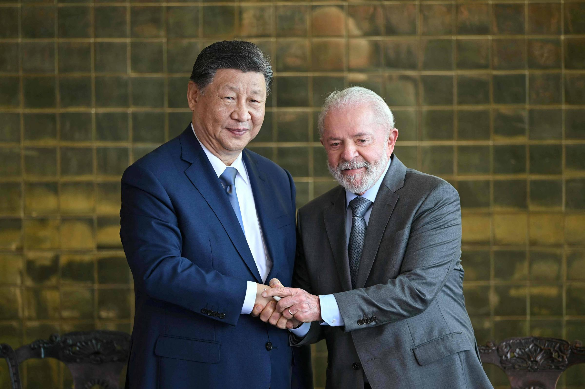
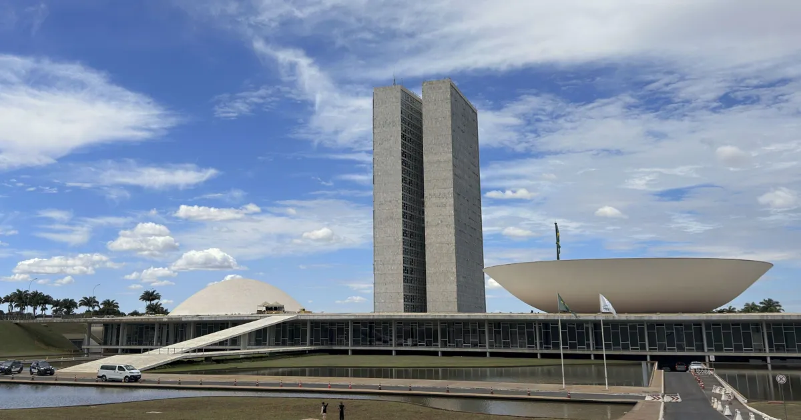
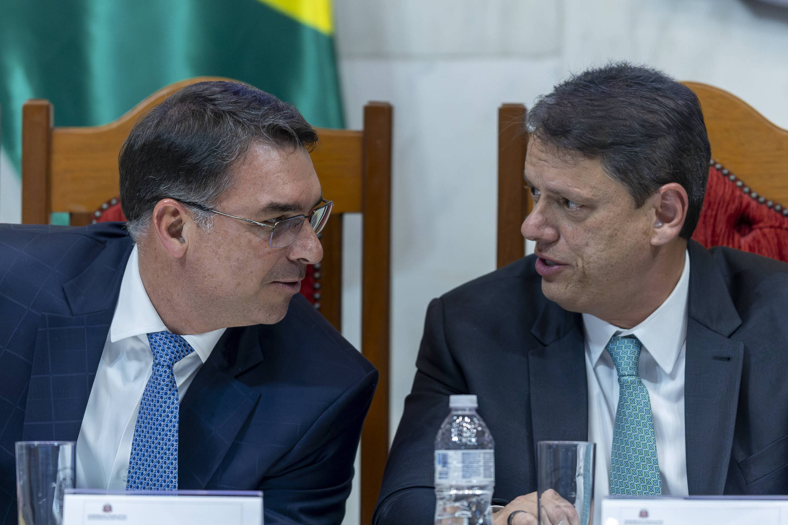
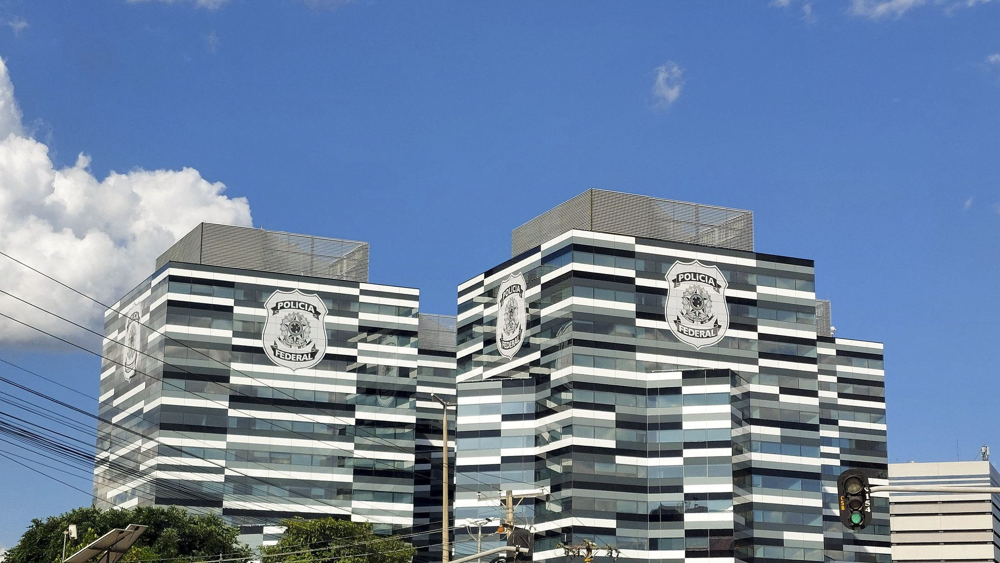

# Heimdall News — quinta-feira, 29 de outubro de 2026

9 assuntos · 24 veículos e fontes

_O vídeo deste briefing ainda não foi postado._

## Assuntos do dia

1. Flávio Bolsonaro divulga carta em que se diz "presidente eleito", depois "líder do Brasil"; partidos reafirmam o resultado
2. Fuga de Flávio para os EUA: jato da Casa Branca, apoio de Milei, PF e mandato; Trump chama a eleição de "vergonha"
3. Caso Master: PF indicia Vorcaro, ex-presidente do BRB e mais 13
4. Assédio eleitoral: denúncias superam 2022 e governo anuncia "lista suja" de empregadores
5. Contas públicas: dívida em 82,9% do PIB, IFI pede ajuste maior e governo diverge sobre cortes
6. Lula 4: partidos que apoiaram Flávio se aproximam; PSD libera filiados e Janones se reúne com Lula
7. Direita se reorganiza: Tarcísio ganha espaço e presidência do Senado vira disputa central; Alcolumbre busca acordo
8. PF prende presidente do TCE-MT por "folha paralela" de R$ 736 milhões
9. TSE arredonda percentual e federação PSOL-Rede supera cláusula de desempenho; agressão a mulher pode gerar inelegibilidade

---

## 1. Flávio Bolsonaro divulga carta em que se diz "presidente eleito", depois "líder do Brasil"; partidos reafirmam o resultado

_Imagem: [G1](https://g1.globo.com/politica/noticia/2026/10/28/ridiculo-ofensa-olhar-para-frente-a-reacao-apos-flavio-fugir-se-dizer-presidente-eleito-apagar-e-falar-que-e-lider-do-brasil.ghtml)_

_Cobertura (14): Imprensa mais à esquerda — Brasil de Fato, CartaCapital; Imprensa de centro / grandes veículos — CNN Brasil, Estadão, Folha, G1, JOTA, Poder360, juruainformativo.com.br; Imprensa mais à direita — Gazeta do Povo; Fontes oficiais — Agência Senado; Partidos e movimentos — PSB (site oficial), PSDB (site oficial), PT (site oficial)_

### O que aconteceu

Já nos EUA, Flávio Bolsonaro (PL-RJ) divulgou uma carta em que disse não reconhecer o resultado do 2º turno, alegou fraude sem apresentar provas e se apresentou como "verdadeiro presidente do Brasil" e "presidente eleito". [[1]](https://g1.globo.com/politica/noticia/2026/10/28/ridiculo-ofensa-olhar-para-frente-a-reacao-apos-flavio-fugir-se-dizer-presidente-eleito-apagar-e-falar-que-e-lider-do-brasil.ghtml)

Em seguida, apagou a primeira versão e publicou outra em que se define como "líder do Brasil". A primeira trazia um brasão antigo com a inscrição "Estados Unidos do Brazil". [[1]](https://g1.globo.com/politica/noticia/2026/10/28/ridiculo-ofensa-olhar-para-frente-a-reacao-apos-flavio-fugir-se-dizer-presidente-eleito-apagar-e-falar-que-e-lider-do-brasil.ghtml) [[2]](https://www.cartacapital.com.br/politica/centrao-isola-golpismo-de-flavio-bolsonaro-e-reforca-respeito-ao-resultado-das-urnas/) [[3]](https://www.estadao.com.br/politica/eleicoes/psdb-mdb-e-uniao-brasil-declaram-confianca-nas-eleicoes-apos-carta-golpista-de-flavio-bolsonaro-nprp/)

Segundo diplomatas ouvidos pelo G1, o Departamento de Estado dos EUA pediu a retirada do trecho em que ele se dizia "presidente eleito". [[4]](https://g1.globo.com/politica/blog/valdo-cruz/post/2026/10/29/eua-pediram-a-flavio-bolsonaro-que-retirasse-de-carta-trecho-em-que-se-dizia-presidente-eleito.ghtml)

O TSE confirmou a vitória de Lula com 51,79% dos votos válidos, contra 48,21%. A prorrogação do horário de votação foi pedida pelas duas campanhas; o TSE registrou pouco mais de 34 mil votos depois das 17h. [[5]](https://www.juruainformativo.com.br/2026/10/renan-santos-ironiza-carta-em-que-flavio-bolsonaro-se-autodeclara-presidente-em-exilio/) [[4]](https://g1.globo.com/politica/blog/valdo-cruz/post/2026/10/29/eua-pediram-a-flavio-bolsonaro-que-retirasse-de-carta-trecho-em-que-se-dizia-presidente-eleito.ghtml)

### Como cada campo político se posicionou

**Pró-governo**

- **PT, PCdoB, PV, PSB, PSOL, Rede e PDT (nota conjunta)**: Afirmaram que a contestação não se sustenta, que a prorrogação do horário foi pedida pelas duas campanhas e que o Brasil não aceita interferência estrangeira. [[6]](https://pt.org.br/candidato-derrotado-fugiu-do-brasil-para-nao-enfrentar-a-justica-afirma-coligacao-de-lula/)
  > “A contestação do resultado não se sustenta. A prorrogação do horário de votação foi pedida pelas duas campanhas, PT e PL” — [PT (site oficial)](https://pt.org.br/candidato-derrotado-fugiu-do-brasil-para-nao-enfrentar-a-justica-afirma-coligacao-de-lula/)
- **Randolfe Rodrigues (PT-AP), senador, líder do governo no Congresso**: Chamou a iniciativa de "ofensa" ao que foi construído no país nas últimas décadas. [[1]](https://g1.globo.com/politica/noticia/2026/10/28/ridiculo-ofensa-olhar-para-frente-a-reacao-apos-flavio-fugir-se-dizer-presidente-eleito-apagar-e-falar-que-e-lider-do-brasil.ghtml)
  > “Randolfe Rodrigues (PT-AP), líder do governo no Congresso Nacional, afirmou que a iniciativa representa uma "ofensa" ao processo eleitoral.” — [G1](https://g1.globo.com/politica/noticia/2026/10/28/ridiculo-ofensa-olhar-para-frente-a-reacao-apos-flavio-fugir-se-dizer-presidente-eleito-apagar-e-falar-que-e-lider-do-brasil.ghtml)
- **Alessandro Vieira (MDB-SE), senador**: Classificou a contestação como "ridícula" e disse que o resultado já foi reconhecido por aliados do candidato derrotado. [[1]](https://g1.globo.com/politica/noticia/2026/10/28/ridiculo-ofensa-olhar-para-frente-a-reacao-apos-flavio-fugir-se-dizer-presidente-eleito-apagar-e-falar-que-e-lider-do-brasil.ghtml)
  > “o senador Alessandro Vieira (MDB-SE) classificou a contestação como "ridícula"” — [G1](https://g1.globo.com/politica/noticia/2026/10/28/ridiculo-ofensa-olhar-para-frente-a-reacao-apos-flavio-fugir-se-dizer-presidente-eleito-apagar-e-falar-que-e-lider-do-brasil.ghtml)

**Centro pró-governo**

- **Antonio Rueda, presidente nacional do União Brasil**: Disse que a eleição transcorreu com lisura, que o resultado deve ser respeitado e que é hora de encerrar a disputa. [[1]](https://g1.globo.com/politica/noticia/2026/10/28/ridiculo-ofensa-olhar-para-frente-a-reacao-apos-flavio-fugir-se-dizer-presidente-eleito-apagar-e-falar-que-e-lider-do-brasil.ghtml)
  > “"A eleição de 25 de outubro transcorreu com lisura e o seu resultado deve ser respeitado", declarou a legenda.” — [G1](https://g1.globo.com/politica/noticia/2026/10/28/ridiculo-ofensa-olhar-para-frente-a-reacao-apos-flavio-fugir-se-dizer-presidente-eleito-apagar-e-falar-que-e-lider-do-brasil.ghtml)
- **MDB (nota oficial)**: Reafirmou confiança no sistema eleitoral e na legitimidade do resultado. [[3]](https://www.estadao.com.br/politica/eleicoes/psdb-mdb-e-uniao-brasil-declaram-confianca-nas-eleicoes-apos-carta-golpista-de-flavio-bolsonaro-nprp/)
  > “O MDB reafirma sua total confiança no sistema eleitoral brasileiro e, portanto, na legitimidade do resultado do pleito do último domingo.” — [Estadão](https://www.estadao.com.br/politica/eleicoes/psdb-mdb-e-uniao-brasil-declaram-confianca-nas-eleicoes-apos-carta-golpista-de-flavio-bolsonaro-nprp/)
- **Aécio Neves (PSDB-MG), deputado, presidente nacional do PSDB**: Chamou o comportamento de Flávio de "incompreensível" e disse que a oposição deve ser exercida em território nacional. [[3]](https://www.estadao.com.br/politica/eleicoes/psdb-mdb-e-uniao-brasil-declaram-confianca-nas-eleicoes-apos-carta-golpista-de-flavio-bolsonaro-nprp/)
  > “O presidente do PSDB, Aécio Neves, chamou a conduta de Flávio de “incompreensível” e criticou sua decisão de exercer oposição fora do país.” — [Estadão](https://www.estadao.com.br/politica/eleicoes/psdb-mdb-e-uniao-brasil-declaram-confianca-nas-eleicoes-apos-carta-golpista-de-flavio-bolsonaro-nprp/)
- **Tarcísio de Freitas (Republicanos), governador de São Paulo**: Disse entender a indignação de Flávio, mas defendeu respeitar o resultado das urnas. [[1]](https://g1.globo.com/politica/noticia/2026/10/28/ridiculo-ofensa-olhar-para-frente-a-reacao-apos-flavio-fugir-se-dizer-presidente-eleito-apagar-e-falar-que-e-lider-do-brasil.ghtml)
  > “Mas o caminho é respeitar o resultado das urnas e seguir em frente” — [G1](https://g1.globo.com/politica/noticia/2026/10/28/ridiculo-ofensa-olhar-para-frente-a-reacao-apos-flavio-fugir-se-dizer-presidente-eleito-apagar-e-falar-que-e-lider-do-brasil.ghtml)

**Oposição ao governo**

- **Valdemar Costa Neto, presidente nacional do PL**: Disse que não gostou da carta e que "ninguém aprovou", e que o partido quer "tocar o país para frente". [[7]](https://www1.folha.uol.com.br/poder/2026/10/valdemar-costa-neto-diz-que-nao-gostou-de-carta-golpista-de-flavio-bolsonaro.shtml)
  > “"Não tocamos nesse assunto. Ninguém aprovou a carta. Ninguém aprova isso", respondeu.” — [Folha](https://www1.folha.uol.com.br/poder/2026/10/valdemar-costa-neto-diz-que-nao-gostou-de-carta-golpista-de-flavio-bolsonaro.shtml)
- **Rogério Marinho (PL-RN), senador, líder da oposição no Senado**: Tratou a carta como "desabafo", disse que não pode afirmar fraude por falta de provas e reconheceu Flávio como líder da oposição. [[8]](https://www.gazetadopovo.com.br/republica/rogerio-marinho-trata-acusacoes-de-fraude-eleitoral-feitas-por-flavio-como-desabafo/)
  > ““Se você faz alguma afirmação, precisa trazer provas. Eu acabei de dizer que não posso afirmar que houve fraude porque não tenho provas”, disse.” — [Gazeta do Povo](https://www.gazetadopovo.com.br/republica/rogerio-marinho-trata-acusacoes-de-fraude-eleitoral-feitas-por-flavio-como-desabafo/)
  > ““É o desabafo de alguém que está se sentindo injustiçado e que foi retirado do seu país pelas circunstâncias”” — [Gazeta do Povo](https://www.gazetadopovo.com.br/republica/rogerio-marinho-trata-acusacoes-de-fraude-eleitoral-feitas-por-flavio-como-desabafo/)

**Independente — Missão / MBL**

- **Renan Santos, presidente do Missão**: Ironizou a carta em vídeo, dizendo não reconhecer "nem Lula nem Flávio" e se declarando, em tom de comédia, presidente em exercício. [[5]](https://www.juruainformativo.com.br/2026/10/renan-santos-ironiza-carta-em-que-flavio-bolsonaro-se-autodeclara-presidente-em-exilio/)
  > “eu não reconheço o resultado do segundo turno das eleições, tampouco reconheço o governo de Flávio Bolsonaro de Atos Unidos, nem Lula nem Flávio” — [juruainformativo.com.br](https://www.juruainformativo.com.br/2026/10/renan-santos-ironiza-carta-em-que-flavio-bolsonaro-se-autodeclara-presidente-em-exilio/)

**Outros / não classificável**

- **Kassio Nunes Marques, presidente do TSE**: Em nota, sem citar Flávio, disse que as eleições transcorreram "dentro da mais absoluta normalidade". [[9]](https://www1.folha.uol.com.br/poder/2026/10/kassio-e-mendonca-tentam-se-desvincular-de-flavio-apos-carta-golpista-e-falam-em-perda-de-bom-senso.shtml)
  > “fala que as eleições "transcorreram dentro da mais absoluta normalidade e com respeito aos ditames legais e constitucionais"” — [Folha](https://www1.folha.uol.com.br/poder/2026/10/kassio-e-mendonca-tentam-se-desvincular-de-flavio-apos-carta-golpista-e-falam-em-perda-de-bom-senso.shtml)

_Sem posicionamento encontrado: Centro, Centro-oposição._

Referências:

1. ['Ridículo', 'ofensa', 'olhar para frente': a reação após Flávio fugir, se dizer 'presidente eleito', apagar e falar que é 'líder do Brasil'](https://g1.globo.com/politica/noticia/2026/10/28/ridiculo-ofensa-olhar-para-frente-a-reacao-apos-flavio-fugir-se-dizer-presidente-eleito-apagar-e-falar-que-e-lider-do-brasil.ghtml) — G1, 28/10 19:51
2. [Centrão isola golpismo de Flávio Bolsonaro e reforça respeito ao resultado das urnas](https://www.cartacapital.com.br/politica/centrao-isola-golpismo-de-flavio-bolsonaro-e-reforca-respeito-ao-resultado-das-urnas/) — CartaCapital, 28/10 23:00
3. [PSDB, MDB e União Brasil declaram confiança nas eleições após carta golpista de Flávio Bolsonaro](https://www.estadao.com.br/politica/eleicoes/psdb-mdb-e-uniao-brasil-declaram-confianca-nas-eleicoes-apos-carta-golpista-de-flavio-bolsonaro-nprp/) — Estadão, 29/10 11:11
4. [EUA pediram a Flávio Bolsonaro que retirasse de carta trecho em que se dizia ‘presidente eleito’](https://g1.globo.com/politica/blog/valdo-cruz/post/2026/10/29/eua-pediram-a-flavio-bolsonaro-que-retirasse-de-carta-trecho-em-que-se-dizia-presidente-eleito.ghtml) — G1, 29/10 12:27
5. [Renan Santos ironiza carta em que Flávio Bolsonaro se autodeclara ‘presidente em exílio’](https://www.juruainformativo.com.br/2026/10/renan-santos-ironiza-carta-em-que-flavio-bolsonaro-se-autodeclara-presidente-em-exilio/) — juruainformativo.com.br, 28/10 22:07
6. [Candidato derrotado fugiu do Brasil para não enfrentar a Justiça, afirma coligação de Lula](https://pt.org.br/candidato-derrotado-fugiu-do-brasil-para-nao-enfrentar-a-justica-afirma-coligacao-de-lula/) — PT (site oficial), 29/10 00:19
7. [Valdemar diz que ninguém aprovou carta golpista de Flávio e que Bolsonaro não sabia de fuga do filho](https://www1.folha.uol.com.br/poder/2026/10/valdemar-costa-neto-diz-que-nao-gostou-de-carta-golpista-de-flavio-bolsonaro.shtml) — Folha, 29/10 10:01
8. [Rogério Marinho trata acusações de fraude eleitoral feitas por Flávio como desabafo](https://www.gazetadopovo.com.br/republica/rogerio-marinho-trata-acusacoes-de-fraude-eleitoral-feitas-por-flavio-como-desabafo/) — Gazeta do Povo, 28/10 19:59
9. [Kassio e Mendonça tentam se desvincular de Flávio após carta golpista e falam em perda de bom senso](https://www1.folha.uol.com.br/poder/2026/10/kassio-e-mendonca-tentam-se-desvincular-de-flavio-apos-carta-golpista-e-falam-em-perda-de-bom-senso.shtml) — Folha, 29/10 12:21

Outras matérias sobre o tema:

- [PT procurou partidos de centro e direita para isolar Flávio Bolsonaro após carta golpista](https://www1.folha.uol.com.br/poder/2026/10/pt-procurou-partidos-de-centro-e-direita-para-isolar-flavio-bolsonaro-apos-carta-golpista.shtml) — Folha, 29/10 10:00
- [Carta de Flávio Bolsonaro tem ao menos 4 versões, com troca de brasão e mudanças no texto](https://www1.folha.uol.com.br/poder/2026/10/carta-de-flavio-bolsonaro-tem-ao-menos-4-versoes-com-troca-de-brasao-e-mudancas-no-texto.shtml) — Folha, 28/10 20:54
- [Carta de Flávio Bolsonaro foi redigida com ajuda do ChatGPT](https://www.poder360.com.br/poder-eleicoes-2026/carta-de-flavio-bolsonaro-foi-redigida-com-ajuda-do-chatgpt/) — Poder360, 29/10 14:39
- [Aliados de Flávio Bolsonaro culpam ChatGPT por vaivém em versões da carta golpista](https://www1.folha.uol.com.br/poder/2026/10/aliados-de-flavio-bolsonaro-culpam-chatgpt-por-vaivem-em-versoes-da-carta-golpista.shtml) — Folha, 29/10 14:11
- [Carta de Flávio Bolsonaro mente sobre 'fraude eleitoral' e distorce fatos; veja](https://www1.folha.uol.com.br/poder/2026/10/carta-de-flavio-bolsonaro-mente-sobre-fraude-eleitoral-e-distorce-fatos-veja.shtml) — Folha, 28/10 21:16
- [Carta golpista de Flávio é rejeitada por aliados próximos, que veem postura perigosa](https://www1.folha.uol.com.br/colunas/painel/2026/10/carta-golpista-de-flavio-e-rejeitada-por-aliados-proximos-que-veem-postura-perigosa.shtml) — Folha, 28/10 20:11
- [Carta golpista isola Flávio, que perde apoio até entre líderes da direita e enfraquece oposição bolsonarista a Lula](https://g1.globo.com/politica/blog/valdo-cruz/post/2026/10/29/carta-golpista-isola-flavio-que-perde-apoio-ate-entre-lideres-da-direita-e-enfraquece-oposicao-bolsonarista-a-lula.ghtml) — G1, 29/10 08:48
- [Partidos rechaçam golpismo de Flávio Bolsonaro: ‘Contestação do resultado não se sustenta’](https://www.brasildefato.com.br/2026/10/28/partidos-rechacam-golpismo-de-flavio-bolsonaro-contestacao-do-resultado-nao-se-sustenta/) — Brasil de Fato, 28/10 21:12
- [União Brasil, que apoiou Flávio no 2º turno, cobra respeito ao resultado das urnas](https://www.cartacapital.com.br/politica/uniao-brasil-que-apoiou-flavio-no-2o-turno-cobra-respeito-ao-resultado-das-urnas/) — CartaCapital, 28/10 20:31
- [TSE, partidos e até aliados de Flávio Bolsonaro defendem resultado das urnas após carta golpista](https://www.jota.info/eleicoes/eleicoes-2026/tse-partidos-e-ate-aliados-de-flavio-bolsonaro-defendem-resultado-das-urnas-apos-carta-golpista) — JOTA, 28/10 21:30
- ['Entendo indignação, mas caminho é seguir em frente', diz Tarcísio após Flávio Bolsonaro divulgar carta em que se declara 'líder do Brasil'](https://g1.globo.com/sp/sao-paulo/eleicoes/2026/noticia/2026/10/28/entendo-indignacao-mas-caminho-e-seguir-em-frente-diz-tarcisio-apos-flavio-bolsonaro-divulgar-carta-em-que-se-declara-presidente-do-brasil.ghtml) — G1, 28/10 19:15
- [Tarcísio diz entender indignação de Flávio, mas defende respeito ao resultado das urnas](https://www.gazetadopovo.com.br/republica/tarcisio-diz-entender-indignacao-de-flavio-mas-defende-respeito-ao-resultado-das-urnas/) — Gazeta do Povo, 28/10 19:27
- [“Não gostei, ninguém aprovou”, reage presidente do PL à carta de Flávio Bolsonaro](https://www.gazetadopovo.com.br/republica/nao-gostei-reage-presidente-pl-carta-flavio-bolsonaro/) — Gazeta do Povo, 29/10 11:34
- [Valdemar diz não ter gostado de carta golpista de Flávio Bolsonaro, divulgada na chegada aos EUA](https://www.estadao.com.br/politica/eleicoes/valdemar-diz-nao-ter-gostado-de-carta-golpista-de-flavio-bolsonaro-divulgada-na-chegada-aos-eua/) — Estadão, 29/10 09:34
- [Valdemar diz que 'ninguém aprovou' carta de Flávio e que ele não avisou ao pai que sairia do país](https://g1.globo.com/politica/noticia/2026/10/29/valdemar-critica-carta-em-que-flavio-se-diz-lider-do-brasil-antes-de-visitar-jair-bolsonaro-nao-gostei.ghtml) — G1, 29/10 09:06
- [Rogério Marinho contradiz Flávio Bolsonaro e diz que não há provas de fraude eleitoral](https://www.cartacapital.com.br/politica/rogerio-marinho-contradiz-flavio-bolsonaro-e-diz-que-nao-ha-provas-de-fraude-eleitoral/) — CartaCapital, 28/10 21:16
- ['Nem eu nem PL podemos dizer que houve fraude nas eleições', diz chefe de campanha de Flávio](https://www1.folha.uol.com.br/poder/2026/10/nem-eu-nem-pl-podemos-dizer-que-houve-fraude-nas-eleicoes-diz-chefe-de-campanha-de-flavio.shtml) — Folha, 28/10 19:21
- [Só um dos 15 aliados que estavam ao lado de Flávio no discurso após eleição reproduziu carta nas redes; maioria se calou](https://g1.globo.com/politica/noticia/2026/10/29/so-um-dos-15-aliados-que-estavam-ao-lado-de-flavio-no-discurso-apos-eleicao-reproduziu-carta-nas-redes-maioria-se-calou.ghtml) — G1, 29/10 13:53
- [Senadores reafirmam resultado das eleições](https://www12.senado.leg.br/noticias/materias/2026/10/28/senadores-reafirmam-resultado-das-eleicoes) — Agência Senado, 28/10 19:45
- [Áudio: Senadores repercutem carta de Flávio Bolsonaro nos Estados Unidos](https://www12.senado.leg.br/noticias/audios/2026/10/senadores-repercutem-carta-de-flavio-bolsonaro-nos-estados-unidos) — Agência Senado, 29/10 11:20
- [Nota conjunta: “A vontade soberana do povo brasileiro será respeitada”](https://psb40.org.br/nota-conjunta-a-vontade-soberana-do-povo-brasileiro-sera-respeitada/) — PSB (site oficial), 28/10 20:57
- [É incompreensível o comportamento do candidato derrotado à Presidência da República](https://www.psdb.org.br/acompanhe/noticias/e-incompreensivel-o-comportamento-do-candidato-derrotado-a-presidencia-da-republica/) — PSDB (site oficial), 28/10 20:44
- [Kassio volta a defender no TSE resultado das eleições sem citar carta golpista de Flávio Bolsonaro](https://www1.folha.uol.com.br/poder/2026/10/kassio-volta-a-defender-no-tse-resultado-das-eleicoes-sem-citar-carta-golpista-de-flavio-bolsonaro.shtml) — Folha, 28/10 19:37
- [Após carta de Flávio, Nunes Marques diz que eleições ocorreram em “absoluta normalidade”](https://www.gazetadopovo.com.br/republica/apos-carta-de-flavio-nunes-marques-diz-que-eleicoes-ocorreram-em-absoluta-normalidade/) — Gazeta do Povo, 28/10 20:27
- [Nunes Marques diz que eleição foi legítima sem citar carta golpista de Flávio](https://www.jota.info/eleicoes/eleicoes-2026/nunes-marques-diz-que-eleicao-foi-legitima-sem-citar-carta-golpista-de-flavio) — JOTA, 28/10 20:01
- [“Autoproclamação” de Flávio degrada a democracia, diz Celso de Mello](https://www.poder360.com.br/poder-eleicoes-2026/autoproclamacao-de-flavio-degrada-a-democracia-diz-celso-de-mello/) — Poder360, 29/10 14:05
- [Ex-presidente do STF reage à carta de Flávio Bolsonaro: 'legitimidade não nasce da convicção pessoal de um candidato vencido'](https://g1.globo.com/politica/noticia/2026/10/28/ex-presidente-do-stf-reage-a-carta-de-flavio-bolsonaro-legitimidade-nao-nasce-da-conviccao-pessoal-de-um-candidato-vencido.ghtml) — G1, 28/10 21:15
- [Jurista que votou em Flávio reconhece urnas, mas vê interferência do STF](https://www.cnnbrasil.com.br/eleicoes/jurista-que-votou-em-flavio-reconhece-urnas-mas-ve-interferencia-do-stf/) — CNN Brasil, 29/10 15:15
- [Ives Gandra diz que Flávio errou ao se declarar presidente e critica interferência do STF](https://www.gazetadopovo.com.br/republica/ives-gandra-diz-que-flavio-errou-ao-se-declarar-presidente-e-critica-interferencia-do-stf/) — Gazeta do Povo, 28/10 23:06

---

## 2. Fuga de Flávio para os EUA: jato da Casa Branca, apoio de Milei, PF e mandato; Trump chama a eleição de "vergonha"

_Imagem: [Folha](https://www1.folha.uol.com.br/mundo/2026/10/china-sai-em-defesa-da-escolha-dos-brasileiros-apos-trump-ver-fraude-em-eleicao-de-lula.shtml)_

_Cobertura (11): Imprensa mais à esquerda — Brasil de Fato, CartaCapital; Imprensa de centro / grandes veículos — CNN Brasil, Estadão, Folha, G1, JOTA; Imprensa mais à direita — Gazeta do Povo, Revista Oeste; Fontes oficiais — Câmara — Plenário no YouTube (TV Câmara); Partidos e movimentos — PT (site oficial)_

### O que aconteceu

Flávio deixou o Brasil dois dias após a derrota, descumprindo a ordem de Moraes de entregar os passaportes. Entrou na Argentina por Misiones, voou a Guayaquil e de lá a Miami, por rota que evitou o espaço aéreo brasileiro. [[1]](https://www1.folha.uol.com.br/mundo/2026/10/china-sai-em-defesa-da-escolha-dos-brasileiros-apos-trump-ver-fraude-em-eleicao-de-lula.shtml)

Segundo a Folha, o jato foi providenciado por um funcionário da Casa Branca, e Flávio entrou nos EUA com "parole" (admissão condicional) por ordem de Trump. [[2]](https://www1.folha.uol.com.br/poder/2026/10/flavio-bolsonaro-teve-ajuda-de-trump-e-do-governo-americano-para-fugir-para-os-estados-unidos.shtml) [[3]](https://www.gazetadopovo.com.br/mundo/jornal-detalha-operacao-levar-flavio-eua/)

A PF abriu investigação para mapear a rota e disse em nota que não podia monitorar o senador sem decisão judicial. Pelo regimento, faltas não justificadas podem levar à perda do mandato, que termina em 31/1/2027. [[4]](https://www.cnnbrasil.com.br/politica/pf-cobra-superintendencia-do-parana-sobre-fuga-de-flavio-na-fronteira/) [[5]](https://www1.folha.uol.com.br/colunas/painel/2026/10/flavio-ignora-senado-e-nao-comunica-saida-do-pais.shtml)

Trump disse que a eleição foi "uma vergonha" e que vai conversar com Lula; a China disse respeitar "a escolha independente do povo brasileiro". [[6]](https://www1.folha.uol.com.br/poder/2026/10/trump-diz-que-conversara-com-lula-e-que-petista-lhe-pediu-para-nao-tomar-lado.shtml) [[1]](https://www1.folha.uol.com.br/mundo/2026/10/china-sai-em-defesa-da-escolha-dos-brasileiros-apos-trump-ver-fraude-em-eleicao-de-lula.shtml)

### Como cada campo político se posicionou

**Pró-governo**

- **Coligação de Lula (PT, PCdoB, PV, PSB, PSOL, Rede e PDT)**: Afirmou que o candidato derrotado fugiu para não enfrentar a Justiça e buscou abrigo junto a Trump, que teria atuado para interferir na eleição. [[7]](https://pt.org.br/candidato-derrotado-fugiu-do-brasil-para-nao-enfrentar-a-justica-afirma-coligacao-de-lula/)
  > “O candidato derrotado nas eleições fugiu do Brasil para não enfrentar a Justiça brasileira. Não por acaso, o candidato derrotado buscou abrigo justamente junto a Trump” — [PT (site oficial)](https://pt.org.br/candidato-derrotado-fugiu-do-brasil-para-nao-enfrentar-a-justica-afirma-coligacao-de-lula/)
- **Alencar Santana (PT-SP), deputado, vice-líder do governo na Câmara**: Acionou a PGR para pedir ao TSE a inelegibilidade de Flávio por oito anos, com base na carta. [[8]](https://www.cartacapital.com.br/cartaexpressa/vice-lider-do-governo-lanca-ofensiva-para-tornar-flavio-bolsonaro-inelegivel/)
  > “Santana defendeu que o órgão solicite ao Tribunal Superior Eleitoral a inelegibilidade do senador por oito anos.” — [CartaCapital](https://www.cartacapital.com.br/cartaexpressa/vice-lider-do-governo-lanca-ofensiva-para-tornar-flavio-bolsonaro-inelegivel/)
- **Teresa Leitão (PT-PE), senadora, líder do governo no Senado**: Criticou a saída do país e defendeu que as investigações prossigam. [[9]](https://pt.org.br/petistas-reagem-a-fuga-de-flavio-bolsonaro-e-defendem-medidas-para-evitar-impunidade/)
  > ““Do ponto de vista da responsabilidade com um cargo público, é uma lástima. Ele teria direito de defesa. Fugir é de fato mostrar a quem ele serve”, afirmou a senadora.” — [PT (site oficial)](https://pt.org.br/petistas-reagem-a-fuga-de-flavio-bolsonaro-e-defendem-medidas-para-evitar-impunidade/)

**Centro pró-governo**

- **Aécio Neves (PSDB-MG), deputado, presidente nacional do PSDB**: Disse que a oposição deve ser exercida "em território nacional". [[10]](https://www.estadao.com.br/politica/eleicoes/psdb-mdb-e-uniao-brasil-declaram-confianca-nas-eleicoes-apos-carta-golpista-de-flavio-bolsonaro-nprp/)
  > “E ele deve se dar em território nacional, fiscalizando os atos do governo e cobrando os compromissos por ele assumidos com a população” — [Estadão](https://www.estadao.com.br/politica/eleicoes/psdb-mdb-e-uniao-brasil-declaram-confianca-nas-eleicoes-apos-carta-golpista-de-flavio-bolsonaro-nprp/)

**Oposição ao governo**

- **Rogério Marinho (PL-RN), senador, líder da oposição no Senado**: Chamou a ordem de entrega dos passaportes de "abuso e humilhação" e disse compreender a saída, sem concordar por não ter sido consultado. [[11]](https://g1.globo.com/politica/noticia/2026/10/28/covarde-exilio-politico-o-que-disseram-os-alidaos-de-lula-e-flavio-sobre-fuga-do-senador.ghtml)
  > “Isso é abuso e humilhação.” — [G1](https://g1.globo.com/politica/noticia/2026/10/28/covarde-exilio-politico-o-que-disseram-os-alidaos-de-lula-e-flavio-sobre-fuga-do-senador.ghtml)
  > “"Então até compreendo caso Flávio tenha saído do Brasil. Não digo que concordo porque não fui consultado", ele afirmou.” — [G1](https://g1.globo.com/politica/noticia/2026/10/28/covarde-exilio-politico-o-que-disseram-os-alidaos-de-lula-e-flavio-sobre-fuga-do-senador.ghtml)
- **Deltan Dallagnol (Novo-PR), senador eleito**: Chamou a saída de "exílio político" e criticou a decisão de Moraes. [[11]](https://g1.globo.com/politica/noticia/2026/10/28/covarde-exilio-politico-o-que-disseram-os-alidaos-de-lula-e-flavio-sobre-fuga-do-senador.ghtml)
  > “"A coluna chama de fuga, mas a verdade, gente, é que no contexto atual de perseguição judicial no Brasil e especialmente na América Latina, isso aqui tem um outro nome, é exílio político", declarou.” — [G1](https://g1.globo.com/politica/noticia/2026/10/28/covarde-exilio-politico-o-que-disseram-os-alidaos-de-lula-e-flavio-sobre-fuga-do-senador.ghtml)
- **Luiz Lima (PL-RJ), deputado, no Plenário da Câmara**: Disse que Flávio "fez o certo" e não seria julgado de forma honesta no país. [[12]](https://www.youtube.com/watch?v=OqFxOOtmsZU&t=6074s)
  > “Flávio Bolsonaro tem apenas 45 anos de idade, duas filhas muito jovens, uma esposa jovem, ele fez o certo.” — [Câmara — Plenário no YouTube (TV Câmara)](https://www.youtube.com/watch?v=OqFxOOtmsZU&t=6074s)

**Outros / não classificável**

- **Departamento de Segurança Interna dos EUA**: Disse que Flávio e a família foram inspecionados e liberados conforme as leis migratórias. [[2]](https://www1.folha.uol.com.br/poder/2026/10/flavio-bolsonaro-teve-ajuda-de-trump-e-do-governo-americano-para-fugir-para-os-estados-unidos.shtml)
  > “foram recebidos e inspecionados pela Alfândega e Proteção de Fronteiras dos EUA, em conformidade com as leis e os procedimentos migratórios aplicáveis” — [Folha](https://www1.folha.uol.com.br/poder/2026/10/flavio-bolsonaro-teve-ajuda-de-trump-e-do-governo-americano-para-fugir-para-os-estados-unidos.shtml)

_Sem posicionamento encontrado: Centro, Centro-oposição, Independente — Missão / MBL._

Referências:

1. [China defende escolha dos brasileiros após Trump ver fraude em eleição de Lula](https://www1.folha.uol.com.br/mundo/2026/10/china-sai-em-defesa-da-escolha-dos-brasileiros-apos-trump-ver-fraude-em-eleicao-de-lula.shtml) — Folha, 29/10 11:13
2. [Flávio Bolsonaro teve ajuda de Trump e do governo americano para fugir para os Estados Unidos](https://www1.folha.uol.com.br/poder/2026/10/flavio-bolsonaro-teve-ajuda-de-trump-e-do-governo-americano-para-fugir-para-os-estados-unidos.shtml) — Folha, 29/10 14:35
3. [Ajuda de Trump e Milei, passaporte italiano e visto humanitário: jornal detalha operação para levar Flávio aos EUA](https://www.gazetadopovo.com.br/mundo/jornal-detalha-operacao-levar-flavio-eua/) — Gazeta do Povo, 29/10 08:37
4. [PF cobra superintendência do Paraná sobre fuga de Flávio na fronteira](https://www.cnnbrasil.com.br/politica/pf-cobra-superintendencia-do-parana-sobre-fuga-de-flavio-na-fronteira/) — CNN Brasil, 29/10 14:54
5. [Flávio ignora Senado e não comunica saída do país](https://www1.folha.uol.com.br/colunas/painel/2026/10/flavio-ignora-senado-e-nao-comunica-saida-do-pais.shtml) — Folha, 29/10 12:48
6. [Trump diz que conversará com Lula e que petista lhe pediu para não tomar lado](https://www1.folha.uol.com.br/poder/2026/10/trump-diz-que-conversara-com-lula-e-que-petista-lhe-pediu-para-nao-tomar-lado.shtml) — Folha, 29/10 12:29
7. [Candidato derrotado fugiu do Brasil para não enfrentar a Justiça, afirma coligação de Lula](https://pt.org.br/candidato-derrotado-fugiu-do-brasil-para-nao-enfrentar-a-justica-afirma-coligacao-de-lula/) — PT (site oficial), 29/10 00:19
8. [Vice-líder do governo lança ofensiva para tornar Flávio Bolsonaro inelegível](https://www.cartacapital.com.br/cartaexpressa/vice-lider-do-governo-lanca-ofensiva-para-tornar-flavio-bolsonaro-inelegivel/) — CartaCapital, 29/10 13:44
9. [Petistas reagem à fuga de Flávio Bolsonaro e defendem medidas para evitar impunidade](https://pt.org.br/petistas-reagem-a-fuga-de-flavio-bolsonaro-e-defendem-medidas-para-evitar-impunidade/) — PT (site oficial), 28/10 15:45
10. [PSDB, MDB e União Brasil declaram confiança nas eleições após carta golpista de Flávio Bolsonaro](https://www.estadao.com.br/politica/eleicoes/psdb-mdb-e-uniao-brasil-declaram-confianca-nas-eleicoes-apos-carta-golpista-de-flavio-bolsonaro-nprp/) — Estadão, 29/10 11:11
11. ['Covarde', 'exílio político': o que disseram os aliados de Lula e Flávio sobre fuga do senador](https://g1.globo.com/politica/noticia/2026/10/28/covarde-exilio-politico-o-que-disseram-os-alidaos-de-lula-e-flavio-sobre-fuga-do-senador.ghtml) — G1, 28/10 12:55
12. [Câmara aprova acordo do Mercosul para proteção às mulheres - 28/10/2026](https://www.youtube.com/watch?v=OqFxOOtmsZU) — Câmara — Plenário no YouTube (TV Câmara), 28/10 00:00

Outras matérias sobre o tema:

- [Flávio Bolsonaro: veja o que pode acontecer com o mandato de senador após fuga para os EUA](https://g1.globo.com/politica/noticia/2026/10/29/flavio-bolsonaro-veja-o-que-pode-acontecer-com-o-mandato-de-senador-apos-fuga-para-os-eua.ghtml) — G1, 29/10 00:00
- [Auxílio de Milei para fuga de Flávio Bolsonaro agrava deterioração da relação do Brasil com a Argentina](https://www1.folha.uol.com.br/poder/2026/10/auxilio-de-milei-para-fuga-de-flavio-bolsonaro-agrava-deterioracao-da-relacao-do-brasil-com-a-argentina.shtml) — Folha, 29/10 04:00
- [EUA pediram a Flávio Bolsonaro que retirasse de carta trecho em que se dizia ‘presidente eleito’](https://g1.globo.com/politica/blog/valdo-cruz/post/2026/10/29/eua-pediram-a-flavio-bolsonaro-que-retirasse-de-carta-trecho-em-que-se-dizia-presidente-eleito.ghtml) — G1, 29/10 12:27
- [Casa Branca providenciou jato particular e Flávio fugiu do Brasil com ajuda de Trump](https://www.estadao.com.br/politica/eleicoes/trump-e-funcionarios-da-casa-branca-ajudaram-bolsonaro-a-fugir-do-brasil-para-os-eua-npr/) — Estadão, 29/10 14:19
- [Assessor de Trump providenciou jato para Flávio ir aos EUA, diz NYT](https://www.cnnbrasil.com.br/internacional/assessor-de-trump-providenciou-jato-para-flavio-ir-aos-eua-diz-nyt/) — CNN Brasil, 29/10 14:41
- [Trump já espera que Flávio Bolsonaro solicite um green card, diz ‘NY Times’](https://www.cartacapital.com.br/carta-capital/trump-ja-espera-que-flavio-bolsonaro-solicite-um-green-card-diz-ny-times/) — CartaCapital, 29/10 14:27
- [Criada em 1925 com estilo inspirado nas “Mil e Uma Noites”: a rota secreta usada por Flávio Bolsonaro para chegar aos EUA](https://www.cnnbrasil.com.br/curiosidades/criada-em-1925-com-estilo-inspirado-nas-mil-e-uma-noites-a-rota-secreta-usada-por-flavio-bolsonaro-para-chegar-aos-eua/) — CNN Brasil, 29/10 14:22
- [Jato que levou Flávio a Miami volta a Buenos Aires sem entrar no espaço aéreo brasileiro](https://www.gazetadopovo.com.br/republica/jato-que-levou-flavio-a-miami-volta-a-buenos-aires-sem-entrar-no-espaco-aereo-brasileiro/) — Gazeta do Povo, 29/10 09:35
- [Polícia Federal investiga rede de apoio usada por Flávio Bolsonaro para sair do país](https://www.gazetadopovo.com.br/republica/policia-federal-investiga-rede-de-apoio-usada-por-flavio-bolsonaro-para-sair-do-pais/) — Gazeta do Povo, 29/10 02:10
- [Sem registro em Foz, rota de Flávio Bolsonaro até Argentina motiva teorias e pressiona PF](https://www1.folha.uol.com.br/poder/2026/10/sem-registro-em-foz-rota-de-flavio-bolsonaro-ate-argentina-motiva-teorias-e-pressiona-pf.shtml) — Folha, 29/10 00:00
- [Argentina diz que Flávio Bolsonaro tinha documentação regular e não havia ‘impedimento da Interpol’](https://www.cartacapital.com.br/mundo/argentina-diz-que-flavio-bolsonaro-tinha-documentacao-regular-e-nao-havia-impedimento-da-interpol/) — CartaCapital, 29/10 14:05
- [Deputados argentinos denunciam cumplicidade de Milei na fuga de Flávio Bolsonaro e cobram reconhecimento da vitória de Lula](https://www.brasildefato.com.br/2026/10/29/deputados-argentinos-denunciam-cumplicidade-de-milei-na-fuga-de-flavio-bolsonaro-e-cobram-reconhecimento-da-vitoria-de-lula/) — Brasil de Fato, 29/10 08:21
- [Oposição da Argentina exige explicações de Milei sobre fuga de Flávio](https://www1.folha.uol.com.br/poder/2026/10/oposicao-da-argentina-exige-explicacoes-de-milei-sobre-fuga-de-flavio.shtml) — Folha, 28/10 22:10
- [Trump chama eleição no Brasil de ‘desgraça’ e diz que vai conversar com Lula](https://revistaoeste.com/mundo/trump-chama-eleicao-no-brasil-de-desgraca-e-diz-que-vai-conversar-com-lula/) — Revista Oeste, 29/10 14:33
- [Trump diz que eleições no Brasil foram “uma vergonha”](https://www.gazetadopovo.com.br/mundo/trump-diz-que-eleicoes-no-brasil-foram-uma-vergonha/) — Gazeta do Povo, 29/10 13:15
- [Trump diz que eleição no Brasil foi ‘uma vergonha’, não explica motivo e afirma que falará com Lula](https://www.estadao.com.br/politica/eleicoes/trump-diz-que-eleicao-no-brasil-foi-uma-vergonha-e-evita-comentar-sobre-flavio-nos-eua-npr/) — Estadão, 29/10 12:45
- [Wall Street Journal acusa governo Lula de perseguição política a Flávio Bolsonaro](https://www1.folha.uol.com.br/mundo/2026/10/wall-street-journal-acusa-governo-lula-de-perseguicao-politica-a-flavio-bolsonaro.shtml) — Folha, 29/10 12:07
- [Wall Street Journal acusa justiça brasileira de vingança política contra Flávio Bolsonaro](https://www.gazetadopovo.com.br/republica/wall-street-journal-acusa-justica-brasileira-de-vinganca-politica-contra-flavio-bolsonaro/) — Gazeta do Povo, 29/10 11:02
- [Jornal americano diz que Flávio é alvo de vingança e que Brasil ruma para a autocracia](https://www.gazetadopovo.com.br/mundo/jornal-americano-diz-flavio-alvo-vinganca-brasil-ruma-autocracia/) — Gazeta do Povo, 29/10 11:53
- [Flávio Bolsonaro se encontra com Eduardo e Ramagem nos EUA](https://www.gazetadopovo.com.br/republica/flavio-bolsonaro-se-encontra-com-eduardo-e-ramagem-nos-eua/) — Gazeta do Povo, 29/10 00:15
- [Eduardo e Ramagem publicam fotos com Flávio Bolsonaro após fuga de senador para os EUA](https://www1.folha.uol.com.br/poder/2026/10/eduardo-e-ramagem-publicam-fotos-com-flavio-bolsonaro-apos-fuga-de-senador-para-os-eua.shtml) — Folha, 28/10 22:35
- [Eduardo Bolsonaro e Ramagem publicam foto com Flávio após fuga para os EUA](https://www.estadao.com.br/politica/eleicoes/eduardo-bolsonaro-e-ramagem-publicam-foto-com-flavio-apos-fuga-para-os-eua-nprp/) — Estadão, 29/10 09:45
- [Esquema de despiste, carro com sirene, proteção na alfândega: como foi a chegada de Flávio aos EUA](https://www.estadao.com.br/politica/esquema-de-despiste-carro-com-sirene-protecao-na-alfandega-como-foi-a-chegada-de-flavio-nos-eua/) — Estadão, 28/10 20:33
- [Flávio Bolsonaro recebeu autorização para ficar 1 ano nos EUA](https://g1.globo.com/mundo/noticia/2026/10/28/flavio-bolsonaro-recebeu-autorizacao-para-ficar-1-ano-nos-eua.ghtml) — G1, 28/10 19:17
- [Flávio Bolsonaro usou passaporte diplomático cancelado para entrar nos EUA](https://g1.globo.com/mundo/noticia/2026/10/28/flavio-bolsonaro-usou-passaporte-diplomatico-cancelado-para-entrar-nos-eua.ghtml) — G1, 28/10 15:14
- [Flávio Bolsonaro chega aos Estados Unidos após fugir do Brasil](https://g1.globo.com/mundo/noticia/2026/10/28/voo-flavio-bolsonaro-chega-aos-eua.ghtml) — G1, 28/10 10:25
- [Viera se reúne com Marco Rubio nesta semana, após Trump não reconhecer resultado das eleições](https://g1.globo.com/politica/noticia/2026/10/28/viera-se-reune-com-marco-rubio-nesta-semana-apos-trump-evitar-comentar-resultado-das-eleicoes.ghtml) — G1, 28/10 10:05
- [Deputados democratas criticam governo Trump por conceder visto a Flávio Bolsonaro](https://www1.folha.uol.com.br/poder/2026/10/deputados-democratas-criticam-governo-trump-por-conceder-visto-a-flavio-bolsonaro.shtml) — Folha, 28/10 16:18
- [Flávio Bolsonaro nos EUA: o rastro do dinheiro e o risco de fuga que não podia ser ignorado](https://www.brasildefato.com.br/2026/10/29/flavio-bolsonaro-nos-eua-o-rastro-do-dinheiro-e-o-risco-de-fuga-que-nao-podia-ser-ignorado/) — Brasil de Fato, 29/10 10:30
- [Os bolsonaristas que já fugiram do Brasil](https://www.cartacapital.com.br/politica/os-bolsonaristas-que-ja-fugiram-do-brasil/) — CartaCapital, 29/10 07:57
- [‘Flávio Bolsonaro não é o 1º criminoso a se evadir, e problema é da direita’, diz ex-chanceler](https://www.cartacapital.com.br/cartaexpressa/flavio-bolsonaro-nao-e-o-1o-criminoso-a-se-evadir-e-problema-e-da-direita-diz-ex-chanceler/) — CartaCapital, 29/10 10:09
- [O que diz a investigação que levou Flávio Bolsonaro a fugir do Brasil?](https://www.jota.info/eleicoes/eleicoes-2026/o-que-diz-a-investigacao-que-levou-flavio-bolsonaro-a-fugir-do-brasil) — JOTA, 29/10 07:20
- [Bastidores: Como Eduardo Bolsonaro atraiu Moraes com isca retórica e driblou a PF na fuga de Flávio](https://www.estadao.com.br/politica/coluna-do-estadao/bastidores-como-eduardo-bolsonaro-atraiu-moraes-com-isca-retorica-e-driblou-a-pf-na-fuga-de-flavio/) — Estadão, 29/10 05:30
- [Saída de Flávio Bolsonaro para os EUA pode ampliar cerco judicial contra aliados e família](https://www.gazetadopovo.com.br/republica/saida-de-flavio-bolsonaro-dos-eua-pode-ampliar-cerco-judicial-contra-aliados-e-familia/) — Gazeta do Povo, 28/10 22:09
- [Deputado italiano pede investigação sobre processo de cidadania da família Bolsonaro](https://www.estadao.com.br/politica/deputado-italiano-pede-investigacao-sobre-processo-de-cidadania-da-familia-bolsonaro-npr/) — Estadão, 29/10 12:59
- [Deputado italiano cobra investigação sobre cidadania de Eduardo, Carlos e Flávio Bolsonaro](https://www.cartacapital.com.br/politica/deputado-italiano-cobra-investigacao-sobre-cidadania-de-eduardo-carlos-e-flavio-bolsonaro/) — CartaCapital, 29/10 10:24
- [Deputado italiano pede investigação sobre processo de cidadania dos irmãos Bolsonaro](https://g1.globo.com/mundo/noticia/2026/10/29/deputado-italiano-pede-investigacao-sobre-processo-de-cidadania-dos-irmaos-bolsonaro.ghtml) — G1, 29/10 09:41

---

## 3. Caso Master: PF indicia Vorcaro, ex-presidente do BRB e mais 13

_Imagem: [JOTA](https://www.jota.info/stf/do-supremo/pf-indicia-vorcaro-e-mais-14-pessoas-pelas-fraudes-no-banco-master-e-no-brb)_

_Cobertura (5): Imprensa mais à esquerda — Brasil de Fato, CartaCapital; Imprensa de centro / grandes veículos — G1, JOTA; Imprensa mais à direita — Gazeta do Povo_

### O que aconteceu

A PF indiciou o banqueiro Daniel Vorcaro, o ex-presidente do BRB Paulo Henrique Costa e outras 13 pessoas por fraudes no Banco Master; o relatório foi à PGR, que decide se denuncia. [[1]](https://www.jota.info/stf/do-supremo/pf-indicia-vorcaro-e-mais-14-pessoas-pelas-fraudes-no-banco-master-e-no-brb)

Políticos citados na investigação (Ciro Nogueira, Jaques Wagner e Flávio Bolsonaro) não estão entre os indiciados nesta etapa; a PF pediu mais 60 dias. [[1]](https://www.jota.info/stf/do-supremo/pf-indicia-vorcaro-e-mais-14-pessoas-pelas-fraudes-no-banco-master-e-no-brb)

Segundo a PF, o BRB seguiu pagando ao Master depois de alertas de liquidez: 42 pagamentos, R$ 7,417 bilhões. [[2]](https://www.gazetadopovo.com.br/republica/pf-indicia-vorcaro-ex-presidente-do-brb-e-mais-13-no-caso-master/)

### Como cada campo político se posicionou

**Outros / não classificável**

- **Defesa de Daniel Vorcaro**: Afirmou que o negócio das carteiras da Tirreno não foi concluído e que as carteiras foram substituídas, sem prejuízo ao BRB. [[2]](https://www.gazetadopovo.com.br/republica/pf-indicia-vorcaro-ex-presidente-do-brb-e-mais-13-no-caso-master/)
  > “Em nota à imprensa, a defesa de Vorcaro afirmou que o negócio envolvendo as carteiras da Tirreno não foi concluído e enfatizou que as carteiras foram substituídas por outros ativos, sem prejuízo para o BRB.” — [Gazeta do Povo](https://www.gazetadopovo.com.br/republica/pf-indicia-vorcaro-ex-presidente-do-brb-e-mais-13-no-caso-master/)
- **Defesa de Paulo Henrique Costa**: Disse ter recebido o indiciamento com surpresa e que ele não sabia das fraudes. [[2]](https://www.gazetadopovo.com.br/republica/pf-indicia-vorcaro-ex-presidente-do-brb-e-mais-13-no-caso-master/)
  > “Já a defesa de Costa disse ter recebido seu indiciamento com surpresa e destacou que o ex-presidente do BRB “não tinha conhecimento das fraudes nas carteiras”.” — [Gazeta do Povo](https://www.gazetadopovo.com.br/republica/pf-indicia-vorcaro-ex-presidente-do-brb-e-mais-13-no-caso-master/)

_Sem posicionamento encontrado: Pró-governo, Centro pró-governo, Centro, Centro-oposição, Oposição ao governo, Independente — Missão / MBL._

Referências:

1. [PF indicia Vorcaro e mais 14 pessoas pelas fraudes no Banco Master e no BRB](https://www.jota.info/stf/do-supremo/pf-indicia-vorcaro-e-mais-14-pessoas-pelas-fraudes-no-banco-master-e-no-brb) — JOTA, 28/10 19:21
2. [PF indicia Vorcaro, ex-presidente do BRB e mais 13 no caso Master](https://www.gazetadopovo.com.br/republica/pf-indicia-vorcaro-ex-presidente-do-brb-e-mais-13-no-caso-master/) — Gazeta do Povo, 28/10 21:30

Outras matérias sobre o tema:

- [PF indicia Vorcaro e mais 14 investigados no caso Master](https://www.brasildefato.com.br/2026/10/28/pf-indicia-vorcaro-e-mais-14-investigados-no-caso-master/) — Brasil de Fato, 28/10 20:02
- [Caso Master: PF indicia Vorcaro, ex-presidente do BRB e mais 13 em inquérito principal](https://g1.globo.com/df/distrito-federal/noticia/2026/10/28/pf-indiciamentos-vorcaro-master.ghtml) — G1, 28/10 16:26
- [Caso Master: veja os nomes e as condutas dos 15 indiciados no relatório da PF; lista inclui Vorcaro e ex-presidente do BRB](https://g1.globo.com/df/distrito-federal/noticia/2026/10/28/caso-master-veja-os-nomes-e-as-condutas-dos-15-indiciados-no-relatorio-da-pf-lista-inclui-vorcaro-e-ex-presidente-do-brb.ghtml) — G1, 28/10 19:23
- ['Fingindo demência': diretora do BRB alertou para R$ 1,1 bilhão em créditos atrasados, diz PF](https://g1.globo.com/df/distrito-federal/noticia/2026/10/29/fingindo-demencia-diretora-do-brb-alertou-para-r-11-bilhao-em-creditos-atrasados-diz-pf.ghtml) — G1, 29/10 02:00
- [Diretoria do BRB foi alertada sobre falhas em 90% de carteira do Master em 2024, diz relatório da PF](https://g1.globo.com/df/distrito-federal/noticia/2026/10/28/diretoria-do-brb-foi-alertada-sobre-falhas-em-90percent-de-carteira-do-master-em-2024-diz-relatorio-da-pf.ghtml) — G1, 28/10 17:27
- [Ex-presidente do BRB pressionou por compras de carteiras do Master mesmo após alertas, diz PF](https://g1.globo.com/df/distrito-federal/noticia/2026/10/29/ex-presidente-do-brb-pressionou-por-compras-de-carteiras-do-master-mesmo-apos-alertas-diz-pf.ghtml) — G1, 29/10 00:00
- [PF pede ao STF mais 60 dias para concluir investigação sobre o Master](https://www.cartacapital.com.br/justica/pf-pede-ao-stf-mais-60-dias-para-concluir-investigacao-sobre-o-master/) — CartaCapital, 29/10 08:06

---

## 4. Assédio eleitoral: denúncias superam 2022 e governo anuncia "lista suja" de empregadores

_Imagem: [G1](https://g1.globo.com/trabalho-e-carreira/noticia/2026/10/29/denuncias-de-assedio-eleitoral-no-trabalho-veja-como-denunciar.ghtml)_

_Cobertura (8): Imprensa mais à esquerda — Brasil de Fato; Imprensa de centro / grandes veículos — CNN Brasil, G1, JOTA; Imprensa mais à direita — Gazeta do Povo; Fontes oficiais — Câmara — Plenário no YouTube (TV Câmara); Partidos e movimentos — PT (site oficial); Outras fontes — VEJA (via Google News)_

### O que aconteceu

O MPT recebeu 3.396 denúncias de assédio eleitoral em 2026 até 29/10, mais que em 2022; 1.459 delas depois do 2º turno. [[1]](https://g1.globo.com/trabalho-e-carreira/noticia/2026/10/29/denuncias-de-assedio-eleitoral-no-trabalho-veja-como-denunciar.ghtml)

O governo confirmou uma lista de empregadores envolvidos em casos de assédio eleitoral, com possíveis restrições de crédito, e uma força-tarefa com MPT, AGU, TST, MPE e Ministério da Justiça. [[2]](https://www.gazetadopovo.com.br/economia/governo-lula-confirma-lista-suja-empresas-acusadas-assedio-eleitoral/)

O ministro não detalhou critérios de inclusão nem como as denúncias seriam comprovadas. [[3]](https://www.gazetadopovo.com.br/economia/governo-lula-lista-suja-empresas-demitirem-por-voto-politico/)

### Como cada campo político se posicionou

**Pró-governo**

- **Luiz Marinho (PT), ministro do Trabalho**: Disse que o assédio é inaceitável e defendeu a lista para mostrar à sociedade empresas que cometem ilegalidades. [[3]](https://www.gazetadopovo.com.br/economia/governo-lula-lista-suja-empresas-demitirem-por-voto-politico/)
  > ““O objetivo é poder, além das providências, ter uma lista que a gente possa mostrar para a sociedade que tem empresas cometendo ilegalidades de eventual crime contra o trabalhador”, afirmou o ministro.” — [Gazeta do Povo](https://www.gazetadopovo.com.br/economia/governo-lula-lista-suja-empresas-demitirem-por-voto-politico/)
- **Daiana Santos (PCdoB-RS), deputada, no Plenário da Câmara**: Relatou denúncias de perseguição política a trabalhadores e disse ter articulado um protocolo com o MPT e ministérios. [[4]](https://www.youtube.com/watch?v=OqFxOOtmsZU&t=6356s)
  > “Nos últimos dias a gente tem recebido um número expressivo de denúncias relacionadas à perseguição política em todo o Brasil” — [Câmara — Plenário no YouTube (TV Câmara)](https://www.youtube.com/watch?v=OqFxOOtmsZU&t=6356s)

**Outros / não classificável**

- **Gláucio Araújo de Oliveira, procurador-geral do Trabalho**: Disse que demitir trabalhadores por convicção política é ilegal. [[3]](https://www.gazetadopovo.com.br/economia/governo-lula-lista-suja-empresas-demitirem-por-voto-politico/)
  > ““O empresário é dono do negócio, e não do voto do seu empregado. Demitir trabalhadores por sua convicção política é ilegal e será alvo de atuação do MPT perante a Justiça do Trabalho”” — [Gazeta do Povo](https://www.gazetadopovo.com.br/economia/governo-lula-lista-suja-empresas-demitirem-por-voto-politico/)

_Sem posicionamento encontrado: Centro pró-governo, Centro, Centro-oposição, Oposição ao governo, Independente — Missão / MBL._

Referências:

1. [MPT recebe 3.396 denúncias de assédio eleitoral no trabalho e supera eleições de 2022; veja como denunciar](https://g1.globo.com/trabalho-e-carreira/noticia/2026/10/29/denuncias-de-assedio-eleitoral-no-trabalho-veja-como-denunciar.ghtml) — G1, 29/10 09:04
2. [Governo Lula confirma “lista suja” de empresas acusadas de assédio eleitoral](https://www.gazetadopovo.com.br/economia/governo-lula-confirma-lista-suja-empresas-acusadas-assedio-eleitoral/) — Gazeta do Povo, 29/10 14:52
3. [Governo Lula avalia criar “lista suja” de empresas que demitirem por voto político](https://www.gazetadopovo.com.br/economia/governo-lula-lista-suja-empresas-demitirem-por-voto-politico/) — Gazeta do Povo, 29/10 11:48
4. [Câmara aprova acordo do Mercosul para proteção às mulheres - 28/10/2026](https://www.youtube.com/watch?v=OqFxOOtmsZU) — Câmara — Plenário no YouTube (TV Câmara), 28/10 00:00

Outras matérias sobre o tema:

- [MTE estuda criar ‘lista suja’ de empresas que cometeram crime de assédio eleitoral](https://www.jota.info/trabalho/mte-estuda-criar-lista-suja-de-empresas-que-cometeram-crime-de-assedio-eleitoral) — JOTA, 29/10 11:30
- [Denúncias de assédio eleitoral chegam a 3,5 mil em 2026 e superam a de 2022](https://www.cnnbrasil.com.br/eleicoes/denuncias-de-assedio-eleitoral-chegam-a-35-mil-em-2026-e-superam-a-de-2022/) — CNN Brasil, 29/10 13:38
- [Com 3,3 mil denúncias, governo e MPT anunciam medidas contra assédio eleitoral](https://www.brasildefato.com.br/2026/10/29/com-33-mil-denuncias-governo-e-mpt-anunciam-medidas-contra-assedio-eleitoral/) — Brasil de Fato, 29/10 12:29
- [MPT processa Meta em R$ 50 milhões por publicações com assédio eleitoral](https://www.cnnbrasil.com.br/eleicoes/mpt-processa-meta-em-r-50-milhoes-por-publicacoes-com-assedio-eleitoral/) — CNN Brasil, 29/10 12:51
- [O assédio eleitoral é o ovo da serpente](https://www.brasildefato.com.br/2026/10/29/o-assedio-eleitoral-e-o-ovo-da-serpente/) — Brasil de Fato, 29/10 09:24
- [Denúncias de assédio eleitoral a trabalhadores explodem após a vitória de Lula](https://pt.org.br/denuncias-de-assedio-eleitoral-a-trabalhadores-explodem-apos-a-vitoria-de-lula/) — PT (site oficial), 28/10 18:16
- [Pizzaria pede que clientes de esquerda não frequentem o local; veja o que diz a lei sobre recusar atendimento](https://g1.globo.com/empreendedorismo/noticia/2026/10/29/pizzaria-pede-que-clientes-de-esquerda-nao-frequentem-o-local-veja-o-que-diz-a-lei-sobre-recusar-atendimento.ghtml) — G1, 29/10 03:00
- [Esquerda critica boicotes a petistas, mas já promoveu campanhas contra empresas e jornais](https://www.gazetadopovo.com.br/republica/esquerda-critica-boicotes-a-petistas-mas-ja-promoveu-campanhas-contra-empresas-e-jornais/) — Gazeta do Povo, 29/10 15:19
- [Deputada do PSOL pede ao Ministério Público do Trabalho medidas contra assédio eleitoral](https://news.google.com/rss/articles/CBMivwFBVV95cUxNa09oUURKbmFQUG1ldnQ4Q0VoZS05RlRVbzZJaEV4OHBsa1hKbnhDUTllUmNtbTJ6YWlEaVR2cVY2dFNPLVp1MXlrVHp2ZnVOejdnd2x6SnMtVFV6WUdRSUxiSGR5aFAtOUFOWTVfOHljQ0VIVnBQdVk5UjloNkJDN2dzMnNQNXBvSXN0S1dTMjNfNFI3bk54SUtNVnRiT1dXSVZDRG1iQlowTi1OXzJ4akVHeUxRSzd3bnlBVGxYSQ?oc=5) — VEJA (via Google News), 27/10 16:30

---

## 5. Contas públicas: dívida em 82,9% do PIB, IFI pede ajuste maior e governo diverge sobre cortes

_Imagem: [G1](https://g1.globo.com/economia/noticia/2026/10/29/contas-publicas-tem-deficit-de-r-55-bilhoes-em-setembro-divida-segue-em-829percent-do-pib-maior-nivel-desde-2021.ghtml)_

_Cobertura (9): Imprensa mais à esquerda — Brasil de Fato; Imprensa de centro / grandes veículos — CNN Brasil, Folha, G1, JOTA, Poder360; Imprensa mais à direita — Gazeta do Povo; Fontes oficiais — Agência Câmara; Partidos e movimentos — PSB (site oficial)_

### O que aconteceu

O setor público teve déficit primário de R$ 5,5 bilhões em setembro; a dívida ficou em 82,9% do PIB. No ano, o déficit é de R$ 94,3 bilhões (0,93% do PIB). [[1]](https://g1.globo.com/economia/noticia/2026/10/29/contas-publicas-tem-deficit-de-r-55-bilhoes-em-setembro-divida-segue-em-829percent-do-pib-maior-nivel-desde-2021.ghtml)

A IFI, do Senado, avaliou que as medidas da campanha agravaram as contas e que só reajuste do Bolsa Família, perda de arrecadação das bets e o pacote dos MEIs somam R$ 40 bilhões em 2027. [[2]](https://g1.globo.com/economia/noticia/2026/10/29/orgao-do-senado-diz-que-medidas-da-campanha-pioraram-contas-publicas-e-exigirao-ajuste-maior-para-reequilibrar-economia.ghtml)

O secretário do Tesouro disse que há um pacote em preparo para o 4º mandato, mas negou decisão sobre IOF nos títulos isentos (LCI, LCA). [[3]](https://g1.globo.com/economia/noticia/2026/10/29/tesouro-diz-que-governo-prepara-pacote-de-medidas-para-lula-4-mas-nega-que-taxacao-de-titulos-isentos-com-iof-esteja-definida.ghtml)

No governo, o ministro José Guimarães (PT) disse na terça (27) que ajuste fiscal não está em discussão até o fim do ano. [[4]](https://www.gazetadopovo.com.br/republica/tebet-defende-ajuste-fiscal-em-meio-a-divergencias-no-governo-lula-sobre-corte-de-gastos/)

### Como cada campo político se posicionou

**Pró-governo**

- **Guilherme Boulos (PSOL), ministro da Secretaria-Geral**: Disse que quem defende ajuste com cortes em políticas sociais "não entendeu nada" da eleição. [[5]](https://www.cnnbrasil.com.br/politica/boulos-quem-defende-que-lula-faca-ajuste-fiscal-nao-entendeu-eleicao/)
  > “Quem está defendendo que Lula faça ajuste fiscal, cortando gastos em políticas sociais, não entendeu nada do que foi essa eleição.” — [CNN Brasil](https://www.cnnbrasil.com.br/politica/boulos-quem-defende-que-lula-faca-ajuste-fiscal-nao-entendeu-eleicao/)
- **Simone Tebet (PSB), ex-ministra do Planejamento**: Defendeu ajuste via corte de renúncias fiscais e revisão de gastos, sem retirar benefícios, e uma PEC de contenção. [[6]](https://psb40.org.br/simone-tebet-defende-corte-de-renuncias-fiscais-para-equilibrar-contas-publicas/)
  > “é possível e necessário fazer um ajuste fiscal, uma revisão de gastos sem tirar um benefício sequer” — [PSB (site oficial)](https://psb40.org.br/simone-tebet-defende-corte-de-renuncias-fiscais-para-equilibrar-contas-publicas/)

**Independente — Missão / MBL**

- **Kim Kataguiri (Missão-SP), deputado**: Disse que o governo terá de fazer ajuste "a contragosto". [[7]](https://www.camara.leg.br/noticias/1314541-lideres-de-partidos-defendem-busca-da-governabilidade-apos-as-eleicoes)
  > “O governo Lula também, a contragosto, vai ter que fazer ajuste, porque sabe que ano que vem estoura a bomba no colo dele.” — [Agência Câmara](https://www.camara.leg.br/noticias/1314541-lideres-de-partidos-defendem-busca-da-governabilidade-apos-as-eleicoes)

**Outros / não classificável**

- **Instituição Fiscal Independente (IFI), do Senado**: Disse que anunciar logo um plano crível e o nome da Fazenda pode acalmar os agentes econômicos. [[2]](https://g1.globo.com/economia/noticia/2026/10/29/orgao-do-senado-diz-que-medidas-da-campanha-pioraram-contas-publicas-e-exigirao-ajuste-maior-para-reequilibrar-economia.ghtml)
  > “de quem estará à frente do Ministério da Fazenda poderá acalmar os agentes econômicos e investidores” — [G1](https://g1.globo.com/economia/noticia/2026/10/29/orgao-do-senado-diz-que-medidas-da-campanha-pioraram-contas-publicas-e-exigirao-ajuste-maior-para-reequilibrar-economia.ghtml)

_Sem posicionamento encontrado: Centro pró-governo, Centro, Centro-oposição, Oposição ao governo._

Referências:

1. [Contas públicas têm déficit de R$ 5,5 bilhões em setembro; dívida soma 82,9% do PIB, maior nível em cinco anos e meio](https://g1.globo.com/economia/noticia/2026/10/29/contas-publicas-tem-deficit-de-r-55-bilhoes-em-setembro-divida-segue-em-829percent-do-pib-maior-nivel-desde-2021.ghtml) — G1, 29/10 14:11
2. [Órgão do Senado diz que medidas da campanha pioraram contas públicas e exigirão ajuste maior para reequilibrar economia](https://g1.globo.com/economia/noticia/2026/10/29/orgao-do-senado-diz-que-medidas-da-campanha-pioraram-contas-publicas-e-exigirao-ajuste-maior-para-reequilibrar-economia.ghtml) — G1, 29/10 11:00
3. [Tesouro diz que governo prepara pacote de medidas para Lula 4, mas nega definição sobre taxação de títulos isentos com IOF](https://g1.globo.com/economia/noticia/2026/10/29/tesouro-diz-que-governo-prepara-pacote-de-medidas-para-lula-4-mas-nega-que-taxacao-de-titulos-isentos-com-iof-esteja-definida.ghtml) — G1, 29/10 10:51
4. [Tebet defende ajuste fiscal em meio a divergências no governo Lula sobre corte de gastos](https://www.gazetadopovo.com.br/republica/tebet-defende-ajuste-fiscal-em-meio-a-divergencias-no-governo-lula-sobre-corte-de-gastos/) — Gazeta do Povo, 28/10 17:34
5. [Boulos: Quem defende que Lula faça ajuste fiscal não entendeu eleição](https://www.cnnbrasil.com.br/politica/boulos-quem-defende-que-lula-faca-ajuste-fiscal-nao-entendeu-eleicao/) — CNN Brasil, 29/10 15:27
6. [Simone Tebet defende corte de renúncias fiscais para equilibrar contas públicas](https://psb40.org.br/simone-tebet-defende-corte-de-renuncias-fiscais-para-equilibrar-contas-publicas/) — PSB (site oficial), 28/10 17:50
7. [Líderes de partidos defendem busca da governabilidade após as eleições](https://www.camara.leg.br/noticias/1314541-lideres-de-partidos-defendem-busca-da-governabilidade-apos-as-eleicoes) — Agência Câmara, 28/10 14:32

Outras matérias sobre o tema:

- [Tesouro nega que governo tenha medida para taxar títulos isentos com IOF](https://www.cnnbrasil.com.br/economia/money/macroeconomia/tesouro-nega-que-governo-tenha-medida-para-taxar-titulos-isentos-com-iof/) — CNN Brasil, 29/10 13:36
- [Tributação de títulos isentos ‘deve acontecer em algum momento’, diz secretário do Tesouro](https://www.jota.info/executivo/tributacao-de-titulos-isentos-deve-acontecer-em-algum-momento-diz-secretario-do-tesouro) — JOTA, 29/10 12:40
- [Ala do governo Lula já resiste à tributação de debêntures incentivadas](https://www.jota.info/tributos-e-empresas/mercado/ala-do-governo-lula-ja-resiste-a-tributacao-de-debentures-incentivadas) — JOTA, 28/10 19:33
- [Contas do governo têm superávit de R$ 4,8 bilhões em setembro, melhor saldo para o mês em três anos](https://g1.globo.com/economia/noticia/2026/10/29/contas-do-governo-tem-superavit-de-r-48-bilhoes-em-setembro-melhor-saldo-para-o-mes-em-tres-anos.ghtml) — G1, 29/10 09:33
- [BC: Setor público registra déficit de R$ 5,5 bilhões em setembro](https://www.cnnbrasil.com.br/economia/money/macroeconomia/bc-setor-publico-registra-deficit-de-r-55-bilhoes-em-setembro/) — CNN Brasil, 29/10 14:23
- [Déficit das estatais federais sobe para R$ 8,5 bilhões até setembro e bate novo recorde](https://g1.globo.com/economia/noticia/2026/10/29/deficit-das-estatais-federais-sobe-para-r-85-bilhoes-ate-setembro-e-bate-novo-recorde.ghtml) — G1, 29/10 14:40
- [Inadimplência e endividamento das famílias são recorde em setembro, informa Banco Central](https://g1.globo.com/economia/noticia/2026/10/29/inadimplencia-e-endividamento-das-familias-sao-recorde-em-setembro-informa-banco-central.ghtml) — G1, 29/10 14:02
- [Há risco de alta de impostos sobre empresas, diz associação](https://www.poder360.com.br/reforma-tributaria-2027/ha-risco-de-alta-de-impostos-sobre-empresas-diz-associacao/) — Poder360, 29/10 15:12
- [Cotado para Fazenda, Fonteles se formou em matemática com notas 10 em todas as disciplinas](https://www1.folha.uol.com.br/colunas/painel/2026/10/cotado-para-fazenda-fonteles-se-formou-em-matematica-com-notas-10-em-todas-as-disciplinas.shtml) — Folha, 29/10 14:00
- [Lula deve repetir com Fonteles gesto que teve com Palocci, caso o convide para Fazenda](https://www1.folha.uol.com.br/colunas/painel/2026/10/lula-deve-repetir-com-fonteles-gesto-que-teve-com-palocci-caso-o-convide-para-fazenda.shtml) — Folha, 29/10 06:00
- [ICMS sobre combustíveis terá aumento a partir de 2027; veja novos valores](https://www.cnnbrasil.com.br/economia/seu-bolso/meu-dinheiro/icms-sobre-combustiveis-tera-aumento-a-partir-de-2027-veja-novos-valores/) — CNN Brasil, 29/10 14:06
- [Estados aprovam aumento do ICMS sobre combustíveis a partir de fevereiro de 2027](https://www.brasildefato.com.br/2026/10/28/estados-aprovam-aumento-do-icms-sobre-combustiveis-a-partir-de-fevereiro-de-2027/) — Brasil de Fato, 28/10 21:51
- [“Imposto do pecado” deve ser definido nesta semana: veja quais itens podem ter aumento de preços](https://www.gazetadopovo.com.br/economia/aliquotas-imposto-seletivo/) — Gazeta do Povo, 28/10 21:18

---

## 6. Lula 4: partidos que apoiaram Flávio se aproximam; PSD libera filiados e Janones se reúne com Lula

_Imagem: [CNN Brasil](https://www.cnnbrasil.com.br/politica/partidos-que-apoiaram-flavio-iniciam-articulacao-com-lula/)_

_Cobertura (7): Imprensa mais à esquerda — Brasil de Fato; Imprensa de centro / grandes veículos — CNN Brasil, Folha, G1; Imprensa mais à direita — Revista Oeste; Fontes oficiais — Agência Câmara; Partidos e movimentos — PT (site oficial)_

### O que aconteceu

Partidos do centrão que apoiaram Flávio no 2º turno começaram a negociar espaço no próximo governo. [[1]](https://www.cnnbrasil.com.br/politica/partidos-que-apoiaram-flavio-iniciam-articulacao-com-lula/)

Segundo a Folha, a direção do PT procurou União Brasil, PSD e MDB para que publicassem notas em defesa do resultado. [[2]](https://www1.folha.uol.com.br/poder/2026/10/pt-procurou-partidos-de-centro-e-direita-para-isolar-flavio-bolsonaro-apos-carta-golpista.shtml)

O presidente do PT, Edinho Silva, disse que Lula vai se concentrar em votações no Congresso, como a PEC da Segurança, antes de montar o ministério. [[3]](https://pt.org.br/lula-esta-focado-em-votacoes-no-congresso-e-so-depois-definira-ministros-diz-edinho/)

Lula recebeu o deputado André Janones, coordenador do canal "Exército do Lula", para almoço no Alvorada; o convite partiu do presidente. [[4]](https://revistaoeste.com/politica/janones-admite-cargo-no-governo-se-lula-pedir/)

### Como cada campo político se posicionou

**Pró-governo**

- **Bohn Gass (PT-RS), deputado, vice-líder do governo**: Disse ser possível dialogar com a direita que "pensa a democracia". [[5]](https://www.camara.leg.br/noticias/1314541-lideres-de-partidos-defendem-busca-da-governabilidade-apos-as-eleicoes)
  > “Esse movimento da extrema-direita é da extrema-direita, mas a direita, que pensa a democracia, isso faz parte do debate político. E nós vamos dialogar.” — [Agência Câmara](https://www.camara.leg.br/noticias/1314541-lideres-de-partidos-defendem-busca-da-governabilidade-apos-as-eleicoes)
- **André Janones (Rede-MG), deputado**: Disse que pode ajudar mais no Congresso do que num ministério e que seguirá o que Lula decidir. [[4]](https://revistaoeste.com/politica/janones-admite-cargo-no-governo-se-lula-pedir/)
  > ““Eu posso ajudar muito como deputado, acho que o presidente vai precisar de muita força no Congresso, muita força para aprovar projetos de interesse da população”, disse Janones.” — [Revista Oeste](https://revistaoeste.com/politica/janones-admite-cargo-no-governo-se-lula-pedir/)

**Centro pró-governo**

- **Gilberto Kassab, presidente nacional do PSD**: Liberou filiados para integrar o governo, mas disse que o partido manterá independência. [[1]](https://www.cnnbrasil.com.br/politica/partidos-que-apoiaram-flavio-iniciam-articulacao-com-lula/)
  > ““Vamos permitir que nossos companheiros integrem o governo, mas sem submissão. A independência é o melhor caminho”, declarou.” — [CNN Brasil](https://www.cnnbrasil.com.br/politica/partidos-que-apoiaram-flavio-iniciam-articulacao-com-lula/)

**Oposição ao governo**

- **Alberto Fraga (PL-DF), deputado, vice-líder do PL**: Defendeu oposição "responsável" e pediu que aliados de campanha não troquem apoio por cargos. [[5]](https://www.camara.leg.br/noticias/1314541-lideres-de-partidos-defendem-busca-da-governabilidade-apos-as-eleicoes)
  > “Eu espero que esses parlamentares que, durante a campanha, mostravam-se claramente contra a esquerda, que não se vendam, que não se deixem corromper por um ministério ou por cargos” — [Agência Câmara](https://www.camara.leg.br/noticias/1314541-lideres-de-partidos-defendem-busca-da-governabilidade-apos-as-eleicoes)

**Independente — Missão / MBL**

- **Kim Kataguiri (Missão-SP), deputado**: Defendeu oposição propositiva: "agora é o momento de construir". [[5]](https://www.camara.leg.br/noticias/1314541-lideres-de-partidos-defendem-busca-da-governabilidade-apos-as-eleicoes)
  > “Não adianta fazer oposição por oposição.” — [Agência Câmara](https://www.camara.leg.br/noticias/1314541-lideres-de-partidos-defendem-busca-da-governabilidade-apos-as-eleicoes)

_Sem posicionamento encontrado: Centro, Centro-oposição, Outros / não classificável._

Referências:

1. [Partidos que apoiaram Flávio iniciam articulação com Lula](https://www.cnnbrasil.com.br/politica/partidos-que-apoiaram-flavio-iniciam-articulacao-com-lula/) — CNN Brasil, 29/10 14:26
2. [PT procurou partidos de centro e direita para isolar Flávio Bolsonaro após carta golpista](https://www1.folha.uol.com.br/poder/2026/10/pt-procurou-partidos-de-centro-e-direita-para-isolar-flavio-bolsonaro-apos-carta-golpista.shtml) — Folha, 29/10 10:00
3. [Lula está focado em votações no Congresso e só depois definirá ministros, diz Edinho](https://pt.org.br/lula-esta-focado-em-votacoes-no-congresso-e-so-depois-definira-ministros-diz-edinho/) — PT (site oficial), 28/10 18:52
4. [Janones admite assumir cargo no governo se Lula pedir](https://revistaoeste.com/politica/janones-admite-cargo-no-governo-se-lula-pedir/) — Revista Oeste, 29/10 14:01
5. [Líderes de partidos defendem busca da governabilidade após as eleições](https://www.camara.leg.br/noticias/1314541-lideres-de-partidos-defendem-busca-da-governabilidade-apos-as-eleicoes) — Agência Câmara, 28/10 14:32

Outras matérias sobre o tema:

- [Reconhecido por Lula após atuação na campanha, Janones se reúne com petista para traçar futuro: 'Precisa de força no Congresso'](https://g1.globo.com/politica/noticia/2026/10/29/reconhecido-por-atuacao-na-campanha-digital-janones-se-reune-com-lula-para-tracar-futuro-precisa-de-forca-no-congresso.ghtml) — G1, 29/10 12:38
- [“Vou seguir o que Lula determinar”, diz Janones sobre vaga na Esplanada](https://www.cnnbrasil.com.br/politica/vou-seguir-o-que-lula-determinar-diz-janones-sobre-vaga-na-esplanada/) — CNN Brasil, 29/10 13:11
- [Janones e militância deram impulso decisivo à campanha de Lula](https://www1.folha.uol.com.br/poder/2026/10/janones-e-militancia-deram-impulso-decisivo-a-campanha-de-lula.shtml) — Folha, 29/10 13:00
- [Lula cogita criar Ministério do Idoso em quarto governo](https://www.cnnbrasil.com.br/politica/lula-cogita-criar-ministerio-do-idoso-em-quarto-governo/) — CNN Brasil, 29/10 14:10
- [Mulheres pressionam Lula por indicação inédita de ministra negra ao STF](https://www1.folha.uol.com.br/poder/2026/10/mulheres-pressionam-lula-por-indicacao-inedita-de-ministra-negra-ao-stf.shtml) — Folha, 29/10 04:00
- [Ex-presidentes do PT veem necessidade de que governo Lula 4 fale com novas bases políticas](https://www1.folha.uol.com.br/poder/2026/10/ex-presidentes-do-pt-veem-necessidade-de-que-governo-lula-4-fale-com-novas-bases-politicas.shtml) — Folha, 28/10 23:00
- [Cotado para Fazenda, Fonteles se formou em matemática com notas 10 em todas as disciplinas](https://www1.folha.uol.com.br/colunas/painel/2026/10/cotado-para-fazenda-fonteles-se-formou-em-matematica-com-notas-10-em-todas-as-disciplinas.shtml) — Folha, 29/10 14:00
- [Lula deve repetir com Fonteles gesto que teve com Palocci, caso o convide para Fazenda](https://www1.folha.uol.com.br/colunas/painel/2026/10/lula-deve-repetir-com-fonteles-gesto-que-teve-com-palocci-caso-o-convide-para-fazenda.shtml) — Folha, 29/10 06:00
- [André Janones vai receber maior honraria do Câmara do Rio por virada histórica de Lula no 2º turno](https://www.brasildefato.com.br/2026/10/29/andre-janones-vai-receber-maior-honraria-do-camara-do-rio-por-virada-historica-de-lula-no-2o-turno/) — Brasil de Fato, 29/10 12:35
- [Para facilitar aprovação, governistas defendem acelerar pautas no Congresso ainda em 2026](https://g1.globo.com/politica/noticia/2026/10/27/para-facilitar-aprovacao-governistas-defendem-acelerar-pautas-no-congresso-ainda-em-2026.ghtml) — G1, 27/10 00:04
- [Após eleição de Lula, Centrão recalcula rota e admite compor com o governo](https://g1.globo.com/politica/noticia/2026/10/26/apos-eleicao-de-lula-centrao-recalcula-rota-e-admite-compor-com-o-governo.ghtml) — G1, 26/10 16:44

---

## 7. Direita se reorganiza: Tarcísio ganha espaço e presidência do Senado vira disputa central; Alcolumbre busca acordo

_Imagem: [Folha](https://www1.folha.uol.com.br/poder/2026/10/fuga-de-flavio-precipita-ascensao-de-tarcisio-e-direita-aposta-em-nomes-do-senado-para-liderar-oposicao.shtml)_

_Cobertura (7): Imprensa mais à esquerda — Brasil de Fato; Imprensa de centro / grandes veículos — CNN Brasil, Estadão, Folha, G1; Imprensa mais à direita — Gazeta do Povo, Revista Oeste_

### O que aconteceu

Segundo a Folha, integrantes da direita avaliam que a fuga antecipa a liderança nacional de Tarcísio e aumenta a pressão sobre a presidência do Senado. [[1]](https://www1.folha.uol.com.br/poder/2026/10/fuga-de-flavio-precipita-ascensao-de-tarcisio-e-direita-aposta-em-nomes-do-senado-para-liderar-oposicao.shtml)

Segundo o G1, Alcolumbre avalia acordo que envolva conter pedidos de impeachment de ministros do STF e discutir indulto ou anistia a Bolsonaro, para viabilizar sua reeleição; não há acordo fechado. [[2]](https://g1.globo.com/politica/blog/andreia-sadi/post/2026/10/29/alcolumbre-acordo-indulto-bolsonaro.ghtml)

União Brasil e PP anunciaram apoio à reeleição de Alcolumbre; o PL cogita Rogério Marinho, e Tereza Cristina sinaliza candidatura. [[3]](https://www.gazetadopovo.com.br/republica/tereza-cristina-critica-apoio-uniao-brasil-pp-reeleicao-alcolumbre/)

### Como cada campo político se posicionou

**Centro pró-governo**

- **Antonio Rueda (União Brasil) e Ciro Nogueira (PP), presidentes nacionais**: Defenderam a continuidade de Alcolumbre para garantir estabilidade política e institucional. [[3]](https://www.gazetadopovo.com.br/republica/tereza-cristina-critica-apoio-uniao-brasil-pp-reeleicao-alcolumbre/)
  > “defenderam a continuidade do senador como forma de garantir estabilidade política e institucional” — [Gazeta do Povo](https://www.gazetadopovo.com.br/republica/tereza-cristina-critica-apoio-uniao-brasil-pp-reeleicao-alcolumbre/)

**Oposição ao governo**

- **Bia Kicis (PL-DF), deputada e senadora eleita**: Disse que a oposição vai primeiro se organizar e definir as presidências da Câmara e do Senado. [[4]](https://revistaoeste.com/no-ponto/oposicao-prioriza-comando-do-congresso-antes-de-rever-reforma-tributaria/)
  > ““A gente está, primeiro, querendo se organizar como oposição, vendo a questão da presidência do Senado, da Presidência da Câmara, para poder, então, tratar desses outros assuntos”” — [Revista Oeste](https://revistaoeste.com/no-ponto/oposicao-prioriza-comando-do-congresso-antes-de-rever-reforma-tributaria/)
- **Tereza Cristina (PP-MS), senadora**: Criticou o apoio antecipado de União e PP a Alcolumbre e disse que o voto dos senadores é "livre, soberano e secreto". [[3]](https://www.gazetadopovo.com.br/republica/tereza-cristina-critica-apoio-uniao-brasil-pp-reeleicao-alcolumbre/)
  > “Tereza Cristina afirmou que o voto dos senadores é “livre, soberano e secreto”” — [Gazeta do Povo](https://www.gazetadopovo.com.br/republica/tereza-cristina-critica-apoio-uniao-brasil-pp-reeleicao-alcolumbre/)

_Sem posicionamento encontrado: Pró-governo, Centro, Centro-oposição, Independente — Missão / MBL, Outros / não classificável._

Referências:

1. [Fuga de Flávio precipita ascensão de Tarcísio, e direita aposta em nomes do Senado para liderar oposição](https://www1.folha.uol.com.br/poder/2026/10/fuga-de-flavio-precipita-ascensao-de-tarcisio-e-direita-aposta-em-nomes-do-senado-para-liderar-oposicao.shtml) — Folha, 28/10 23:00
2. [Alcolumbre articula acordo para conter impeachment de ministros do STF e admite discutir indulto e anistia a Bolsonaro em busca da reeleição](https://g1.globo.com/politica/blog/andreia-sadi/post/2026/10/29/alcolumbre-acordo-indulto-bolsonaro.ghtml) — G1, 29/10 07:53
3. [Tereza Cristina critica apoio do União Brasil e PP à reeleição de Alcolumbre no Senado](https://www.gazetadopovo.com.br/republica/tereza-cristina-critica-apoio-uniao-brasil-pp-reeleicao-alcolumbre/) — Gazeta do Povo, 28/10 09:55
4. [Oposição prioriza comando do Congresso antes de rever reforma tributária](https://revistaoeste.com/no-ponto/oposicao-prioriza-comando-do-congresso-antes-de-rever-reforma-tributaria/) — Revista Oeste, 29/10 14:36

Outras matérias sobre o tema:

- [Tarcísio reforça peso para liderar direita e oposição a Lula no Brasil](https://www.gazetadopovo.com.br/eleicoes/2026/ganha-espaco-para-liderar-direita-e-oposicao-a-lula/) — Gazeta do Povo, 29/10 09:35
- [Tarcísio volta a cogitar Presidência após saída de Flávio do país](https://www.gazetadopovo.com.br/republica/tarcisio-volta-a-cogitar-presidenia-em-2030-apos-saida-de-flavio-do-pais/) — Gazeta do Povo, 29/10 08:20
- [Tarcísio confirma manutenção de 2 secretários, mas fecha as portas para volta de Kassab ao governo](https://www.estadao.com.br/politica/tarcisio-confirma-manutencao-de-2-secretarios-mas-fecha-as-portas-para-volta-de-kassab-ao-governo/) — Estadão, 28/10 22:11
- [Após carta golpista, PL e direita isolam Flávio Bolsonaro e aliados já focam em Tarcísio para 2030](https://www.brasildefato.com.br/2026/10/29/apos-carta-golpista-pl-e-direita-isolam-flavio-bolsonaro-e-aliados-ja-focam-em-tarcisio-para-2030/) — Brasil de Fato, 29/10 15:22
- [Especialista vê risco de “fragmentação” da oposição após fuga de Flávio](https://www.cnnbrasil.com.br/politica/especialista-ve-risco-de-fragmentacao-da-oposicao-apos-fuga-de-flavio/) — CNN Brasil, 29/10 13:18
- [Qual o futuro do bolsonarismo após Flávio Bolsonaro ir para os EUA?](https://www1.folha.uol.com.br/poder/2026/10/qual-o-futuro-do-bolsonarismo-apos-flavio-bolsonaro-ir-para-os-eua.shtml) — Folha, 29/10 11:26
- [Aos trancos, os Bolsonaros dissolvem o capital político da família](https://www1.folha.uol.com.br/colunas/dora-kramer/2026/10/aos-trancos-os-bolsonaros-dissolvem-o-capital-politico-da-familia.shtml) — Folha, 29/10 11:11
- [Flávio Bolsonaro enfrenta isolamento após carta golpista e operação despiste com fuga para os EUA](https://www1.folha.uol.com.br/poder/2026/10/flavio-bolsonaro-enfrenta-isolamento-apos-carta-golpista-e-operacao-despiste-com-fuga-para-os-eua.shtml) — Folha, 28/10 23:00
- [Carta golpista isola Flávio, que perde apoio até entre líderes da direita e enfraquece oposição bolsonarista a Lula](https://g1.globo.com/politica/blog/valdo-cruz/post/2026/10/29/carta-golpista-isola-flavio-que-perde-apoio-ate-entre-lideres-da-direita-e-enfraquece-oposicao-bolsonarista-a-lula.ghtml) — G1, 29/10 08:48
- [Após derrota e fuga de Flávio Bolsonaro, veja quem da família terá cargo após se eleger em 2026](https://g1.globo.com/politica/noticia/2026/10/29/familia-bolsonaro-cargos-2027.ghtml) — G1, 29/10 13:06
- [Derrota de Flávio dificulta soltura de Jair Bolsonaro por indulto ou por via judicial](https://www1.folha.uol.com.br/poder/2026/10/derrota-de-flavio-dificulta-soltura-de-jair-bolsonaro-por-indulto-ou-por-via-judicial.shtml) — Folha, 29/10 13:00
- [Moraes autoriza presidente do PL a visitar Bolsonaro após derrota e fuga de Flávio](https://www1.folha.uol.com.br/blogs/brasilia-hoje/2026/10/moraes-autoriza-presidente-do-pl-a-visitar-bolsonaro-apos-derrota-e-fuga-de-flavio.shtml) — Folha, 28/10 22:44
- [Moraes autoriza visita de Valdemar a Bolsonaro](https://www.gazetadopovo.com.br/republica/moraes-autoriza-visita-de-valdemar-a-bolsonaro/) — Gazeta do Povo, 28/10 20:02
- [Valdemar e Michelle discutem futuro do PL após Flávio deixar o país](https://www.gazetadopovo.com.br/republica/valdemar-e-michelle-discutem-futuro-do-pl-apos-flavio-deixar-o-pais/) — Gazeta do Povo, 27/10 23:50

---

## 8. PF prende presidente do TCE-MT por "folha paralela" de R$ 736 milhões

_Imagem: [JOTA](https://www.jota.info/opiniao-e-analise/artigos/pf-ve-pagamentos-por-fora-movimentarem-r-736-mi-no-tce-mt-presidente-e-preso)_

_Cobertura (5): Imprensa de centro / grandes veículos — CNN Brasil, Conjur, Estadão, G1, JOTA_

### O que aconteceu

A PF prendeu o presidente do Tribunal de Contas de Mato Grosso, Sérgio Ricardo de Almeida, e outros cinco servidores na operação "Tomada de Contas", autorizada pelo ministro Og Fernandes, do STJ. [[1]](https://www.jota.info/opiniao-e-analise/artigos/pf-ve-pagamentos-por-fora-movimentarem-r-736-mi-no-tce-mt-presidente-e-preso)

A investigação aponta R$ 736 milhões que teriam abastecido uma "folha paralela"; o presidente teria recebido R$ 15,4 milhões em menos de 10 meses. [[1]](https://www.jota.info/opiniao-e-analise/artigos/pf-ve-pagamentos-por-fora-movimentarem-r-736-mi-no-tce-mt-presidente-e-preso)

### Como cada campo político se posicionou

**Outros / não classificável**

- **Ministério Público Federal (parecer)**: Disse que os pagamentos "por fora" não têm equivalente legal. [[1]](https://www.jota.info/opiniao-e-analise/artigos/pf-ve-pagamentos-por-fora-movimentarem-r-736-mi-no-tce-mt-presidente-e-preso)
  > “disse que os pagamentos “por fora” não têm “equivalente legal, ainda que fosse considerado algum tipo de verba de natureza indenizatória” — [JOTA](https://www.jota.info/opiniao-e-analise/artigos/pf-ve-pagamentos-por-fora-movimentarem-r-736-mi-no-tce-mt-presidente-e-preso)

_Sem posicionamento encontrado: Pró-governo, Centro pró-governo, Centro, Centro-oposição, Oposição ao governo, Independente — Missão / MBL._

Referências:

1. [PF vê pagamentos “por fora” movimentarem R$ 736 mi no TCE-MT; presidente é preso](https://www.jota.info/opiniao-e-analise/artigos/pf-ve-pagamentos-por-fora-movimentarem-r-736-mi-no-tce-mt-presidente-e-preso) — JOTA, 29/10 15:11

Outras matérias sobre o tema:

- [PF prende seis por pagamentos fraudulentos no Tribunal de Contas de MT; presidente é alvo](https://www.estadao.com.br/politica/blog-do-fausto-macedo/pf-prende-seis-por-esquema-de-pagamentos-fraudulentos-a-servidores-do-tribunal-de-contas-de-mt/) — Estadão, 29/10 07:56
- [Presidente do TCE-MT é preso por indícios de desvios na corte](https://conjur.com.br/2026-out-29/presidente-do-tce-mt-e-preso-por-indicios-de-desvios-na-corte/) — Conjur, 29/10 13:47
- [Presidente do TCE-MT recebeu R$ 15,4 milhões em “folha paralela”, diz STJ](https://www.cnnbrasil.com.br/politica/presidente-do-tce-mt-recebeu-r-154-milhoes-em-folha-paralela-diz-stj/) — CNN Brasil, 29/10 14:45
- [Imagens de circuito interno mostram saques suspeitos dentro do Tribunal de Contas do MT](https://g1.globo.com/politica/blog/camila-bomfim/post/2026/10/29/imagens-de-circuito-interno-mostram-saques-suspeitos-dentro-do-tribunal-de-contas-do-mt.ghtml) — G1, 29/10 10:04

---

## 9. TSE arredonda percentual e federação PSOL-Rede supera cláusula de desempenho; agressão a mulher pode gerar inelegibilidade

_Imagem: [Conjur](https://conjur.com.br/2026-out-29/tse-afirma-entendimento-para-aferir-clausula-de-desempenho-para-partidos/)_

_Cobertura (6): Imprensa mais à esquerda — Brasil de Fato, CartaCapital; Imprensa de centro / grandes veículos — CNN Brasil, Conjur, Estadão, G1_

### O que aconteceu

Por unanimidade, o TSE decidiu arredondar para uma casa decimal os percentuais da cláusula de desempenho; com isso, os 1,49% da federação PSOL-Rede no Espírito Santo viraram 1,5%. [[1]](https://conjur.com.br/2026-out-29/tse-afirma-entendimento-para-aferir-clausula-de-desempenho-para-partidos/) [[2]](https://www.brasildefato.com.br/2026/10/28/o-caminho-e-a-mobilizacao-presidenta-do-psol-celebra-decisao-do-tse-de-que-partido-superou-clausula-de-barreira/)

Em outro caso, o TSE decidiu por unanimidade que condenação por lesão corporal contra a mulher pode gerar inelegibilidade, e pediu ao Congresso que preveja isso expressamente na lei. [[3]](https://www.cnnbrasil.com.br/politica/tse-decide-que-agressao-contra-a-mulher-pode-tornar-candidato-inelegivel/)

### Como cada campo político se posicionou

**Pró-governo**

- **Paula Coradi, presidenta nacional do PSOL**: Comemorou a decisão e disse que a federação teve mais votos que outros partidos que passaram na cláusula. [[2]](https://www.brasildefato.com.br/2026/10/28/o-caminho-e-a-mobilizacao-presidenta-do-psol-celebra-decisao-do-tse-de-que-partido-superou-clausula-de-barreira/)
  > ““Nós fizemos mais de 5 milhões de votos para deputado federal no Brasil inteiro, nós fizemos mais votos do que outros três partidos que passaram a cláusula”” — [Brasil de Fato](https://www.brasildefato.com.br/2026/10/28/o-caminho-e-a-mobilizacao-presidenta-do-psol-celebra-decisao-do-tse-de-que-partido-superou-clausula-de-barreira/)

**Outros / não classificável**

- **Dias Toffoli, ministro relator no TSE**: Disse que a decisão não cria nova inelegibilidade, apenas define o alcance dos "crimes contra a vida". [[3]](https://www.cnnbrasil.com.br/politica/tse-decide-que-agressao-contra-a-mulher-pode-tornar-candidato-inelegivel/)
  > ““Aqui não se está a criar uma nova causa de inelegibilidade nem a incluir por analogia um delito não encontrado ali” — [CNN Brasil](https://www.cnnbrasil.com.br/politica/tse-decide-que-agressao-contra-a-mulher-pode-tornar-candidato-inelegivel/)

_Sem posicionamento encontrado: Centro pró-governo, Centro, Centro-oposição, Oposição ao governo, Independente — Missão / MBL._

Referências:

1. [TSE fixa critério para aferir cláusula de desempenho dos partidos](https://conjur.com.br/2026-out-29/tse-afirma-entendimento-para-aferir-clausula-de-desempenho-para-partidos/) — Conjur, 29/10 14:15
2. [‘O caminho é a mobilização’: presidenta do Psol celebra decisão do TSE de que partido superou cláusula de barreira](https://www.brasildefato.com.br/2026/10/28/o-caminho-e-a-mobilizacao-presidenta-do-psol-celebra-decisao-do-tse-de-que-partido-superou-clausula-de-barreira/) — Brasil de Fato, 28/10 19:26
3. [TSE decide que agressão contra a mulher pode tornar candidato inelegível](https://www.cnnbrasil.com.br/politica/tse-decide-que-agressao-contra-a-mulher-pode-tornar-candidato-inelegivel/) — CNN Brasil, 29/10 13:03

Outras matérias sobre o tema:

- [Condenado por lesão corporal contra mulher fica inelegível, decide TSE](https://www.cartacapital.com.br/politica/condenado-por-lesao-corporal-contra-mulher-fica-inelegivel-decide-tse/) — CartaCapital, 29/10 13:40
- [TSE decide que federação PSOL-Rede cumpriu cláusula de barreira](https://g1.globo.com/politica/noticia/2026/10/28/tse-decide-que-federacao-psol-rede-cumpriu-clausula-de-barreira.ghtml) — G1, 28/10 13:09
- [TSE ainda vai julgar 29 ações eleitorais de Lula e Flávio Bolsonaro](https://www.estadao.com.br/politica/eleicoes/tse-ainda-ira-julgar-acoes-de-lula-e-flavio-bolsonaro-nprp/) — Estadão, 29/10 14:59

---

## Atuação dos Poderes

### Supremo Tribunal Federal

#### Inq 4781 (fake news) — Fachin arquiva cinco investigações a pedido da PGR

**Situação:** Julgado

**Pauta:** Pedidos de arquivamento da PGR em cinco frentes do inquérito das fake news. [[1]](https://noticias.stf.jus.br/postsnoticias/stf-determina-arquivamento-de-mais-cinco-investigacoes-ligadas-ao-inquerito-das-fake-news/)

**Resultado:** Arquivadas as investigações sobre Rui Costa Pimenta (PCO, prescrição), Gilson Machado, Alex Brasil, Flávia Cordeiro Magalhães (revogada a preventiva) e um grupo de Telegram. [[1]](https://noticias.stf.jus.br/postsnoticias/stf-determina-arquivamento-de-mais-cinco-investigacoes-ligadas-ao-inquerito-das-fake-news/)

**Destaques**

- **Ministro Edson Fachin, presidente do STF**: Acolheu os pareceres da PGR por falta de provas ou prescrição. [[1]](https://noticias.stf.jus.br/postsnoticias/stf-determina-arquivamento-de-mais-cinco-investigacoes-ligadas-ao-inquerito-das-fake-news/)
  > “considerou inviável o prosseguimento das investigações por ausência de provas ou porque já havia passado o prazo legal” — [STF — notícias oficiais](https://noticias.stf.jus.br/postsnoticias/stf-determina-arquivamento-de-mais-cinco-investigacoes-ligadas-ao-inquerito-das-fake-news/)

_Sem posicionamento encontrado: Pró-governo, Centro pró-governo, Centro, Centro-oposição, Oposição ao governo, Independente — Missão / MBL, Outros / não classificável._

Referências:

1. [STF determina arquivamento de mais cinco investigações ligadas ao inquérito das fake news](https://noticias.stf.jus.br/postsnoticias/stf-determina-arquivamento-de-mais-cinco-investigacoes-ligadas-ao-inquerito-das-fake-news/) — STF — notícias oficiais, 29/10 10:05

Outras matérias sobre o tema:

- [Fachin arquiva mais cinco investigações ligadas a inquérito das fake news](https://www1.folha.uol.com.br/poder/2026/10/fachin-arquiva-mais-cinco-investigacoes-ligadas-a-inquerito-das-fake-news.shtml) — Folha, 29/10 13:12
- [Fachin e Moraes arquivam mais 5 investigações relacionadas ao inquérito das fake news](https://www.jota.info/stf/do-supremo/fachin-e-moraes-arquivam-mais-5-investigacoes-relacionadas-ao-inquerito-das-fake-news) — JOTA, 29/10 12:35
- [Fachin arquiva mais investigações ligadas ao Inquérito das Fake News](https://www.cartacapital.com.br/justica/fachin-arquiva-mais-investigacoes-ligadas-ao-inquerito-das-fake-news/) — CartaCapital, 29/10 11:54
- [Fachin avança contra inquérito das fake news e encerra mais cinco frentes](https://www.gazetadopovo.com.br/republica/fachin-arquiva-mais-cinco-investigacoes-do-inquerito-das-fake-news/) — Gazeta do Povo, 29/10 11:43
- [Fachin determina arquivamento de cinco investigações ligadas ao inquérito das fake news](https://g1.globo.com/politica/noticia/2026/10/29/fachin-determina-arquivamento-de-cinco-investigacoes-ligadas-ao-inquerito-das-fake-news.ghtml) — G1, 29/10 10:30

#### Moraes arquiva inquéritos contra Monark e Daniel Silveira

**Situação:** Julgado

**Pauta:** Pedidos da PGR de arquivamento de inquéritos contra o influenciador Monark e o ex-deputado Daniel Silveira. [[1]](https://g1.globo.com/politica/noticia/2026/10/29/apos-pagamento-de-r-300-mil-em-multa-stf-encerra-inquerito-contra-monark.ghtml)

**Resultado:** Arquivado o inquérito contra Monark após pagamento de multa de R$ 300 mil; arquivado o Inq 4.928 contra Daniel Silveira por falta de justa causa. [[1]](https://g1.globo.com/politica/noticia/2026/10/29/apos-pagamento-de-r-300-mil-em-multa-stf-encerra-inquerito-contra-monark.ghtml) [[2]](https://revistaoeste.com/politica/moraes-arquiva-inquerito-contra-daniel-silveira-informa-defesa/)

**Destaques**

- **Paulo Gonet, procurador-geral da República**: Entendeu que a multa já aplicada a Monark era sanção suficiente e que não há justa causa para ação penal. [[1]](https://g1.globo.com/politica/noticia/2026/10/29/apos-pagamento-de-r-300-mil-em-multa-stf-encerra-inquerito-contra-monark.ghtml)
  > “"Não há, portanto, justa causa apta a deflagração de persecução penal autônoma em relação ao referido descumprimento"” — [G1](https://g1.globo.com/politica/noticia/2026/10/29/apos-pagamento-de-r-300-mil-em-multa-stf-encerra-inquerito-contra-monark.ghtml)

**Outros / não classificável**

- **Defesa de Daniel Silveira**: Disse que o desfecho confirma que as suspeitas não se sustentaram e pediu a devolução de R$ 257 mil. [[2]](https://revistaoeste.com/politica/moraes-arquiva-inquerito-contra-daniel-silveira-informa-defesa/)
  > ““Para a defesa, o desfecho confirma o que sempre se sustentou: as suspeitas lançadas publicamente contra Daniel Silveira não se sustentaram diante da prova”” — [Revista Oeste](https://revistaoeste.com/politica/moraes-arquiva-inquerito-contra-daniel-silveira-informa-defesa/)

_Sem posicionamento encontrado: Pró-governo, Centro pró-governo, Centro, Centro-oposição, Oposição ao governo, Independente — Missão / MBL._

Referências:

1. [Após pagamento de R$ 300 mil em multa, STF encerra inquérito contra Monark](https://g1.globo.com/politica/noticia/2026/10/29/apos-pagamento-de-r-300-mil-em-multa-stf-encerra-inquerito-contra-monark.ghtml) — G1, 29/10 12:56
2. [Moraes arquiva inquérito contra Daniel Silveira, informa defesa](https://revistaoeste.com/politica/moraes-arquiva-inquerito-contra-daniel-silveira-informa-defesa/) — Revista Oeste, 29/10 14:20

Outras matérias sobre o tema:

- [Moraes arquiva inquérito contra o influenciador Monark](https://www.cartacapital.com.br/cartaexpressa/moraes-arquiva-inquerito-contra-o-influenciador-monark/) — CartaCapital, 29/10 13:19

#### RE 1415115 (Tema 1.423) — mesmo tempo de contribuição para homens e mulheres na previdência complementar (Previ)

**Situação:** Em andamento

**Pauta:** O Plenário julga se a regra da Previ que exige 30 anos para homens e mulheres fere a igualdade. [[1]](https://noticias.stf.jus.br/postsnoticias/confira-a-pauta-do-stf-desta-quinta-feira-29/)

**Resultado:** Em 28/10, relatório e sustentações orais; julgamento retomado em 29/10. Resultado não coletado. [[2]](https://noticias.stf.jus.br/postsnoticias/stf-comeca-a-julgar-diferenca-de-tratamento-entre-homens-e-mulheres-na-previdencia-complementar/)

**Destaques**

- **Ministro Alexandre de Moraes, relator**: Leu o relatório; o voto não estava disponível na coleta. [[2]](https://noticias.stf.jus.br/postsnoticias/stf-comeca-a-julgar-diferenca-de-tratamento-entre-homens-e-mulheres-na-previdencia-complementar/)
  > “Após a leitura do relatório pelo relator, ministro Alexandre de Moraes, e as sustentações orais” — [STF — notícias oficiais](https://noticias.stf.jus.br/postsnoticias/stf-comeca-a-julgar-diferenca-de-tratamento-entre-homens-e-mulheres-na-previdencia-complementar/)

**Outros / não classificável**

- **Rodrigo Studart Wernik, advogado das aposentadas**: Disse que a regra igual gera discriminação indireta. [[2]](https://noticias.stf.jus.br/postsnoticias/stf-comeca-a-julgar-diferenca-de-tratamento-entre-homens-e-mulheres-na-previdencia-complementar/)
  > “argumentou que a adoção de uma regra aparentemente igual para homens e mulheres gera discriminação indireta” — [STF — notícias oficiais](https://noticias.stf.jus.br/postsnoticias/stf-comeca-a-julgar-diferenca-de-tratamento-entre-homens-e-mulheres-na-previdencia-complementar/)
- **Ophir Cavalcante Júnior, advogado da Previ**: Defendeu o regulamento e disse que a mudança pode comprometer o equilíbrio do plano. [[2]](https://noticias.stf.jus.br/postsnoticias/stf-comeca-a-julgar-diferenca-de-tratamento-entre-homens-e-mulheres-na-previdencia-complementar/)
  > “defendeu a validade do regulamento e afirmou que a mudança no cálculo poderia comprometer o equilíbrio financeiro do plano” — [STF — notícias oficiais](https://noticias.stf.jus.br/postsnoticias/stf-comeca-a-julgar-diferenca-de-tratamento-entre-homens-e-mulheres-na-previdencia-complementar/)

_Sem posicionamento encontrado: Pró-governo, Centro pró-governo, Centro, Centro-oposição, Oposição ao governo, Independente — Missão / MBL._

Referências:

1. [Confira a pauta do STF desta quinta-feira (29)](https://noticias.stf.jus.br/postsnoticias/confira-a-pauta-do-stf-desta-quinta-feira-29/) — STF — notícias oficiais, 29/10 09:42
2. [STF começa a julgar diferença de tratamento entre homens e mulheres na previdência complementar](https://noticias.stf.jus.br/postsnoticias/stf-comeca-a-julgar-diferenca-de-tratamento-entre-homens-e-mulheres-na-previdencia-complementar/) — STF — notícias oficiais, 28/10 19:51

Outras matérias sobre o tema:

- [Ao vivo: STF julga igualdade de gênero na previdência complementar](https://www.poder360.com.br/poder-justica/ao-vivo-stf-julga-igualdade-de-genero-na-previdencia-complementar/) — Poder360, 29/10 14:10
- [STF AO VIVO – Tempo de contribuição da aposentadoria para homens e mulheres – 29/10/2026](https://www.jota.info/stf/do-supremo/stf-ao-vivo-tempo-de-contribuicao-da-aposentadoria-para-homens-e-mulheres-29-10-2026) — JOTA, 29/10 11:05

#### Revisão criminal de Jair Bolsonaro — Kassio dá 10 dias para a PGR

**Situação:** Em andamento

**Pauta:** Segundo pedido de revisão criminal da condenação de Bolsonaro a 27 anos por tentativa de golpe. [[1]](https://www1.folha.uol.com.br/blogs/brasilia-hoje/2026/10/kassio-manda-pgr-se-manifestar-sobre-revisao-criminal-que-pode-levar-a-soltura-de-bolsonaro.shtml)

**Resultado:** Despacho pedindo parecer da PGR em 10 dias; a PGR já se manifestou contra no primeiro pedido. [[1]](https://www1.folha.uol.com.br/blogs/brasilia-hoje/2026/10/kassio-manda-pgr-se-manifestar-sobre-revisao-criminal-que-pode-levar-a-soltura-de-bolsonaro.shtml)

**Destaques**

- **Ministro Kassio Nunes Marques, relator**: Já tinha dito que o julgamento ficaria para depois do 2º turno. [[1]](https://www1.folha.uol.com.br/blogs/brasilia-hoje/2026/10/kassio-manda-pgr-se-manifestar-sobre-revisao-criminal-que-pode-levar-a-soltura-de-bolsonaro.shtml)
  > “Kassio já havia dito que o julgamento da revisão criminal ficaria para depois do segundo turno das eleições” — [Folha](https://www1.folha.uol.com.br/blogs/brasilia-hoje/2026/10/kassio-manda-pgr-se-manifestar-sobre-revisao-criminal-que-pode-levar-a-soltura-de-bolsonaro.shtml)

_Sem posicionamento encontrado: Pró-governo, Centro pró-governo, Centro, Centro-oposição, Oposição ao governo, Independente — Missão / MBL, Outros / não classificável._

Referências:

1. [Kassio manda PGR se manifestar sobre revisão criminal que pode levar à soltura de Bolsonaro](https://www1.folha.uol.com.br/blogs/brasilia-hoje/2026/10/kassio-manda-pgr-se-manifestar-sobre-revisao-criminal-que-pode-levar-a-soltura-de-bolsonaro.shtml) — Folha, 28/10 16:36

Outras matérias sobre o tema:

- [Nunes Marques dá 10 dias para PGR se manifestar sobre nova revisão da condenação de Bolsonaro](https://g1.globo.com/politica/noticia/2026/10/28/nunes-marques-da-10-dias-para-pgr-se-manifestar-sobre-nova-revisao-da-condenacao-de-bolsonaro.ghtml) — G1, 28/10 15:23
- [Derrota de Flávio dificulta soltura de Jair Bolsonaro por indulto ou por via judicial](https://www1.folha.uol.com.br/poder/2026/10/derrota-de-flavio-dificulta-soltura-de-jair-bolsonaro-por-indulto-ou-por-via-judicial.shtml) — Folha, 29/10 13:00
- [Moraes autoriza presidente do PL a visitar Bolsonaro após derrota e fuga de Flávio](https://www1.folha.uol.com.br/blogs/brasilia-hoje/2026/10/moraes-autoriza-presidente-do-pl-a-visitar-bolsonaro-apos-derrota-e-fuga-de-flavio.shtml) — Folha, 28/10 22:44

### Câmara dos Deputados

Não há pauta de Plenário coletada para 29/10. Itens abaixo: sessão deliberativa de quarta-feira, 28/10 (o briefing de 27/10 trazia a pauta, sem resultados). Análises reaproveitadas de estudos/2026-10-27-pauta-camara e 2026-10-14-pauta-camara.

#### REQ 4300/2026 — urgência para o PL 5542/2026 (monitoração eletrônica em medidas protetivas da Lei Maria da Penha)

**Situação:** Aprovado

**Pauta:** Requerimento de urgência (art. 155) para projeto que fixa garantias mínimas para a monitoração eletrônica como medida protetiva. [[1]](https://www.camara.leg.br/propostas-legislativas/2647427#evento-83108-item-2)

**Resultado:** Aprovado por unanimidade, em votação simbólica. [[1]](https://www.camara.leg.br/propostas-legislativas/2647427#evento-83108-item-2)

**Detalhes da proposta**

- Dá urgência ao projeto que altera a Lei Maria da Penha para fixar garantias mínimas da monitoração eletrônica, com alertas sonoros e luminosos e, excepcionalmente, contenção física remota. [[1]](https://www.camara.leg.br/propostas-legislativas/2647427#evento-83108-item-2)

Argumentos:

- Uma deputada que falou em nome de sua federação disse, após a votação, ser favorável à urgência, mas querer discutir no mérito para que a exigência de monitoração não atrase a concessão da medida protetiva (a transcrição não identifica a oradora). [[2]](https://www.youtube.com/watch?v=OqFxOOtmsZU&t=6682s)

> **Ponto de atenção:** A urgência leva o projeto direto ao Plenário. A ementa fala em "mecanismo de contenção física remota" sem descrevê-lo; o texto do PL 5542/2026 não foi analisado neste briefing. [[1]](https://www.camara.leg.br/propostas-legislativas/2647427#evento-83108-item-2)

**Conclusão:** Requerimento de procedimento; o conteúdo a analisar é o do PL 5542/2026, quando for a voto.

_Sem posicionamento encontrado: Pró-governo, Centro pró-governo, Centro, Centro-oposição, Oposição ao governo, Independente — Missão / MBL, Outros / não classificável._

Referências:

1. [Câmara: REQ 4300/2026 — Altera a Lei nº 11.340, de 7 de agosto de 2006 – Lei Maria da Penha, a fim de estabelecer garantias mínimas para a execução da monitoração e…](https://www.camara.leg.br/propostas-legislativas/2647427#evento-83108-item-2) — Câmara — pauta do Plenário, 28/10 14:34
2. [Câmara aprova acordo do Mercosul para proteção às mulheres - 28/10/2026](https://www.youtube.com/watch?v=OqFxOOtmsZU) — Câmara — Plenário no YouTube (TV Câmara), 28/10 00:00

#### REQ 4194/2026 — urgência para o PL 3099/2019 (Dia Nacional do Autocuidado)

**Situação:** Aprovado

**Pauta:** Requerimento de urgência (art. 155) para o projeto que institui o Dia Nacional do Autocuidado. [[1]](https://www.camara.leg.br/propostas-legislativas/2204495#evento-83108-item-1)

**Resultado:** Aprovado por unanimidade, em votação simbólica. [[1]](https://www.camara.leg.br/propostas-legislativas/2204495#evento-83108-item-1)

**Detalhes da proposta**

- Dá urgência ao projeto que cria o Dia Nacional do Autocuidado e prevê estímulo ao autocuidado no SUS. [[2]](https://www.youtube.com/watch?v=OqFxOOtmsZU&t=5740s)

**Conclusão:** Requerimento de procedimento para projeto de data comemorativa; sem jabuti a apontar no requerimento.

**Destaques**

- **Flávia Morais (PDT-GO), deputada**: Encaminhou o requerimento em Plenário. [[2]](https://www.youtube.com/watch?v=OqFxOOtmsZU&t=5740s)
  > “Para encaminhar o requerimento, deputada Flávia Moraes.” — [Câmara — Plenário no YouTube (TV Câmara)](https://www.youtube.com/watch?v=OqFxOOtmsZU&t=5740s)

_Sem posicionamento encontrado: Pró-governo, Centro pró-governo, Centro, Centro-oposição, Oposição ao governo, Independente — Missão / MBL, Outros / não classificável._

Referências:

1. [Câmara: REQ 4194/2026 — Institui no calendário nacional o "Dia Nacional do Autocuidado".](https://www.camara.leg.br/propostas-legislativas/2204495#evento-83108-item-1) — Câmara — pauta do Plenário, 28/10 14:34
2. [Câmara aprova acordo do Mercosul para proteção às mulheres - 28/10/2026](https://www.youtube.com/watch?v=OqFxOOtmsZU) — Câmara — Plenário no YouTube (TV Câmara), 28/10 00:00

#### PL 5902/2023 — pena para sobrevoo de drone sobre presídios (autor Kim Kataguiri, relator Nikolas Ferreira)

**Situação:** Não deliberado

**Pauta:** Em pauta na sessão de 28/10. [[1]](https://www.camara.leg.br/propostas-legislativas/2410357#evento-83108-item-3)

**Resultado:** Não apreciado: a Ordem do Dia foi encerrada. [[1]](https://www.camara.leg.br/propostas-legislativas/2410357#evento-83108-item-3)

**Detalhes da proposta**

- O original de Kim punia quem usasse drone para entregar objetos a presos (1 a 5 anos). [[4]](https://www.camara.leg.br/proposicoesWeb/prop_mostrarintegra?codteor=2371207)
- O substitutivo de Nikolas pune o simples sobrevoo não autorizado (1 a 5 anos), com aumento de 1/3 se houver risco e troca por serviços comunitários em caso de erro de navegação. [[5]](https://www.camara.leg.br/proposicoesWeb/prop_mostrarintegra?codteor=3061417)

Argumentos:

- O autor cita mais de 700 ocorrências com drones em presídios desde 2018. [[4]](https://www.camara.leg.br/proposicoesWeb/prop_mostrarintegra?codteor=2371207)
- O sobrevoo, mesmo sem entrega, passa a ter pena de 1 a 5 anos de reclusão; o crime de introduzir celular em presídio (art. 349-A do Código Penal, citado no parecer) tem pena de detenção de 3 meses a 1 ano. [[5]](https://www.camara.leg.br/proposicoesWeb/prop_mostrarintegra?codteor=3061417)
- O relator afirma que o sobrevoo também serve para reconhecimento e comunicação, e não só para entrega. [[5]](https://www.camara.leg.br/proposicoesWeb/prop_mostrarintegra?codteor=3061417)
- A entrega de objetos deixa de ter pena própria; o aumento de 1/3 depende de haver “risco à segurança”. [[5]](https://www.camara.leg.br/proposicoesWeb/prop_mostrarintegra?codteor=3061417)

> **Pegadinha:** O §2º trata o erro de navegação como crime com pena substituída e põe no réu o ônus de comprovar o erro, embora sem dolo não haja crime. [[5]](https://www.camara.leg.br/proposicoesWeb/prop_mostrarintegra?codteor=3061417)

> **Ponto de atenção:** O texto original citava por engano o Código de Processo Penal; o substitutivo corrigiu. [[4]](https://www.camara.leg.br/proposicoesWeb/prop_mostrarintegra?codteor=2371207)

**Conclusão:** Sem jabuti. A mudança de fundo (de entrega para sobrevoo) traz um problema de proporcionalidade, e o parágrafo sobre erro de navegação é contraditório.

**Destaques**

- **Nikolas Ferreira (PL-MG), relator**: Ampliou o alcance do projeto, que antes punia só a entrega de objetos a presos. [[3]](https://www.camara.leg.br/noticias/1311037-camara-pode-votar-nesta-quarta-feira-novo-regime-para-socorrer-ou-liquidar-bancos)
  > “O relator ampliou o alcance da proposta original, que punia apenas a entrega de objetos a presos.” — [Agência Câmara](https://www.camara.leg.br/noticias/1311037-camara-pode-votar-nesta-quarta-feira-novo-regime-para-socorrer-ou-liquidar-bancos)

**Oposição ao governo**

- **PL (site oficial)**: O site do PL divulgou o parecer de Nikolas e disse que o texto pune qualquer sobrevoo, sem precisar comprovar entrega. [[2]](https://partidoliberal.org.br/nikolas-ferreira-prisao-sobrevoo-drones-presidios/)
  > “Com a alteração, não será necessário comprovar a entrega de objetos para que a conduta possa ser enquadrada na futura lei.” — [PL (site oficial)](https://partidoliberal.org.br/nikolas-ferreira-prisao-sobrevoo-drones-presidios/)

**Independente — Missão / MBL**

- **Kim Kataguiri (Missão-SP), deputado**: Autor do projeto. [[2]](https://partidoliberal.org.br/nikolas-ferreira-prisao-sobrevoo-drones-presidios/)
  > “de autoria do deputado Kim Kataguiri (Missão-SP)” — [PL (site oficial)](https://partidoliberal.org.br/nikolas-ferreira-prisao-sobrevoo-drones-presidios/)

_Sem posicionamento encontrado: Pró-governo, Centro pró-governo, Centro, Centro-oposição, Outros / não classificável._

Referências:

1. [Câmara: PL 5902/2023 — Altera o Decreto-Lei nº 2848, de 07 de dezembro de 1940 – Código Penal, para dispor sobre o uso de drones no espaço aéreo dos presídios.](https://www.camara.leg.br/propostas-legislativas/2410357#evento-83108-item-3) — Câmara — pauta do Plenário, 28/10 14:34
2. [Nikolas Ferreira relata projeto que prevê até cinco anos de prisão por sobrevoo de drones em presídios](https://partidoliberal.org.br/nikolas-ferreira-prisao-sobrevoo-drones-presidios/) — PL (site oficial), 14/10 12:00
3. [Câmara pode votar nesta quarta-feira novo regime para socorrer ou liquidar bancos](https://www.camara.leg.br/noticias/1311037-camara-pode-votar-nesta-quarta-feira-novo-regime-para-socorrer-ou-liquidar-bancos) — Agência Câmara, 14/10 08:34
4. [PL 5902/2023 — texto original (Kim Kataguiri)](https://www.camara.leg.br/proposicoesWeb/prop_mostrarintegra?codteor=2371207) — Câmara — documentos oficiais, 14/10 13:31
5. [PL 5902/2023 — parecer e substitutivo da CCJ (Nikolas Ferreira)](https://www.camara.leg.br/proposicoesWeb/prop_mostrarintegra?codteor=3061417) — Câmara — documentos oficiais, 14/10 13:31

Outras matérias sobre o tema:

- [Câmara: PL 5902/2023 — Altera o Decreto-Lei nº 2848, de 07 de dezembro de 1940 – Código Penal, para dispor sobre o uso de drones no espaço aéreo dos presídios.](https://www.camara.leg.br/propostas-legislativas/2410357#evento-83057-item-9) — Câmara — pauta do Plenário, 14/10 14:23
- [Câmara: PL 5902/2023 — Altera o Decreto-Lei nº 2848, de 07 de dezembro de 1940 – Código Penal, para dispor sobre o uso de drones no espaço aéreo dos presídios.](https://www.camara.leg.br/propostas-legislativas/2410357#evento-83066-item-7) — Câmara — pauta do Plenário, 15/10 10:00
- [Câmara: PL 5902/2023 — Altera o Decreto-Lei nº 2848, de 07 de dezembro de 1940 – Código Penal, para dispor sobre o uso de drones no espaço aéreo dos presídios.](https://www.camara.leg.br/propostas-legislativas/2410357#evento-83066-item-8) — Câmara — pauta do Plenário, 15/10 15:12
- [Câmara: PL 5902/2023 — Altera o Decreto-Lei nº 2848, de 07 de dezembro de 1940 – Código Penal, para dispor sobre o uso de drones no espaço aéreo dos presídios.](https://www.camara.leg.br/propostas-legislativas/2410357#evento-83098-item-3) — Câmara — pauta do Plenário, 27/10 13:55

#### PL 68/2025 — proteção a mulheres vítimas de violência política de gênero

**Situação:** Não deliberado

**Pauta:** Em pauta na sessão de 28/10. [[1]](https://www.camara.leg.br/propostas-legislativas/2482275#evento-83108-item-4)

**Resultado:** Não apreciado: a Ordem do Dia foi encerrada. [[1]](https://www.camara.leg.br/propostas-legislativas/2482275#evento-83108-item-4)

**Detalhes da proposta**

- Amplia a lei de violência política contra a mulher (Lei 14.192/2021) para liderança social, comunitária, institucional e econômica e para o meio digital: IA, contas automatizadas, deepfake, deepnude e doxxing. [[2]](https://www.camara.leg.br/proposicoesWeb/prop_mostrarintegra?codteor=3137118)
- Reescreve o crime do art. 326-B do Código Eleitoral (1 a 4 anos), com aumentos de pena e forma qualificada de 3 a 6 anos. [[2]](https://www.camara.leg.br/proposicoesWeb/prop_mostrarintegra?codteor=3137118)
- Cria o crime de “deepnude de candidato”, com pena de 3 a 6 anos. [[2]](https://www.camara.leg.br/proposicoesWeb/prop_mostrarintegra?codteor=3137118)
- Permite medidas protetivas de urgência pelo rito da Lei Maria da Penha e fixa a competência da Justiça Eleitoral. [[2]](https://www.camara.leg.br/proposicoesWeb/prop_mostrarintegra?codteor=3137118)
- Em 14/10 a relatora protocolou o PRLP 4, que incorpora o PL 1.446/2025 (Renilce Nicodemos) aos apensados; na comparação com o PRLP 3, o substitutivo não mudou. [[4]](https://www.camara.leg.br/proposicoesWeb/prop_mostrarintegra?codteor=3183838)

Argumentos:

- A relatora afirma que a lei de 2021 se concentrou na disputa eleitoral formal e deixou de fora outros espaços de liderança. [[2]](https://www.camara.leg.br/proposicoesWeb/prop_mostrarintegra?codteor=3137118)
- O crime deixa de exigir que a vítima seja candidata ou tenha mandato: passa a abranger qualquer mulher, desde que a finalidade seja impedir ou dificultar o exercício de direitos políticos. [[2]](https://www.camara.leg.br/proposicoesWeb/prop_mostrarintegra?codteor=3137118)
- O parecer cita o uso de deepfakes pornográficos contra candidatas como motivo para o novo crime. [[2]](https://www.camara.leg.br/proposicoesWeb/prop_mostrarintegra?codteor=3137118)
- A definição de violência política passa a incluir a divulgação de fatos “notoriamente inverídicos ou descontextualizados” e discurso “ofensivo ou depreciativo” amplificado por contas automatizadas ou redes coordenadas. [[2]](https://www.camara.leg.br/proposicoesWeb/prop_mostrarintegra?codteor=3137118)
- As medidas protetivas seguem o modelo da Lei Maria da Penha e podem ser concedidas antes do fim do processo penal. [[2]](https://www.camara.leg.br/proposicoesWeb/prop_mostrarintegra?codteor=3137118)
- As medidas protetivas podem ser concedidas sem inquérito, ação penal ou boletim de ocorrência, inclusive durante a campanha. [[2]](https://www.camara.leg.br/proposicoesWeb/prop_mostrarintegra?codteor=3137118)

> **Pegadinha:** O “especial valor probatório” da palavra da vítima vale para todos os crimes do Código Eleitoral quando a vítima for mulher, não só para os de violência política. [[2]](https://www.camara.leg.br/proposicoesWeb/prop_mostrarintegra?codteor=3137118)

> **Pegadinha:** A ampliação vai até a liderança “econômica” e cargos de gestão em instituições privadas, além do que diz a ementa original. [[2]](https://www.camara.leg.br/proposicoesWeb/prop_mostrarintegra?codteor=3137118)

> **Ponto de atenção:** A lei vale a partir da publicação. O 2º turno de 2026 já passou; se aprovada e sancionada, valerá para as próximas eleições. Ainda precisa passar pelo Senado. [[2]](https://www.camara.leg.br/proposicoesWeb/prop_mostrarintegra?codteor=3137118)

> **Ponto de atenção:** O substitutivo retirou “orientação sexual ou identidade de gênero”, que o texto original incluía nos crimes. [[5]](https://www.camara.leg.br/proposicoesWeb/prop_mostrarintegra?codteor=2849857)

> **Ponto de atenção:** Erro de redação: há um parágrafo sem conteúdo no art. 326-B. [[2]](https://www.camara.leg.br/proposicoesWeb/prop_mostrarintegra?codteor=3137118)

**Conclusão:** Sem jabuti em sentido estrito (o tema é o mesmo), mas com pegadinhas de alcance: o crime passa a valer para qualquer mulher, a palavra da vítima ganha peso em todos os crimes eleitorais e há medidas protetivas sem inquérito. O PRLP 4 (14/10) só acrescentou um apensado; o texto lido em Plenário ainda pode mudar.

**Destaques**

- **Natália Bonavides (PT-RN), relatora**: Relatora da proposta. [[3]](https://www.camara.leg.br/propostas-legislativas/2482275#evento-83057-item-3)
  > “Relator: Dep. Natália Bonavides (PT-RN)” — [Câmara — pauta do Plenário](https://www.camara.leg.br/propostas-legislativas/2482275#evento-83057-item-3)

**Pró-governo**

- **Daiana Santos (PCdoB-RS), deputada**: Autora do projeto. [[2]](https://www.camara.leg.br/proposicoesWeb/prop_mostrarintegra?codteor=3137118)
  > “Autora: Deputada Daiana Santos” — [Câmara — documentos oficiais](https://www.camara.leg.br/proposicoesWeb/prop_mostrarintegra?codteor=3137118)

_Sem posicionamento encontrado: Centro pró-governo, Centro, Centro-oposição, Oposição ao governo, Independente — Missão / MBL, Outros / não classificável._

Referências:

1. [Câmara: PL 68/2025 — Altera a Lei nº 14.192, de 2021, que dispõe sobre a violência política de gênero, e a Lei nº 4.737, de 1965 (Código Eleitoral), para incluir…](https://www.camara.leg.br/propostas-legislativas/2482275#evento-83108-item-4) — Câmara — pauta do Plenário, 28/10 14:34
2. [PL 68/2025 — parecer de Plenário e substitutivo (PRLP 3, Natália Bonavides)](https://www.camara.leg.br/proposicoesWeb/prop_mostrarintegra?codteor=3137118) — Câmara — documentos oficiais, 14/10 13:30
3. [Câmara: PL 68/2025 — Altera a Lei nº 14.192, de 2021, que dispõe sobre a violência política de gênero, e a Lei nº 4.737, de 1965 (Código Eleitoral), para incluir…](https://www.camara.leg.br/propostas-legislativas/2482275#evento-83057-item-3) — Câmara — pauta do Plenário, 14/10 13:55
4. [PL 68/2025 — parecer de Plenário (PRLP 4)](https://www.camara.leg.br/proposicoesWeb/prop_mostrarintegra?codteor=3183838) — Câmara — documentos oficiais, 27/10 08:18
5. [PL 68/2025 — texto original (Daiana Santos)](https://www.camara.leg.br/proposicoesWeb/prop_mostrarintegra?codteor=2849857) — Câmara — documentos oficiais, 14/10 13:30

Outras matérias sobre o tema:

- [PL 68/2025 — despacho de apensação do PL 1446/2025](https://www.camara.leg.br/proposicoesWeb/prop_mostrarintegra?codteor=3159032) — Câmara — documentos oficiais, 14/10 13:30
- [Câmara: PL 68/2025 — Altera a Lei nº 14.192, de 2021, que dispõe sobre a violência política de gênero, e a Lei nº 4.737, de 1965 (Código Eleitoral), para incluir…](https://www.camara.leg.br/propostas-legislativas/2482275#evento-83057-item-4) — Câmara — pauta do Plenário, 14/10 14:23
- [Câmara: PL 68/2025 — Altera a Lei nº 14.192, de 2021, que dispõe sobre a violência política de gênero, e a Lei nº 4.737, de 1965 (Código Eleitoral), para incluir…](https://www.camara.leg.br/propostas-legislativas/2482275#evento-83066-item-2) — Câmara — pauta do Plenário, 15/10 10:00
- [Câmara: PL 68/2025 — Altera a Lei nº 14.192, de 2021, que dispõe sobre a violência política de gênero, e a Lei nº 4.737, de 1965 (Código Eleitoral), para incluir…](https://www.camara.leg.br/propostas-legislativas/2482275#evento-83066-item-3) — Câmara — pauta do Plenário, 15/10 15:12
- [Câmara: PL 68/2025 — Altera a Lei nº 14.192, de 2021, que dispõe sobre a violência política de gênero, e a Lei nº 4.737, de 1965 (Código Eleitoral), para incluir…](https://www.camara.leg.br/propostas-legislativas/2482275#evento-83098-item-4) — Câmara — pauta do Plenário, 27/10 13:55

#### PL 4553/2025 — portal de dados socioambientais e climáticos (InfoClima)

**Situação:** Não deliberado

**Pauta:** Em pauta na sessão de 28/10. [[1]](https://www.camara.leg.br/propostas-legislativas/2560757#evento-83108-item-5)

**Resultado:** Não apreciado: a Ordem do Dia foi encerrada. [[1]](https://www.camara.leg.br/propostas-legislativas/2560757#evento-83108-item-5)

**Detalhes da proposta**

- O substitutivo manda o sistema nacional de informações ambientais (Sinima) integrar e abrir dados de todos os entes sobre clima, desmatamento, riscos, malha fundiária, CAR, crédito e seguro rural, licenciamento e outros temas. [[2]](https://www.camara.leg.br/proposicoesWeb/prop_mostrarintegra?codteor=3126631)
- Os dados devem permitir download em formato aberto, com implantação gradual e respeito à LGPD. [[2]](https://www.camara.leg.br/proposicoesWeb/prop_mostrarintegra?codteor=3126631)
- O PRLP 3 (15/10) acrescenta um § 5º: os dados não podem ser usados para restringir propriedades ou atividades no acesso a políticas públicas, crédito ou seguros, nem para cruzamento automatizado com fins de fiscalização ou sanção. [[3]](https://www.camara.leg.br/proposicoesWeb/prop_mostrarintegra?codteor=3184105)

Argumentos:

- A relatora afirma que integrar os sistemas é um caminho para a transparência das políticas públicas. [[2]](https://www.camara.leg.br/proposicoesWeb/prop_mostrarintegra?codteor=3126631)
- A relatora afirma que integrar dezenas de sistemas exigiria investimentos vultosos. [[2]](https://www.camara.leg.br/proposicoesWeb/prop_mostrarintegra?codteor=3126631)
- A relatora afirma que o texto original tinha vícios de iniciativa e de custo, que o substitutivo corrige. [[2]](https://www.camara.leg.br/proposicoesWeb/prop_mostrarintegra?codteor=3126631)
- O artigo novo manda o Sinima integrar dados “conforme regulamento”; o portal InfoClima, citado na ementa, não é criado no corpo do texto. [[2]](https://www.camara.leg.br/proposicoesWeb/prop_mostrarintegra?codteor=3126631)
- Segundo a relatora, o § 5º veio de uma emenda de Plenário (Emenda 2) que “integra o acordo político” com os líderes; as emendas foram formalmente rejeitadas. [[4]](https://www.camara.leg.br/proposicoesWeb/prop_mostrarintegra?codteor=3184110)

> **Jabuti:** O 2º parecer incluiu que os dados não podem ser usados para restringir políticas públicas e crédito sem previsão legal. A frase não estava no projeto original nem no 1º parecer, e pode servir para contestar normas infralegais que usam dados ambientais para negar crédito rural. [[2]](https://www.camara.leg.br/proposicoesWeb/prop_mostrarintegra?codteor=3126631)

> **Pegadinha:** O § 5º do PRLP 3 amplia a restrição do 2º parecer: além de crédito e políticas públicas, veta o uso dos dados em seguros e incentivos, públicos ou privados, e o cruzamento automatizado para fiscalização, monitoramento ou sanção. Um projeto de transparência passa a limitar o uso fiscalizatório dos próprios dados. [[3]](https://www.camara.leg.br/proposicoesWeb/prop_mostrarintegra?codteor=3184105)

> **Pegadinha:** Ao mesmo tempo, o 2º parecer acrescentou crédito e seguro rural e o CAR entre os dados a publicar. [[2]](https://www.camara.leg.br/proposicoesWeb/prop_mostrarintegra?codteor=3126631)

**Conclusão:** Há um ponto equivalente a jabuti, ampliado no 3º parecer (15/10): a cláusula que veda o uso dos dados ambientais para restringir crédito, seguros e acesso a políticas públicas, e para fiscalização automatizada, vai na direção oposta à do projeto de transparência ambiental.

**Destaques**

- **Elcione Barbalho (MDB-PA), relatora**: Trocou o projeto original por um artigo novo na Lei 10.650/2003 (Sinima), apontando vício de iniciativa e criação de despesa no texto original. [[2]](https://www.camara.leg.br/proposicoesWeb/prop_mostrarintegra?codteor=3126631)
  > “Dessa forma sanamos problemas de técnica legislativa, constitucionalidade e adequação financeira identificados na proposição original.” — [Câmara — documentos oficiais](https://www.camara.leg.br/proposicoesWeb/prop_mostrarintegra?codteor=3126631)

**Pró-governo**

- **Tabata Amaral (PSB-SP), deputada**: Autora principal do projeto. [[2]](https://www.camara.leg.br/proposicoesWeb/prop_mostrarintegra?codteor=3126631)
  > “Autores: Deputados TABATA AMARAL E OUTROS” — [Câmara — documentos oficiais](https://www.camara.leg.br/proposicoesWeb/prop_mostrarintegra?codteor=3126631)

_Sem posicionamento encontrado: Centro pró-governo, Centro, Centro-oposição, Oposição ao governo, Independente — Missão / MBL, Outros / não classificável._

Referências:

1. [Câmara: PL 4553/2025 — Institui o Portal Nacional de Informações Estratégicas Socioambientais, Climáticas e Territoriais - “INFOCLIMA-TERRA-BRASIL”, e dá outras pr…](https://www.camara.leg.br/propostas-legislativas/2560757#evento-83108-item-5) — Câmara — pauta do Plenário, 28/10 14:34
2. [PL 4553/2025 — parecer de Plenário e substitutivo (PRLP 2, Elcione Barbalho)](https://www.camara.leg.br/proposicoesWeb/prop_mostrarintegra?codteor=3126631) — Câmara — documentos oficiais, 14/10 13:30
3. [PL 4553/2025 — parecer de Plenário (PRLP 3)](https://www.camara.leg.br/proposicoesWeb/prop_mostrarintegra?codteor=3184105) — Câmara — documentos oficiais, 27/10 08:23
4. [PL 4553/2025 — parecer às emendas de Plenário (PRLE 1)](https://www.camara.leg.br/proposicoesWeb/prop_mostrarintegra?codteor=3184110) — Câmara — documentos oficiais, 27/10 08:23

Outras matérias sobre o tema:

- [PL 4553/2025 — texto original (Tabata Amaral e outros)](https://www.camara.leg.br/proposicoesWeb/prop_mostrarintegra?codteor=2999693) — Câmara — documentos oficiais, 14/10 13:30
- [PL 4553/2025 — parecer de Plenário (PRLP 1, Elcione Barbalho)](https://www.camara.leg.br/proposicoesWeb/prop_mostrarintegra?codteor=3063002) — Câmara — documentos oficiais, 14/10 13:30
- [Câmara: PL 4553/2025 — Institui o Portal Nacional de Informações Estratégicas Socioambientais, Climáticas e Territoriais - “INFOCLIMA-TERRA-BRASIL”, e dá outras pr…](https://www.camara.leg.br/propostas-legislativas/2560757#evento-83057-item-6) — Câmara — pauta do Plenário, 14/10 14:23
- [Câmara: PL 4553/2025 — Institui o Portal Nacional de Informações Estratégicas Socioambientais, Climáticas e Territoriais - “INFOCLIMA-TERRA-BRASIL”, e dá outras pr…](https://www.camara.leg.br/propostas-legislativas/2560757#evento-83066-item-4) — Câmara — pauta do Plenário, 15/10 10:00
- [Câmara: PL 4553/2025 — Institui o Portal Nacional de Informações Estratégicas Socioambientais, Climáticas e Territoriais - “INFOCLIMA-TERRA-BRASIL”, e dá outras pr…](https://www.camara.leg.br/propostas-legislativas/2560757#evento-83066-item-5) — Câmara — pauta do Plenário, 15/10 15:12
- [Câmara: PL 4553/2025 — Institui o Portal Nacional de Informações Estratégicas Socioambientais, Climáticas e Territoriais - “INFOCLIMA-TERRA-BRASIL”, e dá outras pr…](https://www.camara.leg.br/propostas-legislativas/2560757#evento-83098-item-5) — Câmara — pauta do Plenário, 27/10 13:55

#### PDL 274/2026 — acordo do Mercosul para reconhecer medidas protetivas de outros países

**Situação:** Aprovado

**Pauta:** Discussão em turno único do acordo do Mercosul sobre reconhecimento mútuo de medidas protetivas; relatora em Plenário: Benedita da Silva (PT-RJ). [[1]](https://www.camara.leg.br/propostas-legislativas/2620905#evento-83108-item-6)

**Resultado:** Rejeitado o pedido de retirada de pauta; aprovado o substitutivo da relatora e a redação final, em votações simbólicas. Vai ao Senado. [[1]](https://www.camara.leg.br/propostas-legislativas/2620905#evento-83108-item-6)

**Detalhes da proposta**

- Cria a Ordem Mercosul de Proteção: medida protetiva dada por juiz de um país é reconhecida e executada em outro como se fosse local. [[3]](https://www.camara.leg.br/proposicoesWeb/prop_mostrarintegra?codteor=3072903)
- Vale independentemente da situação migratória da mulher e inclui filhos e dependentes. [[3]](https://www.camara.leg.br/proposicoesWeb/prop_mostrarintegra?codteor=3072903)
- O decreto legislativo só aprova ou rejeita o acordo; não se pode mudar o texto. [[4]](https://www.camara.leg.br/proposicoesWeb/prop_mostrarintegra?codteor=3122361)

Argumentos:

- A relatora na Comissão da Mulher afirma que a proteção não pode acabar na fronteira. [[5]](https://www.camara.leg.br/proposicoesWeb/prop_mostrarintegra?codteor=3142836)
- O Brasil passa a executar medidas decididas por juízes de outros países, incluindo “qualquer outra medida necessária”, e há hipótese de emissão de ofício. [[3]](https://www.camara.leg.br/proposicoesWeb/prop_mostrarintegra?codteor=3072903)
- O pedido de reconhecimento exige certidão de que o agressor foi citado e teve direito de defesa no país de origem. [[3]](https://www.camara.leg.br/proposicoesWeb/prop_mostrarintegra?codteor=3072903)
- O país que recebe o pedido só pode recusar o reconhecimento em hipóteses restritas, como violação da ordem pública. [[3]](https://www.camara.leg.br/proposicoesWeb/prop_mostrarintegra?codteor=3072903)
- O acordo foi assinado em 2022 pelo então chanceler Carlos França e encaminhado em 2025 pelos ministérios das Relações Exteriores, da Justiça e das Mulheres. [[3]](https://www.camara.leg.br/proposicoesWeb/prop_mostrarintegra?codteor=3072903)
- O país executor arca com os custos, inclusive assistência jurídica gratuita. [[3]](https://www.camara.leg.br/proposicoesWeb/prop_mostrarintegra?codteor=3072903)
- Por acordo em Plenário, o substitutivo diz que "violência de gênero" será interpretada conforme a Constituição e a legislação brasileira aplicável às mulheres. [[2]](https://www.youtube.com/watch?v=OqFxOOtmsZU&t=6994s)

> **Ponto de atenção:** O art. 13 estende o acordo a vítimas de violência de gênero “distintas das mulheres”, sem defini-las. Não aparece na ementa. [[3]](https://www.camara.leg.br/proposicoesWeb/prop_mostrarintegra?codteor=3072903)

**Conclusão:** Não há jabuti possível (decreto legislativo só aprova ou rejeita). O ponto de debate é o art. 13, que estende o acordo a outras vítimas sem defini-las.

**Destaques**

- **Benedita da Silva (PT-RJ), relatora em Plenário**: Deu parecer favorável pela CREDN e pela CCJ, com substitutivo que acrescenta parágrafo sobre a interpretação de "violência de gênero". [[2]](https://www.youtube.com/watch?v=OqFxOOtmsZU&t=6994s)
  > “inserimos um novo parágrafo, segundo, no artigo primeirº do projeto do decreto legislativo, no sentido de aclarar o entendimento da expressão violência de gênero” — [Câmara — Plenário no YouTube (TV Câmara)](https://www.youtube.com/watch?v=OqFxOOtmsZU&t=6994s)

**Pró-governo**

- **Alice Portugal (PCdoB-BA), deputada**: Discursou a favor do acordo. [[2]](https://www.youtube.com/watch?v=OqFxOOtmsZU&t=7858s)
  > “o PDL é de nosso total acordo 274” — [Câmara — Plenário no YouTube (TV Câmara)](https://www.youtube.com/watch?v=OqFxOOtmsZU&t=7858s)

**Oposição ao governo**

- **Sóstenes Cavalcante (PL-RJ), deputado, líder do PL**: Apresentou requerimento para retirar o PDL da pauta, rejeitado em votação simbólica. [[1]](https://www.camara.leg.br/propostas-legislativas/2620905#evento-83108-item-6)
  > “Votação do Requerimento do Dep. Sóstenes Cavalcante, que solicita a retirada de pauta deste Projeto de Decreto Legislativo. Rejeitado o Requerimento.” — [Câmara — pauta do Plenário](https://www.camara.leg.br/propostas-legislativas/2620905#evento-83108-item-6)

_Sem posicionamento encontrado: Centro pró-governo, Centro, Centro-oposição, Independente — Missão / MBL, Outros / não classificável._

Referências:

1. [Câmara: PDL 274/2026 — Aprova o texto do Acordo sobre o Reconhecimento Mútuo de Medidas de Proteção às Mulheres em Situações de Violência de Gênero entre os Estado…](https://www.camara.leg.br/propostas-legislativas/2620905#evento-83108-item-6) — Câmara — pauta do Plenário, 28/10 14:34
2. [Câmara aprova acordo do Mercosul para proteção às mulheres - 28/10/2026](https://www.youtube.com/watch?v=OqFxOOtmsZU) — Câmara — Plenário no YouTube (TV Câmara), 28/10 00:00
3. [MSC 1.873/2025 — mensagem e texto do Acordo do Mercosul sobre medidas de proteção](https://www.camara.leg.br/proposicoesWeb/prop_mostrarintegra?codteor=3072903) — Câmara — documentos oficiais, 14/10 13:31
4. [PDL 274/2026 — texto do projeto de decreto legislativo](https://www.camara.leg.br/proposicoesWeb/prop_mostrarintegra?codteor=3122361) — Câmara — documentos oficiais, 14/10 13:31
5. [PDL 274/2026 — parecer da Comissão da Mulher (Erika Hilton)](https://www.camara.leg.br/proposicoesWeb/prop_mostrarintegra?codteor=3142836) — Câmara — documentos oficiais, 14/10 13:31

Outras matérias sobre o tema:

- [Câmara: PDL 274/2026 — Aprova o texto do Acordo sobre o Reconhecimento Mútuo de Medidas de Proteção às Mulheres em Situações de Violência de Gênero entre os Estado…](https://www.camara.leg.br/propostas-legislativas/2620905#evento-83057-item-8) — Câmara — pauta do Plenário, 14/10 14:23
- [Câmara: PDL 274/2026 — Aprova o texto do Acordo sobre o Reconhecimento Mútuo de Medidas de Proteção às Mulheres em Situações de Violência de Gênero entre os Estado…](https://www.camara.leg.br/propostas-legislativas/2620905#evento-83066-item-6) — Câmara — pauta do Plenário, 15/10 10:00
- [Câmara: PDL 274/2026 — Aprova o texto do Acordo sobre o Reconhecimento Mútuo de Medidas de Proteção às Mulheres em Situações de Violência de Gênero entre os Estado…](https://www.camara.leg.br/propostas-legislativas/2620905#evento-83066-item-7) — Câmara — pauta do Plenário, 15/10 15:12
- [Câmara: PDL 274/2026 — Aprova o texto do Acordo sobre o Reconhecimento Mútuo de Medidas de Proteção às Mulheres em Situações de Violência de Gênero entre os Estado…](https://www.camara.leg.br/propostas-legislativas/2620905#evento-83098-item-8) — Câmara — pauta do Plenário, 27/10 13:55
- [Câmara aprova acordo do Mercosul para proteger mulheres vítimas de violência](https://www.camara.leg.br/noticias/1314230-camara-aprova-acordo-do-mercosul-para-proteger-mulheres-vitimas-de-violencia) — Agência Câmara, 28/10 16:53
- [Deputados analisam acordo do Mercosul sobre proteção às mulheres; acompanhe](https://www.camara.leg.br/noticias/1314635-deputados-analisam-acordo-do-mercosul-sobre-protecao-as-mulheres-acompanhe) — Agência Câmara, 28/10 16:14

### Senado Federal

Não há pauta de Plenário coletada para 29/10. Itens abaixo: sessão deliberativa de quarta-feira, 28/10.

#### REQ 732/2026 — sessão especial em homenagem a atletas (Dia do Atleta)

**Situação:** Aprovado

**Pauta:** Requerimento da senadora Leany Lemos e outros para sessão especial em homenagem a nomes do esporte. [[1]](https://www25.senado.leg.br/web/atividade/materias/-/materia/176127#sessao-593614-item-593785)

**Resultado:** Aprovado; a sessão será agendada pela Secretaria-Geral da Mesa. [[1]](https://www25.senado.leg.br/web/atividade/materias/-/materia/176127#sessao-593614-item-593785)

**Detalhes da proposta**

- Pede sessão especial em homenagem a grandes nomes do esporte, em alusão ao Dia do Atleta (21 de dezembro). [[1]](https://www25.senado.leg.br/web/atividade/materias/-/materia/176127#sessao-593614-item-593785)

**Conclusão:** Requerimento de homenagem, sem efeito normativo.

_Sem posicionamento encontrado: Pró-governo, Centro pró-governo, Centro, Centro-oposição, Oposição ao governo, Independente — Missão / MBL, Outros / não classificável._

Referências:

1. [Senado: Requerimento n° 732, de 2026 — solicita a realização de Sessão Especial destinada a homenagear grandes nomes do esporte brasileiro, em alusão ao Dia do Atleta, celebrado a…](https://www25.senado.leg.br/web/atividade/materias/-/materia/176127#sessao-593614-item-593785) — Senado — pauta do Plenário, 28/10 16:00

Outras matérias sobre o tema:

- [Senado fará sessão especial em homenagem a atletas brasileiros](https://www12.senado.leg.br/noticias/materias/2026/10/28/senado-fara-sessao-especial-em-homenagem-a-atletas-brasileiros) — Agência Senado, 28/10 19:43

#### PL 5649/2026 — subvenção à cana do Nordeste, R$ 14,5 bi para renovar frotas, FNDCT e seguro de crédito à aviação

**Situação:** Aprovado

**Pauta:** Projeto vindo da Câmara, com urgência pedida pelos líderes (Requerimento 730/2026); relator em Plenário: Fernando Dueire. [[1]](https://www25.senado.leg.br/web/atividade/materias/-/materia/176118#sessao-593614-item-593635)

**Resultado:** Aprovado em votação simbólica; a Emenda 2, destacada, teve o destaque retirado e foi rejeitada. Vai à sanção. [[1]](https://www25.senado.leg.br/web/atividade/materias/-/materia/176118#sessao-593614-item-593635)

**Detalhes da proposta**

- Autoriza subvenção de R$ 12 por tonelada de cana entregue na safra 2025/2026 a produtores independentes do Nordeste prejudicados pela sobretaxa dos EUA ou por eventos climáticos. [[2]](https://www.camara.leg.br/proposicoesWeb/prop_mostrarintegra?codteor=3185833)
- Autoriza a União a destinar até R$ 14,5 bilhões, via BNDES, a financiamento de caminhões, ônibus e implementos de fabricação nacional. [[2]](https://www.camara.leg.br/proposicoesWeb/prop_mostrarintegra?codteor=3185833)
- Permite usar até R$ 10 bilhões do superávit do FNDCT em empréstimos à Finep para equipamentos agrícolas nacionais, tratados como crédito rural. [[2]](https://www.camara.leg.br/proposicoesWeb/prop_mostrarintegra?codteor=3185833)
- Inclui no Fundo de Garantia à Exportação (FGE) o seguro de crédito interno para a aviação civil, inclusive para compra de combustível. [[2]](https://www.camara.leg.br/proposicoesWeb/prop_mostrarintegra?codteor=3185833)

Argumentos:

- A justificação cita clima, queda do preço internacional do açúcar e a tarifa dos EUA. [[2]](https://www.camara.leg.br/proposicoesWeb/prop_mostrarintegra?codteor=3185833)
- O autor diz que a MP 1.374 já está em execução, mas pode caducar sem votação; o projeto aproveita os atos administrativos já feitos. [[2]](https://www.camara.leg.br/proposicoesWeb/prop_mostrarintegra?codteor=3185833)
- A despesa com a subvenção é discricionária e depende de dotação e disponibilidade financeira. [[2]](https://www.camara.leg.br/proposicoesWeb/prop_mostrarintegra?codteor=3185833)
- Na linha do FNDCT, a Finep assume o risco integral da operação perante o fundo. [[2]](https://www.camara.leg.br/proposicoesWeb/prop_mostrarintegra?codteor=3185833)

> **Pegadinha:** O título e a ementa destacam a cana e a frota; o FNDCT, o seguro de aviação no FGE e o capital de giro em infraestrutura aparecem na ementa só como números de leis alteradas. [[2]](https://www.camara.leg.br/proposicoesWeb/prop_mostrarintegra?codteor=3185833)

> **Ponto de atenção:** O projeto põe em lei ordinária o conteúdo de uma medida provisória que o Congresso não votou, e chega ao Plenário com urgência e sem parecer protocolado. [[2]](https://www.camara.leg.br/proposicoesWeb/prop_mostrarintegra?codteor=3185833)

**Conclusão:** Não há jabuti em relação à MP que o projeto recria, mas ele reúne quatro políticas distintas (cana, frota, FNDCT agrícola e seguro de crédito para a aviação), e a ementa descreve só duas. O texto votado depende do parecer do relator, ainda não protocolado.

**Destaques**

- **Fernando Dueire (MDB-PE), relator em Plenário**: Deu parecer favorável ao projeto e contrário às emendas 1 e 2. [[1]](https://www25.senado.leg.br/web/atividade/materias/-/materia/176118#sessao-593614-item-593635)
  > “favorável ao projeto e contrário às emendas nºs 1 e 2 de Plenário” — [Senado — pauta do Plenário](https://www25.senado.leg.br/web/atividade/materias/-/materia/176118#sessao-593614-item-593635)

_Sem posicionamento encontrado: Pró-governo, Centro pró-governo, Centro, Centro-oposição, Oposição ao governo, Independente — Missão / MBL, Outros / não classificável._

Referências:

1. [Senado: Projeto de Lei n° 5649, de 2026 — autoriza a concessão de apoio financeiro aos produtores independentes de cana-de-açúcar da Região Nordeste no exercício de 2026 e a destinaç…](https://www25.senado.leg.br/web/atividade/materias/-/materia/176118#sessao-593614-item-593635) — Senado — pauta do Plenário, 28/10 16:00
2. [PL 5649/2026 — texto original (cana-de-açúcar do Nordeste)](https://www.camara.leg.br/proposicoesWeb/prop_mostrarintegra?codteor=3185833) — Câmara — documentos oficiais, 27/10 08:18

Outras matérias sobre o tema:

- [Câmara: PL 5649/2026 — Autoriza a concessão de apoio financeiro aos produtores independentes de cana-de-açúcar da Região Nordeste no exercício de 2026 e a destinaç…](https://www.camara.leg.br/propostas-legislativas/2648807#evento-83098-item-7) — Câmara — pauta do Plenário, 27/10 13:55
- [REQ 4328/2026 — urgência para o PL 5649/2026](https://www.camara.leg.br/proposicoesWeb/prop_mostrarintegra?codteor=3185844) — Câmara — documentos oficiais, 27/10 08:18
- [Vídeo: Aprovado socorro financeiro a produtores de cana-de-açúcar](https://www12.senado.leg.br/noticias/videos/2026/10/aprovado-socorro-financeiro-a-produtores-de-cana-de-acucar) — Agência Senado, 29/10 09:20
- [Pacote de apoio a agricultura, transporte e aviação vai à sanção](https://www12.senado.leg.br/noticias/materias/2026/10/28/pacote-de-apoio-a-agricultura-transporte-e-aviacao-vai-a-sancao-presidencial) — Agência Senado, 28/10 18:22

#### MPV 1375/2026 — indenização de fronteira para servidores e cargos na CVM (PLV 12/2026 amplia carreiras e inclui outros temas)

**Situação:** Aprovado

**Pauta:** PLV 12/2026, da comissão mista (relator: senador Eduardo Gomes), que amplia a indenização de fronteira e inclui outros temas. [[1]](https://www25.senado.leg.br/web/atividade/materias/-/materia/174944#sessao-593614-item-593647)

**Resultado:** Aprovado o projeto de lei de conversão; vai à sanção. [[1]](https://www25.senado.leg.br/web/atividade/materias/-/materia/174944#sessao-593614-item-593647)

**Detalhes da proposta**

- A MP original mantém a indenização de fronteira para servidores enquadrados como Analista Técnico (PF, PRF, Fazenda), inclui a carreira de Finanças e Controle (CGU), reabre prazo de opção a ex-servidores dos ex-Territórios e cria 50 cargos na CVM transformando 254 cargos vagos. [[3]](https://www.camara.leg.br/proposicoesWeb/prop_mostrarintegra?codteor=3178911)
- O PLV 12 estende a indenização a muitas outras carreiras (magistério federal e técnicos de educação, Seguro Social, agências reguladoras, Suframa, Funai, fiscais agropecuários) e fixa R$ 191 por dia trabalhado, a partir de 2027. [[4]](https://www.camara.leg.br/proposicoesWeb/prop_mostrarintegra?codteor=3178914)
- O PLV acrescenta temas: Fundaf para a saúde de servidores da Receita, lotação de engenheiros e economistas no MGI, nível superior para Técnico do Banco Central e auxílio-moradia de militares do DF. [[4]](https://www.camara.leg.br/proposicoesWeb/prop_mostrarintegra?codteor=3178914)

Argumentos:

- O governo estimou, para a reabertura de opção dos ex-Territórios, R$ 27,2 milhões de despesa primária em 2027 e R$ 69,4 milhões em 2028. [[3]](https://www.camara.leg.br/proposicoesWeb/prop_mostrarintegra?codteor=3178911)
- O PLV convalida pagamentos da indenização feitos desde 31/3/2026 aos Analistas Técnicos e reajustes já concedidos a servidores dos ex-Territórios, vedando descontos. [[4]](https://www.camara.leg.br/proposicoesWeb/prop_mostrarintegra?codteor=3178914)
- O PLV permite receber a indenização em teletrabalho, desde que o servidor more na localidade, e durante deslocamentos para outras localidades. [[4]](https://www.camara.leg.br/proposicoesWeb/prop_mostrarintegra?codteor=3178914)
- O relator rejeitou as emendas 11, 12, 13, 15, 16 e 17 e acolheu as demais, no todo ou em parte. [[2]](https://www.camara.leg.br/proposicoesWeb/prop_mostrarintegra?codteor=3178915)

> **Jabuti:** Auxílio-moradia de militares do Distrito Federal (Lei 10.486/2002), sem relação com a indenização de fronteira nem com os cargos da MP. [[4]](https://www.camara.leg.br/proposicoesWeb/prop_mostrarintegra?codteor=3178914)

> **Jabuti:** Uso do Fundaf para custear a saúde de servidores da Receita e seus dependentes, incluído pelo relator. [[2]](https://www.camara.leg.br/proposicoesWeb/prop_mostrarintegra?codteor=3178915)

> **Jabuti:** Exigência de nível superior para Técnico do Banco Central e regras de lotação de engenheiros, arquitetos e economistas, vindas de emendas. [[2]](https://www.camara.leg.br/proposicoesWeb/prop_mostrarintegra?codteor=3178915)

> **Pegadinha:** A indenização é “de fronteira”, mas o PLV diz que critério demográfico, capitais e regiões metropolitanas não impedem o pagamento. [[4]](https://www.camara.leg.br/proposicoesWeb/prop_mostrarintegra?codteor=3178914)

> **Ponto de atenção:** A estimativa da exposição de motivos cobre só as medidas originais (cerca de R$ 1,16 milhão por ano na indenização); a ampliação a novas carreiras e o valor de R$ 191 por dia vêm do PLV. [[3]](https://www.camara.leg.br/proposicoesWeb/prop_mostrarintegra?codteor=3178911)

**Conclusão:** Há jabutis: o auxílio-moradia de militares do DF, o Fundaf para a saúde de servidores da Receita e as regras do Técnico do BC e dos engenheiros não têm relação com o tema da MP. O núcleo também cresceu: a indenização passa a alcançar muitas carreiras e pode ser paga em capitais e regiões metropolitanas.

**Destaques**

- **Senador Eduardo Gomes, relator na comissão mista**: Aprovou a MP com emendas, inclusive sugestões do líder do governo. [[2]](https://www.camara.leg.br/proposicoesWeb/prop_mostrarintegra?codteor=3178915)
  > “igualmente atendemos sugestões de outros congressistas, inclusive o ilustre líder do Governo” — [Câmara — documentos oficiais](https://www.camara.leg.br/proposicoesWeb/prop_mostrarintegra?codteor=3178915)

_Sem posicionamento encontrado: Pró-governo, Centro pró-governo, Centro, Centro-oposição, Oposição ao governo, Independente — Missão / MBL, Outros / não classificável._

Referências:

1. [Senado: Medida Provisória n° 1375, de 2026 — amplia o rol de Carreiras e Planos Especiais de Cargos cujos ocupantes fazem jus à indenização de que trata a Lei nº 12.855, de 2 de setembr…](https://www25.senado.leg.br/web/atividade/materias/-/materia/174944#sessao-593614-item-593647) — Senado — pauta do Plenário, 28/10 16:00
2. [MPV 1375/2026 — parecer da comissão mista (PAR 1)](https://www.camara.leg.br/proposicoesWeb/prop_mostrarintegra?codteor=3178915) — Câmara — documentos oficiais, 27/10 08:18
3. [MPV 1375/2026 — mensagem e texto original](https://www.camara.leg.br/proposicoesWeb/prop_mostrarintegra?codteor=3178911) — Câmara — documentos oficiais, 27/10 08:18
4. [MPV 1375/2026 — PLV 12/2026 (comissão mista)](https://www.camara.leg.br/proposicoesWeb/prop_mostrarintegra?codteor=3178914) — Câmara — documentos oficiais, 27/10 08:18

Outras matérias sobre o tema:

- [Câmara: MPV 1375/2026 — Amplia o rol de Carreiras e Planos Especiais de Cargos cujos ocupantes fazem jus à indenização de que trata a Lei nº 12.855, de 2 de setembr…](https://www.camara.leg.br/propostas-legislativas/2637101#evento-83098-item-2) — Câmara — pauta do Plenário, 27/10 13:55
- [Aprovada ampliação do adicional de fronteira para servidores federais](https://www12.senado.leg.br/noticias/materias/2026/10/28/aprovada-ampliacao-do-adicional-de-fronteira-para-servidores-federais) — Agência Senado, 28/10 19:28
- [Eduardo Gomes relata medida que amplia adicional de fronteira para servidores federais](https://partidoliberal.org.br/eduardo-gomes-ampliacao-adicional-fronteira-servidores-federais/) — PL (site oficial), 29/10 12:00

---

_Gerado em 03/11/2026 18:26. Cada afirmação tem a fonte citada literalmente._