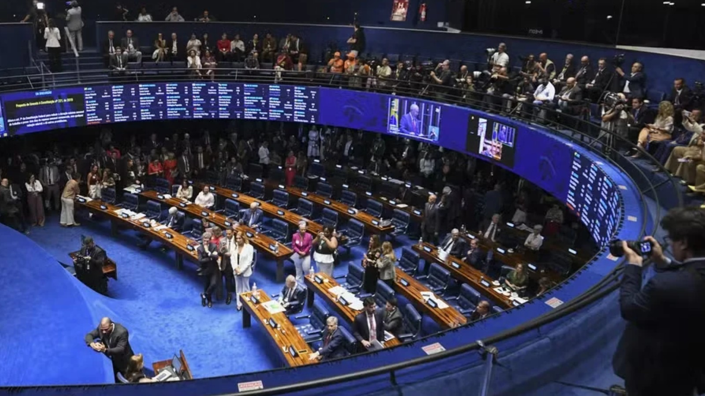
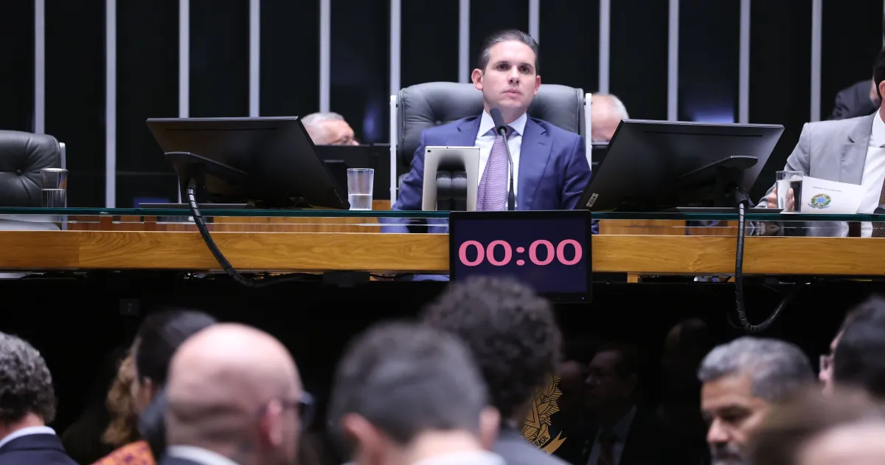
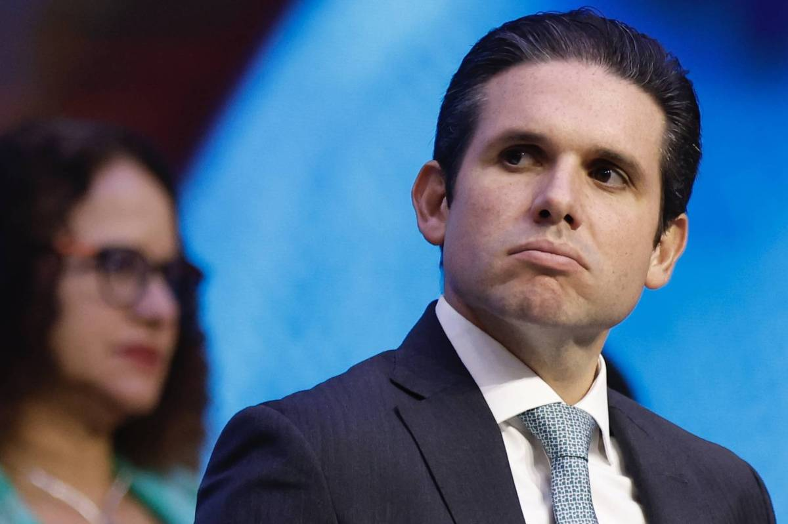

# Heimdall News — terça-feira, 3 de novembro de 2026

10 assuntos · 29 veículos e fontes

[Assistir ao vídeo deste briefing no YouTube](https://www.youtube.com/watch?v=PYnnk91kP1A)

## Assuntos do dia

1. PEC da Segurança vai a voto no Senado hoje; governo quer deixar a maioridade penal de fora
2. Presidência do Senado: PL lança Rogério Marinho contra Alcolumbre e defende que a direita mostre o voto
3. Câmara: PL decide hoje se apoia a reeleição de Hugo Motta; o PT, já no bloco, não quer o PL
4. Lula 4: Fazenda sem nome até o fim de novembro e disputa no PT sobre a proposta de Lara Resende para os juros
5. Flávio Bolsonaro recorre contra Moraes; PF investiga ex-agente israelense que participou da fuga
6. Reforma eleitoral: Motta quer aprovar o distrital misto até dezembro; PL e Novo anunciam voto contra
7. STF faz audiência pública sobre a MP que proibiu as bets; a maioria dos expositores é contra a proibição
8. Gilmar Mendes critica a condução do TSE nas eleições, sem citar Kassio Nunes Marques
9. Janones se reúne com Cristina Kirchner e Sergio Massa para levar à Argentina a estratégia digital da campanha de Lula
10. Caso Master: Vorcaro aciona a Comissão Interamericana e o pai pede prisão domiciliar ao STF

---

## 1. PEC da Segurança vai a voto no Senado hoje; governo quer deixar a maioridade penal de fora

_Imagem: [G1](https://g1.globo.com/politica/noticia/2026/11/03/senado-deve-votar-nesta-terca-pec-da-seguranca-publica.ghtml)_

_Cobertura (12): Imprensa mais à esquerda — Brasil de Fato; Imprensa de centro / grandes veículos — CNN Brasil, Estadão, Folha, G1, Poder360; Fontes oficiais — Agência Senado, Senado — pauta do Plenário; Outras fontes — A TARDE (via Google News), Brasil 247 (via Google News), PAIPEE - (via Google News), Portal Moju News (via Google News)_

### O que aconteceu

O Plenário do Senado deve votar hoje (3) a PEC da Segurança Pública. Para ser aprovada, precisa de 49 votos em cada um dos dois turnos; um calendário especial permite votar os dois no mesmo dia. [[1]](https://g1.globo.com/politica/noticia/2026/11/03/senado-deve-votar-nesta-terca-pec-da-seguranca-publica.ghtml) [[2]](https://www.cnnbrasil.com.br/politica/senado-inicia-hoje-debate-da-pec-da-seguranca-com-impasse-sobre-maioridade/) [[3]](https://www25.senado.leg.br/web/atividade/materias/-/materia/172997#sessao-594169-item-594242) [[4]](https://www.brasildefato.com.br/2026/11/02/pec-da-seguranca-publica-vai-testar-capacidade-de-coalizacao-do-governo-lula-afirma-cientista-politico/)

A votação estava marcada para 15 de outubro e foi adiada por um impasse sobre a maioridade penal: a oposição propôs 16 anos para todos os crimes e 14 para os hediondos; o líder do PT, Camilo Santana, propôs 16 anos só nos hediondos. [[2]](https://www.cnnbrasil.com.br/politica/senado-inicia-hoje-debate-da-pec-da-seguranca-com-impasse-sobre-maioridade/) [[1]](https://g1.globo.com/politica/noticia/2026/11/03/senado-deve-votar-nesta-terca-pec-da-seguranca-publica.ghtml)

O governo quer aprovar o texto sem mudanças, porque uma alteração de mérito devolveria a PEC à Câmara. Lula condiciona a criação do Ministério da Segurança Pública à aprovação. [[2]](https://www.cnnbrasil.com.br/politica/senado-inicia-hoje-debate-da-pec-da-seguranca-com-impasse-sobre-maioridade/) [[5]](https://www.estadao.com.br/politica/coluna-do-estadao/reducao-da-maioridade-penal-que-lula-defendeu-a-dois-dias-do-2-turno-sobe-no-telhado/)

### Como cada campo político se posicionou

**Pró-governo**

- **Teresa Leitão (PT-PE), líder do governo no Senado**: Disse que a posição do governo continua sendo não votar a maioridade penal junto com a PEC; segundo ela, o tema está em comissão especial na Câmara. [[1]](https://g1.globo.com/politica/noticia/2026/11/03/senado-deve-votar-nesta-terca-pec-da-seguranca-publica.ghtml)
  > “afirmou que a posição do governo continua sendo não votar a maioridade penal junto com a PEC da Segurança” — [G1](https://g1.globo.com/politica/noticia/2026/11/03/senado-deve-votar-nesta-terca-pec-da-seguranca-publica.ghtml)
- **Lula (PT), presidente**: Disse ser a favor de reduzir a pena em crimes hediondos, mas defendeu discutir o tema só depois de aprovar a PEC. [[1]](https://g1.globo.com/politica/noticia/2026/11/03/senado-deve-votar-nesta-terca-pec-da-seguranca-publica.ghtml)
  > “Primeiro você discute a PEC, aprova a PEC e aí você pode discutir a maioridade penal ou não” — [G1](https://g1.globo.com/politica/noticia/2026/11/03/senado-deve-votar-nesta-terca-pec-da-seguranca-publica.ghtml)

**Centro**

- **Davi Alcolumbre (União-AP), presidente do Senado**: Segundo o Estadão, defende aprovar hoje só os pontos de consenso e deixar os trechos polêmicos para depois. [[5]](https://www.estadao.com.br/politica/coluna-do-estadao/reducao-da-maioridade-penal-que-lula-defendeu-a-dois-dias-do-2-turno-sobe-no-telhado/)
  > “o argumento oficial, também usado por Alcolumbre, é o de tentar aprovar a PEC da Segurança, nesta terça-feira, com os pontos de consenso” — [Estadão](https://www.estadao.com.br/politica/coluna-do-estadao/reducao-da-maioridade-penal-que-lula-defendeu-a-dois-dias-do-2-turno-sobe-no-telhado/)

**Oposição ao governo**

- **Rogério Marinho (PL-RN), líder da oposição no Senado**: Apresentou a emenda que reduz a maioridade penal para 16 anos, e para 14 nos crimes hediondos. [[5]](https://www.estadao.com.br/politica/coluna-do-estadao/reducao-da-maioridade-penal-que-lula-defendeu-a-dois-dias-do-2-turno-sobe-no-telhado/)
  > “O senador Rogério Marinho (PL-RN), líder da Oposição, apresentou uma emenda que propõe a redução da maioridade penal de 18 para 16 anos” — [Estadão](https://www.estadao.com.br/politica/coluna-do-estadao/reducao-da-maioridade-penal-que-lula-defendeu-a-dois-dias-do-2-turno-sobe-no-telhado/)
- **Efraim Filho (PL-PB), senador**: Defendeu incluir a redução: disse que o endurecimento responde ao avanço da violência e segue o que pensa a maioria da população. [[2]](https://www.cnnbrasil.com.br/politica/senado-inicia-hoje-debate-da-pec-da-seguranca-com-impasse-sobre-maioridade/)
  > “Para o senador Efraim Filho (PL-PB), o endurecimento é uma resposta ao avanço da violência e está alinhado ao que pensa a maioria da população.” — [CNN Brasil](https://www.cnnbrasil.com.br/politica/senado-inicia-hoje-debate-da-pec-da-seguranca-com-impasse-sobre-maioridade/)

**Outros / não classificável**

- **Mateus de Albuquerque, cientista político (UFJF)**: Disse que a votação será um dos primeiros testes da capacidade de coalizão do novo governo. [[4]](https://www.brasildefato.com.br/2026/11/02/pec-da-seguranca-publica-vai-testar-capacidade-de-coalizacao-do-governo-lula-afirma-cientista-politico/)
  > “Vai ser um dos primeiros testes de fogo da capacidade de coalizão do novo governo.” — [Brasil de Fato](https://www.brasildefato.com.br/2026/11/02/pec-da-seguranca-publica-vai-testar-capacidade-de-coalizacao-do-governo-lula-afirma-cientista-politico/)

_Sem posicionamento encontrado: Centro pró-governo, Centro-oposição, Independente — Missão / MBL._

Referências:

1. [Senado deve votar nesta terça PEC da Segurança Pública](https://g1.globo.com/politica/noticia/2026/11/03/senado-deve-votar-nesta-terca-pec-da-seguranca-publica.ghtml) — G1, 03/11 00:00
2. [Senado inicia hoje análise da PEC da Segurança com impasse sobre maioridade](https://www.cnnbrasil.com.br/politica/senado-inicia-hoje-debate-da-pec-da-seguranca-com-impasse-sobre-maioridade/) — CNN Brasil, 03/11 03:15
3. [Senado: Proposta de Emenda à Constituição n° 18, de 2025 — PEC da Segurança Pública](https://www25.senado.leg.br/web/atividade/materias/-/materia/172997#sessao-594169-item-594242) — Senado — pauta do Plenário, 03/11 14:00
4. [PEC da Segurança Pública vai testar capacidade de coalizão do governo Lula, afirma cientista político](https://www.brasildefato.com.br/2026/11/02/pec-da-seguranca-publica-vai-testar-capacidade-de-coalizacao-do-governo-lula-afirma-cientista-politico/) — Brasil de Fato, 02/11 14:30
5. [Planalto aposta na aprovação da PEC da Segurança, mas redução da maioridade penal sobe no telhado](https://www.estadao.com.br/politica/coluna-do-estadao/reducao-da-maioridade-penal-que-lula-defendeu-a-dois-dias-do-2-turno-sobe-no-telhado/) — Estadão, 03/11 05:30

Outras matérias sobre o tema:

- [Alcolumbre marca votação da PEC da Segurança Pública para terça-feira (3)](https://www.brasildefato.com.br/2026/10/31/alcolumbre-marca-votacao-da-pec-da-seguranca-publica-para-terca-feira-3/) — Brasil de Fato, 31/10 13:30
- [Alcolumbre pauta PEC da Segurança para terça e governo costura acordo sobre maioridade](https://www1.folha.uol.com.br/colunas/painel/2026/10/alcolumbre-pauta-pec-da-seguranca-para-terca-e-governo-costura-acordo-sobre-maioridade.shtml) — Folha, 30/10 17:32
- [Alcolumbre pauta votação da PEC da Segurança Pública para a próxima terça-feira](https://g1.globo.com/politica/noticia/2026/10/30/alcolumbre-pauta-votacao-da-pec-da-seguranca-publica-para-a-proxima-terca-feira.ghtml) — G1, 30/10 18:32
- [Davi marca para terça votação da PEC da Segurança](https://www12.senado.leg.br/noticias/materias/2026/10/30/davi-marca-para-terca-votacao-da-pec-da-seguranca) — Agência Senado, 30/10 20:10
- [Saiba quais ações estão na pauta do Congresso nesta 3ª feira](https://www.poder360.com.br/poder-congresso/saiba-quais-acoes-estao-na-pauta-do-congresso-nesta-3a-feira-3/) — Poder360, 03/11 06:15
- [Redução da maioridade penal divide bancada do PT no Senado](https://news.google.com/rss/articles/CBMingFBVV95cUxObE1OQWREVXlMc2pTVzdqVmJzVExNdUtJYTh5TFA4R25FeGsyZktyZ2pfV3V2UDlyZzQyZi1KYjgtVzZWNU9HN0pXN3JtUHktNU1zQWdVSjRxalRINThFaWZ5d1REbXVaUUQ1SEZrTzVuNGprZXB3RVp2OEd1YUJpOGFDWGpsUnA1a2ppYXlsblUwaWNVYlJ3Qm11X0hPdw?oc=5) — A TARDE (via Google News), 01/11 07:50
- [Sem acordo, bancada do PT fará reunião para debater maioridade penal](https://news.google.com/rss/articles/CBMiowFBVV95cUxOd1FYMFdHUnlPTVBTNWR2R3JPVzdYcEhOOE9fOFU2bWp6ZjJ4NUxrMXJZa2pWVEN2SU5mTXBJRnBvUVNpekVxRGx5M1JnSFVGVWtrOFdZOGd2NDd0LXl4S0tGWHlxZTZDSy1SMDJ1NzQyT3FTVHg3WVRDU3M1ZmZ2dktUTXdZcXp6Q2JfVVF0a1JROEU1eXl2MVE2WU8xX1FpMnBZ?oc=5) — PAIPEE - (via Google News), 01/11 08:21
- [Bancada do PT se reúne para discutir redução da maioridade penal](https://news.google.com/rss/articles/CBMiogFBVV95cUxQVzR1ZnN3UE9mekhvaG1zZkpYZWxVaGFTMUN6UlktRXB5QVBmQlVrOGxDVDg2OGxJLUl0eFY3VGl1TFlKa3hpYWZfY2ktQjFBeWdKRjI0ZTcxa3IxLXVTektNVi0taWZGSGxVclVUYlNEczN0cW5WOEJ5bGI2R1E1ZENWWTJ0N3ZvX0JHci1YRVVvZzJZVWlyaUJKZlFDVXRsamc?oc=5) — Brasil 247 (via Google News), 01/11 08:02
- [Bancada do PT se reúne para discutir proposta de redução da maioridade penal para 16 anos](https://news.google.com/rss/articles/CBMisAFBVV95cUxPczhBeHpmc0tDV1B2b1JzSUQtUXRKbnpoUEhEd1l6VTdUdU1DMnRCdVdkRmQwNHE0enI4U0F2NGo3VUFPSF9ScF9PbXVmRXo1eWRsYTBySE9RMFRIUnBvOXJYalhIVnlkMzBqVC1uRU9mbzVGNnNWUmFZOGFjajVzVXpMcmRLYjYxSzBlUTVqNnlncjlZa05mZnNwSjFwa1FUcUFYMHRYTGdSUTdwMWxJNw?oc=5) — Portal Moju News (via Google News), 01/11 16:00

---

## 2. Presidência do Senado: PL lança Rogério Marinho contra Alcolumbre e defende que a direita mostre o voto

_Imagem: [G1](https://g1.globo.com/politica/noticia/2026/11/02/presidencia-do-senado-pl-deve-ter-candidato-proprio-mesmo-com-aproximacao-de-alcolumbre.ghtml)_

_Cobertura (6): Imprensa de centro / grandes veículos — CNN Brasil, Estadão, Folha, G1; Imprensa mais à direita — Gazeta do Povo; Outras fontes — Portal Obidense (via Google News)_

### O que aconteceu

O PL deve anunciar na quarta (4) a candidatura de Rogério Marinho (RN) à presidência do Senado. A eleição é em fevereiro de 2027, e são precisos 41 votos. [[1]](https://g1.globo.com/politica/noticia/2026/11/02/presidencia-do-senado-pl-deve-ter-candidato-proprio-mesmo-com-aproximacao-de-alcolumbre.ghtml) [[2]](https://www1.folha.uol.com.br/poder/2026/11/rogerio-marinho-vai-defender-que-direita-divulgue-voto-em-estrategia-para-derrotar-alcolumbre.shtml)

O PL elegeu 19 senadores e terá a maior bancada da Casa em 2027: 29 senadores segundo a Folha e a Gazeta do Povo, 28 segundo o G1 e a CNN. [[3]](https://www.gazetadopovo.com.br/republica/rogerio-marinho-defende-voto-aberto-na-disputa-contra-alcolumbre-pela-presidencia-do-senado/) [[1]](https://g1.globo.com/politica/noticia/2026/11/02/presidencia-do-senado-pl-deve-ter-candidato-proprio-mesmo-com-aproximacao-de-alcolumbre.ghtml)

Alcolumbre e Marinho dizem ter 48 votos cada, o que significa que as contagens se sobrepõem. O voto é secreto. [[2]](https://www1.folha.uol.com.br/poder/2026/11/rogerio-marinho-vai-defender-que-direita-divulgue-voto-em-estrategia-para-derrotar-alcolumbre.shtml) [[4]](https://www1.folha.uol.com.br/colunas/painel/2026/11/marinho-tera-apoio-do-novo-em-lancamento-para-presidente-do-senado-e-busca-outros-partidos.shtml)

Alcolumbre recebeu o apoio de Lula e discute com parlamentares pautar uma anistia aos condenados do 8 de janeiro, Jair Bolsonaro incluído. [[5]](https://www.estadao.com.br/politica/coluna-do-estadao/alcolumbre-aciona-modo-lula-e-negocia-ate-o-impossivel-para-tentar-reeleicao-no-comando-do-senado/) [[1]](https://g1.globo.com/politica/noticia/2026/11/02/presidencia-do-senado-pl-deve-ter-candidato-proprio-mesmo-com-aproximacao-de-alcolumbre.ghtml)

### Como cada campo político se posicionou

**Pró-governo**

- **Lula (PT), presidente**: Apoia a reeleição de Alcolumbre, segundo o Estadão. [[5]](https://www.estadao.com.br/politica/coluna-do-estadao/alcolumbre-aciona-modo-lula-e-negocia-ate-o-impossivel-para-tentar-reeleicao-no-comando-do-senado/)
  > “Davi Alcolumbre recebeu apoio do presidente Luiz Inácio Lula da Silva para sua reeleição no comando do Senado” — [Estadão](https://www.estadao.com.br/politica/coluna-do-estadao/alcolumbre-aciona-modo-lula-e-negocia-ate-o-impossivel-para-tentar-reeleicao-no-comando-do-senado/)

**Centro pró-governo**

- **Ciro Nogueira (PP) e Antonio Rueda (União), presidentes da federação União-PP**: Anunciaram o apoio da federação a Alcolumbre. Nenhum dos dois vota na eleição: Ciro não se reelegeu senador, e Rueda é deputado. [[5]](https://www.estadao.com.br/politica/coluna-do-estadao/alcolumbre-aciona-modo-lula-e-negocia-ate-o-impossivel-para-tentar-reeleicao-no-comando-do-senado/)
  > “O congressista também anunciou que será apoiado pela federação União-PP, com base na manifestação dos presidentes dos dois partidos, Ciro Nogueira (PP) e Antonio Rueda.” — [Estadão](https://www.estadao.com.br/politica/coluna-do-estadao/alcolumbre-aciona-modo-lula-e-negocia-ate-o-impossivel-para-tentar-reeleicao-no-comando-do-senado/)

**Centro**

- **Davi Alcolumbre (União-AP), presidente do Senado**: Diz a interlocutores que busca "pacificar" o país e "virar a página" da tensão entre Lula, os Bolsonaros e o STF. [[5]](https://www.estadao.com.br/politica/coluna-do-estadao/alcolumbre-aciona-modo-lula-e-negocia-ate-o-impossivel-para-tentar-reeleicao-no-comando-do-senado/)
  > “O senador tem argumentado a interlocutores que busca a pacificação do País” — [Estadão](https://www.estadao.com.br/politica/coluna-do-estadao/alcolumbre-aciona-modo-lula-e-negocia-ate-o-impossivel-para-tentar-reeleicao-no-comando-do-senado/)

**Oposição ao governo**

- **Rogério Marinho (PL-RN), líder da oposição no Senado**: Disse que vai defender que os senadores de direita divulguem o voto: "É difícil justificar em público o voto no Alcolumbre". [[2]](https://www1.folha.uol.com.br/poder/2026/11/rogerio-marinho-vai-defender-que-direita-divulgue-voto-em-estrategia-para-derrotar-alcolumbre.shtml)
  > “Vou defender. É difícil justificar em público o voto no Alcolumbre, né?” — [Folha](https://www1.folha.uol.com.br/poder/2026/11/rogerio-marinho-vai-defender-que-direita-divulgue-voto-em-estrategia-para-derrotar-alcolumbre.shtml)
- **Carlos Portinho (PL-RJ), líder do PL no Senado**: Confirmou Marinho como candidato do partido e disse que o PL vai buscar aliados de outras siglas. [[4]](https://www1.folha.uol.com.br/colunas/painel/2026/11/marinho-tera-apoio-do-novo-em-lancamento-para-presidente-do-senado-e-busca-outros-partidos.shtml)
  > “Rogério é o candidato do PL e vamos articular com a bancada, partidos aliados e seus parlamentares também avulsos” — [Folha](https://www1.folha.uol.com.br/colunas/painel/2026/11/marinho-tera-apoio-do-novo-em-lancamento-para-presidente-do-senado-e-busca-outros-partidos.shtml)
- **Tereza Cristina (PP-MS), senadora**: Mantém a intenção de se candidatar mesmo com o lançamento de Marinho. [[1]](https://g1.globo.com/politica/noticia/2026/11/02/presidencia-do-senado-pl-deve-ter-candidato-proprio-mesmo-com-aproximacao-de-alcolumbre.ghtml)
  > “Eu mantenho meu desejo de concorrer, de ser a primeira mulher presidente do Senado.” — [G1](https://g1.globo.com/politica/noticia/2026/11/02/presidencia-do-senado-pl-deve-ter-candidato-proprio-mesmo-com-aproximacao-de-alcolumbre.ghtml)
- **Liderança do PL no Senado (sob anonimato, ao G1)**: Defendeu tentar um acordo com Alcolumbre antes de lançar candidato, para o partido não perder comissões em caso de derrota. [[1]](https://g1.globo.com/politica/noticia/2026/11/02/presidencia-do-senado-pl-deve-ter-candidato-proprio-mesmo-com-aproximacao-de-alcolumbre.ghtml)
  > “argumenta ser contrário a uma "radicalização" na eleição da Mesa” — [G1](https://g1.globo.com/politica/noticia/2026/11/02/presidencia-do-senado-pl-deve-ter-candidato-proprio-mesmo-com-aproximacao-de-alcolumbre.ghtml)

_Sem posicionamento encontrado: Centro-oposição, Independente — Missão / MBL, Outros / não classificável._

Referências:

1. [Presidência do Senado: PL deve ter candidato próprio, mesmo com aproximação de Alcolumbre](https://g1.globo.com/politica/noticia/2026/11/02/presidencia-do-senado-pl-deve-ter-candidato-proprio-mesmo-com-aproximacao-de-alcolumbre.ghtml) — G1, 02/11 00:00
2. [Rogério Marinho vai defender que direita divulgue voto em estratégia para derrotar Alcolumbre](https://www1.folha.uol.com.br/poder/2026/11/rogerio-marinho-vai-defender-que-direita-divulgue-voto-em-estrategia-para-derrotar-alcolumbre.shtml) — Folha, 02/11 13:00
3. [Rogério Marinho defende voto aberto na disputa contra Alcolumbre pela Presidência do Senado](https://www.gazetadopovo.com.br/republica/rogerio-marinho-defende-voto-aberto-na-disputa-contra-alcolumbre-pela-presidencia-do-senado/) — Gazeta do Povo, 02/11 17:35
4. [Marinho terá apoio do Novo em lançamento para presidente do Senado e busca outros partidos](https://www1.folha.uol.com.br/colunas/painel/2026/11/marinho-tera-apoio-do-novo-em-lancamento-para-presidente-do-senado-e-busca-outros-partidos.shtml) — Folha, 02/11 19:00
5. [Alcolumbre aciona ‘modo Lula’ e negocia até o impossível para tentar reeleição no comando do Senado](https://www.estadao.com.br/politica/coluna-do-estadao/alcolumbre-aciona-modo-lula-e-negocia-ate-o-impossivel-para-tentar-reeleicao-no-comando-do-senado/) — Estadão, 02/11 05:30

Outras matérias sobre o tema:

- [Direita terá dificuldade de conter STF se não impedir reeleição de Alcolumbre](https://www.gazetadopovo.com.br/vida-e-cidadania/direita-dificuldade-conter-stf-impedir-reeleicao-alcolumbre/) — Gazeta do Povo, 02/11 21:59
- [PL rejeita acordo com Alcolumbre e vai lançar Marinho à Presidência do Senado](https://news.google.com/rss/articles/CBMiuwFBVV95cUxNUEh1azFNUDRLZjJUUUdXQlo5TVFWdGpYY01GWnpVUENRY04weGg0LXdXVGtaSUdSdy1Obi1YMFNfcGxwczhLVkM5aDNmd3d4Zk5DRWhhUl9tY1VXSWx3d3FzeFZEQUtNX0Izb2NVU2xENEFWbEEzZlVuZWRubVZkZV9vT20zdllGTEFfb3hmNFBmOGRaa0ZjNXdZWHJiZi13MkVmTFpRQ2NLVTNJOGcxY1JYWWVvejVkT1JR?oc=5) — Portal Obidense (via Google News), 01/11 09:34
- [PL reúne bancada nesta terça para debater apoio a Hugo no comando da Câmara](https://www.cnnbrasil.com.br/politica/pl-reune-bancada-nesta-terca-para-debater-apoio-a-hugo-no-comando-da-camara/) — CNN Brasil, 03/11 03:30

---

## 3. Câmara: PL decide hoje se apoia a reeleição de Hugo Motta; o PT, já no bloco, não quer o PL

_Imagem: [CNN Brasil](https://www.cnnbrasil.com.br/politica/pl-reune-bancada-nesta-terca-para-debater-apoio-a-hugo-no-comando-da-camara/)_

_Cobertura (3): Imprensa de centro / grandes veículos — CNN Brasil; Imprensa mais à direita — Gazeta do Povo; Outras fontes — AM POST (via Google News)_

### O que aconteceu

O PL reúne a bancada às 18h de hoje para decidir se apoia a reeleição de Hugo Motta. O partido terá 121 deputados a partir de 2027, a maior bancada da Casa. [[1]](https://www.cnnbrasil.com.br/politica/pl-reune-bancada-nesta-terca-para-debater-apoio-a-hugo-no-comando-da-camara/)

Motta tem o apoio de 15 legendas, o PT entre elas, ao lado do PCdoB e do PV. [[1]](https://www.cnnbrasil.com.br/politica/pl-reune-bancada-nesta-terca-para-debater-apoio-a-hugo-no-comando-da-camara/) [[2]](https://www.gazetadopovo.com.br/republica/avanco-do-pl-pressiona-hugo-motta-e-leva-partidos-a-antecipar-disputa-pela-camara/)

Fora do bloco de Motta, o PL passaria da 1ª e 2ª escolha de comissões para a 14ª. [[1]](https://www.cnnbrasil.com.br/politica/pl-reune-bancada-nesta-terca-para-debater-apoio-a-hugo-no-comando-da-camara/)

### Como cada campo político se posicionou

**Pró-governo**

- **Pedro Uczai (PT-SC), líder do PT na Câmara**: Disse que o apoio a Motta é estratégico para a governabilidade de Lula. [[2]](https://www.gazetadopovo.com.br/republica/avanco-do-pl-pressiona-hugo-motta-e-leva-partidos-a-antecipar-disputa-pela-camara/)
  > “Essa composição é estratégica para os próximos quatro anos, para dar governabilidade ao governo do presidente Lula” — [Gazeta do Povo](https://www.gazetadopovo.com.br/republica/avanco-do-pl-pressiona-hugo-motta-e-leva-partidos-a-antecipar-disputa-pela-camara/)
- **Bancada do PT na Câmara**: Põe como condição que o PL e o Novo fiquem fora do bloco de apoio a Motta. [[2]](https://www.gazetadopovo.com.br/republica/avanco-do-pl-pressiona-hugo-motta-e-leva-partidos-a-antecipar-disputa-pela-camara/)
  > “os petistas querem impedir que o PL e o Novo integrem o bloco de apoio a Motta” — [Gazeta do Povo](https://www.gazetadopovo.com.br/republica/avanco-do-pl-pressiona-hugo-motta-e-leva-partidos-a-antecipar-disputa-pela-camara/)

**Centro pró-governo**

- **Hugo Motta (Republicanos-PB), presidente da Câmara**: Diz que ouvirá as demandas da oposição, mas que o PT terá prioridade. [[1]](https://www.cnnbrasil.com.br/politica/pl-reune-bancada-nesta-terca-para-debater-apoio-a-hugo-no-comando-da-camara/)
  > “O presidente da Câmara, por sua vez, tem dito que ouvirá as demandas da oposição, mas que os petistas teriam prioridade.” — [CNN Brasil](https://www.cnnbrasil.com.br/politica/pl-reune-bancada-nesta-terca-para-debater-apoio-a-hugo-no-comando-da-camara/)

**Oposição ao governo**

- **Ala do PL ligada a Valdemar Costa Neto, presidente do partido**: Defende um acordo com Motta para não deixar o partido isolado na divisão de cargos. [[1]](https://www.cnnbrasil.com.br/politica/pl-reune-bancada-nesta-terca-para-debater-apoio-a-hugo-no-comando-da-camara/)
  > “A ala ligada ao presidente da legenda, Valdemar Costa Neto, defende o pragmatismo e um acordo com Hugo.” — [CNN Brasil](https://www.cnnbrasil.com.br/politica/pl-reune-bancada-nesta-terca-para-debater-apoio-a-hugo-no-comando-da-camara/)
- **Zé Trovão (PL-SC), deputado**: Disse que apresentará candidatura avulsa se o PL não lançar candidato próprio. [[1]](https://www.cnnbrasil.com.br/politica/pl-reune-bancada-nesta-terca-para-debater-apoio-a-hugo-no-comando-da-camara/)
  > “O deputado Zé Trovão (PL-SC) afirmou na segunda-feira (2) que se o PL decidir não lançar um candidato próprio, iria apresentar um pedido de registro de candidatura avulsa.” — [CNN Brasil](https://www.cnnbrasil.com.br/politica/pl-reune-bancada-nesta-terca-para-debater-apoio-a-hugo-no-comando-da-camara/)

_Sem posicionamento encontrado: Centro, Centro-oposição, Independente — Missão / MBL, Outros / não classificável._

Referências:

1. [PL reúne bancada nesta terça para debater apoio a Hugo no comando da Câmara](https://www.cnnbrasil.com.br/politica/pl-reune-bancada-nesta-terca-para-debater-apoio-a-hugo-no-comando-da-camara/) — CNN Brasil, 03/11 03:30
2. [Avanço do PL pressiona Hugo Motta e leva partidos a antecipar disputa pela Câmara](https://www.gazetadopovo.com.br/republica/avanco-do-pl-pressiona-hugo-motta-e-leva-partidos-a-antecipar-disputa-pela-camara/) — Gazeta do Povo, 01/11 21:59

Outras matérias sobre o tema:

- [PL pode ficar fora de blocão de Hugo Motta e perder espaço em comissões da Câmara](https://news.google.com/rss/articles/CBMisAFBVV95cUxQZnYxMUFheHgyMGQzWWVDbVhxUkxjRC1XN1N4Ykx0MXBra3NlakpEazJ5al8wTWFGWFdHaW1ZZ01XX1BHTFVrcHA4S3ZQWlBiUDZCZmNma1BodGotS3piN1otZ09NbWtmUDlCT3VEaE02czFqV3BjYkx4ek84WXBES0dsbzNvNlAwYTRRWVhTc2Y5RTYtdWVRdnM5UGZ0dTV6M0NZZ192RjVrcmFDMlBBdg?oc=5) — AM POST (via Google News), 02/11 15:52

---

## 4. Lula 4: Fazenda sem nome até o fim de novembro e disputa no PT sobre a proposta de Lara Resende para os juros

_Imagem: [Folha](https://www1.folha.uol.com.br/colunas/painel/2026/11/lula-rejeita-fazer-gesto-ao-mercado-e-antecipar-nome-para-fazenda.shtml)_

_Cobertura (7): Imprensa de centro / grandes veículos — CNN Brasil, Estadão, Folha, G1, JOTA; Imprensa mais à direita — Gazeta do Povo, Revista Oeste_

### O que aconteceu

Lula não pretende antecipar o nome do ministro da Fazenda; a tendência é anunciá-lo depois da viagem à COP31. Os nomes mais citados são Geraldo Alckmin e Rafael Fonteles; Dario Durigan pode ficar. [[1]](https://www1.folha.uol.com.br/colunas/painel/2026/11/lula-rejeita-fazer-gesto-ao-mercado-e-antecipar-nome-para-fazenda.shtml)

O economista André Lara Resende propôs baixar a Selic gradualmente de 13,75% para cerca de 7,5% ao ano, sob um novo Conselho Fiscal e Monetário Nacional. [[2]](https://www.gazetadopovo.com.br/republica/gleisi-volta-a-atacar-mercado-e-recua-na-defesa-do-tabelamento-de-juros/)

O Copom começa a se reunir hoje; a decisão sai na quarta (4). [[3]](https://www.estadao.com.br/politica/coluna-do-estadao/proposta-de-lara-resende-sobre-tabelamento-dos-juros-reacende-disputa-no-pt-por-rumos-de-lula-4/)

### Como cada campo político se posicionou

**Pró-governo**

- **Dario Durigan, ministro da Fazenda**: Disse que propostas como tabelar os juros ou queimar reservas não estão em avaliação e que não há encontro marcado entre Lula e Lara Resende. [[4]](https://g1.globo.com/politica/noticia/2026/11/02/propostas-como-tabelar-os-juros-ou-queimar-reservas-cambiais-nao-estao-em-avaliacao-diz-durigan.ghtml)
  > “Propostas como tabelar os juros ou queimar reservas cambiais não estão em avaliação” — [G1](https://g1.globo.com/politica/noticia/2026/11/02/propostas-como-tabelar-os-juros-ou-queimar-reservas-cambiais-nao-estao-em-avaliacao-diz-durigan.ghtml)
  > “Não há agenda com o presidente Lula e o economista André Lara Resende” — [G1](https://g1.globo.com/politica/noticia/2026/11/02/propostas-como-tabelar-os-juros-ou-queimar-reservas-cambiais-nao-estao-em-avaliacao-diz-durigan.ghtml)
- **Gleisi Hoffmann (PT-PR), deputada**: Disse que o mercado tem o "DNA do autoritarismo" e que conversar com quem pensa diferente da Faria Lima não significa adotar as propostas. [[2]](https://www.gazetadopovo.com.br/republica/gleisi-volta-a-atacar-mercado-e-recua-na-defesa-do-tabelamento-de-juros/)
  > “Segundo a petista, isso não significa que ele adotará as ideias e propostas das pessoas com quem conversa.” — [Gazeta do Povo](https://www.gazetadopovo.com.br/republica/gleisi-volta-a-atacar-mercado-e-recua-na-defesa-do-tabelamento-de-juros/)
- **Edinho Silva, presidente do PT**: Disse que só o ministro da Fazenda está autorizado a falar de política econômica. [[2]](https://www.gazetadopovo.com.br/republica/gleisi-volta-a-atacar-mercado-e-recua-na-defesa-do-tabelamento-de-juros/)
  > “o presidente nacional do PT, Edinho Silva, afirmou que somente o ministro da Fazenda, Dario Durigan, tem autorização para falar da política econômica” — [Gazeta do Povo](https://www.gazetadopovo.com.br/republica/gleisi-volta-a-atacar-mercado-e-recua-na-defesa-do-tabelamento-de-juros/)
- **Guilherme Boulos (PSOL), ministro da Secretaria-Geral**: Chamou de "chantagem do mercado" a cobrança por ajuste fiscal e defendeu cortar benefícios fiscais, supersalários e emendas, e não saúde e educação. [[5]](https://revistaoeste.com/politica/cobranca-por-ajuste-fiscal-e-chantagem-do-mercado-diz-boulos/)
  > “defendeu que eventuais cortes se concentrem em benefícios fiscais, supersalários do funcionalismo e emendas parlamentares, mas não em áreas como saúde e educação” — [Revista Oeste](https://revistaoeste.com/politica/cobranca-por-ajuste-fiscal-e-chantagem-do-mercado-diz-boulos/)

**Outros / não classificável**

- **Lucinda Pinto, editora de Economia da CNN**: Disse que forçar a queda da Selic tenderia a aumentar os juros cobrados para financiar o governo. [[6]](https://www.cnnbrasil.com.br/economia/money/mercado/analise-indefinicao-na-fazenda-preocupa-mercado-para-lula-4/)
  > “Na prática, o que você vai fazer é aumentar ainda mais a taxa de juros que o investidor vai exigir para emprestar dinheiro para o governo” — [CNN Brasil](https://www.cnnbrasil.com.br/economia/money/mercado/analise-indefinicao-na-fazenda-preocupa-mercado-para-lula-4/)

_Sem posicionamento encontrado: Centro pró-governo, Centro, Centro-oposição, Oposição ao governo, Independente — Missão / MBL._

Referências:

1. [Lula rejeita fazer gesto ao mercado e antecipar nome para Fazenda](https://www1.folha.uol.com.br/colunas/painel/2026/11/lula-rejeita-fazer-gesto-ao-mercado-e-antecipar-nome-para-fazenda.shtml) — Folha, 02/11 23:00
2. [Gleisi volta a atacar mercado e recua na defesa do tabelamento de juros](https://www.gazetadopovo.com.br/republica/gleisi-volta-a-atacar-mercado-e-recua-na-defesa-do-tabelamento-de-juros/) — Gazeta do Povo, 02/11 21:51
3. [Proposta de Lara Resende sobre ‘tabelamento’ dos juros reacende disputa no PT por rumos de Lula 4](https://www.estadao.com.br/politica/coluna-do-estadao/proposta-de-lara-resende-sobre-tabelamento-dos-juros-reacende-disputa-no-pt-por-rumos-de-lula-4/) — Estadão, 02/11 18:11
4. ['Propostas como tabelar os juros ou queimar reservas cambiais não estão em avaliação', diz Durigan](https://g1.globo.com/politica/noticia/2026/11/02/propostas-como-tabelar-os-juros-ou-queimar-reservas-cambiais-nao-estao-em-avaliacao-diz-durigan.ghtml) — G1, 02/11 16:31
5. [Cobrança por ajuste fiscal é ‘chantagem do mercado’, diz Boulos](https://revistaoeste.com/politica/cobranca-por-ajuste-fiscal-e-chantagem-do-mercado-diz-boulos/) — Revista Oeste, 02/11 21:33
6. [Análise: Indefinição na Fazenda preocupa mercado para Lula 4](https://www.cnnbrasil.com.br/economia/money/mercado/analise-indefinicao-na-fazenda-preocupa-mercado-para-lula-4/) — CNN Brasil, 02/11 21:32

Outras matérias sobre o tema:

- [Juros não são única razão da dívida pública, diz ex-diretor do BC](https://www.cnnbrasil.com.br/economia/money/macroeconomia/juros-nao-sao-unica-razao-da-divida-publica-diz-ex-diretor-do-bc/) — CNN Brasil, 03/11 02:50
- [BC abre decisão sobre juros em meio à mudança das expectativas do mercado](https://www.cnnbrasil.com.br/economia/money/macroeconomia/bc-abre-decisao-sobre-juros-em-meio-a-mudanca-das-expectativas-do-mercado/) — CNN Brasil, 03/11 04:06
- [O atalho que Lula deve evitar](https://www.jota.info/opiniao-e-analise/artigos/o-atalho-que-lula-deve-evitar) — JOTA, 02/11 17:54

---

## 5. Flávio Bolsonaro recorre contra Moraes; PF investiga ex-agente israelense que participou da fuga

_Imagem: [G1](https://g1.globo.com/politica/noticia/2026/11/02/flavio-bolsonaro-recorre-contra-apreensao-de-passaportes-defesa-pede-tambem-que-moraes-seja-declarado-impedido-em-investigacao.ghtml)_

_Cobertura (9): Imprensa mais à esquerda — Brasil de Fato, CartaCapital; Imprensa de centro / grandes veículos — Estadão, Folha, G1; Imprensa mais à direita — Gazeta do Povo; Partidos e movimentos — PT (site oficial); Outras fontes — UOL (via Google News), UOL Notícias (via Google News)_

### O que aconteceu

A defesa de Flávio pediu a revogação da ordem de Moraes que mandou entregar os passaportes e pediu que o inquérito passe para André Mendonça, com Moraes declarado impedido ou suspeito. [[1]](https://g1.globo.com/politica/noticia/2026/11/02/flavio-bolsonaro-recorre-contra-apreensao-de-passaportes-defesa-pede-tambem-que-moraes-seja-declarado-impedido-em-investigacao.ghtml)

A investigação apura lavagem de dinheiro num suposto esquema com empresas do advogado Willer Tomaz e bets. [[1]](https://g1.globo.com/politica/noticia/2026/11/02/flavio-bolsonaro-recorre-contra-apreensao-de-passaportes-defesa-pede-tambem-que-moraes-seja-declarado-impedido-em-investigacao.ghtml)

Segundo o Fantástico e a Folha, o ex-agente do Mossad Menachem Booky Halevy estava numa van que cruzou a fronteira com a Argentina minutos antes da van de Flávio. Ele é investigado pela PF. [[2]](https://www1.folha.uol.com.br/poder/2026/11/ex-agente-do-governo-israelense-teria-ajudado-flavio-bolsonaro-a-fugir-para-os-eua-diz-tv.shtml)

Em sua primeira aparição pública nos EUA, Flávio foi a um culto evangélico na Flórida no domingo (1º), com o irmão Eduardo. [[3]](https://www.estadao.com.br/politica/flavio-culto-evangelico-primeira-aparicao-publica-fuga-eua-npr/) [[4]](https://www.gazetadopovo.com.br/republica/flavio-bolsonaro-faz-primeira-aparicao-publica-nos-eua-ao-lado-de-eduardo/)

### Como cada campo político se posicionou

**Pró-governo**

- **PT (site oficial)**: Publicou lista de bolsonaristas que deixaram o país e chamou a saída de Flávio de fuga para evitar a Justiça. [[5]](https://pt.org.br/patriotas-de-aeroporto-a-amplia-lista-de-bolsonaristas-que-fugiram-do-brasil/)
  > “O patriotismo bolsonarista tem uma curiosa preferência pela ponte aérea internacional quando obrigado a dar explicações à Justiça.” — [PT (site oficial)](https://pt.org.br/patriotas-de-aeroporto-a-amplia-lista-de-bolsonaristas-que-fugiram-do-brasil/)

**Oposição ao governo**

- **Flávio Bolsonaro (PL-RJ), senador**: Disse que não se arrepende, que "saiu pelo Brasil" e que as cautelares contra ele se baseiam em mentiras. [[3]](https://www.estadao.com.br/politica/flavio-culto-evangelico-primeira-aparicao-publica-fuga-eua-npr/)
  > “apenas sete minutos após o anúncio do resultado das eleições já havia uma decisão judicial com medidas cautelares contra mim, com base em mentiras” — [Estadão](https://www.estadao.com.br/politica/flavio-culto-evangelico-primeira-aparicao-publica-fuga-eua-npr/)

**Outros / não classificável**

- **Oficiais das Forças Armadas ouvidos pela Folha (sob anonimato)**: Criticaram a saída de Flávio sem reconhecer a derrota e a compararam ao comandante que abandona a tropa. [[6]](https://www1.folha.uol.com.br/poder/2026/11/fuga-de-flavio-bolsonaro-aos-eua-apos-derrota-leva-militares-a-abracarem-tarcisio.shtml)
  > “corresponde ao gesto do comandante que abandona sua tropa” — [Folha](https://www1.folha.uol.com.br/poder/2026/11/fuga-de-flavio-bolsonaro-aos-eua-apos-derrota-leva-militares-a-abracarem-tarcisio.shtml)
- **Iguaçu Dallas Travel Turismo**: Negou, em nota, ter transportado Flávio. [[7]](https://www.estadao.com.br/politica/tres-entradas-na-argentina-em-40-minutos-os-bastidores-da-fuga-de-flavio-bolsonaro-npr/)
  > “Em nota, a Dallas Turismo negou ter transportado o candidato.” — [Estadão](https://www.estadao.com.br/politica/tres-entradas-na-argentina-em-40-minutos-os-bastidores-da-fuga-de-flavio-bolsonaro-npr/)

_Sem posicionamento encontrado: Centro pró-governo, Centro, Centro-oposição, Independente — Missão / MBL._

Referências:

1. [Flávio Bolsonaro recorre contra apreensão de passaportes; defesa pede que Moraes seja declarado impedido em investigação](https://g1.globo.com/politica/noticia/2026/11/02/flavio-bolsonaro-recorre-contra-apreensao-de-passaportes-defesa-pede-tambem-que-moraes-seja-declarado-impedido-em-investigacao.ghtml) — G1, 02/11 16:20
2. [Ex-agente do governo israelense ajudou Flávio Bolsonaro a fugir para os EUA, indica investigação](https://www1.folha.uol.com.br/poder/2026/11/ex-agente-do-governo-israelense-teria-ajudado-flavio-bolsonaro-a-fugir-para-os-eua-diz-tv.shtml) — Folha, 02/11 14:18
3. [Flávio Bolsonaro vai a culto evangélico em primeira aparição pública após fuga para os EUA](https://www.estadao.com.br/politica/flavio-culto-evangelico-primeira-aparicao-publica-fuga-eua-npr/) — Estadão, 02/11 12:24
4. [Flávio Bolsonaro faz primeira aparição pública nos EUA ao lado de Eduardo](https://www.gazetadopovo.com.br/republica/flavio-bolsonaro-faz-primeira-aparicao-publica-nos-eua-ao-lado-de-eduardo/) — Gazeta do Povo, 02/11 09:44
5. [Patriotas de aeroporto: a ampla lista de bolsonaristas que fugiram do Brasil](https://pt.org.br/patriotas-de-aeroporto-a-amplia-lista-de-bolsonaristas-que-fugiram-do-brasil/) — PT (site oficial), 02/11 14:39
6. [Fuga de Flávio Bolsonaro aos EUA após derrota leva militares a abraçarem Tarcísio](https://www1.folha.uol.com.br/poder/2026/11/fuga-de-flavio-bolsonaro-aos-eua-apos-derrota-leva-militares-a-abracarem-tarcisio.shtml) — Folha, 02/11 15:39
7. [Fuga de Flávio teve participação de agência ‘fantasma’ e ex-oficial de inteligência de Israel](https://www.estadao.com.br/politica/tres-entradas-na-argentina-em-40-minutos-os-bastidores-da-fuga-de-flavio-bolsonaro-npr/) — Estadão, 02/11 10:26

Outras matérias sobre o tema:

- [Flávio Bolsonaro participa de culto na Flórida em primeira aparição depois da fuga](https://www1.folha.uol.com.br/poder/2026/11/flavio-bolsonaro-participa-de-culto-na-florida-em-primeira-aparicao-depois-da-fuga.shtml) — Folha, 02/11 11:12
- [Em 1ª aparição após fuga para os EUA, Flávio vai a culto em igreja ligada a pastor citado na CPMI do INSS](https://www.cartacapital.com.br/politica/em-1a-aparicao-apos-fuga-para-os-eua-flavio-vai-a-culto-em-igreja-ligada-a-pastor-citado-na-cpmi-do-inss/) — CartaCapital, 02/11 10:40
- [Ex-agente do governo israelense é investigado por participação na fuga de Flávio Bolsonaro para os EUA](https://www.cartacapital.com.br/politica/ex-agente-do-governo-israelense-e-investigado-por-participacao-na-fuga-de-flavio-bolsonaro-para-os-eua/) — CartaCapital, 02/11 09:50
- [Ex-agente do Mossad teria ajudado Flávio Bolsonaro a fugir do Brasil, afirma jornal](https://www.brasildefato.com.br/2026/11/01/ex-agente-do-mossad-teria-ajudado-flavio-bolsonaro-a-fugir-do-brasil-afirma-jornal/) — Brasil de Fato, 01/11 12:08
- [Trump descarta encontro com Flávio, mas diz que ele pode ficar o quanto quiser](https://www.brasildefato.com.br/2026/11/01/trump-descarta-encontro-com-flavio-mas-diz-que-ele-pode-ficar-o-quanto-quiser/) — Brasil de Fato, 01/11 10:24
- [Flávio Bolsonaro recorre ao STF contra retenção de passaporte](https://news.google.com/rss/articles/CBMiZ0FVX3lxTE1uLVJpVElmRVhGSzhoVXNVQTRSZ0J6SXZYWkFXSVFTLWxFejN0YzdIOUR5RzJkdVdQZU5PUFVNRXRRZkhiTWRCM1JQVll1Mk9DRDlPbjE1VlpoZ1MxcnFlMTZiVnZqNDQ?oc=5) — UOL (via Google News), 02/11 18:32
- [Flávio Bolsonaro recorre ao STF contra retenção de passaporte](https://news.google.com/rss/articles/CBMiywFBVV95cUxNem5rOWpSdnl4eUxMTTkzemJLZVVxX2Q4ckNqUFM3VTBWbHZYQkdOZTBWci1BR0ozX0tjTkxkbEF6UmRqWktLRmFkRmhLNE1RbFZGX2FYRFg5WGNpMlQ5STFQVndUc0p2Q2o1V2xPN3RVeUtlOXdSUUQyeHpObVhsYm9FMXpkQWpzTFFpQkxlcmdTV2pSb1B6aC14Nk9Kb3JnUV9DVW9nQWpGYnpRZUxwd1FibFFYOTRqb3hwakNwUmlNakE0ZVlOcHVlRQ?oc=5) — UOL Notícias (via Google News), 02/11 22:14
- [Ativistas espalham cartazes de “procurado” com foto de Flávio Bolsonaro](https://www.gazetadopovo.com.br/republica/ativistas-espalham-cartazes-de-procurado-com-foto-de-flavio-bolsonaro/) — Gazeta do Povo, 02/11 15:13
- [Além de Flávio Bolsonaro, 6 senadores derrotados deixarão Congresso com ações e inquéritos no STF](https://www.estadao.com.br/politica/alem-de-flavio-bolsonaro-6-senadores-derrotados-deixarao-congresso-com-acoes-e-inqueritos-no-stf/) — Estadão, 02/11 05:30

---

## 6. Reforma eleitoral: Motta quer aprovar o distrital misto até dezembro; PL e Novo anunciam voto contra

_Imagem: [Folha](https://www1.folha.uol.com.br/poder/2026/11/modelo-da-reforma-eleitoral-divide-camara-e-ameaca-implodir-acordo-para-frear-pl.shtml)_

_Cobertura (6): Imprensa de centro / grandes veículos — CNN Brasil, Folha, G1, JOTA; Outras fontes — GP1 (via Google News), Plantão Brasil (via Google News)_

### O que aconteceu

Pela proposta, metade das vagas da Câmara iria para distritos e a outra metade para listas dos partidos. A regra valeria por completo a partir de 2034, com uma transição antes. [[1]](https://www1.folha.uol.com.br/poder/2026/11/modelo-da-reforma-eleitoral-divide-camara-e-ameaca-implodir-acordo-para-frear-pl.shtml) [[2]](https://g1.globo.com/politica/noticia/2026/11/01/camara-quer-mudar-a-forma-de-eleicao-dos-deputados-entenda-o-novo-modelo-em-discussao.ghtml)

A intenção é votar até dezembro, antes da posse dos novos deputados. O PL elegeu 121, a maior bancada desde a Constituinte. [[1]](https://www1.folha.uol.com.br/poder/2026/11/modelo-da-reforma-eleitoral-divide-camara-e-ameaca-implodir-acordo-para-frear-pl.shtml) [[2]](https://g1.globo.com/politica/noticia/2026/11/01/camara-quer-mudar-a-forma-de-eleicao-dos-deputados-entenda-o-novo-modelo-em-discussao.ghtml)

### Como cada campo político se posicionou

**Pró-governo**

- **Deputados do PT**: Estão divididos: parte aceita discutir um sistema misto, parte rejeita por temer perder cadeiras. [[3]](https://www1.folha.uol.com.br/poder/2026/11/camara-discute-reforma-eleitoral-para-frear-puxadores-de-voto-como-nikolas-veja-modelos-e-debates.shtml)
  > “Parte dos integrantes do PT afirma que é possível debater um sistema misto, enquanto outros rejeitam completamente” — [Folha](https://www1.folha.uol.com.br/poder/2026/11/camara-discute-reforma-eleitoral-para-frear-puxadores-de-voto-como-nikolas-veja-modelos-e-debates.shtml)

**Centro pró-governo**

- **Hugo Motta (Republicanos-PB), presidente da Câmara**: Disse que pretende aprovar uma PEC que institui o distrital misto. [[2]](https://g1.globo.com/politica/noticia/2026/11/01/camara-quer-mudar-a-forma-de-eleicao-dos-deputados-entenda-o-novo-modelo-em-discussao.ghtml)
  > “Hugo Motta afirmou que pretende aprovar uma Proposta de Emenda à Constituição (PEC) instituindo o sistema distrital misto.” — [G1](https://g1.globo.com/politica/noticia/2026/11/01/camara-quer-mudar-a-forma-de-eleicao-dos-deputados-entenda-o-novo-modelo-em-discussao.ghtml)
- **Igor Timo (Podemos-MG), deputado**: Defende o "distritão", em que os mais votados do estado são eleitos. [[1]](https://www1.folha.uol.com.br/poder/2026/11/modelo-da-reforma-eleitoral-divide-camara-e-ameaca-implodir-acordo-para-frear-pl.shtml)
  > “É o sistema mais representativo. Um parlamentar com votação expressiva eleger outros com votação ínfima é incompatível com a democracia.” — [Folha](https://www1.folha.uol.com.br/poder/2026/11/modelo-da-reforma-eleitoral-divide-camara-e-ameaca-implodir-acordo-para-frear-pl.shtml)

**Oposição ao governo**

- **Cabo Gilberto (PL-PB), líder da oposição na Câmara**: Disse que os deputados do PL e do Novo decidiram votar contra a mudança. [[1]](https://www1.folha.uol.com.br/poder/2026/11/modelo-da-reforma-eleitoral-divide-camara-e-ameaca-implodir-acordo-para-frear-pl.shtml)
  > “O líder da oposição na Câmara, deputado cabo Gilberto (PL-PB), declarou que os deputados do PL e Novo se reuniram e decidiram votar contra a alteração.” — [Folha](https://www1.folha.uol.com.br/poder/2026/11/modelo-da-reforma-eleitoral-divide-camara-e-ameaca-implodir-acordo-para-frear-pl.shtml)

**Outros / não classificável**

- **João Henrique Hummel, diretor da Action Consultoria**: Disse que o distrital misto fortalece os presidentes de partido. [[4]](https://www.cnnbrasil.com.br/politica/voto-distrital-misto-empodera-presidentes-de-partidos-diz-especialista/)
  > “Cada dia mais forte a presença do líder do partido, que vai ter o caixa e o controle dos diretórios nacionais” — [CNN Brasil](https://www.cnnbrasil.com.br/politica/voto-distrital-misto-empodera-presidentes-de-partidos-diz-especialista/)

_Sem posicionamento encontrado: Centro, Centro-oposição, Independente — Missão / MBL._

Referências:

1. [Modelo da reforma eleitoral divide Câmara e ameaça implodir acordo para frear PL](https://www1.folha.uol.com.br/poder/2026/11/modelo-da-reforma-eleitoral-divide-camara-e-ameaca-implodir-acordo-para-frear-pl.shtml) — Folha, 01/11 22:04
2. [Câmara quer mudar a forma de eleição dos deputados; entenda o novo modelo em discussão](https://g1.globo.com/politica/noticia/2026/11/01/camara-quer-mudar-a-forma-de-eleicao-dos-deputados-entenda-o-novo-modelo-em-discussao.ghtml) — G1, 01/11 00:00
3. [Câmara discute reforma eleitoral para frear puxadores de voto como Nikolas; veja modelos e debates](https://www1.folha.uol.com.br/poder/2026/11/camara-discute-reforma-eleitoral-para-frear-puxadores-de-voto-como-nikolas-veja-modelos-e-debates.shtml) — Folha, 01/11 23:00
4. [Voto distrital misto empodera presidentes de partidos, diz especialista](https://www.cnnbrasil.com.br/politica/voto-distrital-misto-empodera-presidentes-de-partidos-diz-especialista/) — CNN Brasil, 03/11 05:00

Outras matérias sobre o tema:

- [Câmara exclui eleitor do debate sobre mudança no sistema eleitoral](https://www1.folha.uol.com.br/colunas/dora-kramer/2026/11/camara-exclui-eleitor-do-debate-sobre-mudanca-no-sistema-eleitoral.shtml) — Folha, 02/11 16:20
- [Hugo Motta quer votar sistema distrital misto ainda neste ano](https://g1.globo.com/politica/blog/julia-duailibi/post/2026/10/30/hugo-motta-quer-votar-sistema-distrital-misto-ainda-neste-ano.ghtml) — G1, 30/10 08:43
- [Ciro Nogueira defende adoção do voto distrital misto para deputados](https://news.google.com/rss/articles/CBMizgFBVV95cUxObzBQZlAtMDdkQ2JRXzBvbWxCQ0RhbV9iWjZjSFAtclhSNmhxbUpHdU5lTFhNLTZoOFdOUUVtYWFPVFVsbmZBRVo0cElKZXJ0b2NZYURtcG44TWdtOTZONzlEeGl2LWZDTklLSk00YnVRTDNBVGNRc3hBZ2Q1Mzg4YkRqekQwdE1DQkllVTdmOWRJbzdFWW9Gc0hJVjNHMUxELUhFbHpCYmNTTnQ3WnRpOHNZWkloekN2X2xQN3hQWW5PRnJ5VVZ0bU9ES00xZ9IBzgFBVV95cUxObzBQZlAtMDdkQ2JRXzBvbWxCQ0RhbV9iWjZjSFAtclhSNmhxbUpHdU5lTFhNLTZoOFdOUUVtYWFPVFVsbmZBRVo0cElKZXJ0b2NZYURtcG44TWdtOTZONzlEeGl2LWZDTklLSk00YnVRTDNBVGNRc3hBZ2Q1Mzg4YkRqekQwdE1DQkllVTdmOWRJbzdFWW9Gc0hJVjNHMUxELUhFbHpCYmNTTnQ3WnRpOHNZWkloekN2X2xQN3hQWW5PRnJ5VVZ0bU9ES00xZw?oc=5) — GP1 (via Google News), 02/11 06:00
- [É ARMADILHA! É GOLPE! Thiago dos Reis alerta para riscos do voto distrital misto proposto na Câmara](https://news.google.com/rss/articles/CBMiWEFVX3lxTE56dzJ1elc3NHBGRnUxUTVXZXN2WDdFNVdkWS1WVkZHd2NlNGsyUEtTaVFBQ0Z3SFRxUHJOeDVldWNiWXdwLVhxTk5LeUxobDhMWDNEcnpfUzY?oc=5) — Plantão Brasil (via Google News), 02/11 22:09
- [A democracia dos algoritmos exige uma nova reforma política](https://www.jota.info/opiniao-e-analise/artigos/a-democracia-dos-algoritmos-exige-uma-nova-reforma-politica) — JOTA, 03/11 01:33

---

## 7. STF faz audiência pública sobre a MP que proibiu as bets; a maioria dos expositores é contra a proibição

_Imagem: [STF — notícias oficiais](https://noticias.stf.jus.br/postsnoticias/stf-realiza-nesta-terca-3-audiencia-publica-sobre-proibicao-das-bets/)_

_Cobertura (5): Imprensa de centro / grandes veículos — CNN Brasil, Poder360; Fontes oficiais — STF — notícias oficiais; Outras fontes — Poder360 (via Google News), Rádio Itatiaia (via Google News)_

### O que aconteceu

O ministro Luiz Fux, relator da ADI 8027, conduz hoje às 10h uma audiência pública sobre a MP 1.394/2026, que proibiu as apostas de quota fixa no país. [[1]](https://noticias.stf.jus.br/postsnoticias/stf-realiza-nesta-terca-3-audiencia-publica-sobre-proibicao-das-bets/) [[2]](https://www.poder360.com.br/poder-justica/stf-faz-audiencia-publica-sobre-bets-nesta-3a-feira/)

Dos 34 expositores, ao menos 22 são contra a medida, segundo a CNN. [[3]](https://www.cnnbrasil.com.br/politica/maioria-convocada-por-fux-para-audiencia-sobre-bets-e-contra-a-proibicao/)

### Como cada campo político se posicionou

**Pró-governo**

- **Governo federal (Fazenda, Saúde, Esporte e AGU)**: Defende a proibição na audiência. [[3]](https://www.cnnbrasil.com.br/politica/maioria-convocada-por-fux-para-audiencia-sobre-bets-e-contra-a-proibicao/)
  > “entre os que defendem a proibição das bets estão, principalmente, órgãos do próprio governo, como os ministérios da Fazenda, da Saúde e do Esporte, além da AGU” — [CNN Brasil](https://www.cnnbrasil.com.br/politica/maioria-convocada-por-fux-para-audiencia-sobre-bets-e-contra-a-proibicao/)

**Outros / não classificável**

- **Associação Nacional de Jogos e Loterias (ANJL)**: Autora da ADI 8027, pede que o STF declare a MP inconstitucional. [[1]](https://noticias.stf.jus.br/postsnoticias/stf-realiza-nesta-terca-3-audiencia-publica-sobre-proibicao-das-bets/)
  > “A ADI 8027 foi proposta pela Associação Nacional de Jogos e Loterias (ANJL), que pede que o STF declare a inconstitucionalidade da MP 1.394/2026” — [STF — notícias oficiais](https://noticias.stf.jus.br/postsnoticias/stf-realiza-nesta-terca-3-audiencia-publica-sobre-proibicao-das-bets/)
- **Clubes de futebol e CBF**: São contra a proibição. [[3]](https://www.cnnbrasil.com.br/politica/maioria-convocada-por-fux-para-audiencia-sobre-bets-e-contra-a-proibicao/)
  > “o grupo contrário à proibição reúne diversos clubes de futebol, como Flamengo, Corinthians e Cruzeiro, além da própria CBF” — [CNN Brasil](https://www.cnnbrasil.com.br/politica/maioria-convocada-por-fux-para-audiencia-sobre-bets-e-contra-a-proibicao/)
- **CNC e CNI**: Apoiam a medida provisória. [[3]](https://www.cnnbrasil.com.br/politica/maioria-convocada-por-fux-para-audiencia-sobre-bets-e-contra-a-proibicao/)
  > “a CNC (Confederação Nacional do Comércio) e a CNI (Confederação Nacional da Indústria) também apoiam a medida” — [CNN Brasil](https://www.cnnbrasil.com.br/politica/maioria-convocada-por-fux-para-audiencia-sobre-bets-e-contra-a-proibicao/)

_Sem posicionamento encontrado: Centro pró-governo, Centro, Centro-oposição, Oposição ao governo, Independente — Missão / MBL._

Referências:

1. [STF realiza nesta terça (3) audiência pública sobre proibição das bets](https://noticias.stf.jus.br/postsnoticias/stf-realiza-nesta-terca-3-audiencia-publica-sobre-proibicao-das-bets/) — STF — notícias oficiais, 02/11 09:00
2. [STF faz audiência pública sobre bets nesta 3ª feira](https://www.poder360.com.br/poder-justica/stf-faz-audiencia-publica-sobre-bets-nesta-3a-feira/) — Poder360, 03/11 06:02
3. [Maioria convocada por Fux para audiência sobre bets é contra a proibição](https://www.cnnbrasil.com.br/politica/maioria-convocada-por-fux-para-audiencia-sobre-bets-e-contra-a-proibicao/) — CNN Brasil, 03/11 03:40

Outras matérias sobre o tema:

- [STF faz audiência pública sobre bets nesta 3ª feira](https://news.google.com/rss/articles/CBMinAFBVV95cUxNdEJFT2FuRzBXWWF0cHNmWm1PRDBSWHhqcDRrMzZZUVZrb1RvZ29YUVBkNnZBWlV2WHgxY0I3QXpyMkZ1blNDSVZyanplU2YyS0ZLcHUxZ0UxS0gxQnBFbWlXYjhKSkU1azVBQ1lZRDY5am1ZUWw0bnZyUWJqU3pHMkYwX19UTUIyMDNmRXlaNjhNZ3VMQmVXRDhVTmc?oc=5) — Poder360 (via Google News), 03/11 06:07
- [Corinthians terá representantes em audiência pública sobre bets no STF](https://news.google.com/rss/articles/CBMi9AFBVV95cUxQWGhlZFJkZjM3Z3lTRWxVTC1UYzhvcGUyOF9LVTBwNlNsbnpYM0pYWGs1SnVmT2JtQWZCNWpHVE0ySC1nTFZsUXFBLU1laG1ULXFEaGpSbHBqNWRkcGtpOXFBNWctNUJTcFFlUTVsU2R2eFQ2NHhON0pRUm9QQlE2X0hJZTkzc0tUMmpKOHJPalVtN2xiQUwxUEs1RTFQN1YzV3VaQ3pXcU9kNFg0VG11RnRTbkhyN09UcVBRc1BEbTVheU51SFJROGhubGhONFo2b291dHZGNUczQTVXUDZkaE4zM1NFb0RSQ0gzR0s3eS1zbmFM?oc=5) — Rádio Itatiaia (via Google News), 02/11 16:34

---

## 8. Gilmar Mendes critica a condução do TSE nas eleições, sem citar Kassio Nunes Marques

_Imagem: [CNN Brasil](https://www.cnnbrasil.com.br/politica/gilmar-ve-falhas-na-conducao-do-tse-e-diz-que-colegiado-garantiu-eleicoes/)_

_Cobertura (4): Imprensa de centro / grandes veículos — CNN Brasil, Estadão; Outras fontes — Poder360 (via Google News), SBT News (via Google News)_

### O que aconteceu

Na noite de segunda (2), Gilmar disse nas redes que quem conduz o TSE deve ser "árbitro equidistante" e que foi o colegiado que garantiu as regras da eleição. Ele não citou o presidente do TSE, Kassio Nunes Marques. [[1]](https://www.cnnbrasil.com.br/politica/gilmar-ve-falhas-na-conducao-do-tse-e-diz-que-colegiado-garantiu-eleicoes/) [[2]](https://www.estadao.com.br/politica/sem-citar-kassio-gilmar-mendes-critica-conducao-no-tse-silencios-e-hesitacoes-nao-nao-neutros/)

No dia da eleição, Cristiano Zanin, do STF, prorrogou a votação até 19h. Segundo o TSE, 34.393 votos foram dados depois das 17h, menos de 1% da diferença entre Lula e Flávio. [[1]](https://www.cnnbrasil.com.br/politica/gilmar-ve-falhas-na-conducao-do-tse-e-diz-que-colegiado-garantiu-eleicoes/)

### Como cada campo político se posicionou

**Outros / não classificável**

- **Gilmar Mendes, ministro do STF (decano)**: Disse que "silêncios e hesitações não são neutros" e que a solidez do processo eleitoral não pode depender só do colegiado. [[2]](https://www.estadao.com.br/politica/sem-citar-kassio-gilmar-mendes-critica-conducao-no-tse-silencios-e-hesitacoes-nao-nao-neutros/) [[1]](https://www.cnnbrasil.com.br/politica/gilmar-ve-falhas-na-conducao-do-tse-e-diz-que-colegiado-garantiu-eleicoes/)
  > “silêncios e hesitações não são neutros” — [Estadão](https://www.estadao.com.br/politica/sem-citar-kassio-gilmar-mendes-critica-conducao-no-tse-silencios-e-hesitacoes-nao-nao-neutros/)
  > “A solidez do processo eleitoral, contudo, não pode depender apenas da força do colegiado.” — [CNN Brasil](https://www.cnnbrasil.com.br/politica/gilmar-ve-falhas-na-conducao-do-tse-e-diz-que-colegiado-garantiu-eleicoes/)

_Sem posicionamento encontrado: Pró-governo, Centro pró-governo, Centro, Centro-oposição, Oposição ao governo, Independente — Missão / MBL._

Referências:

1. [Gilmar vê falhas na condução do TSE e diz que colegiado garantiu eleições](https://www.cnnbrasil.com.br/politica/gilmar-ve-falhas-na-conducao-do-tse-e-diz-que-colegiado-garantiu-eleicoes/) — CNN Brasil, 03/11 01:54
2. [Sem citar Kassio, Gilmar Mendes critica condução no TSE: ‘silêncios e hesitações não não neutros’](https://www.estadao.com.br/politica/sem-citar-kassio-gilmar-mendes-critica-conducao-no-tse-silencios-e-hesitacoes-nao-nao-neutros/) — Estadão, 03/11 06:41

Outras matérias sobre o tema:

- [Gilmar critica TSE e destaca papel do colegiado nas eleições](https://news.google.com/rss/articles/CBMipwFBVV95cUxPbE45RWlXYWo3Q09fWTI4cm9BYzF3THRLZm85Y0pqb2ZSNkdpd1FPanUxTVNPZFNoUG5nS0M2bEVKUTlHdEhseU5lRGJHQURyZkxoVGhocTZhemktTnJZZnFMbzExLWEyRmRobVFfbUppU3RBUWZLcGNxUkVxWVpyUXI4d2dpMXZfTmJ4MGNBTW1XZmxmMFpNTGJZRUZZU3RxM3pUWHBHVQ?oc=5) — SBT News (via Google News), 02/11 23:11
- [Gilmar critica condução do TSE e diz que colegiado garantiu eleições](https://news.google.com/rss/articles/CBMiuAFBVV95cUxNWm41b0gwS2QySnY1WU16dndhOVpPNXQzX1dtYkUtOURqa2wtZUdqMGFkMy1NME9VbG44b01ZckEwQjlvT0RnM3pfR3BibHFsMmh1Y1RKSkZPZU5DYURndlpSaGcyUlFYT2sxWS00aWNPRFNtTXBPVkprMFNBdW5vb1FlNkNwSkt4Sk5ZV2k1VU1NdUljSnNiZEtxbEVGWExVNUJQY2tsMWViQWpERGo4QWIxVFJNYjVI?oc=5) — Poder360 (via Google News), 03/11 04:56
- [Batalha judicial no TSE entre Lula e Flávio Bolsonaro continua mesmo após eleição](https://www.estadao.com.br/politica/batalha-judicial-no-tse-entre-lula-e-flavio-bolsonaro-continua-mesmo-apos-eleicao/) — Estadão, 01/11 14:41

---

## 9. Janones se reúne com Cristina Kirchner e Sergio Massa para levar à Argentina a estratégia digital da campanha de Lula

_Imagem: [Estadão](https://www.estadao.com.br/politica/janones-se-encontra-com-cristina-kirchner-na-argentina-para-discutir-oposicao-a-milei-npr/)_

_Cobertura (6): Imprensa mais à esquerda — Brasil de Fato; Imprensa de centro / grandes veículos — Estadão, Folha, G1; Imprensa mais à direita — Gazeta do Povo, Revista Oeste_

### O que aconteceu

O deputado André Janones (Rede-MG) se reuniu na segunda (2), em Buenos Aires, com Cristina Kirchner e Sergio Massa para tratar de mobilização digital contra Javier Milei. [[1]](https://www.estadao.com.br/politica/janones-se-encontra-com-cristina-kirchner-na-argentina-para-discutir-oposicao-a-milei-npr/)

Cristina cumpre prisão domiciliar após condenação a seis anos no caso Vialidad, confirmada em 2025. [[2]](https://revistaoeste.com/mundo/condenada-por-corrupcao-cristina-kirchner-recebe-janones-em-buenos-aires/)

No domingo (1º), Janones disse que não aceitará ministério e seguirá na Câmara e na Rede. [[3]](https://www.brasildefato.com.br/2026/11/02/andre-janones-descarta-assumir-ministerio-e-decide-continuar-na-camara/)

### Como cada campo político se posicionou

**Pró-governo**

- **André Janones (Rede-MG), deputado**: Disse que o objetivo é "varrer a extrema direita do cenário mundial" e que a vitória de Lula pode inspirar a Argentina. [[2]](https://revistaoeste.com/mundo/condenada-por-corrupcao-cristina-kirchner-recebe-janones-em-buenos-aires/)
  > “Nosso objetivo é um só: varrer a extrema direita do cenário mundial.” — [Revista Oeste](https://revistaoeste.com/mundo/condenada-por-corrupcao-cristina-kirchner-recebe-janones-em-buenos-aires/)

_Sem posicionamento encontrado: Centro pró-governo, Centro, Centro-oposição, Oposição ao governo, Independente — Missão / MBL, Outros / não classificável._

Referências:

1. [Janones se encontra com Cristina Kirchner na Argentina para discutir oposição a Milei](https://www.estadao.com.br/politica/janones-se-encontra-com-cristina-kirchner-na-argentina-para-discutir-oposicao-a-milei-npr/) — Estadão, 02/11 21:00
2. [Condenada por corrupção, Cristina Kirchner recebe Janones em Buenos Aires](https://revistaoeste.com/mundo/condenada-por-corrupcao-cristina-kirchner-recebe-janones-em-buenos-aires/) — Revista Oeste, 02/11 21:25
3. [André Janones descarta assumir ministério e decide continuar na Câmara](https://www.brasildefato.com.br/2026/11/02/andre-janones-descarta-assumir-ministerio-e-decide-continuar-na-camara/) — Brasil de Fato, 02/11 09:35

Outras matérias sobre o tema:

- [Janones visita Cristina Kirchner para lançar “Ejército del peronismo” contra reeleição de Milei](https://www.gazetadopovo.com.br/mundo/janones-peronista-exportar-estrategia-digital-contra-reeleicao-de-milei/) — Gazeta do Povo, 02/11 20:07
- [Janones vai à Argentina para reunião com Cristina Kirchner e grava vídeo no canal ‘Exército do Peronismo’](https://www.brasildefato.com.br/2026/11/02/janones-vai-a-argentina-para-reuniao-com-opositor-de-milei-e-grava-video-no-canal-exercito-do-peronismo/) — Brasil de Fato, 02/11 18:31
- [Janones se reúne com Cristina Kirchner na Argentina para discutir estratégias contra Milei](https://www1.folha.uol.com.br/poder/2026/11/na-argentina-janones-se-reune-com-opositor-de-milei-e-vai-encontrar-cristina-kirchner.shtml) — Folha, 02/11 16:21
- [André Janones diz que não será ministro de Lula e que continuará na Câmara](https://www1.folha.uol.com.br/poder/2026/11/andre-janones-diz-que-nao-sera-ministro-de-lula-e-que-continuara-na-camara.shtml) — Folha, 02/11 00:36
- [Janones diz que não aceitaria convite para ministério de Lula e que seguirá como deputado federal](https://www.estadao.com.br/politica/janones-diz-que-nao-aceitaria-convite-para-ministerio-de-lula-e-que-seguira-como-deputado-federal-npr/) — Estadão, 01/11 22:33
- [Antes de ser deputado, Janones foi cobrador de ônibus e estudou Direito com bolsa](https://g1.globo.com/fantastico/noticia/2026/11/03/antes-de-ser-deputado-janones-foi-cobrador-de-onibus-e-estudou-direito-com-bolsa.ghtml) — G1, 03/11 05:00
- [Janones diz que estado de ‘democracia mitigada’ foi necessário para vencer eleição](https://www.gazetadopovo.com.br/republica/janones-diz-que-estado-de-democracia-mitigada-foi-necessario-para-vencer-eleicao/) — Gazeta do Povo, 01/11 23:40

---

## 10. Caso Master: Vorcaro aciona a Comissão Interamericana e o pai pede prisão domiciliar ao STF

_Imagem: [Estadão](https://www.estadao.com.br/politica/blog-do-fausto-macedo/defesa-de-vorcaro-recorre-a-comissao-interamericana-para-tentar-revogacao-de-prisao-e-cita-violacoes/)_

_Cobertura (5): Imprensa de centro / grandes veículos — Estadão; Imprensa mais à direita — Gazeta do Povo, Revista Oeste; Outras fontes — Metrópoles (via Google News), Poder360 (via Google News)_

### O que aconteceu

A defesa de Daniel Vorcaro disse ter apresentado petição à CIDH, alegando violações de direitos, para pressionar o STF a decidir sobre a prisão. A CIDH não pode ordenar nada ao Judiciário brasileiro. [[1]](https://www.estadao.com.br/politica/blog-do-fausto-macedo/defesa-de-vorcaro-recorre-a-comissao-interamericana-para-tentar-revogacao-de-prisao-e-cita-violacoes/)

Os pedidos de liberdade estão parados desde setembro. Na semana passada, Fachin decidiu manter os processos com ele por 90 dias. [[1]](https://www.estadao.com.br/politica/blog-do-fausto-macedo/defesa-de-vorcaro-recorre-a-comissao-interamericana-para-tentar-revogacao-de-prisao-e-cita-violacoes/)

A defesa do pai, Henrique Vorcaro, preso desde maio, entregou ao STF um laudo sobre crises de diverticulite para reforçar o pedido de prisão domiciliar. [[2]](https://www.estadao.com.br/politica/pai-de-vorcaro-apresenta-relatorio-medico-para-pedir-prisao-domiciliar-npr/) [[3]](https://revistaoeste.com/politica/pai-de-vorcaro-volta-a-pedir-soltura-ao-stf-por-problemas-de-saude/)

### Como cada campo político se posicionou

**Outros / não classificável**

- **Defesa de Daniel Vorcaro**: Diz que ele colaborou com as investigações e pede liberdade com cautelares ou decisão de um juiz em cinco dias. [[1]](https://www.estadao.com.br/politica/blog-do-fausto-macedo/defesa-de-vorcaro-recorre-a-comissao-interamericana-para-tentar-revogacao-de-prisao-e-cita-violacoes/)
  > “Daniel Vorcaro tem colaborado com as investigações” — [Estadão](https://www.estadao.com.br/politica/blog-do-fausto-macedo/defesa-de-vorcaro-recorre-a-comissao-interamericana-para-tentar-revogacao-de-prisao-e-cita-violacoes/)

_Sem posicionamento encontrado: Pró-governo, Centro pró-governo, Centro, Centro-oposição, Oposição ao governo, Independente — Missão / MBL._

Referências:

1. [Defesa de Vorcaro recorre à Comissão Interamericana para tentar revogação de prisão e cita violações](https://www.estadao.com.br/politica/blog-do-fausto-macedo/defesa-de-vorcaro-recorre-a-comissao-interamericana-para-tentar-revogacao-de-prisao-e-cita-violacoes/) — Estadão, 02/11 11:57
2. [Pai de Vorcaro pede prisão domiciliar e apresenta laudo que aponta risco de complicação intestinal](https://www.estadao.com.br/politica/pai-de-vorcaro-apresenta-relatorio-medico-para-pedir-prisao-domiciliar-npr/) — Estadão, 02/11 16:17
3. [Pai de Vorcaro volta a pedir soltura ao STF por problemas de saúde](https://revistaoeste.com/politica/pai-de-vorcaro-volta-a-pedir-soltura-ao-stf-por-problemas-de-saude/) — Revista Oeste, 02/11 22:02

Outras matérias sobre o tema:

- [Vorcaro denuncia Brasil à Comissão Interamericana de Direitos Humanos](https://www.gazetadopovo.com.br/republica/vorcaro-denuncia-brasil-a-comissao-interamericana-de-direitos-humanos/) — Gazeta do Povo, 02/11 11:25
- [Passada a eleição, Vorcaro já sabe quem pode delatar?](https://www.estadao.com.br/politica/eliane-cantanhede/passada-a-eleicao-vorcaro-ja-sabe-quem-pode-delatar/) — Estadão, 02/11 20:16
- [Defesa de Vorcaro pede audiência no STF sobre pedidos pendentes](https://news.google.com/rss/articles/CBMiqgFBVV95cUxPVHBVYndiNXNSeUk2U1dEc0d3dS1LNnZfTzgtb0lVTGdQamF6R1l6QUNmWE9yMVZZVFh3cERhdTVOUmNyZ1ZfVjNwaFlueG1DWVRZbU9zWE1lUDVKbTJ0R2V2SE1lTVk5NXZ2bXc1S2JaSzZOTkt5UURjQ1V6ZXhRQ2tLZnVybFB1dGluZEpaQjF3RTNqT3daRGZYaWlxLWNkbVZEdGJkRU9FUQ?oc=5) — Poder360 (via Google News), 02/11 17:36
- [Após acionar OEA, defesa de Vorcaro terá audiência no STF](https://news.google.com/rss/articles/CBMirgFBVV95cUxNcGZJM0dWQTUxMDFmY0twVC11c2h3Q0c2MlByNGduOThPZUVGSXNySUNfTE1TWS1PNDVKNWNpM2treU8tQ1E0OEpNQzI0RkFZZW4wSnBvU1J1ekxZdHlPcFdPYmhETzctc0lTdFZIei16YS1YWGpFcVBnOFFTVDFXT0J1OUdIT0N5N3BQaWdmX1I0Q3pLeVBSSWJDYlV6MlVPYlR2US01NzBPYzFna3c?oc=5) — Metrópoles (via Google News), 02/11 13:58

---

## Atuação dos Poderes

### Supremo Tribunal Federal

#### ADI 8027 e outras — audiência pública sobre a MP 1.394/2026, que proíbe as bets

**Situação:** Na pauta

**Pauta:** Audiência pública convocada pelo relator Luiz Fux, a partir das 10h, com dez minutos para cada entidade. [[1]](https://noticias.stf.jus.br/postsnoticias/stf-realiza-nesta-terca-3-audiencia-publica-sobre-proibicao-das-bets/)

**Resultado:** Audiência marcada para hoje; não há decisão. Ela subsidia o julgamento das ADIs 8024, 8027, 8028 e 8035. [[1]](https://noticias.stf.jus.br/postsnoticias/stf-realiza-nesta-terca-3-audiencia-publica-sobre-proibicao-das-bets/)

**Destaques**

- **Luiz Fux, relator**: Atendeu a pedido da AGU para fazer a audiência e incluiu entidades favoráveis à proibição para equilibrar as falas. [[2]](https://www.cnnbrasil.com.br/politica/maioria-convocada-por-fux-para-audiencia-sobre-bets-e-contra-a-proibicao/)
  > “Fux incluiu mais algumas instituições que defendem a proibição das bets, de forma a equilibrar as manifestações” — [CNN Brasil](https://www.cnnbrasil.com.br/politica/maioria-convocada-por-fux-para-audiencia-sobre-bets-e-contra-a-proibicao/)

**Pró-governo**

- **Governo federal (Fazenda, Saúde, Esporte e AGU)**: Defende a proibição. [[2]](https://www.cnnbrasil.com.br/politica/maioria-convocada-por-fux-para-audiencia-sobre-bets-e-contra-a-proibicao/)
  > “entre os que defendem a proibição das bets estão, principalmente, órgãos do próprio governo, como os ministérios da Fazenda, da Saúde e do Esporte, além da AGU” — [CNN Brasil](https://www.cnnbrasil.com.br/politica/maioria-convocada-por-fux-para-audiencia-sobre-bets-e-contra-a-proibicao/)

**Outros / não classificável**

- **Associação Nacional de Jogos e Loterias (ANJL)**: Pede que a MP seja declarada inconstitucional. [[1]](https://noticias.stf.jus.br/postsnoticias/stf-realiza-nesta-terca-3-audiencia-publica-sobre-proibicao-das-bets/)
  > “A ADI 8027 foi proposta pela Associação Nacional de Jogos e Loterias (ANJL), que pede que o STF declare a inconstitucionalidade da MP 1.394/2026” — [STF — notícias oficiais](https://noticias.stf.jus.br/postsnoticias/stf-realiza-nesta-terca-3-audiencia-publica-sobre-proibicao-das-bets/)

_Sem posicionamento encontrado: Centro pró-governo, Centro, Centro-oposição, Oposição ao governo, Independente — Missão / MBL._

Referências:

1. [STF realiza nesta terça (3) audiência pública sobre proibição das bets](https://noticias.stf.jus.br/postsnoticias/stf-realiza-nesta-terca-3-audiencia-publica-sobre-proibicao-das-bets/) — STF — notícias oficiais, 02/11 09:00
2. [Maioria convocada por Fux para audiência sobre bets é contra a proibição](https://www.cnnbrasil.com.br/politica/maioria-convocada-por-fux-para-audiencia-sobre-bets-e-contra-a-proibicao/) — CNN Brasil, 03/11 03:40

Outras matérias sobre o tema:

- [STF faz audiência pública sobre bets nesta 3ª feira](https://www.poder360.com.br/poder-justica/stf-faz-audiencia-publica-sobre-bets-nesta-3a-feira/) — Poder360, 03/11 06:02
- [STF faz audiência pública sobre bets nesta 3ª feira](https://news.google.com/rss/articles/CBMinAFBVV95cUxNdEJFT2FuRzBXWWF0cHNmWm1PRDBSWHhqcDRrMzZZUVZrb1RvZ29YUVBkNnZBWlV2WHgxY0I3QXpyMkZ1blNDSVZyanplU2YyS0ZLcHUxZ0UxS0gxQnBFbWlXYjhKSkU1azVBQ1lZRDY5am1ZUWw0bnZyUWJqU3pHMkYwX19UTUIyMDNmRXlaNjhNZ3VMQmVXRDhVTmc?oc=5) — Poder360 (via Google News), 03/11 06:07
- [Corinthians terá representantes em audiência pública sobre bets no STF](https://news.google.com/rss/articles/CBMi9AFBVV95cUxQWGhlZFJkZjM3Z3lTRWxVTC1UYzhvcGUyOF9LVTBwNlNsbnpYM0pYWGs1SnVmT2JtQWZCNWpHVE0ySC1nTFZsUXFBLU1laG1ULXFEaGpSbHBqNWRkcGtpOXFBNWctNUJTcFFlUTVsU2R2eFQ2NHhON0pRUm9QQlE2X0hJZTkzc0tUMmpKOHJPalVtN2xiQUwxUEs1RTFQN1YzV3VaQ3pXcU9kNFg0VG11RnRTbkhyN09UcVBRc1BEbTVheU51SFJROGhubGhONFo2b291dHZGNUczQTVXUDZkaE4zM1NFb0RSQ0gzR0s3eS1zbmFM?oc=5) — Rádio Itatiaia (via Google News), 02/11 16:34

#### Plenário virtual (30/10 a 10/11) — nacionalidade de crianças adotadas, cotas raciais em concursos e saneamento

**Situação:** Em andamento

**Pauta:** A sessão virtual aberta em 30 de outubro recebe votos até as 23h59 de 10 de novembro, sem debate. [[1]](https://www.poder360.com.br/poder-justica/plenario-do-stf-saiba-quais-acoes-estao-na-pauta-desta-3a-feira-2/)

**Resultado:** Sessão em andamento. [[1]](https://www.poder360.com.br/poder-justica/plenario-do-stf-saiba-quais-acoes-estao-na-pauta-desta-3a-feira-2/)

_Sem posicionamento encontrado: Pró-governo, Centro pró-governo, Centro, Centro-oposição, Oposição ao governo, Independente — Missão / MBL, Outros / não classificável._

Referências:

1. [Plenário do STF: saiba quais ações estão na pauta desta 3ª feira](https://www.poder360.com.br/poder-justica/plenario-do-stf-saiba-quais-acoes-estao-na-pauta-desta-3a-feira-2/) — Poder360, 03/11 06:15

#### Pet (inquérito Flávio Bolsonaro–Willer Tomaz) — pedido de revogação das cautelares e de afastamento de Moraes

**Situação:** Em andamento

**Pauta:** A defesa de Flávio pediu a revogação da entrega dos passaportes, a redistribuição do caso a André Mendonça e o impedimento ou a suspeição de Moraes. [[1]](https://g1.globo.com/politica/noticia/2026/11/02/flavio-bolsonaro-recorre-contra-apreensao-de-passaportes-defesa-pede-tambem-que-moraes-seja-declarado-impedido-em-investigacao.ghtml)

**Resultado:** Pedido protocolado, sem decisão. [[1]](https://g1.globo.com/politica/noticia/2026/11/02/flavio-bolsonaro-recorre-contra-apreensao-de-passaportes-defesa-pede-tambem-que-moraes-seja-declarado-impedido-em-investigacao.ghtml)

**Oposição ao governo**

- **Flávio Bolsonaro (PL-RJ), senador**: Diz que as cautelares se baseiam em mentiras e que o processo não é imparcial. [[2]](https://www.estadao.com.br/politica/flavio-culto-evangelico-primeira-aparicao-publica-fuga-eua-npr/)
  > “já havia uma decisão judicial com medidas cautelares contra mim, com base em mentiras” — [Estadão](https://www.estadao.com.br/politica/flavio-culto-evangelico-primeira-aparicao-publica-fuga-eua-npr/)

_Sem posicionamento encontrado: Pró-governo, Centro pró-governo, Centro, Centro-oposição, Independente — Missão / MBL, Outros / não classificável._

Referências:

1. [Flávio Bolsonaro recorre contra apreensão de passaportes; defesa pede que Moraes seja declarado impedido em investigação](https://g1.globo.com/politica/noticia/2026/11/02/flavio-bolsonaro-recorre-contra-apreensao-de-passaportes-defesa-pede-tambem-que-moraes-seja-declarado-impedido-em-investigacao.ghtml) — G1, 02/11 16:20
2. [Flávio Bolsonaro vai a culto evangélico em primeira aparição pública após fuga para os EUA](https://www.estadao.com.br/politica/flavio-culto-evangelico-primeira-aparicao-publica-fuga-eua-npr/) — Estadão, 02/11 12:24

Outras matérias sobre o tema:

- [Flávio Bolsonaro faz primeira aparição pública nos EUA ao lado de Eduardo](https://www.gazetadopovo.com.br/republica/flavio-bolsonaro-faz-primeira-aparicao-publica-nos-eua-ao-lado-de-eduardo/) — Gazeta do Povo, 02/11 09:44
- [Flávio Bolsonaro recorre ao STF contra retenção de passaporte](https://news.google.com/rss/articles/CBMiZ0FVX3lxTE1uLVJpVElmRVhGSzhoVXNVQTRSZ0J6SXZYWkFXSVFTLWxFejN0YzdIOUR5RzJkdVdQZU5PUFVNRXRRZkhiTWRCM1JQVll1Mk9DRDlPbjE1VlpoZ1MxcnFlMTZiVnZqNDQ?oc=5) — UOL (via Google News), 02/11 18:32
- [Flávio Bolsonaro recorre ao STF contra retenção de passaporte](https://news.google.com/rss/articles/CBMiywFBVV95cUxNem5rOWpSdnl4eUxMTTkzemJLZVVxX2Q4ckNqUFM3VTBWbHZYQkdOZTBWci1BR0ozX0tjTkxkbEF6UmRqWktLRmFkRmhLNE1RbFZGX2FYRFg5WGNpMlQ5STFQVndUc0p2Q2o1V2xPN3RVeUtlOXdSUUQyeHpObVhsYm9FMXpkQWpzTFFpQkxlcmdTV2pSb1B6aC14Nk9Kb3JnUV9DVW9nQWpGYnpRZUxwd1FibFFYOTRqb3hwakNwUmlNakE0ZVlOcHVlRQ?oc=5) — UOL Notícias (via Google News), 02/11 22:14

#### Operação Compliance Zero (caso Master) — pedidos de liberdade de Daniel e Henrique Vorcaro com a Presidência do STF

**Situação:** Em andamento

**Pauta:** A defesa do pai de Vorcaro entregou a Fachin um novo laudo médico; os pedidos de revisão das prisões estão sem resposta. [[1]](https://www.estadao.com.br/politica/pai-de-vorcaro-apresenta-relatorio-medico-para-pedir-prisao-domiciliar-npr/)

**Resultado:** Sem decisão. Fachin manteve os processos com ele por 90 dias e disse que decidirá os pedidos urgentes. [[2]](https://www.estadao.com.br/politica/blog-do-fausto-macedo/defesa-de-vorcaro-recorre-a-comissao-interamericana-para-tentar-revogacao-de-prisao-e-cita-violacoes/)

_Sem posicionamento encontrado: Pró-governo, Centro pró-governo, Centro, Centro-oposição, Oposição ao governo, Independente — Missão / MBL, Outros / não classificável._

Referências:

1. [Pai de Vorcaro pede prisão domiciliar e apresenta laudo que aponta risco de complicação intestinal](https://www.estadao.com.br/politica/pai-de-vorcaro-apresenta-relatorio-medico-para-pedir-prisao-domiciliar-npr/) — Estadão, 02/11 16:17
2. [Defesa de Vorcaro recorre à Comissão Interamericana para tentar revogação de prisão e cita violações](https://www.estadao.com.br/politica/blog-do-fausto-macedo/defesa-de-vorcaro-recorre-a-comissao-interamericana-para-tentar-revogacao-de-prisao-e-cita-violacoes/) — Estadão, 02/11 11:57

Outras matérias sobre o tema:

- [Pai de Vorcaro volta a pedir soltura ao STF por problemas de saúde](https://revistaoeste.com/politica/pai-de-vorcaro-volta-a-pedir-soltura-ao-stf-por-problemas-de-saude/) — Revista Oeste, 02/11 22:02
- [Defesa de Vorcaro pede audiência no STF sobre pedidos pendentes](https://news.google.com/rss/articles/CBMiqgFBVV95cUxPVHBVYndiNXNSeUk2U1dEc0d3dS1LNnZfTzgtb0lVTGdQamF6R1l6QUNmWE9yMVZZVFh3cERhdTVOUmNyZ1ZfVjNwaFlueG1DWVRZbU9zWE1lUDVKbTJ0R2V2SE1lTVk5NXZ2bXc1S2JaSzZOTkt5UURjQ1V6ZXhRQ2tLZnVybFB1dGluZEpaQjF3RTNqT3daRGZYaWlxLWNkbVZEdGJkRU9FUQ?oc=5) — Poder360 (via Google News), 02/11 17:36
- [Após acionar OEA, defesa de Vorcaro terá audiência no STF](https://news.google.com/rss/articles/CBMirgFBVV95cUxNcGZJM0dWQTUxMDFmY0twVC11c2h3Q0c2MlByNGduOThPZUVGSXNySUNfTE1TWS1PNDVKNWNpM2treU8tQ1E0OEpNQzI0RkFZZW4wSnBvU1J1ekxZdHlPcFdPYmhETzctc0lTdFZIei16YS1YWGpFcVBnOFFTVDFXT0J1OUdIT0N5N3BQaWdmX1I0Q3pLeVBSSWJDYlV6MlVPYlR2US01NzBPYzFna3c?oc=5) — Metrópoles (via Google News), 02/11 13:58

### Câmara dos Deputados

A pauta do Plenário da Câmara de hoje ainda não constava dos dados abertos na coleta da manhã (7h); não há itens nem vídeo de sessão.

### Senado Federal

#### PEC 18/2025 — PEC da Segurança Pública (1º turno, com calendário especial)

**Situação:** Na pauta

**Pauta:** Item 1: primeira sessão de discussão, em 1º turno, com parecer da CCJ (relator Rogério Carvalho) e pendente de parecer sobre as emendas de Plenário; o calendário especial foi aprovado em 14/10. [[1]](https://www25.senado.leg.br/web/atividade/materias/-/materia/172997#sessao-594169-item-594242)

**Resultado:** Na pauta da sessão das 14h; ainda não deliberado na coleta. [[1]](https://www25.senado.leg.br/web/atividade/materias/-/materia/172997#sessao-594169-item-594242)

**Detalhes da proposta**

- Cria o Sistema Único de Segurança Pública na Constituição, com forças-tarefa, compartilhamento de dados e cooperação entre União, estados e municípios. [[4]](https://legis.senado.leg.br/sdleg-getter/dadosabertos/documento/6d95e961-fb10-4a5b-9b7c-dfaec52c4d59)
- Manda a lei fixar regime mais duro para facções e milícias: prisão em segurança máxima e restrição de progressão, liberdade provisória, saída temporária e acordo de não persecução. [[4]](https://legis.senado.leg.br/sdleg-getter/dadosabertos/documento/6d95e961-fb10-4a5b-9b7c-dfaec52c4d59)
- Permite polícias municipais de natureza civil, para policiamento ostensivo e comunitário, com controle externo do Ministério Público. [[4]](https://legis.senado.leg.br/sdleg-getter/dadosabertos/documento/6d95e961-fb10-4a5b-9b7c-dfaec52c4d59)
- Amplia as atribuições da PRF, protege os fundos de segurança e penitenciário de contingenciamento e cria repasses obrigatórios a estados. [[4]](https://legis.senado.leg.br/sdleg-getter/dadosabertos/documento/6d95e961-fb10-4a5b-9b7c-dfaec52c4d59)

Argumentos:

- O relator afirma que o endurecimento penal não suprime garantias fundamentais e que não há ofensa a cláusula pétrea. [[4]](https://legis.senado.leg.br/sdleg-getter/dadosabertos/documento/6d95e961-fb10-4a5b-9b7c-dfaec52c4d59)
- O relator rejeitou emendas sobre categorias (agentes de trânsito, guarda portuária, polícia científica, previdência) por fugirem do núcleo da PEC. [[4]](https://legis.senado.leg.br/sdleg-getter/dadosabertos/documento/6d95e961-fb10-4a5b-9b7c-dfaec52c4d59)
- A emenda 84 (oposição) reduz a maioridade penal para 16 anos, e 14 para crimes graves; a justificação cita pesquisa Datafolha com 79% de apoio. [[5]](https://legis.senado.leg.br/sdleg-getter/dadosabertos/documento/04871ea6-1d8d-4354-8270-25c550bdf686)
- A emenda 85 (oposição) permite usar o Fundo Nacional de Segurança Pública em ações das Forças Armadas; o relator rejeitou proposta igual na CCJ (emenda 45). [[4]](https://legis.senado.leg.br/sdleg-getter/dadosabertos/documento/6d95e961-fb10-4a5b-9b7c-dfaec52c4d59)

> **Jabuti:** O art. 139 do ADCT (30% da arrecadação das bets para os fundos, depois de descontar o custeio das operadoras) entrou só no Plenário da Câmara, sem emenda, e muda a partilha atual das apostas. A CCJ do Senado o suprimiu. [[4]](https://legis.senado.leg.br/sdleg-getter/dadosabertos/documento/6d95e961-fb10-4a5b-9b7c-dfaec52c4d59)

> **Ponto de atenção:** O texto da Câmara permite ao Congresso sustar atos normativos do CNJ e do CNMP em matéria penal e de segurança; o presidente do STF manifestou preocupação. [[4]](https://legis.senado.leg.br/sdleg-getter/dadosabertos/documento/6d95e961-fb10-4a5b-9b7c-dfaec52c4d59)

> **Ponto de atenção:** A emenda 84, da maioridade penal, trata de tema que não está na PEC e que tem PEC própria em comissão na Câmara. [[6]](https://g1.globo.com/politica/noticia/2026/10/14/flavio-bolsonaro-e-aliados-querem-incluir-reducao-da-maioridade-penal-em-pec-da-seguranca-publica.ghtml)

**Conclusão:** O núcleo da PEC (Susp, polícias municipais, regime penal mais duro para facções, financiamento) é o texto da Câmara. Havia um jabuti (art. 139, receita das bets), suprimido pela CCJ. Ficam em aberto em Plenário as emendas 84 (maioridade penal, tema estranho à PEC) e 85 (fundo para as Forças Armadas), destacadas pelo PL, e o dispositivo sobre CNJ e CNMP.

**Destaques**

- **Rogério Carvalho (PT-SE), relator na CCJ**: Parecer favorável, com as emendas que suprimem o artigo das bets, e pela rejeição das demais emendas. [[1]](https://www25.senado.leg.br/web/atividade/materias/-/materia/172997#sessao-594169-item-594242)
  > “Relator: Senador Rogério Carvalho, favorável à proposta e às Emendas nºs 22, 39, 55 e 64” — [Senado — pauta do Plenário](https://www25.senado.leg.br/web/atividade/materias/-/materia/172997#sessao-594169-item-594242)

**Pró-governo**

- **Teresa Leitão (PT-PE), líder do governo no Senado**: Defende votar a PEC sem a redução da maioridade penal. [[2]](https://g1.globo.com/politica/noticia/2026/11/03/senado-deve-votar-nesta-terca-pec-da-seguranca-publica.ghtml)
  > “afirmou que a posição do governo continua sendo não votar a maioridade penal junto com a PEC da Segurança” — [G1](https://g1.globo.com/politica/noticia/2026/11/03/senado-deve-votar-nesta-terca-pec-da-seguranca-publica.ghtml)

**Centro**

- **Davi Alcolumbre (União-AP), presidente do Senado**: Pautou a PEC para hoje e defende aprovar os pontos de consenso. [[3]](https://www.estadao.com.br/politica/coluna-do-estadao/reducao-da-maioridade-penal-que-lula-defendeu-a-dois-dias-do-2-turno-sobe-no-telhado/)
  > “o argumento oficial, também usado por Alcolumbre, é o de tentar aprovar a PEC da Segurança, nesta terça-feira, com os pontos de consenso” — [Estadão](https://www.estadao.com.br/politica/coluna-do-estadao/reducao-da-maioridade-penal-que-lula-defendeu-a-dois-dias-do-2-turno-sobe-no-telhado/)

**Oposição ao governo**

- **Rogério Marinho (PL-RN), líder da oposição**: Autor da emenda da maioridade penal (16 anos, e 14 nos crimes hediondos). [[3]](https://www.estadao.com.br/politica/coluna-do-estadao/reducao-da-maioridade-penal-que-lula-defendeu-a-dois-dias-do-2-turno-sobe-no-telhado/)
  > “O senador Rogério Marinho (PL-RN), líder da Oposição, apresentou uma emenda que propõe a redução da maioridade penal de 18 para 16 anos” — [Estadão](https://www.estadao.com.br/politica/coluna-do-estadao/reducao-da-maioridade-penal-que-lula-defendeu-a-dois-dias-do-2-turno-sobe-no-telhado/)

_Sem posicionamento encontrado: Centro pró-governo, Centro-oposição, Independente — Missão / MBL, Outros / não classificável._

Referências:

1. [Senado: Proposta de Emenda à Constituição n° 18, de 2025 — PEC da Segurança Pública](https://www25.senado.leg.br/web/atividade/materias/-/materia/172997#sessao-594169-item-594242) — Senado — pauta do Plenário, 03/11 14:00
2. [Senado deve votar nesta terça PEC da Segurança Pública](https://g1.globo.com/politica/noticia/2026/11/03/senado-deve-votar-nesta-terca-pec-da-seguranca-publica.ghtml) — G1, 03/11 00:00
3. [Planalto aposta na aprovação da PEC da Segurança, mas redução da maioridade penal sobe no telhado](https://www.estadao.com.br/politica/coluna-do-estadao/reducao-da-maioridade-penal-que-lula-defendeu-a-dois-dias-do-2-turno-sobe-no-telhado/) — Estadão, 03/11 05:30
4. [PEC 18/2025 — parecer da CCJ do Senado (Parecer 61/2026, relator Rogério Carvalho)](https://legis.senado.leg.br/sdleg-getter/dadosabertos/documento/6d95e961-fb10-4a5b-9b7c-dfaec52c4d59) — Senado — documentos oficiais, 15/10 08:50
5. [PEC 18/2025 — Emenda 84 de Plenário (Rogério Marinho e outros: redução da maioridade penal)](https://legis.senado.leg.br/sdleg-getter/dadosabertos/documento/04871ea6-1d8d-4354-8270-25c550bdf686) — Senado — documentos oficiais, 15/10 08:50
6. [Flávio Bolsonaro e aliados querem incluir redução da maioridade penal em PEC da Segurança Pública](https://g1.globo.com/politica/noticia/2026/10/14/flavio-bolsonaro-e-aliados-querem-incluir-reducao-da-maioridade-penal-em-pec-da-seguranca-publica.ghtml) — G1, 14/10 17:49

Outras matérias sobre o tema:

- [Senado inicia hoje análise da PEC da Segurança com impasse sobre maioridade](https://www.cnnbrasil.com.br/politica/senado-inicia-hoje-debate-da-pec-da-seguranca-com-impasse-sobre-maioridade/) — CNN Brasil, 03/11 03:15
- [PEC 18/2025 — texto aprovado pela Câmara e enviado ao Senado](https://legis.senado.leg.br/sdleg-getter/dadosabertos/documento/e6034c8c-f874-487c-9bd7-62c549e49253) — Senado — documentos oficiais, 15/10 08:50
- [PEC 18/2025 — relatório na CCJ do Senado (v.2, Rogério Carvalho)](https://legis.senado.leg.br/sdleg-getter/dadosabertos/documento/16f44c6e-1555-4fdd-a952-345d0794d00c) — Senado — documentos oficiais, 15/10 08:50
- [PEC 18/2025 — Emenda 85 de Plenário (Carlos Portinho e outros: defesa nacional)](https://legis.senado.leg.br/sdleg-getter/dadosabertos/documento/0f3d23b0-2415-4b78-9ff9-d5ff7ae627fd) — Senado — documentos oficiais, 15/10 08:50

#### PL 186/2025 — parentalidade positiva: cursos, campanhas e palestras baseados em evidências científicas

**Situação:** Na pauta

**Pauta:** Item 2: discussão em turno único do projeto da deputada Laura Carneiro, com pareceres favoráveis da relatora Damares Alves na CDH e na CAS. [[1]](https://www25.senado.leg.br/web/atividade/materias/-/materia/173226#sessao-594169-item-594217)

**Resultado:** Na pauta da sessão das 14h; ainda não deliberado na coleta. [[1]](https://www25.senado.leg.br/web/atividade/materias/-/materia/173226#sessao-594169-item-594217)

**Detalhes da proposta**

- Inclui na Lei 14.826/2024 (Política de Parentalidade Positiva) cursos, campanhas e palestras baseados em evidências científicas. O projeto tem três artigos, e a lei vale a partir da publicação. [[2]](https://legis.senado.leg.br/sdleg-getter/dadosabertos/documento/526a1ed0-c8b6-4670-96bd-b18fb64f64d0)

Argumentos:

- A relatora diz que exigir base científica impede a difusão de métodos sem eficácia comprovada. [[2]](https://legis.senado.leg.br/sdleg-getter/dadosabertos/documento/526a1ed0-c8b6-4670-96bd-b18fb64f64d0)
- O parecer afirma que a medida não cria obrigações novas, só aperfeiçoa instrumentos que a lei já prevê. [[2]](https://legis.senado.leg.br/sdleg-getter/dadosabertos/documento/526a1ed0-c8b6-4670-96bd-b18fb64f64d0)
- O parecer diz que a política não substitui a autoridade dos pais. [[2]](https://legis.senado.leg.br/sdleg-getter/dadosabertos/documento/526a1ed0-c8b6-4670-96bd-b18fb64f64d0)

**Conclusão:** É uma alteração pontual, com um inciso novo na lei de 2024. Não tem jabuti nem efeito escondido. Não houve emendas na CDH nem na CAS.

**Destaques**

- **Damares Alves (Republicanos-DF), relatora**: Deu parecer favorável nas duas comissões, sem emendas. [[1]](https://www25.senado.leg.br/web/atividade/materias/-/materia/173226#sessao-594169-item-594217)
  > “Pareceres favoráveis da Relatora: Senadora Damares Alves” — [Senado — pauta do Plenário](https://www25.senado.leg.br/web/atividade/materias/-/materia/173226#sessao-594169-item-594217)

_Sem posicionamento encontrado: Pró-governo, Centro pró-governo, Centro, Centro-oposição, Oposição ao governo, Independente — Missão / MBL, Outros / não classificável._

Referências:

1. [Senado: Projeto de Lei n° 186, de 2025 — altera a Lei nº 14.826, de 20 de março de 2024, para incluir entre as ações destinadas à promoção da parentalidade positiva a realização de…](https://www25.senado.leg.br/web/atividade/materias/-/materia/173226#sessao-594169-item-594217) — Senado — pauta do Plenário, 03/11 14:00
2. [PL 186/2025 — parecer CAS (P.S 79/2026)](https://legis.senado.leg.br/sdleg-getter/dadosabertos/documento/526a1ed0-c8b6-4670-96bd-b18fb64f64d0) — Senado — documentos oficiais, 03/11 06:56

Outras matérias sobre o tema:

- [PL 186/2025 — texto da Câmara](https://legis.senado.leg.br/sdleg-getter/dadosabertos/documento/69851cc9-5578-4637-abc5-6f908817621b) — Senado — documentos oficiais, 03/11 06:56
- [PL 186/2025 — parecer CDH (P.S 63/2026)](https://legis.senado.leg.br/sdleg-getter/dadosabertos/documento/7ebea58b-a4ef-4e58-80bd-f8fa6ce2a26a) — Senado — documentos oficiais, 03/11 06:56

#### PL 5782/2023 — campanha Setembro em Flor (tumores ginecológicos)

**Situação:** Na pauta

**Pauta:** Item 3: discussão em turno único do projeto da deputada Renilce Nicodemos, com parecer favorável da CDH e uma emenda de redação. [[1]](https://www25.senado.leg.br/web/atividade/materias/-/materia/171335#sessao-594169-item-594220)

**Resultado:** Na pauta da sessão das 14h; ainda não deliberado na coleta. [[1]](https://www25.senado.leg.br/web/atividade/materias/-/materia/171335#sessao-594169-item-594220)

**Detalhes da proposta**

- Cria a campanha anual Setembro em Flor, para alertar sobre fatores de risco, sinais e sintomas precoces dos tumores ginecológicos. [[2]](https://legis.senado.leg.br/sdleg-getter/dadosabertos/documento/2ff06e1b-875f-41fe-8f38-979d409e91e6)

Argumentos:

- O parecer cita estimativa do INCA de mais de 30 mil diagnósticos por ano de câncer do colo do útero, do endométrio e de ovário. [[2]](https://legis.senado.leg.br/sdleg-getter/dadosabertos/documento/2ff06e1b-875f-41fe-8f38-979d409e91e6)
- Para cumprir a Lei 12.345/2010 (datas comemorativas), o parecer cita um fórum realizado na Câmara em 2023. [[2]](https://legis.senado.leg.br/sdleg-getter/dadosabertos/documento/2ff06e1b-875f-41fe-8f38-979d409e91e6)
- A emenda de redação troca "minimizar tratamentos" por "favorecer o diagnóstico oportuno e reduzir a necessidade de tratamentos mais agressivos". [[2]](https://legis.senado.leg.br/sdleg-getter/dadosabertos/documento/2ff06e1b-875f-41fe-8f38-979d409e91e6)

> **Ponto de atenção:** Erro material: a Emenda nº 1 manda dar nova redação ao art. 2º do "Projeto de Lei nº 5.559, de 2023", e não do PL 5.782/2023. [[2]](https://legis.senado.leg.br/sdleg-getter/dadosabertos/documento/2ff06e1b-875f-41fe-8f38-979d409e91e6)

**Conclusão:** É uma campanha de conscientização, sem matéria estranha. A única ressalva é o número errado de projeto no texto da emenda de redação, que pode precisar de correção na redação final.

**Destaques**

- **Ivete da Silveira (MDB-SC), relatora; Damares Alves (Republicanos-DF), relatora ad hoc**: Parecer favorável na CDH, com a Emenda nº 1, de redação. [[1]](https://www25.senado.leg.br/web/atividade/materias/-/materia/171335#sessao-594169-item-594220)
  > “favorável ao projeto, com a Emenda nº 1, de redação, que apresenta” — [Senado — pauta do Plenário](https://www25.senado.leg.br/web/atividade/materias/-/materia/171335#sessao-594169-item-594220)

_Sem posicionamento encontrado: Pró-governo, Centro pró-governo, Centro, Centro-oposição, Oposição ao governo, Independente — Missão / MBL, Outros / não classificável._

Referências:

1. [Senado: Projeto de Lei n° 5782, de 2023 — institui a campanha Setembro em Flor, destinada à conscientização sobre os tumores ginecológicos.](https://www25.senado.leg.br/web/atividade/materias/-/materia/171335#sessao-594169-item-594220) — Senado — pauta do Plenário, 03/11 14:00
2. [PL 5782/2023 — parecer CDH (P.S 61/2026)](https://legis.senado.leg.br/sdleg-getter/dadosabertos/documento/2ff06e1b-875f-41fe-8f38-979d409e91e6) — Senado — documentos oficiais, 03/11 06:56

Outras matérias sobre o tema:

- [PL 5782/2023 — texto da Câmara](https://legis.senado.leg.br/sdleg-getter/dadosabertos/documento/33c094f3-cafa-472e-bbe4-5b8d545ea41e) — Senado — documentos oficiais, 03/11 06:56

#### PDL 240/2011 — acordo Brasil–Guiana de cooperação em defesa (2009)

**Situação:** Na pauta

**Pauta:** Item 4: discussão em turno único; parecer favorável da Comissão de Relações Exteriores (relator ad hoc Hamilton Mourão). O projeto já havia sido retirado de pauta em outubro. [[1]](https://www25.senado.leg.br/web/atividade/materias/-/materia/102633#sessao-594169-item-594236)

**Resultado:** Na pauta da sessão das 14h; ainda não deliberado na coleta. [[1]](https://www25.senado.leg.br/web/atividade/materias/-/materia/102633#sessao-594169-item-594236)

**Detalhes da proposta**

- Aprova o acordo de cooperação em defesa assinado com a Guiana em Bonfim (RR), em 2009. [[2]](https://www25.senado.leg.br/web/atividade/materias/-/materia/102633#sessao-591273-item-591274)

Argumentos:

- O projeto veio da Câmara (PDC 57/2011) e tramita no Senado desde 2011. [[2]](https://www25.senado.leg.br/web/atividade/materias/-/materia/102633#sessao-591273-item-591274)
- A Comissão de Relações Exteriores do Senado deu parecer favorável. [[2]](https://www25.senado.leg.br/web/atividade/materias/-/materia/102633#sessao-591273-item-591274)

**Conclusão:** Aprovação de acordo internacional. O texto do PDL (arquivo RTF, guardado no estudo) traz só a aprovação e a cláusula padrão de controle do Congresso, mas o CLI não conseguiu importá-lo para citação; a análise cita a pauta oficial. Não há matéria estranha.

**Destaques**

- **Hamilton Mourão (Republicanos-RS), relator ad hoc**: Parecer favorável na CRE. [[1]](https://www25.senado.leg.br/web/atividade/materias/-/materia/102633#sessao-594169-item-594236)
  > “Relator "ad hoc": Senador Hamilton Mourão” — [Senado — pauta do Plenário](https://www25.senado.leg.br/web/atividade/materias/-/materia/102633#sessao-594169-item-594236)

_Sem posicionamento encontrado: Pró-governo, Centro pró-governo, Centro, Centro-oposição, Oposição ao governo, Independente — Missão / MBL, Outros / não classificável._

Referências:

1. [Senado: Projeto de Decreto Legislativo (SF) n° 240, de 2011 — aprova o texto do Acordo entre o Governo da República Federativa do Brasil e o Governo da República da Guiana sobre Cooperação em Matéria de…](https://www25.senado.leg.br/web/atividade/materias/-/materia/102633#sessao-594169-item-594236) — Senado — pauta do Plenário, 03/11 14:00
2. [Senado: Projeto de Decreto Legislativo (SF) n° 240, de 2011 — aprova o texto do Acordo entre o Governo da República Federativa do Brasil e o Governo da República da Guiana sobre Cooperação em Matéria de…](https://www25.senado.leg.br/web/atividade/materias/-/materia/102633#sessao-591273-item-591274) — Senado — pauta do Plenário, 15/10 14:00

#### PDL 575/2026 — acordo-quadro Brasil–Venezuela de cooperação em ciência e tecnologia espacial (2008)

**Situação:** Na pauta

**Pauta:** Item 5: discussão em turno único; parecer favorável da Comissão de Relações Exteriores, relator Hamilton Mourão. [[1]](https://www25.senado.leg.br/web/atividade/materias/-/materia/174513#sessao-594169-item-594239)

**Resultado:** Na pauta da sessão das 14h; ainda não deliberado na coleta. [[1]](https://www25.senado.leg.br/web/atividade/materias/-/materia/174513#sessao-594169-item-594239)

**Detalhes da proposta**

- Aprova o acordo-quadro assinado em Caracas em 2008 para cooperação espacial com fins pacíficos, com prioridade para observação da Terra; o acordo será executado por projetos específicos da AEB e da agência venezuelana. [[2]](https://legis.senado.leg.br/sdleg-getter/dadosabertos/documento/2d9b68b5-081a-4803-b526-11ccc8d103fd)
- Além da cláusula padrão, o decreto exige que cada projeto específico também passe pelo Congresso. [[3]](https://legis.senado.leg.br/sdleg-getter/dadosabertos/documento/ad4cf496-e81c-4ae6-af0c-cf951d6a204e)

Argumentos:

- O relator cita o uso de dados de satélite na Amazônia e no monitoramento do crime organizado na região. [[2]](https://legis.senado.leg.br/sdleg-getter/dadosabertos/documento/2d9b68b5-081a-4803-b526-11ccc8d103fd)
- O acordo foi enviado ao Congresso em 2010 (Mensagem 155/2010) e só chegou ao Senado em junho de 2026. [[2]](https://legis.senado.leg.br/sdleg-getter/dadosabertos/documento/2d9b68b5-081a-4803-b526-11ccc8d103fd)
- O relator diz que a cooperação com a Venezuela é política de Estado desde 1973, apesar das diferenças ideológicas. [[2]](https://legis.senado.leg.br/sdleg-getter/dadosabertos/documento/2d9b68b5-081a-4803-b526-11ccc8d103fd)

**Conclusão:** Aprova um acordo internacional e não tem matéria estranha. O decreto amplia o controle do Congresso, que também terá de aprovar os projetos específicos. O parceiro é a Venezuela, e o acordo levou 18 anos para chegar ao Plenário do Senado.

**Destaques**

- **Hamilton Mourão (Republicanos-RS), relator**: Votou pela aprovação, citando soberania e desenvolvimento tecnológico. [[2]](https://legis.senado.leg.br/sdleg-getter/dadosabertos/documento/2d9b68b5-081a-4803-b526-11ccc8d103fd)
  > “nosso voto é pela aprovação do Projeto de Decreto Legislativo nº 575, de 2026” — [Senado — documentos oficiais](https://legis.senado.leg.br/sdleg-getter/dadosabertos/documento/2d9b68b5-081a-4803-b526-11ccc8d103fd)

_Sem posicionamento encontrado: Pró-governo, Centro pró-governo, Centro, Centro-oposição, Oposição ao governo, Independente — Missão / MBL, Outros / não classificável._

Referências:

1. [Senado: Projeto de Decreto Legislativo n° 575, de 2026 — aprova o texto do Acordo-Quadro de Cooperação em Ciência e Tecnologia Espacial entre o Governo da República Federativa do Brasil e o Governo…](https://www25.senado.leg.br/web/atividade/materias/-/materia/174513#sessao-594169-item-594239) — Senado — pauta do Plenário, 03/11 14:00
2. [PDL 575/2026 — parecer CRE (P.S 33/2026)](https://legis.senado.leg.br/sdleg-getter/dadosabertos/documento/2d9b68b5-081a-4803-b526-11ccc8d103fd) — Senado — documentos oficiais, 03/11 06:56
3. [PDL 575/2026 — texto da Câmara](https://legis.senado.leg.br/sdleg-getter/dadosabertos/documento/ad4cf496-e81c-4ae6-af0c-cf951d6a204e) — Senado — documentos oficiais, 03/11 06:56

---

_Gerado em 03/11/2026 19:32. Cada afirmação tem a fonte citada literalmente._