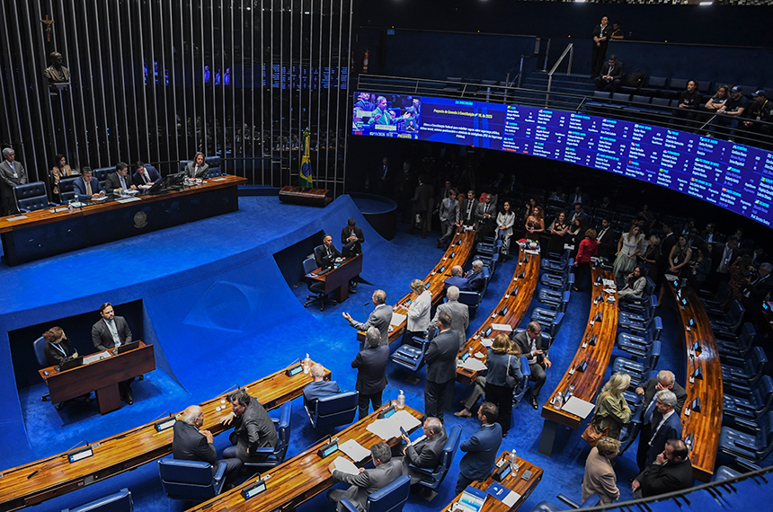
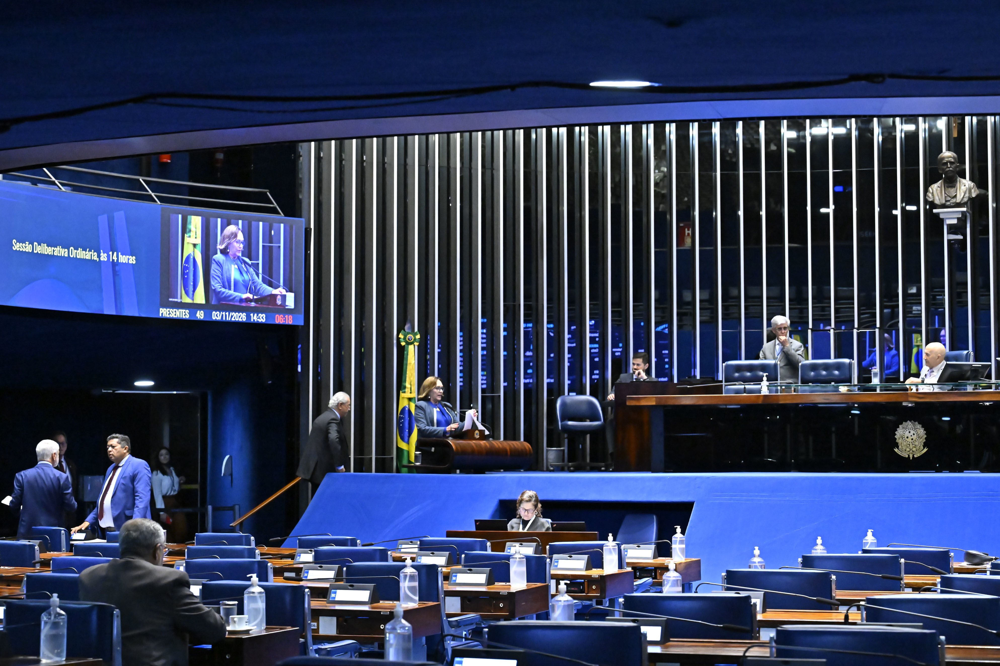
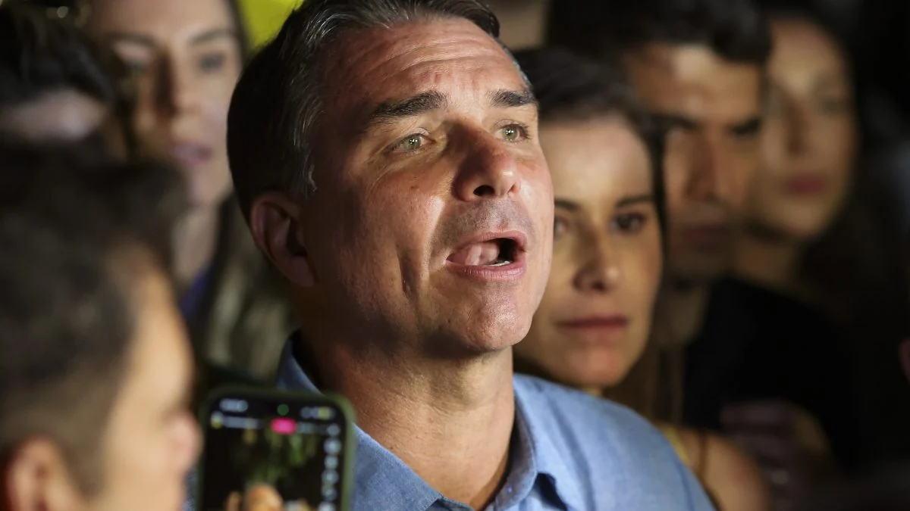
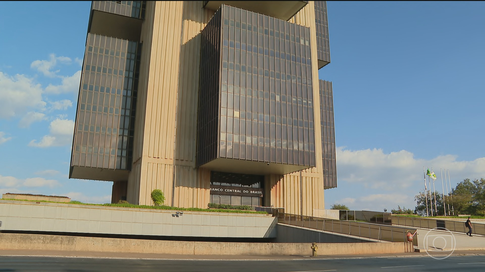
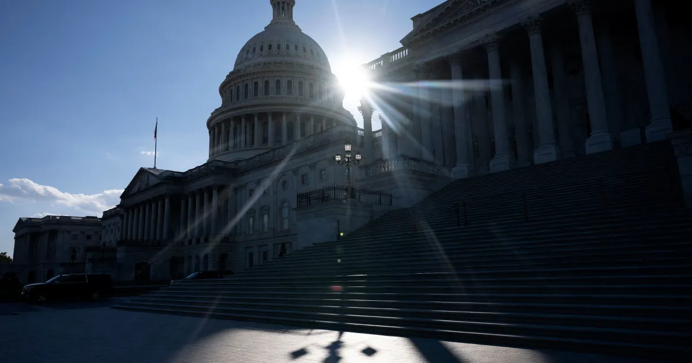
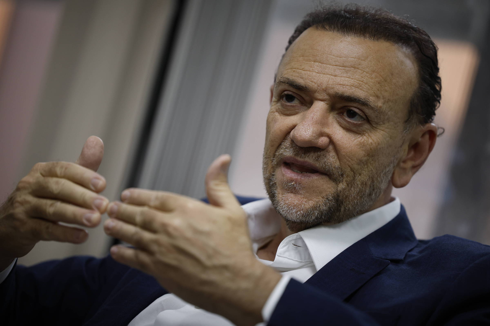

# Heimdall News — quarta-feira, 4 de novembro de 2026

10 assuntos · 29 veículos e fontes

_O vídeo deste briefing ainda não foi postado._

## Assuntos do dia

1. Senado aprova a Proposta de Emenda à Constituição da Segurança Pública, sem a redução da maioridade penal; texto vai à promulgação
2. Governo e oposição negociam votar a redução da maioridade penal no Senado ainda nesta semana
3. Supremo encerra audiência sobre a medida provisória que proibiu as bets; relator diz ter a percepção de que elas devem ser banidas
4. Presidência do Senado: PL deve lançar Rogério Marinho hoje, Tereza Cristina mantém a candidatura e Alcolumbre busca votos da direita
5. Flávio Bolsonaro vota dos Estados Unidos, defesa recorre contra Moraes e reportagem revela mensagem de Vorcaro
6. Banco Central decide os juros hoje em meio à divergência entre governo e mercado
7. Democratas conquistam a maioria nas duas casas do Congresso dos Estados Unidos; Brasil aguarda proposta sobre o tarifaço
8. Eduardo Paes retoma campanha por segundo turno no Rio; governador eleito fala em afronta à Justiça Eleitoral
9. Ministério da Justiça volta atrás e restabelece a classificação livre dos desenhos bíblicos da Record
10. Presidente do PT fala em divórcio com ala do partido; José Dirceu diz que a vitória não foi do PT

---

## 1. Senado aprova a Proposta de Emenda à Constituição da Segurança Pública, sem a redução da maioridade penal; texto vai à promulgação

_Imagem: [Agência Senado](https://www12.senado.leg.br/noticias/materias/2026/11/03/senado-aprova-pec-da-seguranca-publica-sem-reducao-da-maioridade-penal)_

_Cobertura (12): Imprensa mais à esquerda — Brasil de Fato, CartaCapital; Imprensa de centro / grandes veículos — CNN Brasil, Conjur, Folha, G1, JOTA, Poder360; Imprensa mais à direita — Gazeta do Povo; Fontes oficiais — Agência Câmara, Agência Senado, Senado — pauta do Plenário_

### O que aconteceu

O Senado aprovou a proposta em dois turnos, por 73 votos no primeiro e 75 no segundo, sem nenhum voto contrário. Por ter passado pelas duas Casas, ela será promulgada em sessão solene do Congresso. [[1]](https://www12.senado.leg.br/noticias/materias/2026/11/03/senado-aprova-pec-da-seguranca-publica-sem-reducao-da-maioridade-penal) [[2]](https://www25.senado.leg.br/web/atividade/materias/-/materia/172997#sessao-594169-item-594242)

Antes da votação, o Plenário separou do texto as duas emendas sobre maioridade penal, por 38 votos a 36, com uma abstenção. Elas passam a tramitar como propostas próprias. [[2]](https://www25.senado.leg.br/web/atividade/materias/-/materia/172997#sessao-594169-item-594242)

O texto põe o Sistema Único de Segurança Pública na Constituição, permite criar polícias municipais e prevê regras mais duras para integrantes de facções e milícias, como o cumprimento de pena em estabelecimentos de segurança máxima. [[1]](https://www12.senado.leg.br/noticias/materias/2026/11/03/senado-aprova-pec-da-seguranca-publica-sem-reducao-da-maioridade-penal)

Segundo a Folha, o presidente deve assinar nos próximos dias a medida provisória que cria o Ministério da Segurança Pública, com funcionamento pleno só em 2027. [[3]](https://www1.folha.uol.com.br/colunas/painel/2026/11/ministerio-da-seguranca-publica-pode-ficar-so-para-2027.shtml)

### Como cada campo político se posicionou

**Pró-governo**

- **Luiz Inácio Lula da Silva (PT), presidente da República**: Comemorou a aprovação e disse que vai somar a ela a criação do Ministério da Segurança Pública. [[4]](https://www.cartacapital.com.br/politica/lula-celebra-aprovacao-da-pec-da-seguranca-e-reforca-que-criara-ministerio/)
  > “Vamos somar a esse avanço a criação do Ministério da Segurança Pública, com foco em inteligência, planejamento e cooperação com estados e municípios para enfrentar as facções e as milícias” — [CartaCapital](https://www.cartacapital.com.br/politica/lula-celebra-aprovacao-da-pec-da-seguranca-e-reforca-que-criara-ministerio/)
- **Teresa Leitão (PT-PE), líder do governo no Senado**: Defendeu separar a maioridade penal e aprovar a parte em que há acordo. [[1]](https://www12.senado.leg.br/noticias/materias/2026/11/03/senado-aprova-pec-da-seguranca-publica-sem-reducao-da-maioridade-penal)
  > “A luta política sobre a PEC da segurança não existe. Todos concordamos com ela.” — [Agência Senado](https://www12.senado.leg.br/noticias/materias/2026/11/03/senado-aprova-pec-da-seguranca-publica-sem-reducao-da-maioridade-penal)
- **Bancada do PT no Senado (orientação)**: Orientou a favor da separação das emendas; os nove senadores do partido votaram assim. [[2]](https://www25.senado.leg.br/web/atividade/materias/-/materia/172997#sessao-594169-item-594242)
  > “Orientação PT: Sim” — [Senado — pauta do Plenário](https://www25.senado.leg.br/web/atividade/materias/-/materia/172997#sessao-594169-item-594242)
  > “Votos do PT: Sim 9” — [Senado — pauta do Plenário](https://www25.senado.leg.br/web/atividade/materias/-/materia/172997#sessao-594169-item-594242)

**Centro pró-governo**

- **Bancada do PSD no Senado (orientação)**: Orientou a favor da separação das emendas; dez senadores votaram sim e três votaram não. [[2]](https://www25.senado.leg.br/web/atividade/materias/-/materia/172997#sessao-594169-item-594242)
  > “Orientação PSD: Sim” — [Senado — pauta do Plenário](https://www25.senado.leg.br/web/atividade/materias/-/materia/172997#sessao-594169-item-594242)
  > “Votos do PSD: Sim 10, Não 3, não compareceu 1” — [Senado — pauta do Plenário](https://www25.senado.leg.br/web/atividade/materias/-/materia/172997#sessao-594169-item-594242)
- **Bancada do PSB no Senado (orientação)**: Orientou a favor da separação das emendas, com sete votos sim. [[2]](https://www25.senado.leg.br/web/atividade/materias/-/materia/172997#sessao-594169-item-594242)
  > “Orientação PSB: Sim” — [Senado — pauta do Plenário](https://www25.senado.leg.br/web/atividade/materias/-/materia/172997#sessao-594169-item-594242)
  > “Votos do PSB: Sim 7” — [Senado — pauta do Plenário](https://www25.senado.leg.br/web/atividade/materias/-/materia/172997#sessao-594169-item-594242)

**Centro**

- **Bancadas do União Brasil e do Podemos no Senado (orientação)**: O União Brasil orientou a favor da separação; o Podemos orientou contra. [[2]](https://www25.senado.leg.br/web/atividade/materias/-/materia/172997#sessao-594169-item-594242)
  > “Orientação UNIÃO: Sim” — [Senado — pauta do Plenário](https://www25.senado.leg.br/web/atividade/materias/-/materia/172997#sessao-594169-item-594242)
  > “Orientação Podemos: Não” — [Senado — pauta do Plenário](https://www25.senado.leg.br/web/atividade/materias/-/materia/172997#sessao-594169-item-594242)

**Centro-oposição**

- **Bancada do PSDB no Senado (orientação)**: Orientou contra a separação das emendas; três senadores votaram não e um votou sim. [[2]](https://www25.senado.leg.br/web/atividade/materias/-/materia/172997#sessao-594169-item-594242)
  > “Orientação PSDB: Não” — [Senado — pauta do Plenário](https://www25.senado.leg.br/web/atividade/materias/-/materia/172997#sessao-594169-item-594242)
  > “Votos do PSDB: Sim 1, Não 3” — [Senado — pauta do Plenário](https://www25.senado.leg.br/web/atividade/materias/-/materia/172997#sessao-594169-item-594242)

**Oposição ao governo**

- **Rogério Marinho (PL-RN), líder da oposição no Senado**: Disse que a separação impediria a discussão das emendas e criticou a proposta do relator. [[1]](https://www12.senado.leg.br/noticias/materias/2026/11/03/senado-aprova-pec-da-seguranca-publica-sem-reducao-da-maioridade-penal)
  > “O relator propõe que, na prática, este Plenário seja cerceado, seja emudecido, que haja uma procrastinação” — [Agência Senado](https://www12.senado.leg.br/noticias/materias/2026/11/03/senado-aprova-pec-da-seguranca-publica-sem-reducao-da-maioridade-penal)
- **Efraim Filho (PL-PB), senador**: Afirmou que a maioridade penal não é matéria estranha ao texto. [[1]](https://www12.senado.leg.br/noticias/materias/2026/11/03/senado-aprova-pec-da-seguranca-publica-sem-reducao-da-maioridade-penal)
  > “Aqui a gente sabe o que é jabuti, a gente já lidou com muitos deles diversas vezes, e este não é um caso de matéria estranha” — [Agência Senado](https://www12.senado.leg.br/noticias/materias/2026/11/03/senado-aprova-pec-da-seguranca-publica-sem-reducao-da-maioridade-penal)
- **Bancadas do PL e do Republicanos no Senado (orientação)**: Orientaram contra a separação; a bancada do PL teve doze votos não e o Republicanos, seis. Na votação da proposta, orientaram a favor. [[2]](https://www25.senado.leg.br/web/atividade/materias/-/materia/172997#sessao-594169-item-594242)
  > “Votos do PL: Não 12, Abstenção 1” — [Senado — pauta do Plenário](https://www25.senado.leg.br/web/atividade/materias/-/materia/172997#sessao-594169-item-594242)
  > “Votos do REPUBLICANOS: Não 6” — [Senado — pauta do Plenário](https://www25.senado.leg.br/web/atividade/materias/-/materia/172997#sessao-594169-item-594242)
  > “Orientação Oposição: Sim” — [Senado — pauta do Plenário](https://www25.senado.leg.br/web/atividade/materias/-/materia/172997#sessao-594169-item-594242)

**Outros / não classificável**

- **Fórum Brasileiro de Segurança Pública**: O Fórum Brasileiro de Segurança Pública comemorou a aprovação, disse que ela não basta para os problemas estruturais e defendeu recriar o ministério. [[5]](https://g1.globo.com/sp/sao-paulo/noticia/2026/11/03/forum-brasileiro-de-seguranca-publica-celebra-aprovacao-da-pec-da-seguranca-mas-diz-que-texto-nao-resolve-problemas-estruturais.ghtml)
  > “afirmou que a medida, isoladamente, não será suficiente para resolver os problemas estruturais da área” — [G1](https://g1.globo.com/sp/sao-paulo/noticia/2026/11/03/forum-brasileiro-de-seguranca-publica-celebra-aprovacao-da-pec-da-seguranca-mas-diz-que-texto-nao-resolve-problemas-estruturais.ghtml)

_Sem posicionamento encontrado: Independente — Missão / MBL._

Referências:

1. [Senado aprova PEC da Segurança Pública sem redução da maioridade penal](https://www12.senado.leg.br/noticias/materias/2026/11/03/senado-aprova-pec-da-seguranca-publica-sem-reducao-da-maioridade-penal) — Agência Senado, 03/11 19:59
2. [Senado: Proposta de Emenda à Constituição n° 18, de 2025 — PEC da Segurança Pública](https://www25.senado.leg.br/web/atividade/materias/-/materia/172997#sessao-594169-item-594242) — Senado — pauta do Plenário, 03/11 14:00
3. [Ministério da Segurança Pública deve ficar só para 2027](https://www1.folha.uol.com.br/colunas/painel/2026/11/ministerio-da-seguranca-publica-pode-ficar-so-para-2027.shtml) — Folha, 03/11 15:14
4. [Lula celebra aprovação da PEC da Segurança e reforça que criará ministério](https://www.cartacapital.com.br/politica/lula-celebra-aprovacao-da-pec-da-seguranca-e-reforca-que-criara-ministerio/) — CartaCapital, 03/11 21:17
5. [Fórum Brasileiro de Segurança Pública celebra aprovação da PEC da Segurança, mas diz que texto não resolve problemas estruturais](https://g1.globo.com/sp/sao-paulo/noticia/2026/11/03/forum-brasileiro-de-seguranca-publica-celebra-aprovacao-da-pec-da-seguranca-mas-diz-que-texto-nao-resolve-problemas-estruturais.ghtml) — G1, 03/11 19:48

Outras matérias sobre o tema:

- [Em vitória do governo, Senado aprova PEC da Segurança Pública; texto vai a promulgação](https://g1.globo.com/politica/noticia/2026/11/03/senado-aprova-pec-da-seguranca-publica.ghtml) — G1, 03/11 19:06
- [Senado aprova plano federal para reforçar combate ao crime organizado no Brasil](https://www.gazetadopovo.com.br/republica/senado-aprova-plano-federal-para-reforcar-combate-ao-crime-organizado-no-brasil/) — Gazeta do Povo, 03/11 23:08
- [Senado aprova PEC da Segurança Pública sem a redução da maioridade penal](https://www.gazetadopovo.com.br/republica/senado-aprova-pec-seguranca-publica-sem-reducao-da-maioridade-penal/) — Gazeta do Povo, 03/11 21:55
- [Senado aprova PEC da Segurança Pública sem redução da maioridade penal](https://conjur.com.br/2026-nov-03/senado-aprova-pec-da-seguranca-publica-sem-reducao-da-maioridade-penal/) — Conjur, 03/11 20:57
- [Senado aprova PEC da Segurança sem reduzir maioridade penal](https://www.jota.info/legislativo/senado-aprova-pec-da-seguranca-sem-reduzir-maioridade-penal) — JOTA, 03/11 19:56
- [Em vitória do governo, Senado aprova PEC da Segurança Pública sem redução da maioridade](https://www.cartacapital.com.br/politica/senado-aprova-texto-da-pec-da-seguranca-publica/) — CartaCapital, 03/11 18:50
- [Em vitória de Lula: Senado aprova PEC da Segurança Pública em dois turnos](https://www.brasildefato.com.br/2026/11/03/em-vitoria-de-lula-senado-aprova-pec-da-seguranca-publica-em-dois-turnos/) — Brasil de Fato, 03/11 20:20
- [Senado conclui votação da PEC da Segurança; veja como ficou texto](https://g1.globo.com/politica/noticia/2026/11/03/senado-conclui-votacao-da-pec-da-seguranca-veja-como-ficou-texto.ghtml) — G1, 03/11 20:02
- [PEC da Segurança Pública: como votaram senadores e partidos nos dois turnos](https://g1.globo.com/politica/votacoes-no-congresso/noticia/2026/11/03/pec-seguranca-publica-como-votaram-senadores-partidos.ghtml) — G1, 03/11 19:06
- [Como votou cada senador na PEC da Segurança Pública](https://www.gazetadopovo.com.br/republica/como-votou-cada-senador-na-pec-da-seguranca-publica/) — Gazeta do Povo, 03/11 19:47
- [PEC da Segurança: saiba como votou cada senador sobre a maioridade penal](https://www.poder360.com.br/poder-congresso/pec-da-seguranca-saiba-como-votou-cada-senador-sobre-a-maioridade-penal/) — Poder360, 03/11 23:51
- [Saiba o que muda com a PEC da Segurança Pública](https://www.poder360.com.br/poder-congresso/saiba-o-que-muda-com-a-pec-da-seguranca-publica/) — Poder360, 04/11 01:01
- [Aprovação da PEC da Segurança abre caminho para Lula criar ministério](https://www.cnnbrasil.com.br/politica/aprovacao-da-pec-da-seguranca-abre-caminho-para-lula-criar-ministerio/) — CNN Brasil, 04/11 03:50
- [Ministro da Segurança deve ter perfil técnico e político, diz especialista](https://www.cnnbrasil.com.br/politica/ministro-da-seguranca-deve-ter-perfil-tecnico-e-politico-diz-especialista/) — CNN Brasil, 04/11 03:50
- [Hugo Motta destaca aprovação da PEC da Segurança Pública pelo Senado](https://www.camara.leg.br/noticias/1315533-hugo-motta-destaca-aprovacao-da-pec-da-seguranca-publica-pelo-senado) — Agência Câmara, 03/11 20:31
- [Senado aprova PEC da Segurança sem redução da maioridade penal](https://www.camara.leg.br/noticias/1315539-senado-aprova-pec-da-seguranca-sem-reducao-da-maioridade-penal) — Agência Câmara, 03/11 20:54

---

## 2. Governo e oposição negociam votar a redução da maioridade penal no Senado ainda nesta semana

_Imagem: [G1](https://g1.globo.com/politica/noticia/2026/11/04/em-acordo-senado-tentara-votar-reducao-da-maioridade-penal-ainda-nesta-semana.ghtml)_

_Cobertura (10): Imprensa mais à esquerda — Brasil de Fato; Imprensa de centro / grandes veículos — CNN Brasil, Correio da Manhã, Folha, G1, Poder360; Imprensa mais à direita — Gazeta do Povo; Fontes oficiais — Agência Câmara, Agência Senado, Senado — proposições_

### O que aconteceu

Líderes combinaram acelerar a votação, com um pedido de calendário especial previsto para hoje. A ideia é levar o tema direto ao Plenário, em dois turnos. [[1]](https://g1.globo.com/politica/noticia/2026/11/04/em-acordo-senado-tentara-votar-reducao-da-maioridade-penal-ainda-nesta-semana.ghtml) [[2]](https://www.cnnbrasil.com.br/politica/governo-e-oposicao-articulam-para-votar-reducao-da-maioridade-nesta-semana/)

Há dois textos. O do líder do PT reduz a idade para 16 anos só em crimes hediondos. O do líder da oposição fixa 16 anos como regra geral e 14 anos para crimes hediondos, tortura, tráfico, terrorismo e organização criminosa. [[3]](https://www.poder360.com.br/poder-congresso/pt-e-pl-negociam-texto-comum-para-reduzir-maioridade-penal/)

Segundo a Folha, o tema não é consenso no PT. Ainda de acordo com o líder do PL, os presidentes do Senado e da Câmara conversaram para dar rapidez à tramitação entre os deputados. [[4]](https://www1.folha.uol.com.br/colunas/painel/2026/11/governo-e-oposicao-fecham-acordo-para-votar-reducao-da-maioridade-penal-mas-tema-ainda-divide-pt.shtml) [[3]](https://www.poder360.com.br/poder-congresso/pt-e-pl-negociam-texto-comum-para-reduzir-maioridade-penal/)

Foi protocolada no Senado a Proposta de Emenda à Constituição 20 de 2026, sobre a menoridade penal. Na Câmara, uma comissão especial sobre o tema vota hoje pedidos de debates. [[5]](https://www25.senado.leg.br/web/atividade/materias/-/materia/176179) [[6]](https://www.camara.leg.br/noticias/1315354-comissao-sobre-reducao-da-maioridade-civil-e-penal-vota-nesta-quarta-pedidos-para-realizar-debates)

### Como cada campo político se posicionou

**Pró-governo**

- **Eduardo Braga (MDB-AM), líder do MDB no Senado**: Sugeriu pedir urgência hoje e votar o texto do líder do PT, que ele disse construir o entendimento. [[1]](https://g1.globo.com/politica/noticia/2026/11/04/em-acordo-senado-tentara-votar-reducao-da-maioridade-penal-ainda-nesta-semana.ghtml)
  > “a PEC de autoria do senador Camilo Santana, que estabelece maioridade penal a partir de 16 anos para crimes hediondos, que me parece que constrói o entendimento” — [G1](https://g1.globo.com/politica/noticia/2026/11/04/em-acordo-senado-tentara-votar-reducao-da-maioridade-penal-ainda-nesta-semana.ghtml)
- **Camilo Santana (PT-CE), líder do PT no Senado**: Apresentou a emenda que reduz a idade para 16 anos apenas em crimes hediondos. [[7]](https://www12.senado.leg.br/noticias/materias/2026/11/03/senado-aprova-pec-da-seguranca-publica-sem-reducao-da-maioridade-penal)
  > “Pelo texto, a redução para 16 anos valeria apenas para os crimes hediondos.” — [Agência Senado](https://www12.senado.leg.br/noticias/materias/2026/11/03/senado-aprova-pec-da-seguranca-publica-sem-reducao-da-maioridade-penal)

**Oposição ao governo**

- **Carlos Portinho (PL-RJ), líder do PL no Senado**: Disse que vai defender os 14 anos e que as duas propostas convergem na redução. [[1]](https://g1.globo.com/politica/noticia/2026/11/04/em-acordo-senado-tentara-votar-reducao-da-maioridade-penal-ainda-nesta-semana.ghtml)
  > “Ambas as propostas convergem na redução da maioridade penal. E isso é um grande avanço” — [G1](https://g1.globo.com/politica/noticia/2026/11/04/em-acordo-senado-tentara-votar-reducao-da-maioridade-penal-ainda-nesta-semana.ghtml)
- **Marcos Rogério (PL-RO), senador**: Sugeriu aprovar na mesma sessão a ampliação da internação em unidades socioeducativas, de 3 para 10 anos. [[4]](https://www1.folha.uol.com.br/colunas/painel/2026/11/governo-e-oposicao-fecham-acordo-para-votar-reducao-da-maioridade-penal-mas-tema-ainda-divide-pt.shtml)
  > “mas não dá para colocar jovens de 15, 16 anos em presídios ao lado de integrantes de facções criminosas” — [Folha](https://www1.folha.uol.com.br/colunas/painel/2026/11/governo-e-oposicao-fecham-acordo-para-votar-reducao-da-maioridade-penal-mas-tema-ainda-divide-pt.shtml)
- **Damares Alves (Republicanos-DF), senadora**: Questionou a pressa e defendeu discutir antes o sistema atual. [[4]](https://www1.folha.uol.com.br/colunas/painel/2026/11/governo-e-oposicao-fecham-acordo-para-votar-reducao-da-maioridade-penal-mas-tema-ainda-divide-pt.shtml)
  > “Não acho que o debate deve ser feito de forma acelerada, açodada.” — [Folha](https://www1.folha.uol.com.br/colunas/painel/2026/11/governo-e-oposicao-fecham-acordo-para-votar-reducao-da-maioridade-penal-mas-tema-ainda-divide-pt.shtml)

**Independente — Missão / MBL**

- **Kim Kataguiri (Missão-SP), deputado**: Está entre os apoiadores da proposta, em tramitação na Câmara, que reduz a idade penal de 18 para 16 anos, segundo reportagem de junho. Não foi encontrada declaração dele nesta semana. [[8]](https://www.correiodamanha.com.br/nacional/sao-paulo/estado-de-sao-paulo/2026/06/292538-pec-da-maioridade-penal.html)
  > “conta com o apoio de 22 deputados federais eleitos por São Paulo, entre eles o pretenso candidato ao Governo de SP, Kim Kataguiri (Missão)” — [Correio da Manhã](https://www.correiodamanha.com.br/nacional/sao-paulo/estado-de-sao-paulo/2026/06/292538-pec-da-maioridade-penal.html)

_Sem posicionamento encontrado: Centro pró-governo, Centro, Centro-oposição, Outros / não classificável._

Referências:

1. [Em acordo, Senado tentará votar redução da maioridade penal ainda nesta semana](https://g1.globo.com/politica/noticia/2026/11/04/em-acordo-senado-tentara-votar-reducao-da-maioridade-penal-ainda-nesta-semana.ghtml) — G1, 04/11 00:00
2. [Governo e oposição articulam para votar redução da maioridade nesta semana](https://www.cnnbrasil.com.br/politica/governo-e-oposicao-articulam-para-votar-reducao-da-maioridade-nesta-semana/) — CNN Brasil, 04/11 03:30
3. [PT e PL negociam texto comum para reduzir maioridade penal](https://www.poder360.com.br/poder-congresso/pt-e-pl-negociam-texto-comum-para-reduzir-maioridade-penal/) — Poder360, 04/11 00:33
4. [Governo e oposição fecham acordo para votar redução da maioridade penal, mas tema ainda divide PT](https://www1.folha.uol.com.br/colunas/painel/2026/11/governo-e-oposicao-fecham-acordo-para-votar-reducao-da-maioridade-penal-mas-tema-ainda-divide-pt.shtml) — Folha, 03/11 21:26
5. [PEC 20/2026: Dá nova redação ao art. 228 da Constituição Federal para alterar a menoridade penal.](https://www25.senado.leg.br/web/atividade/materias/-/materia/176179) — Senado — proposições, 03/11 12:00
6. [Comissão sobre redução da maioridade civil e penal vota nesta quarta pedidos para realizar debates](https://www.camara.leg.br/noticias/1315354-comissao-sobre-reducao-da-maioridade-civil-e-penal-vota-nesta-quarta-pedidos-para-realizar-debates) — Agência Câmara, 03/11 16:24
7. [Senado aprova PEC da Segurança Pública sem redução da maioridade penal](https://www12.senado.leg.br/noticias/materias/2026/11/03/senado-aprova-pec-da-seguranca-publica-sem-reducao-da-maioridade-penal) — Agência Senado, 03/11 19:59
8. [PEC da Maioridade Penal](https://www.correiodamanha.com.br/nacional/sao-paulo/estado-de-sao-paulo/2026/06/292538-pec-da-maioridade-penal.html) — Correio da Manhã

Outras matérias sobre o tema:

- [Senado Federal decide votar PEC da Segurança sem discutir redução da maioridade penal](https://g1.globo.com/politica/noticia/2026/11/03/senado-federal-decide-votar-pec-da-seguranca-sem-discutir-reducao-da-maioridade-penal.ghtml) — G1, 03/11 18:52
- [Governo quer evitar votação da redução da maioridade penal; líder da oposição no Senado pretende insistir na proposta](https://g1.globo.com/politica/noticia/2026/11/03/lider-da-oposicao-no-senado-diz-que-vai-votar-a-favor-da-pec-da-seguranca-mas-insistira-na-reducao-da-maioridade-penal.ghtml) — G1, 03/11 13:23
- [Ministro de Lula diz que governo votará PEC da Segurança sem redução da maioridade penal](https://www.gazetadopovo.com.br/republica/ministro-de-lula-diz-que-governo-votara-pec-da-seguranca-sem-reducao-da-maioridade-penal/) — Gazeta do Povo, 03/11 13:19
- [Governo Lula quer aprovar PEC da Segurança Pública sem incluir redução da maioridade penal](https://www.brasildefato.com.br/2026/11/03/governo-lula-quer-aprovar-pec-da-seguranca-publica-sem-incluir-reducao-da-maioridade-penal/) — Brasil de Fato, 03/11 13:29

---

## 3. Supremo encerra audiência sobre a medida provisória que proibiu as bets; relator diz ter a percepção de que elas devem ser banidas

_Imagem: [STF — notícias oficiais](https://noticias.stf.jus.br/postsnoticias/proibicao-das-bets-governo-defende-medida-e-setor-esportivo-alerta-para-prejuizos/)_

_Cobertura (9): Imprensa mais à esquerda — Brasil de Fato, CartaCapital; Imprensa de centro / grandes veículos — Estadão, Folha, G1, JOTA; Imprensa mais à direita — Gazeta do Povo, Revista Oeste; Fontes oficiais — STF — notícias oficiais_

### O que aconteceu

O ministro Luiz Fux conduziu ontem a segunda audiência pública sobre as apostas online. Entre os participantes, 21 eram favoráveis à retomada das atividades do setor e seis defendiam a proibição, segundo o JOTA. [[1]](https://noticias.stf.jus.br/postsnoticias/proibicao-das-bets-governo-defende-medida-e-setor-esportivo-alerta-para-prejuizos/) [[2]](https://www.jota.info/stf/do-supremo/em-audiencia-publica-fux-diz-ter-percepcao-de-que-as-bets-devem-ser-banidas)

A medida provisória foi publicada em 25 de setembro, completou 40 dias sem relator no Congresso e deixa de valer se não for aprovada até março. [[3]](https://www.estadao.com.br/politica/coluna-do-estadao/mp-das-bets-completa-40-dias-sem-relator-no-congresso/)

Segundo a Folha, o governo aposta numa decisão que declare inconstitucional a lei de 2018; o julgamento ainda não tem data. [[4]](https://www1.folha.uol.com.br/colunas/painel/2026/11/governo-aposta-no-stf-para-derrubar-as-bets-e-evitar-disputa-no-congresso.shtml)

### Como cada campo político se posicionou

**Pró-governo**

- **Luiz Inácio Lula da Silva (PT), presidente da República**: Pediu mobilização e disse que há mais participantes interessados na volta das bets do que contrários a ela. [[5]](https://www.cartacapital.com.br/politica/lula-pede-mobilizacao-para-manter-a-proibicao-das-bets-no-brasil/)
  > “me parece que tem mais gente participando que interessa que as bets continuem funcionando do que as pessoas que são contra as bets” — [CartaCapital](https://www.cartacapital.com.br/politica/lula-pede-mobilizacao-para-manter-a-proibicao-das-bets-no-brasil/)
- **Alexandre Padilha (PT), ministro da Saúde**: Defendeu a proibição como resposta aos danos à saúde. [[6]](https://www.cartacapital.com.br/justica/stf-encerra-audiencia-sobre-proibicao-das-bets-com-divergencias-sobre-mp/)
  > “a única e melhor solução para evitar suicídio, evitar violência familiar, evitar endividamento é a proibição das bets” — [CartaCapital](https://www.cartacapital.com.br/justica/stf-encerra-audiencia-sobre-proibicao-das-bets-com-divergencias-sobre-mp/)
- **Jorge Messias, advogado-geral da União**: Defendeu que a medida é constitucional e que a regulamentação anterior não protegeu as famílias. [[1]](https://noticias.stf.jus.br/postsnoticias/proibicao-das-bets-governo-defende-medida-e-setor-esportivo-alerta-para-prejuizos/)
  > “defendeu a constitucionalidade da MP 1.394/2026” — [STF — notícias oficiais](https://noticias.stf.jus.br/postsnoticias/proibicao-das-bets-governo-defende-medida-e-setor-esportivo-alerta-para-prejuizos/)

**Oposição ao governo**

- **Oposição no Congresso**: Segundo a Folha, articula derrubar a medida no Congresso e discute como retomar ao menos as apostas esportivas. [[4]](https://www1.folha.uol.com.br/colunas/painel/2026/11/governo-aposta-no-stf-para-derrubar-as-bets-e-evitar-disputa-no-congresso.shtml)
  > “a oposição se articula no Congresso Nacional para derrubar a MP editada por Lula durante a campanha eleitoral” — [Folha](https://www1.folha.uol.com.br/colunas/painel/2026/11/governo-aposta-no-stf-para-derrubar-as-bets-e-evitar-disputa-no-congresso.shtml)
  > “discute estratégias para retomar ao menos as apostas esportivas” — [Folha](https://www1.folha.uol.com.br/colunas/painel/2026/11/governo-aposta-no-stf-para-derrubar-as-bets-e-evitar-disputa-no-congresso.shtml)

**Outros / não classificável**

- **Luiz Fux, ministro do Supremo Tribunal Federal e relator**: Disse ter a percepção de que as bets devem ser banidas e citou a necessidade de acordo ou modulação. [[2]](https://www.jota.info/stf/do-supremo/em-audiencia-publica-fux-diz-ter-percepcao-de-que-as-bets-devem-ser-banidas)
  > “Ele sinalizou, no entanto, que será preciso um acordo mínimo ou modulação dos efeitos da decisão para evitar insegurança jurídica.” — [JOTA](https://www.jota.info/stf/do-supremo/em-audiencia-publica-fux-diz-ter-percepcao-de-que-as-bets-devem-ser-banidas)
- **Flávio de Araújo Willeman, vice-presidente do Flamengo**: O vice-presidente do clube criticou a medida e citou contratos de patrocínio já assinados. [[1]](https://noticias.stf.jus.br/postsnoticias/proibicao-das-bets-governo-defende-medida-e-setor-esportivo-alerta-para-prejuizos/)
  > “criticou a MP que proibiu as bets e afirmou que o clube celebrou seus contratos de patrocínio com duas casas” — [STF — notícias oficiais](https://noticias.stf.jus.br/postsnoticias/proibicao-das-bets-governo-defende-medida-e-setor-esportivo-alerta-para-prejuizos/)
- **Ana Clara Marques de Barros Santos, da Associação Internacional de Gaming**: Defendeu a permissão com regulamentação. [[6]](https://www.cartacapital.com.br/justica/stf-encerra-audiencia-sobre-proibicao-das-bets-com-divergencias-sobre-mp/)
  > “protege o apostador e garante segurança jurídica” — [CartaCapital](https://www.cartacapital.com.br/justica/stf-encerra-audiencia-sobre-proibicao-das-bets-com-divergencias-sobre-mp/)

_Sem posicionamento encontrado: Centro pró-governo, Centro, Centro-oposição, Independente — Missão / MBL._

Referências:

1. [Proibição das bets: governo defende medida, e setor esportivo alerta para prejuízos](https://noticias.stf.jus.br/postsnoticias/proibicao-das-bets-governo-defende-medida-e-setor-esportivo-alerta-para-prejuizos/) — STF — notícias oficiais, 03/11 14:15
2. [Em audiência pública, Fux diz ter ‘percepção de que as bets devem ser banidas’](https://www.jota.info/stf/do-supremo/em-audiencia-publica-fux-diz-ter-percepcao-de-que-as-bets-devem-ser-banidas) — JOTA, 03/11 12:39
3. [MP das bets completa 40 dias sem relator no Congresso](https://www.estadao.com.br/politica/coluna-do-estadao/mp-das-bets-completa-40-dias-sem-relator-no-congresso/) — Estadão, 03/11 15:39
4. [Governo aposta no STF para derrubar as bets e evitar disputa no Congresso](https://www1.folha.uol.com.br/colunas/painel/2026/11/governo-aposta-no-stf-para-derrubar-as-bets-e-evitar-disputa-no-congresso.shtml) — Folha, 03/11 20:13
5. [Lula pede mobilização para manter a proibição das bets no Brasil](https://www.cartacapital.com.br/politica/lula-pede-mobilizacao-para-manter-a-proibicao-das-bets-no-brasil/) — CartaCapital, 03/11 12:32
6. [STF encerra audiência sobre proibição das bets com divergências sobre MP](https://www.cartacapital.com.br/justica/stf-encerra-audiencia-sobre-proibicao-das-bets-com-divergencias-sobre-mp/) — CartaCapital, 03/11 20:51

Outras matérias sobre o tema:

- [Proibição das bets: autoridades e especialistas discutem riscos à saúde e avanço do mercado ilegal](https://noticias.stf.jus.br/postsnoticias/proibicao-das-bets-autoridades-e-especialistas-discutem-riscos-a-saude-e-avanco-do-mercado-ilegal/) — STF — notícias oficiais, 03/11 21:47
- [Audiência pública no STF discute impactos da medida provisória que proibiu bets no Brasil](https://noticias.stf.jus.br/postsnoticias/audiencia-publica-no-stf-discute-impactos-da-medida-provisoria-que-proibiu-bets-no-brasil/) — STF — notícias oficiais, 03/11 12:47
- [Bets: governo defende proibição e times enumeram prejuízos dos campos às Olimpíadas](https://www.jota.info/stf/do-supremo/bets-governo-defende-proibicao-e-times-enumeram-prejuizos-dos-campos-as-olimpiadas) — JOTA, 03/11 20:55
- [Fux defende banimento das bets e aponta desafios jurídicos para a proibição no Brasil](https://www.gazetadopovo.com.br/republica/fux-diz-que-bets-devem-ser-banidas-e-defende-proibicao-das-apostas-no-brasil/) — Gazeta do Povo, 03/11 15:42
- [Fux diz que STF já ouviu — há dois anos — entidades contrárias às bets](https://www.cartacapital.com.br/economia/fux-diz-que-stf-ja-ouviu-ha-dois-anos-entidades-contrarias-as-bets/) — CartaCapital, 03/11 11:49
- [Janja entrega a Fux relatório sobre bets em audiência no STF: ‘Mulheres sentem peso do vício’](https://www.estadao.com.br/politica/janja-entrega-a-fux-relatorio-sobre-bets-em-audiencia-no-stf-nprp/) — Estadão, 03/11 16:09
- [Janja e Paula Lavigne vão a audiência pública sobre bets no STF](https://www.gazetadopovo.com.br/republica/janja-e-paula-lavigne-participam-de-audiencia-sobre-bets-no-stf/) — Gazeta do Povo, 03/11 10:37
- [Lula e aliados convocam pressão nas redes durante audiência no STF sobre bets](https://www.gazetadopovo.com.br/republica/lula-e-aliados-convocam-pressao-nas-redes-durante-audiencia-no-stf-sobre-bets/) — Gazeta do Povo, 03/11 11:33
- [Cruzeiro critica proibição das bets no STF; governo federal aponta danos à saúde pública](https://www.brasildefato.com.br/2026/11/03/cruzeiro-critica-proibicao-das-bets-no-stf-governo-federal-aponta-danos-a-saude-publica/) — Brasil de Fato, 03/11 19:27
- [Fux sinaliza apoio à proibição das bets em audiência marcada por pressão de clubes de futebol](https://www.brasildefato.com.br/2026/11/03/fux-sinaliza-apoio-a-proibicao-das-bets-em-audiencia-marcada-por-pressao-de-clubes-de-futebol/) — Brasil de Fato, 03/11 17:48
- [Ministro aponta ligação entre bets e crime organizado](https://www.brasildefato.com.br/2026/11/03/ministro-aponta-ligacao-entre-bets-e-crime-organizado/) — Brasil de Fato, 03/11 21:29
- [Lobbies de apostas pressionam o Congresso e STF contra proibição das bets, alerta cientista político](https://www.brasildefato.com.br/2026/11/03/lobbies-de-apostas-pressionam-o-congresso-e-stf-contra-proibicao-das-bets-alerta-cientista-politico/) — Brasil de Fato, 03/11 15:55
- [‘Sociedade civil não pode permitir continuidade das bets’, diz Lula em dia de audiência no STF](https://www.brasildefato.com.br/2026/11/03/sociedade-civil-nao-pode-permitir-continuidade-das-bets-diz-lula-em-dia-de-audiencia-no-stf/) — Brasil de Fato, 03/11 10:53
- [Governo Lula nega acesso a documentos sobre Desenrola e fim das bets](https://revistaoeste.com/politica/governo-lula-nega-acesso-a-documentos-sobre-desenrola-e-fim-das-bets/) — Revista Oeste, 03/11 23:30
- [Proibir ou regular as bets: qual o caminho mais eficiente?](https://www.jota.info/opiniao-e-analise/colunas/direito-economia-mercado/proibir-ou-regular-as-bets-qual-o-caminho-mais-eficiente) — JOTA, 03/11 13:18
- [Fux cita críticas nas redes e diz que STF já discutiu consequências nocivas das bets](https://g1.globo.com/politica/noticia/2026/11/03/fux-cita-criticas-nas-redes-e-diz-que-stf-ja-discutiu-consequencias-nocivas-das-bets.ghtml) — G1, 03/11 10:33

---

## 4. Presidência do Senado: PL deve lançar Rogério Marinho hoje, Tereza Cristina mantém a candidatura e Alcolumbre busca votos da direita

_Imagem: [CNN Brasil](https://www.cnnbrasil.com.br/politica/pl-deve-anunciar-marinho-ao-senado-e-decisao-sobre-camara-segue-indefinida/)_

_Cobertura (9): Imprensa mais à esquerda — CartaCapital; Imprensa de centro / grandes veículos — CNN Brasil, Estadão, Folha, G1, JOTA; Imprensa mais à direita — Gazeta do Povo; Fontes oficiais — Agência Câmara, Agência Senado_

### O que aconteceu

O PL prevê anunciar hoje a candidatura de Marinho, depois de reunião às 11h. A eleição será em fevereiro de 2027, e são precisos 41 votos. [[1]](https://www.cnnbrasil.com.br/politica/pl-deve-anunciar-marinho-ao-senado-e-decisao-sobre-camara-segue-indefinida/) [[2]](https://www.jota.info/legislativo/marinho-diz-que-ele-e-tereza-cristina-nao-disputarao-presidencia-um-contra-o-outro)

O senador Eduardo Braga foi escolhido relator-geral do Orçamento de 2027. Segundo o G1, ele é próximo de Alcolumbre e já tinha anunciado apoio à reeleição. [[3]](https://www12.senado.leg.br/noticias/materias/2026/11/03/eduardo-braga-sera-o-relator-geral-do-projeto-de-lei-do-orcamento-2027) [[4]](https://g1.globo.com/politica/noticia/2026/11/03/alcolumbre-escolhe-aliado-para-relatoria-do-orcamento-em-meio-a-articulacao-pela-reeleicao-no-senado.ghtml)

O PL terá a maior bancada do Senado a partir de 2027. O número varia entre as fontes: 29 cadeiras no G1 e 28 na CNN. [[4]](https://g1.globo.com/politica/noticia/2026/11/03/alcolumbre-escolhe-aliado-para-relatoria-do-orcamento-em-meio-a-articulacao-pela-reeleicao-no-senado.ghtml) [[1]](https://www.cnnbrasil.com.br/politica/pl-deve-anunciar-marinho-ao-senado-e-decisao-sobre-camara-segue-indefinida/)

Na Câmara, a posição do PL segue indefinida, e o anúncio ficou para depois de uma reunião marcada para a próxima quarta-feira, dia 11. [[1]](https://www.cnnbrasil.com.br/politica/pl-deve-anunciar-marinho-ao-senado-e-decisao-sobre-camara-segue-indefinida/)

### Como cada campo político se posicionou

**Pró-governo**

- **Senadores do PT**: Segundo a Gazeta do Povo, senadores petistas rejeitam negociar anistia em troca de apoio na eleição. [[5]](https://www.gazetadopovo.com.br/republica/davi-alcolumbre-acena-com-anistia-a-bolsonaro-para-garantir-comando-do-senado/)
  > “Senadores petistas afirmam que o país não pode ser governado como um balcão de favores” — [Gazeta do Povo](https://www.gazetadopovo.com.br/republica/davi-alcolumbre-acena-com-anistia-a-bolsonaro-para-garantir-comando-do-senado/)
- **Eduardo Braga (MDB-AM), senador**: Disse que seu foco como relator será garantir recursos para áreas essenciais, com equilíbrio fiscal. [[3]](https://www12.senado.leg.br/noticias/materias/2026/11/03/eduardo-braga-sera-o-relator-geral-do-projeto-de-lei-do-orcamento-2027)
  > “compromisso com o equilíbrio fiscal e a responsabilidade com o dinheiro de cada brasileiro” — [Agência Senado](https://www12.senado.leg.br/noticias/materias/2026/11/03/eduardo-braga-sera-o-relator-geral-do-projeto-de-lei-do-orcamento-2027)

**Centro**

- **Davi Alcolumbre (União-AP), presidente do Senado**: Segundo a Gazeta do Povo, usa a possibilidade de uma anistia para atrair votos do PL; a reportagem diz que o Palácio do Planalto não deu aval. [[6]](https://www.gazetadopovo.com.br/republica/aposta-de-alcolumbre-em-pacificacao-com-anistia-a-bolsonaro-enfrenta-resistencia-no-pt-e-no-stf/)
  > “vende a ideia de que o projeto de anistia seria capaz de pacificar as relações políticas no Congresso” — [Gazeta do Povo](https://www.gazetadopovo.com.br/republica/aposta-de-alcolumbre-em-pacificacao-com-anistia-a-bolsonaro-enfrenta-resistencia-no-pt-e-no-stf/)

**Oposição ao governo**

- **Rogério Marinho (PL-RN), líder da oposição no Senado**: Disse que não será candidato contra Tereza Cristina. [[2]](https://www.jota.info/legislativo/marinho-diz-que-ele-e-tereza-cristina-nao-disputarao-presidencia-um-contra-o-outro)
  > “Nós já temos um acordo entre nós, não seremos candidatos um contra o outro” — [JOTA](https://www.jota.info/legislativo/marinho-diz-que-ele-e-tereza-cristina-nao-disputarao-presidencia-um-contra-o-outro)
- **Tereza Cristina (PP-MS), líder do PP no Senado**: Reafirmou a candidatura e disse querer ser a primeira mulher a presidir o Senado. [[2]](https://www.jota.info/legislativo/marinho-diz-que-ele-e-tereza-cristina-nao-disputarao-presidencia-um-contra-o-outro)
  > “E eu quero ser a primeira mulher presidente do Senado” — [JOTA](https://www.jota.info/legislativo/marinho-diz-que-ele-e-tereza-cristina-nao-disputarao-presidencia-um-contra-o-outro)
- **Carlos Portinho (PL-RJ), líder do PL no Senado**: Criticou a atual presidência da Casa e citou a relação com o Supremo. [[1]](https://www.cnnbrasil.com.br/politica/pl-deve-anunciar-marinho-ao-senado-e-decisao-sobre-camara-segue-indefinida/)
  > “A gente não pode mais ter na Casa um presidente que tenha rabo preso” — [CNN Brasil](https://www.cnnbrasil.com.br/politica/pl-deve-anunciar-marinho-ao-senado-e-decisao-sobre-camara-segue-indefinida/)
- **Senadores do PP**: Segundo a Folha, senadores do partido se incomodaram com cobranças para que Tereza Cristina desista. [[7]](https://www1.folha.uol.com.br/poder/2026/11/pp-se-irrita-com-ataques-a-tereza-cristina-apos-acordo-com-rogerio-marinho-por-chefia-do-senado.shtml)
  > “Senadores do PP se incomodaram com o lançamento da candidatura de Rogério Marinho (PL-RN) à presidência do Senado” — [Folha](https://www1.folha.uol.com.br/poder/2026/11/pp-se-irrita-com-ataques-a-tereza-cristina-apos-acordo-com-rogerio-marinho-por-chefia-do-senado.shtml)
- **Senadores do Novo**: Segundo a Folha, os senadores eleitos do partido devem ir ao lançamento de Marinho. [[8]](https://www1.folha.uol.com.br/colunas/painel/2026/11/marinho-tera-apoio-do-novo-em-lancamento-para-presidente-do-senado-e-busca-outros-partidos.shtml)
  > “Os senadores do Novo, por exemplo, devem comparecer ao encontro.” — [Folha](https://www1.folha.uol.com.br/colunas/painel/2026/11/marinho-tera-apoio-do-novo-em-lancamento-para-presidente-do-senado-e-busca-outros-partidos.shtml)

_Sem posicionamento encontrado: Centro pró-governo, Centro-oposição, Independente — Missão / MBL, Outros / não classificável._

Referências:

1. [PL deve anunciar Marinho ao Senado e decisão sobre Câmara segue indefinida](https://www.cnnbrasil.com.br/politica/pl-deve-anunciar-marinho-ao-senado-e-decisao-sobre-camara-segue-indefinida/) — CNN Brasil, 04/11 03:40
2. [Marinho diz que ele e Tereza Cristina não disputarão presidência um contra o outro](https://www.jota.info/legislativo/marinho-diz-que-ele-e-tereza-cristina-nao-disputarao-presidencia-um-contra-o-outro) — JOTA, 03/11 19:24
3. [Eduardo Braga será o relator-geral do projeto de lei do Orçamento 2027](https://www12.senado.leg.br/noticias/materias/2026/11/03/eduardo-braga-sera-o-relator-geral-do-projeto-de-lei-do-orcamento-2027) — Agência Senado, 03/11 18:00
4. [Alcolumbre escolhe aliado para relatoria do Orçamento em meio à articulação pela reeleição no Senado](https://g1.globo.com/politica/noticia/2026/11/03/alcolumbre-escolhe-aliado-para-relatoria-do-orcamento-em-meio-a-articulacao-pela-reeleicao-no-senado.ghtml) — G1, 03/11 15:11
5. [Davi Alcolumbre acena com anistia a Bolsonaro para garantir comando do Senado](https://www.gazetadopovo.com.br/republica/davi-alcolumbre-acena-com-anistia-a-bolsonaro-para-garantir-comando-do-senado/) — Gazeta do Povo, 03/11 21:40
6. [Aposta de Alcolumbre em pacificação com anistia a Bolsonaro enfrenta resistência no PT e no STF](https://www.gazetadopovo.com.br/republica/aposta-de-alcolumbre-em-pacificacao-com-anistia-a-bolsonaro-enfrenta-resistencia-no-pt-e-no-stf/) — Gazeta do Povo, 03/11 17:40
7. [PP se irrita com ataques a Tereza Cristina após acordo com Rogério Marinho por chefia do Senado](https://www1.folha.uol.com.br/poder/2026/11/pp-se-irrita-com-ataques-a-tereza-cristina-apos-acordo-com-rogerio-marinho-por-chefia-do-senado.shtml) — Folha, 04/11 04:00
8. [Marinho terá apoio do Novo em lançamento para presidente do Senado e busca outros partidos](https://www1.folha.uol.com.br/colunas/painel/2026/11/marinho-tera-apoio-do-novo-em-lancamento-para-presidente-do-senado-e-busca-outros-partidos.shtml) — Folha, 02/11 19:00

Outras matérias sobre o tema:

- [Eduardo Braga é escolhido como relator do Orçamento para 2027](https://www.cartacapital.com.br/politica/eduardo-braga-e-escolhido-como-relator-do-orcamento-para-2027/) — CartaCapital, 03/11 16:54
- [Eduardo Braga será o relator-geral do Orçamento 2027](https://www.camara.leg.br/noticias/1315522-eduardo-braga-sera-o-relator-geral-do-orcamento-2027) — Agência Câmara, 03/11 19:53
- [Poderoso do Centrão, Arthur Lira já se movimenta para ter protagonismo no Senado](https://www.gazetadopovo.com.br/vozes/silvio-ribas/poderoso-do-centrao-arthur-lira-ja-se-movimenta-para-ter-protagonismo-no-senado/) — Gazeta do Povo, 03/11 21:15
- [Orçamento, PEC da Segurança e tarifa zero: As prioridades do governo Lula no Senado](https://www.cartacapital.com.br/politica/orcamento-pec-da-seguranca-e-tarifa-zero-as-prioridades-do-governo-lula-no-senado/) — CartaCapital, 03/11 17:33
- [Motta e Alcolumbre reforçam aproximação com o governo e vão a evento sobre mulheres](https://www1.folha.uol.com.br/colunas/painel/2026/11/motta-e-alcolumbre-reforcam-aproximacao-com-o-governo-e-vao-a-evento-sobre-mulheres.shtml) — Folha, 03/11 23:00
- [Lula convida Motta e Alcolumbre para viagens à Turquia e às Filipinas](https://www.estadao.com.br/politica/lula-convida-motta-e-alcolumbre-para-viagens-a-turquia-e-as-filipinas/) — Estadão, 03/11 15:37

---

## 5. Flávio Bolsonaro vota dos Estados Unidos, defesa recorre contra Moraes e reportagem revela mensagem de Vorcaro

_Imagem: [Poder360](https://www.poder360.com.br/poder-congresso/dos-eua-flavio-vota-a-favor-da-pec-da-seguranca-publica/)_

_Cobertura (7): Imprensa mais à esquerda — CartaCapital; Imprensa de centro / grandes veículos — Estadão, Folha, G1, Poder360; Imprensa mais à direita — Gazeta do Povo; Fontes oficiais — Senado — pauta do Plenário_

### O que aconteceu

O senador votou remotamente a favor da proposta da segurança e contra a separação das emendas, na primeira participação nas deliberações desde que deixou o Brasil. [[1]](https://www.poder360.com.br/poder-congresso/dos-eua-flavio-vota-a-favor-da-pec-da-seguranca-publica/) [[2]](https://www25.senado.leg.br/web/atividade/materias/-/materia/172997#sessao-594169-item-594242)

Segundo a Folha, o regimento exige que senadores comuniquem a ausência do país, o que ele não fez. [[3]](https://www1.folha.uol.com.br/blogs/brasilia-hoje/2026/11/flavio-bolsonaro-registra-presenca-e-vota-em-sessao-do-senado-apos-fugir-para-os-eua.shtml)

A defesa pediu ao ministro Alexandre de Moraes que revogue a entrega dos passaportes e pediu o reconhecimento de impedimento ou suspeição dele. O senador é investigado por suspeita de lavagem de dinheiro envolvendo bets estrangeiras. [[4]](https://www.estadao.com.br/politica/blog-do-fausto-macedo/defesa-de-flavio-tenta-derrubar-ordem-de-moraes-sobre-passaportes-e-afastar-ministro-do-caso/)

Segundo reportagem do UOL citada pela Folha, Daniel Vorcaro enviou mensagem de visualização única ao senador um dia antes de ser preso. [[5]](https://www1.folha.uol.com.br/poder/2026/11/vorcaro-disse-que-ta-muito-dificil-em-mensagem-a-flavio-bolsonaro-antes-de-prisao-diz-portal.shtml)

### Como cada campo político se posicionou

**Oposição ao governo**

- **Flávio Bolsonaro (PL-RJ), senador**: Nega irregularidades, segundo a Folha. Sobre a mensagem de Vorcaro, a defesa não se manifestou à reportagem do portal. [[3]](https://www1.folha.uol.com.br/blogs/brasilia-hoje/2026/11/flavio-bolsonaro-registra-presenca-e-vota-em-sessao-do-senado-apos-fugir-para-os-eua.shtml) [[5]](https://www1.folha.uol.com.br/poder/2026/11/vorcaro-disse-que-ta-muito-dificil-em-mensagem-a-flavio-bolsonaro-antes-de-prisao-diz-portal.shtml)
  > “O senador nega irregularidades.” — [Folha](https://www1.folha.uol.com.br/blogs/brasilia-hoje/2026/11/flavio-bolsonaro-registra-presenca-e-vota-em-sessao-do-senado-apos-fugir-para-os-eua.shtml)
  > “A reportagem procurou as defesas de Flávio Bolsonaro e Daniel Vorcaro, que não se manifestaram.” — [Folha](https://www1.folha.uol.com.br/poder/2026/11/vorcaro-disse-que-ta-muito-dificil-em-mensagem-a-flavio-bolsonaro-antes-de-prisao-diz-portal.shtml)

_Sem posicionamento encontrado: Pró-governo, Centro pró-governo, Centro, Centro-oposição, Independente — Missão / MBL, Outros / não classificável._

Referências:

1. [Dos EUA, Flávio vota a favor da PEC da Segurança Pública](https://www.poder360.com.br/poder-congresso/dos-eua-flavio-vota-a-favor-da-pec-da-seguranca-publica/) — Poder360, 04/11 01:17
2. [Senado: Proposta de Emenda à Constituição n° 18, de 2025 — PEC da Segurança Pública](https://www25.senado.leg.br/web/atividade/materias/-/materia/172997#sessao-594169-item-594242) — Senado — pauta do Plenário, 03/11 14:00
3. [Flávio Bolsonaro registra presença e vota em sessão do Senado após fugir para os EUA](https://www1.folha.uol.com.br/blogs/brasilia-hoje/2026/11/flavio-bolsonaro-registra-presenca-e-vota-em-sessao-do-senado-apos-fugir-para-os-eua.shtml) — Folha, 03/11 19:03
4. [Defesa de Flávio tenta derrubar ordem de Moraes sobre passaportes e quer afastar ministro do caso](https://www.estadao.com.br/politica/blog-do-fausto-macedo/defesa-de-flavio-tenta-derrubar-ordem-de-moraes-sobre-passaportes-e-afastar-ministro-do-caso/) — Estadão, 03/11 11:40
5. [Vorcaro disse que 'tá muito difícil' em mensagem a Flávio Bolsonaro antes de prisão, diz portal](https://www1.folha.uol.com.br/poder/2026/11/vorcaro-disse-que-ta-muito-dificil-em-mensagem-a-flavio-bolsonaro-antes-de-prisao-diz-portal.shtml) — Folha, 03/11 19:22

Outras matérias sobre o tema:

- [Nos EUA, Flávio vota a favor da PEC da Segurança](https://www.gazetadopovo.com.br/republica/nos-eua-flavio-vota-a-favor-da-pec-da-seguranca/) — Gazeta do Povo, 03/11 21:15
- [Nos EUA, Flávio Bolsonaro vota a favor de PEC do governo Lula sobre segurança pública](https://www.cartacapital.com.br/politica/nos-eua-flavio-bolsonaro-vota-a-favor-de-pec-do-governo-lula-sobre-seguranca-publica/) — CartaCapital, 03/11 20:20
- [Nos EUA, Flávio Bolsonaro registra presença em sessão do Senado que discute a PEC da Segurança Pública](https://g1.globo.com/politica/noticia/2026/11/03/nos-eua-flavio-bolsonaro-registra-presenca-em-sessao-do-senado.ghtml) — G1, 03/11 18:00
- [Clã Bolsonaro: duas fugas, uma mesma recusa à democracia](https://www.cartacapital.com.br/opiniao/cla-bolsonaro-duas-fugas-uma-mesma-recusa-a-democracia/) — CartaCapital, 03/11 13:19

---

## 6. Banco Central decide os juros hoje em meio à divergência entre governo e mercado

_Imagem: [G1](https://g1.globo.com/economia/noticia/2026/11/04/com-mercado-dividido-apos-reeleicao-de-lula-bc-decide-nesta-quarta-entre-novo-corte-ou-manutencao-da-taxa-de-juros.ghtml)_

_Cobertura (6): Imprensa de centro / grandes veículos — CNN Brasil, G1, JOTA; Imprensa mais à direita — Gazeta do Povo, Revista Oeste; Fontes oficiais — Agência Senado_

### O que aconteceu

O Comitê de Política Monetária anuncia hoje à noite a taxa básica, hoje em 13,75% ao ano. Os economistas estão divididos entre um corte para 13,50% e a manutenção. [[1]](https://g1.globo.com/economia/noticia/2026/11/04/com-mercado-dividido-apos-reeleicao-de-lula-bc-decide-nesta-quarta-entre-novo-corte-ou-manutencao-da-taxa-de-juros.ghtml)

A CNN informa que a bolsa caiu 18% na semana depois da eleição e que o governo ainda não indicou o novo titular da Fazenda. [[2]](https://www.cnnbrasil.com.br/economia/money/macroeconomia/bc-decide-juros-em-meio-a-queda-de-braco-entre-governo-e-o-mercado/)

O Tesouro Nacional projeta dívida bruta acima de 100% do Produto Interno Bruto em 2033 num cenário adverso. No ano passado, a projeção para esse cenário era de 95,3%. [[3]](https://www.jota.info/executivo/tesouro-ve-divida-bruta-acima-de-100-do-pib-em-2033-com-cenario-adverso)

### Como cada campo político se posicionou

**Pró-governo**

- **Dario Durigan, ministro da Fazenda**: Disse que as conversas com o presidente não justificam o temor do mercado e citou um ajuste gradual. [[4]](https://www.gazetadopovo.com.br/republica/ministro-da-fazenda-critica-temor-do-mercado-apos-reeleicao-de-lula/)
  > “nós não estamos tratando de nada que justifique ao mercado ter uma posição de medo” — [Gazeta do Povo](https://www.gazetadopovo.com.br/republica/ministro-da-fazenda-critica-temor-do-mercado-apos-reeleicao-de-lula/)
- **Edinho Silva, presidente do PT**: Afirmou que não há discussão sobre novos tributos, segundo a Gazeta do Povo. [[5]](https://www.gazetadopovo.com.br/republica/edinho-silva-descarta-impeachment-de-ministros-e-novos-impostos-no-governo-lula/)
  > “Não há nenhuma discussão interna ou agenda construída para a criação de novos tributos, incluindo o imposto sobre grandes fortunas.” — [Gazeta do Povo](https://www.gazetadopovo.com.br/republica/edinho-silva-descarta-impeachment-de-ministros-e-novos-impostos-no-governo-lula/)

**Outros / não classificável**

- **Instituição Fiscal Independente, órgão do Senado**: Publicou relatório em que afirma que, sem um forte ajuste fiscal, pode haver alta de juros e inflação. [[6]](https://www12.senado.leg.br/noticias/audios/2026/11/sem-ajuste-fiscal-juros-podem-subir-aponta-instituicao-fiscal-independente)
  > “sem um forte ajuste fiscal, pode haver alta de juros e inflação” — [Agência Senado](https://www12.senado.leg.br/noticias/audios/2026/11/sem-ajuste-fiscal-juros-podem-subir-aponta-instituicao-fiscal-independente)

_Sem posicionamento encontrado: Centro pró-governo, Centro, Centro-oposição, Oposição ao governo, Independente — Missão / MBL._

Referências:

1. [Com mercado dividido após reeleição de Lula, BC decide nesta quarta entre novo corte ou manutenção da taxa de juros](https://g1.globo.com/economia/noticia/2026/11/04/com-mercado-dividido-apos-reeleicao-de-lula-bc-decide-nesta-quarta-entre-novo-corte-ou-manutencao-da-taxa-de-juros.ghtml) — G1, 04/11 00:00
2. [BC decide juros em meio à queda de braço entre governo e o mercado](https://www.cnnbrasil.com.br/economia/money/macroeconomia/bc-decide-juros-em-meio-a-queda-de-braco-entre-governo-e-o-mercado/) — CNN Brasil, 04/11 04:14
3. [Tesouro vê dívida bruta acima de 100% do PIB em 2033 com cenário adverso](https://www.jota.info/executivo/tesouro-ve-divida-bruta-acima-de-100-do-pib-em-2033-com-cenario-adverso) — JOTA, 03/11 15:02
4. [Ministro da Fazenda critica temor do mercado após reeleição de Lula](https://www.gazetadopovo.com.br/republica/ministro-da-fazenda-critica-temor-do-mercado-apos-reeleicao-de-lula/) — Gazeta do Povo, 03/11 12:14
5. [Edinho Silva descarta impeachment de ministros e novos impostos no governo Lula](https://www.gazetadopovo.com.br/republica/edinho-silva-descarta-impeachment-de-ministros-e-novos-impostos-no-governo-lula/) — Gazeta do Povo, 03/11 15:16
6. [Áudio: Sem ajuste, juros podem subir, aponta Instituição Fiscal Independente](https://www12.senado.leg.br/noticias/audios/2026/11/sem-ajuste-fiscal-juros-podem-subir-aponta-instituicao-fiscal-independente) — Agência Senado, 03/11 20:13

Outras matérias sobre o tema:

- [Quarto mandato de Lula começa sob risco de crise de crédito por dívida crescente](https://www.gazetadopovo.com.br/economia/crise-credito-quarto-mandato-lula/) — Gazeta do Povo, 03/11 21:00
- [Proposta de André Lara Resende para reduzir juros gera debate entre economistas](https://www.jota.info/tributos-e-empresas/mercado/proposta-de-andre-lara-resende-para-reduzir-juros-gera-debate-entre-economistas) — JOTA, 03/11 16:22
- [Quem é o criador do Plano Real que incendiou o mercado com proposta para baixar juros “na marra”](https://www.gazetadopovo.com.br/economia/perfil-andre-lara-resende-abaixar-juros/) — Gazeta do Povo, 03/11 12:15
- [Crédito caro e incertezas climáticas aumentam os desafios para o agro](https://revistaoeste.com/agronegocio/credito-caro-e-incertezas-climaticas-aumentam-os-desafios-para-o-agro/) — Revista Oeste, 03/11 22:00

---

## 7. Democratas conquistam a maioria nas duas casas do Congresso dos Estados Unidos; Brasil aguarda proposta sobre o tarifaço

_Imagem: [CNN Brasil](https://www.cnnbrasil.com.br/internacional/democratas-maioria-congresso-consolida/)_

_Cobertura (6): Imprensa mais à esquerda — Brasil de Fato; Imprensa de centro / grandes veículos — CNN Brasil, G1, JOTA, Poder360; Imprensa mais à direita — Revista Oeste_

### O que aconteceu

Projeção da CNN aponta que o Partido Democrata consolidará o controle da Câmara e do Senado americanos pelos próximos dois anos. [[1]](https://www.cnnbrasil.com.br/internacional/democratas-maioria-congresso-consolida/)

O ministro do Desenvolvimento disse que o Brasil deve receber, entre esta semana e a próxima, um esboço de acordo sobre as tarifas. [[2]](https://g1.globo.com/politica/noticia/2026/11/03/tarifaco-brasil-deve-receber-proposta-dos-eua-entre-esta-semana-e-a-proxima-diz-ministro.ghtml)

Segundo o JOTA, o governo brasileiro esperava o resultado para recalibrar a relação com Washington e busca esclarecer o grau de apoio americano a Flávio Bolsonaro. [[3]](https://www.jota.info/executivo/governo-lula-espera-eleicoes-de-meio-de-mandato-para-recalibrar-relacao-com-trump)

### Como cada campo político se posicionou

**Pró-governo**

- **Márcio Elias Rosa, ministro do Desenvolvimento, Indústria, Comércio e Serviços**: Disse que a eleição americana não muda a negociação sobre as tarifas. [[2]](https://g1.globo.com/politica/noticia/2026/11/03/tarifaco-brasil-deve-receber-proposta-dos-eua-entre-esta-semana-e-a-proxima-diz-ministro.ghtml)
  > “Não muda absolutamente nada” — [G1](https://g1.globo.com/politica/noticia/2026/11/03/tarifaco-brasil-deve-receber-proposta-dos-eua-entre-esta-semana-e-a-proxima-diz-ministro.ghtml)
- **Governo federal (fontes ouvidas pelo JOTA)**: Segundo o JOTA, a avaliação é de que não há divergências insuperáveis, mas sem descartar novas sanções. [[3]](https://www.jota.info/executivo/governo-lula-espera-eleicoes-de-meio-de-mandato-para-recalibrar-relacao-com-trump)
  > “descontado o componente ideológico que marca a relação, não há divergências insuperáveis entre os dois países” — [JOTA](https://www.jota.info/executivo/governo-lula-espera-eleicoes-de-meio-de-mandato-para-recalibrar-relacao-com-trump)

_Sem posicionamento encontrado: Centro pró-governo, Centro, Centro-oposição, Oposição ao governo, Independente — Missão / MBL, Outros / não classificável._

Referências:

1. [Democratas consolidam maioria na Câmara e no Senado, mostra projeção CNN](https://www.cnnbrasil.com.br/internacional/democratas-maioria-congresso-consolida/) — CNN Brasil, 04/11 03:29
2. [Tarifaço: Brasil deve receber proposta dos EUA entre esta semana e a próxima, diz ministro](https://g1.globo.com/politica/noticia/2026/11/03/tarifaco-brasil-deve-receber-proposta-dos-eua-entre-esta-semana-e-a-proxima-diz-ministro.ghtml) — G1, 03/11 16:33
3. [Governo Lula espera eleições de meio de mandato para recalibrar relação com Trump](https://www.jota.info/executivo/governo-lula-espera-eleicoes-de-meio-de-mandato-para-recalibrar-relacao-com-trump) — JOTA, 03/11 11:24

Outras matérias sobre o tema:

- [Trump diz que aceitará derrota, mas posta boné com a palavra “veto”](https://www.poder360.com.br/poder-internacional/trump-diz-que-aceitara-derrota-mas-posta-bone-com-a-palavra-veto/) — Poder360, 04/11 05:11
- [Democratas conquistam maioria no Senado e da Câmara dos EUA](https://www.poder360.com.br/poder-internacional/democratas-retomam-maioria-no-senado-dos-eua-e-impoem-derrota-a-trump/) — Poder360, 04/11 02:55
- [Democratas conquistam maioria na Câmara, segundo projeções](https://revistaoeste.com/mundo/democratas-conquistam-maioria-na-camara-segundo-projecoes/) — Revista Oeste, 04/11 01:52
- [“O povo enviou uma mensagem clara”, diz Obama após onda democrata nos EUA](https://www.cnnbrasil.com.br/internacional/o-povo-enviou-uma-mensagem-clara-diz-obama-apos-onda-democrata-nos-eua/) — CNN Brasil, 04/11 05:01
- [Análise: A onda democrata chegou e varre republicanos nos EUA](https://www.cnnbrasil.com.br/internacional/analise-a-onda-democrata-chegou-e-varre-republicanos-nos-eua/) — CNN Brasil, 04/11 04:11
- [Trump reconhece impacto da guerra no Irã na derrota republicana](https://www.cnnbrasil.com.br/internacional/trump-reconhece-impacto-da-guerra-no-ira-na-derrota-republicana/) — CNN Brasil, 04/11 02:35
- [Trump aceitará resultado das eleições e negociará com democratas, diz NYT](https://www.cnnbrasil.com.br/internacional/trump-aceitara-resultado-das-eleicoes-e-negociara-com-democratas-diz-nyt/) — CNN Brasil, 04/11 01:43
- [Caso perca maioria no parlamento, Trump poderá radicalizar, avalia analista internacional](https://www.brasildefato.com.br/2026/11/03/caso-perca-maioria-no-parlamento-trump-podera-radicalizar-avalia-analista-internacional/) — Brasil de Fato, 03/11 15:01
- [Eleições nos EUA: Partido Democrata larga na frente nas primeiras parciais da apuração](https://www.brasildefato.com.br/2026/11/03/eleicoes-nos-eua-partido-democrata-larga-na-frente-nas-primeiras-parciais-da-apuracao/) — Brasil de Fato, 03/11 21:44

---

## 8. Eduardo Paes retoma campanha por segundo turno no Rio; governador eleito fala em afronta à Justiça Eleitoral

_Imagem: [Estadão](https://www.estadao.com.br/politica/eduardo-paes-defende-segundo-turno-no-rj-nas-redes-sociais-povo-do-rio-tem-o-direito-de-votar-nprp/)_

_Cobertura (4): Imprensa de centro / grandes veículos — Conjur, Estadão, Folha; Imprensa mais à direita — Revista Oeste_

### O que aconteceu

O Tribunal Superior Eleitoral rejeitou a candidatura de Anthony Garotinho por 5 a 2 e anulou os votos dele. Com isso, Douglas Ruas passou de 49,27% para 50,88% dos votos válidos e foi declarado eleito. [[1]](https://www.estadao.com.br/politica/eduardo-paes-defende-segundo-turno-no-rj-nas-redes-sociais-povo-do-rio-tem-o-direito-de-votar-nprp/) [[2]](https://conjur.com.br/2026-nov-03/em-nome-da-soberania-popular-stf-deve-ordenar-segundo-turno-no-rio-em-6-12/)

O PSD apresentou ao Supremo uma ação contra a interpretação do tribunal eleitoral. Se houver segundo turno, ele será em 6 de dezembro, segundo o Conjur. [[3]](https://revistaoeste.com/politica/eduardo-paes-retoma-campanha-por-2o-turno-no-rio-de-janeiro/) [[2]](https://conjur.com.br/2026-nov-03/em-nome-da-soberania-popular-stf-deve-ordenar-segundo-turno-no-rio-em-6-12/)

### Como cada campo político se posicionou

**Centro pró-governo**

- **Eduardo Paes (PSD), ex-candidato ao governo do Rio de Janeiro**: Disse que ninguém alcançou a maioria absoluta e que a Constituição prevê segundo turno nesse caso. [[1]](https://www.estadao.com.br/politica/eduardo-paes-defende-segundo-turno-no-rj-nas-redes-sociais-povo-do-rio-tem-o-direito-de-votar-nprp/)
  > “Ninguém alcançou a maioria absoluta, ou seja, ninguém teve mais do que 50% dos votos” — [Estadão](https://www.estadao.com.br/politica/eduardo-paes-defende-segundo-turno-no-rj-nas-redes-sociais-povo-do-rio-tem-o-direito-de-votar-nprp/)

**Oposição ao governo**

- **Douglas Ruas (PL), governador eleito do Rio de Janeiro**: Criticou os questionamentos ao resultado proclamado. [[4]](https://www1.folha.uol.com.br/poder/2026/11/douglas-ruas-critica-movimentos-contra-supremo-mas-diz-nao-julgar-carta-de-flavio-bolsonaro.shtml)
  > “Realmente é uma afronta à Justiça Eleitoral” — [Folha](https://www1.folha.uol.com.br/poder/2026/11/douglas-ruas-critica-movimentos-contra-supremo-mas-diz-nao-julgar-carta-de-flavio-bolsonaro.shtml)

**Outros / não classificável**

- **Especialistas ouvidos pelo Conjur**: Especialistas ouvidos pelo Conjur afirmam que os votos dados a Garotinho devem contar para definir o segundo turno. [[2]](https://conjur.com.br/2026-nov-03/em-nome-da-soberania-popular-stf-deve-ordenar-segundo-turno-no-rio-em-6-12/)
  > “os votos dados a ele devem ser considerados para fins da realização do segundo turno da eleição para o governo do Rio de Janeiro” — [Conjur](https://conjur.com.br/2026-nov-03/em-nome-da-soberania-popular-stf-deve-ordenar-segundo-turno-no-rio-em-6-12/)

_Sem posicionamento encontrado: Pró-governo, Centro, Centro-oposição, Independente — Missão / MBL._

Referências:

1. [Eduardo Paes defende segundo turno no RJ em vídeo: ‘Povo do Rio tem o direito de votar’](https://www.estadao.com.br/politica/eduardo-paes-defende-segundo-turno-no-rj-nas-redes-sociais-povo-do-rio-tem-o-direito-de-votar-nprp/) — Estadão, 03/11 18:49
2. [Para especialistas, soberania popular justifica 2º turno no Rio em 6 de dezembro](https://conjur.com.br/2026-nov-03/em-nome-da-soberania-popular-stf-deve-ordenar-segundo-turno-no-rio-em-6-12/) — Conjur, 03/11 19:54
3. [Eduardo Paes retoma campanha por 2º turno no Rio de Janeiro](https://revistaoeste.com/politica/eduardo-paes-retoma-campanha-por-2o-turno-no-rio-de-janeiro/) — Revista Oeste, 03/11 22:41
4. [Douglas Ruas critica movimentos contra Supremo, mas diz não julgar carta de Flávio Bolsonaro](https://www1.folha.uol.com.br/poder/2026/11/douglas-ruas-critica-movimentos-contra-supremo-mas-diz-nao-julgar-carta-de-flavio-bolsonaro.shtml) — Folha, 03/11 12:18

---

## 9. Ministério da Justiça volta atrás e restabelece a classificação livre dos desenhos bíblicos da Record

_Imagem: [Gazeta do Povo](https://www.gazetadopovo.com.br/republica/apos-pressao-governo-lula-recua-e-restabelece-classificacao-livre-de-desenhos-biblicos/)_

_Cobertura (11): Imprensa mais à esquerda — CartaCapital; Imprensa mais à direita — Gazeta do Povo; Fontes oficiais — Câmara — proposições; Partidos e movimentos — PL (site oficial); Outras fontes — BossaNews Brasil (via Google News), Crusoé (via Google News), Itamaraju Notícias (via Google News), Metrópoles (via Google News), O Antagonista (via Google News), PAIPEE - (via Google News), Republicanos 10 (via Google News)_

### O que aconteceu

O ministério havia elevado a recomendação para 12 anos e, ontem, restabeleceu a classificação livre do programa. [[1]](https://www.gazetadopovo.com.br/republica/apos-pressao-governo-lula-recua-e-restabelece-classificacao-livre-de-desenhos-biblicos/)

Em nota, a pasta reconheceu que a análise anterior não aplicou por inteiro o guia de classificação editado em 2025. [[2]](https://www.cartacapital.com.br/politica/governo-volta-atras-e-determina-faixa-livre-para-desenhos-biblicos-da-record/)

A deputada Bia Kicis havia apresentado um projeto de decreto legislativo para sustar a portaria. Há outro projeto com o mesmo objetivo na Câmara. [[3]](https://partidoliberal.org.br/bia-kicis-critica-mudanca-na-classificacao-de-desenhos-biblicos-e-apresenta-projeto-que-susta-decisao-do-governo/) [[4]](https://www.camara.leg.br/propostas-legislativas/2649677)

### Como cada campo político se posicionou

**Pró-governo**

- **Ministério da Justiça e Segurança Pública**: Afirmou em nota que a classificação indicativa não tem caráter de censura. [[2]](https://www.cartacapital.com.br/politica/governo-volta-atras-e-determina-faixa-livre-para-desenhos-biblicos-da-record/)
  > “A decisão reafirma que a classificação indicativa não tem caráter de censura” — [CartaCapital](https://www.cartacapital.com.br/politica/governo-volta-atras-e-determina-faixa-livre-para-desenhos-biblicos-da-record/)

**Centro pró-governo**

- **Marcos Pereira (Republicanos-SP), deputado**: Questionou a nova classificação, segundo manchete; o texto completo não foi localizado. [[5]](https://news.google.com/rss/articles/CBMisgFBVV95cUxOZnBKZHBFVnFJZUI5ZTNFUnJlV080U1JKcUZXaDZRQk9OM1B5VzJUcUxvV19lOERZdDAwcWJ3bnZjQ09zeEQzczJ4TnJQRlBneVZyZld5ekNOcjFvYkRrUnA2VFhLVW85ZlBWelRoYWJzbHNCcTBaTFhsOGVNY1EyRWFLYld6Q1VocEZqOGlhVEY2UUloeV9kMk1OLW1WY21xbXVCd1ppbzZ5SXdNWElWaGdR?oc=5)
  > “Marcos Pereira questiona nova classificação de desenhos bíblicos da Record” — [Republicanos 10 (via Google News)](https://news.google.com/rss/articles/CBMisgFBVV95cUxOZnBKZHBFVnFJZUI5ZTNFUnJlV080U1JKcUZXaDZRQk9OM1B5VzJUcUxvV19lOERZdDAwcWJ3bnZjQ09zeEQzczJ4TnJQRlBneVZyZld5ekNOcjFvYkRrUnA2VFhLVW85ZlBWelRoYWJzbHNCcTBaTFhsOGVNY1EyRWFLYld6Q1VocEZqOGlhVEY2UUloeV9kMk1OLW1WY21xbXVCd1ppbzZ5SXdNWElWaGdR?oc=5)

**Oposição ao governo**

- **Bia Kicis (PL-DF), deputada e senadora eleita**: Classificou a mudança como perseguição religiosa. [[3]](https://partidoliberal.org.br/bia-kicis-critica-mudanca-na-classificacao-de-desenhos-biblicos-e-apresenta-projeto-que-susta-decisao-do-governo/)
  > “Isso não é classificação. É perseguição religiosa disfarçada!” — [PL (site oficial)](https://partidoliberal.org.br/bia-kicis-critica-mudanca-na-classificacao-de-desenhos-biblicos-e-apresenta-projeto-que-susta-decisao-do-governo/)

**Independente — Missão / MBL**

- **Vereadora do MBL**: Acusou "censura disfarçada", segundo manchete; o texto completo não foi localizado. [[6]](https://news.google.com/rss/articles/CBMivgFBVV95cUxQSHY1c3QyV2UxeEYySWQ5SXVxMjhtNU1CWExhWDRObXYxbTZJMzFyeVBTc2loVW9yZVE1Rk5sM2tldm5OSFBHc2RQb3ZWdFh4N25kUnR6M3RCWm5CVXVlaERnX0pnNEVscXF1alFVYlgyMVNnUS1WaFJyVTM2UFFCM2FzM0FxamM4STRPT2pWTm1MRDBlMHJ1TFhWZ2pGOTFzYWhhR2lOQmZ0T1I5YmlUM1Robnc2aWl6T04tSGN3?oc=5)
  > “Vereadora do MBL acusa "censura disfarçada" de desenhos bíblicos da Record” — [Metrópoles (via Google News)](https://news.google.com/rss/articles/CBMivgFBVV95cUxQSHY1c3QyV2UxeEYySWQ5SXVxMjhtNU1CWExhWDRObXYxbTZJMzFyeVBTc2loVW9yZVE1Rk5sM2tldm5OSFBHc2RQb3ZWdFh4N25kUnR6M3RCWm5CVXVlaERnX0pnNEVscXF1alFVYlgyMVNnUS1WaFJyVTM2UFFCM2FzM0FxamM4STRPT2pWTm1MRDBlMHJ1TFhWZ2pGOTFzYWhhR2lOQmZ0T1I5YmlUM1Robnc2aWl6T04tSGN3?oc=5)

_Sem posicionamento encontrado: Centro, Centro-oposição, Outros / não classificável._

Referências:

1. [Após pressão, governo Lula recua e restabelece classificação livre de desenhos bíblicos](https://www.gazetadopovo.com.br/republica/apos-pressao-governo-lula-recua-e-restabelece-classificacao-livre-de-desenhos-biblicos/) — Gazeta do Povo, 03/11 19:01
2. [Governo volta atrás e determina faixa livre para desenhos bíblicos da Record](https://www.cartacapital.com.br/politica/governo-volta-atras-e-determina-faixa-livre-para-desenhos-biblicos-da-record/) — CartaCapital, 03/11 17:30
3. [Bia Kicis critica mudança na classificação de desenhos bíblicos e apresenta projeto que susta decisão do governo](https://partidoliberal.org.br/bia-kicis-critica-mudanca-na-classificacao-de-desenhos-biblicos-e-apresenta-projeto-que-susta-decisao-do-governo/) — PL (site oficial), 03/11 12:00
4. [PDL 1016/2026: Susta os efeitos da Portaria CGPCIND/DSPRAD/SEDIGI nº 2.272, de 28 de outubro de 2026, do Ministério da Justiça e Segurança Pública.](https://www.camara.leg.br/propostas-legislativas/2649677) — Câmara — proposições, 03/11 12:00
5. [Marcos Pereira questiona nova classificação de desenhos bíblicos da Record](https://news.google.com/rss/articles/CBMisgFBVV95cUxOZnBKZHBFVnFJZUI5ZTNFUnJlV080U1JKcUZXaDZRQk9OM1B5VzJUcUxvV19lOERZdDAwcWJ3bnZjQ09zeEQzczJ4TnJQRlBneVZyZld5ekNOcjFvYkRrUnA2VFhLVW85ZlBWelRoYWJzbHNCcTBaTFhsOGVNY1EyRWFLYld6Q1VocEZqOGlhVEY2UUloeV9kMk1OLW1WY21xbXVCd1ppbzZ5SXdNWElWaGdR?oc=5) — Republicanos 10 (via Google News), 02/11 23:40
6. [Vereadora do MBL acusa “censura disfarçada” de desenhos bíblicos da Record](https://news.google.com/rss/articles/CBMivgFBVV95cUxQSHY1c3QyV2UxeEYySWQ5SXVxMjhtNU1CWExhWDRObXYxbTZJMzFyeVBTc2loVW9yZVE1Rk5sM2tldm5OSFBHc2RQb3ZWdFh4N25kUnR6M3RCWm5CVXVlaERnX0pnNEVscXF1alFVYlgyMVNnUS1WaFJyVTM2UFFCM2FzM0FxamM4STRPT2pWTm1MRDBlMHJ1TFhWZ2pGOTFzYWhhR2lOQmZ0T1I5YmlUM1Robnc2aWl6T04tSGN3?oc=5) — Metrópoles (via Google News), 03/11 16:20

Outras matérias sobre o tema:

- [Líder do PL reclama de classificação indicativa para desenhos bíblicos](https://news.google.com/rss/articles/CBMiogFBVV95cUxPM0hRZi1pdzd2VUhET3FoUldYRXQtX1FWRUs4ZzVmek5ZeGQzN2Jvd192d3h1NEszLXFDWlNiQVI0OENHZDNrZlFNQ3F2X09CTjROcnNMdDVtbmR1UkVKMVA3OUE1eFV2aVlNSF9DRzZDX0g2QlJZbjVMcE5PTFhySTVoOGxHcVB2cktVTUR0cmVDaWRzMDdUNlJkNTRiSzdKY1E?oc=5) — Crusoé (via Google News), 02/11 11:13
- [Crusoé: Líder do PL reclama de classificação indicativa para desenhos bíblicos](https://news.google.com/rss/articles/CBMiswFBVV95cUxOcDQxbG9kV3A3dWlNanVhNmdmZTVLVzZyakNGbm5hV3gyVVQ3RURITGhhY2hjSjdGemJlXzE3cDJZMlItcTBYeFlBdklsRzkwVW5pZW80RE95bllSV0FIZWlQT3licm5fMHZBS0VjWmtCaTRZZllXZkdzTzZxMTZWcnpIUnNUdy1ZczVadGNuXzFvWlBJaXFPUzB6UEF3ZVQxdW5PdkFHdm9zR3hNcVdrZTdlQQ?oc=5) — O Antagonista (via Google News), 02/11 11:17
- [Vereadora do MBL aponta “censura disfarçada” em desenhos bíblicos da Record](https://news.google.com/rss/articles/CBMiqwFBVV95cUxQbGZSY3hkMkRxQlBKQjFOZTZzT3pBbjhZWUxvMVhWRjRUYUxObXdKeFVrdC1pZ0VwbUY4bGx3U0E4OHBfcFNwcm81QXh6b0JuRGdsb0t6c0lJWU1rX0FaOVF5ckpwUERzVmFZd3pDRFV6RHprZDZwRWVpM1lIdlFpeW55ZUZRUDNYTVpTRlV2bXg2dXZ2Ujk0anVQdTRLc2wxenlUYkU5UmpuSEU?oc=5) — PAIPEE - (via Google News), 03/11 17:02
- [Vereadora do MBL acusa Record de sofrer “censura disfarçada” com classificação de desenhos bíblicos](https://news.google.com/rss/articles/CBMiwAFBVV95cUxOQngtRTZjb0hrVVgxZjkzTkUzYlVpdXRiYUI2bDAzM3k1NEdrZDNzR3c5dGhDUW42VEMwazc2V0Y3dFZGSW9XRFQxM1VadmllanVMTVFRbWF6VnB3TldBRkotSGZhajNvOXk2Y21BbmtiWDcwcFJJbW9Bd3hQc3hrbDJFVm0xR25LanF4bW9tU2JBY0pZWkZCdEg2ZUNjQnJESk5lc2NPcTBtakFhampDSnFQbXNibm1aUU53dDRuVmQ?oc=5) — BossaNews Brasil (via Google News), 03/11 16:59
- [Vereadora do MBL denuncia censura em desenhos bíblicos da Record](https://news.google.com/rss/articles/CBMiywFBVV95cUxQT2I2UVZZNE9TWGZKTlhlYkhiTkx0emp1RE04cWpqbDZWblFad2w2RktLZFBrb09Cb25TUXhFNFNkQVJJU1JpaXdUTVZ5SmVUcTc5eXFKeTRqWVhaQlpWQ0FPbDZlTHFZeE1pMnZTMzliTk5EOTE5V0ZoZnNjakx0MFJiODFrQnduXzhFRkdzU2dzLUhQcFVadEdaZjc2NUpnM0loUHlKOEh1d0YyMXJYTnAzc0FZLXRDSUh0WHZhUEh0UmIxNkUwZkhPTQ?oc=5) — Itamaraju Notícias (via Google News), 03/11 16:32

---

## 10. Presidente do PT fala em divórcio com ala do partido; José Dirceu diz que a vitória não foi do PT

_Imagem: [Folha](https://www1.folha.uol.com.br/poder/2026/11/com-aval-de-lula-presidente-do-pt-atua-para-expulsar-grupo-apelidado-de-centrao-do-partido.shtml)_

_Cobertura (3): Imprensa de centro / grandes veículos — Folha; Imprensa mais à direita — Gazeta do Povo, Revista Oeste_

### O que aconteceu

Segundo a Folha, Edinho Silva, com aval do presidente da República, atua para afastar integrantes acusados de omissão na campanha, apelidados de centrão petista. [[1]](https://www1.folha.uol.com.br/poder/2026/11/com-aval-de-lula-presidente-do-pt-atua-para-expulsar-grupo-apelidado-de-centrao-do-partido.shtml)

A reportagem diz que participantes da reunião da Executiva entenderam que o primeiro alvo é Washington Quaquá, prefeito de Maricá. [[1]](https://www1.folha.uol.com.br/poder/2026/11/com-aval-de-lula-presidente-do-pt-atua-para-expulsar-grupo-apelidado-de-centrao-do-partido.shtml)

### Como cada campo político se posicionou

**Pró-governo**

- **Edinho Silva, presidente do PT**: Disse que o partido não deve ser instrumento de projeção pessoal, segundo a Folha. [[1]](https://www1.folha.uol.com.br/poder/2026/11/com-aval-de-lula-presidente-do-pt-atua-para-expulsar-grupo-apelidado-de-centrao-do-partido.shtml)
  > “afirmou que o partido não deve ser instrumento de projeção e enriquecimento pessoais, mas um projeto coletivo” — [Folha](https://www1.folha.uol.com.br/poder/2026/11/com-aval-de-lula-presidente-do-pt-atua-para-expulsar-grupo-apelidado-de-centrao-do-partido.shtml)
- **José Dirceu (PT-SP), ex-ministro**: Disse que o resultado não foi do partido e defendeu uma reconstrução. [[2]](https://www.gazetadopovo.com.br/republica/dirceu-diz-que-vitoria-de-lula-nao-foi-do-pt-e-cobra-reconstrucao-urgente-do-partido/)
  > “A vitória na eleição não foi do PT.” — [Gazeta do Povo](https://www.gazetadopovo.com.br/republica/dirceu-diz-que-vitoria-de-lula-nao-foi-do-pt-e-cobra-reconstrucao-urgente-do-partido/)
- **Washington Quaquá (PT), prefeito de Maricá**: Afirmou à Folha que a campanha no Rio foi feita por ele. [[1]](https://www1.folha.uol.com.br/poder/2026/11/com-aval-de-lula-presidente-do-pt-atua-para-expulsar-grupo-apelidado-de-centrao-do-partido.shtml)
  > “o prefeito de Maricá afirmou que toda a campanha de Lula no Rio foi feita por ele” — [Folha](https://www1.folha.uol.com.br/poder/2026/11/com-aval-de-lula-presidente-do-pt-atua-para-expulsar-grupo-apelidado-de-centrao-do-partido.shtml)

_Sem posicionamento encontrado: Centro pró-governo, Centro, Centro-oposição, Oposição ao governo, Independente — Missão / MBL, Outros / não classificável._

Referências:

1. [Com aval de Lula, presidente do PT atua para expulsar grupo apelidado de 'centrão' do partido](https://www1.folha.uol.com.br/poder/2026/11/com-aval-de-lula-presidente-do-pt-atua-para-expulsar-grupo-apelidado-de-centrao-do-partido.shtml) — Folha, 03/11 13:00
2. [Dirceu diz que vitória de Lula não foi do PT e cobra reconstrução “urgente” do partido](https://www.gazetadopovo.com.br/republica/dirceu-diz-que-vitoria-de-lula-nao-foi-do-pt-e-cobra-reconstrucao-urgente-do-partido/) — Gazeta do Povo, 03/11 16:51

Outras matérias sobre o tema:

- [PT articula expulsão de grupo com aval de Lula](https://revistaoeste.com/politica/pt-articula-expulsao-de-grupo-com-aval-de-lula/) — Revista Oeste, 03/11 21:18
- [Edinho Silva descarta impeachment de ministros e novos impostos no governo Lula](https://www.gazetadopovo.com.br/republica/edinho-silva-descarta-impeachment-de-ministros-e-novos-impostos-no-governo-lula/) — Gazeta do Povo, 03/11 15:16
- [PT rejeita impeachment no STF, afasta debate sobre anistia e descarta mudanças tributárias](https://www.gazetadopovo.com.br/republica/pt-rejeita-impeachment-no-stf-afasta-debate-sobre-anistia-e-descarta-mudancas-tributarias/) — Gazeta do Povo, 03/11 11:15

---

## Atuação dos Poderes

### Supremo Tribunal Federal

#### ADI 8027 e outras — audiência pública sobre a medida provisória que proíbe as bets

**Situação:** Em andamento

**Pauta:** O relator ouviu governo, clubes e setor sobre a medida provisória e as ações contra ela. [[1]](https://noticias.stf.jus.br/postsnoticias/proibicao-das-bets-governo-defende-medida-e-setor-esportivo-alerta-para-prejuizos/)

**Resultado:** A audiência terminou ontem à noite, e o julgamento não tem data. [[2]](https://www.cartacapital.com.br/justica/stf-encerra-audiencia-sobre-proibicao-das-bets-com-divergencias-sobre-mp/) [[3]](https://www1.folha.uol.com.br/colunas/painel/2026/11/governo-aposta-no-stf-para-derrubar-as-bets-e-evitar-disputa-no-congresso.shtml)

**Destaques**

- **Ministro Luiz Fux, relator**: Disse ter a percepção de que as bets devem ser banidas. [[4]](https://www.jota.info/stf/do-supremo/em-audiencia-publica-fux-diz-ter-percepcao-de-que-as-bets-devem-ser-banidas)
  > “percepção de que as bets devem ser banidas” — [JOTA](https://www.jota.info/stf/do-supremo/em-audiencia-publica-fux-diz-ter-percepcao-de-que-as-bets-devem-ser-banidas)

_Sem posicionamento encontrado: Pró-governo, Centro pró-governo, Centro, Centro-oposição, Oposição ao governo, Independente — Missão / MBL, Outros / não classificável._

Referências:

1. [Proibição das bets: governo defende medida, e setor esportivo alerta para prejuízos](https://noticias.stf.jus.br/postsnoticias/proibicao-das-bets-governo-defende-medida-e-setor-esportivo-alerta-para-prejuizos/) — STF — notícias oficiais, 03/11 14:15
2. [STF encerra audiência sobre proibição das bets com divergências sobre MP](https://www.cartacapital.com.br/justica/stf-encerra-audiencia-sobre-proibicao-das-bets-com-divergencias-sobre-mp/) — CartaCapital, 03/11 20:51
3. [Governo aposta no STF para derrubar as bets e evitar disputa no Congresso](https://www1.folha.uol.com.br/colunas/painel/2026/11/governo-aposta-no-stf-para-derrubar-as-bets-e-evitar-disputa-no-congresso.shtml) — Folha, 03/11 20:13
4. [Em audiência pública, Fux diz ter ‘percepção de que as bets devem ser banidas’](https://www.jota.info/stf/do-supremo/em-audiencia-publica-fux-diz-ter-percepcao-de-que-as-bets-devem-ser-banidas) — JOTA, 03/11 12:39

Outras matérias sobre o tema:

- [Proibição das bets: autoridades e especialistas discutem riscos à saúde e avanço do mercado ilegal](https://noticias.stf.jus.br/postsnoticias/proibicao-das-bets-autoridades-e-especialistas-discutem-riscos-a-saude-e-avanco-do-mercado-ilegal/) — STF — notícias oficiais, 03/11 21:47
- [Audiência pública no STF discute impactos da medida provisória que proibiu bets no Brasil](https://noticias.stf.jus.br/postsnoticias/audiencia-publica-no-stf-discute-impactos-da-medida-provisoria-que-proibiu-bets-no-brasil/) — STF — notícias oficiais, 03/11 12:47

#### ADI 7883 — lei do Maranhão sobre aulas de gênero e sexualidade

**Situação:** Julgado

**Pauta:** O Plenário julgou a lei que permitia aos pais vetar a participação dos filhos nessas atividades escolares. [[1]](https://noticias.stf.jus.br/postsnoticias/stf-invalida-lei-do-maranhao-que-permitia-aos-pais-vetar-participacao-dos-filhos-em-aulas-sobre-genero-e-sexualidade/)

**Resultado:** O Supremo declarou a lei inconstitucional por unanimidade, em sessão virtual encerrada em 23 de outubro. [[1]](https://noticias.stf.jus.br/postsnoticias/stf-invalida-lei-do-maranhao-que-permitia-aos-pais-vetar-participacao-dos-filhos-em-aulas-sobre-genero-e-sexualidade/)

**Destaques**

- **Ministro Gilmar Mendes, relator**: Citou o caso semelhante da lei do Espírito Santo. [[1]](https://noticias.stf.jus.br/postsnoticias/stf-invalida-lei-do-maranhao-que-permitia-aos-pais-vetar-participacao-dos-filhos-em-aulas-sobre-genero-e-sexualidade/)
  > “considerada inconstitucional pelo Supremo no julgamento da ADI 7847” — [STF — notícias oficiais](https://noticias.stf.jus.br/postsnoticias/stf-invalida-lei-do-maranhao-que-permitia-aos-pais-vetar-participacao-dos-filhos-em-aulas-sobre-genero-e-sexualidade/)
- **Ministro Cristiano Zanin**: Ressalvou que as escolas devem adequar os conteúdos às faixas etárias. [[1]](https://noticias.stf.jus.br/postsnoticias/stf-invalida-lei-do-maranhao-que-permitia-aos-pais-vetar-participacao-dos-filhos-em-aulas-sobre-genero-e-sexualidade/)
  > “as instituições de ensino devem adequar os conteúdos relacionados a gênero” — [STF — notícias oficiais](https://noticias.stf.jus.br/postsnoticias/stf-invalida-lei-do-maranhao-que-permitia-aos-pais-vetar-participacao-dos-filhos-em-aulas-sobre-genero-e-sexualidade/)

**Outros / não classificável**

- **Aliança Nacional LGBTI+ e Associação Brasileira de Famílias Homoafetivas**: As entidades autoras alegaram que a norma censura a liberdade de expressão e o exercício do magistério. [[1]](https://noticias.stf.jus.br/postsnoticias/stf-invalida-lei-do-maranhao-que-permitia-aos-pais-vetar-participacao-dos-filhos-em-aulas-sobre-genero-e-sexualidade/)
  > “As entidades alegavam, entre outros pontos, que a norma censura a liberdade de expressão” — [STF — notícias oficiais](https://noticias.stf.jus.br/postsnoticias/stf-invalida-lei-do-maranhao-que-permitia-aos-pais-vetar-participacao-dos-filhos-em-aulas-sobre-genero-e-sexualidade/)

_Sem posicionamento encontrado: Pró-governo, Centro pró-governo, Centro, Centro-oposição, Oposição ao governo, Independente — Missão / MBL._

Referências:

1. [STF invalida lei do Maranhão que permitia aos pais vetar participação dos filhos em aulas sobre gênero e sexualidade](https://noticias.stf.jus.br/postsnoticias/stf-invalida-lei-do-maranhao-que-permitia-aos-pais-vetar-participacao-dos-filhos-em-aulas-sobre-genero-e-sexualidade/) — STF — notícias oficiais, 03/11 16:21

Outras matérias sobre o tema:

- [STF invalida lei que permitia veto a participação em aulas sobre sexo](https://conjur.com.br/2026-nov-03/stf-invalida-lei-que-permitia-veto-a-participacao-em-aulas-sobre-sexo/) — Conjur, 03/11 21:45

#### ADPF 1059 — violência contra indígenas em Mato Grosso do Sul depois das eleições

**Situação:** Em andamento

**Pauta:** O relator pediu informações sobre relatos de ataques a comunidades indígenas após o segundo turno. [[1]](https://noticias.stf.jus.br/postsnoticias/stf-requer-informacoes-sobre-relatos-de-violencia-contra-comunidades-indigenas-apos-as-eleicoes/)

**Resultado:** O governo estadual, a União e outros órgãos têm cinco dias para responder. [[1]](https://noticias.stf.jus.br/postsnoticias/stf-requer-informacoes-sobre-relatos-de-violencia-contra-comunidades-indigenas-apos-as-eleicoes/)

**Destaques**

- **Ministro Gilmar Mendes, relator**: Disse ser necessário que os órgãos apresentem informações oficiais. [[1]](https://noticias.stf.jus.br/postsnoticias/stf-requer-informacoes-sobre-relatos-de-violencia-contra-comunidades-indigenas-apos-as-eleicoes/)
  > “entendo necessário que os órgãos públicos envolvidos apresentem informações oficiais” — [STF — notícias oficiais](https://noticias.stf.jus.br/postsnoticias/stf-requer-informacoes-sobre-relatos-de-violencia-contra-comunidades-indigenas-apos-as-eleicoes/)

**Outros / não classificável**

- **Articulação dos Povos Indígenas do Brasil**: A Articulação dos Povos Indígenas do Brasil contabilizou mais de 30 denúncias, e há ato marcado para hoje em Brasília. [[2]](https://www.brasildefato.com.br/2026/11/03/povos-indigenas-e-organizacoes-convocam-ato-em-brasilia-contra-violencia-e-pela-demarcacao-de-terras/)
  > “foram contabilizadas mais de 30 denúncias contra indígenas” — [Brasil de Fato](https://www.brasildefato.com.br/2026/11/03/povos-indigenas-e-organizacoes-convocam-ato-em-brasilia-contra-violencia-e-pela-demarcacao-de-terras/)

_Sem posicionamento encontrado: Pró-governo, Centro pró-governo, Centro, Centro-oposição, Oposição ao governo, Independente — Missão / MBL._

Referências:

1. [STF requer informações sobre relatos de violência contra comunidades indígenas após as eleições](https://noticias.stf.jus.br/postsnoticias/stf-requer-informacoes-sobre-relatos-de-violencia-contra-comunidades-indigenas-apos-as-eleicoes/) — STF — notícias oficiais, 03/11 17:20
2. [Brasília recebe ato contra violência aos povos indígenas nesta quarta-feira (4)](https://www.brasildefato.com.br/2026/11/03/povos-indigenas-e-organizacoes-convocam-ato-em-brasilia-contra-violencia-e-pela-demarcacao-de-terras/) — Brasil de Fato, 03/11 15:10

Outras matérias sobre o tema:

- [Gilmar cobra explicações sobre violência contra indígenas em MS](https://conjur.com.br/2026-nov-03/gilmar-cobra-explicacoes-sobre-violencia-contra-indigenas-em-ms/) — Conjur, 03/11 18:58
- [Gilmar Mendes manda intimar órgãos para informarem sobre violência contra indígenas após as eleições](https://www.jota.info/stf/do-supremo/gilmar-mendes-manda-intimar-orgaos-para-informarem-sobre-violencia-contra-indigenas-apos-as-eleicoes) — JOTA, 03/11 18:05
- [STF dá 5 dias para governo do Mato Grosso do Sul esclarecer denúncias de violência contra indígenas](https://www.cartacapital.com.br/justica/gilmar-mendes-da-5-dias-para-governo-do-mato-grosso-do-sul-esclarecer-denuncias-de-violencia-contra-indigenas/) — CartaCapital, 03/11 17:52

#### Ação contra a rejeição de Jorge Messias pelo Senado

**Situação:** Julgado

**Pauta:** Uma associação pediu que o Supremo anulasse a votação em que o Senado rejeitou a indicação do advogado-geral da União. [[1]](https://www.estadao.com.br/politica/blog-do-fausto-macedo/fux-barra-acao-que-tentava-anular-rejeicao-de-jorge-messias-ao-stf-pelo-senado/)

**Resultado:** O ministro Luiz Fux arquivou a ação ontem, apontando que a advogada da associação está com a inscrição cancelada. [[1]](https://www.estadao.com.br/politica/blog-do-fausto-macedo/fux-barra-acao-que-tentava-anular-rejeicao-de-jorge-messias-ao-stf-pelo-senado/)

_Sem posicionamento encontrado: Pró-governo, Centro pró-governo, Centro, Centro-oposição, Oposição ao governo, Independente — Missão / MBL, Outros / não classificável._

Referências:

1. [Fux barra ação que tentava anular rejeição de Jorge Messias ao STF pelo Senado](https://www.estadao.com.br/politica/blog-do-fausto-macedo/fux-barra-acao-que-tentava-anular-rejeicao-de-jorge-messias-ao-stf-pelo-senado/) — Estadão, 03/11 15:37

Outras matérias sobre o tema:

- [Fux arquiva ação que tentava anular rejeição de Messias ao STF](https://www.gazetadopovo.com.br/republica/fux-arquiva-acao-que-tentava-anular-rejeicao-de-messias-ao-stf/) — Gazeta do Povo, 03/11 18:38

#### Plenário virtual (30/10 a 10/11) — nacionalidade de crianças adotadas, cotas raciais e saneamento

**Situação:** Em andamento

**Pauta:** Os ministros analisam esses temas em sessão virtual, sem debate. [[1]](https://www.poder360.com.br/poder-justica/plenario-do-stf-saiba-quais-acoes-estao-na-pauta-desta-3a-feira-2/)

**Resultado:** Os votos podem ser depositados até o dia 10 de novembro. [[1]](https://www.poder360.com.br/poder-justica/plenario-do-stf-saiba-quais-acoes-estao-na-pauta-desta-3a-feira-2/)

_Sem posicionamento encontrado: Pró-governo, Centro pró-governo, Centro, Centro-oposição, Oposição ao governo, Independente — Missão / MBL, Outros / não classificável._

Referências:

1. [Plenário do STF: saiba quais ações estão na pauta desta 3ª feira](https://www.poder360.com.br/poder-justica/plenario-do-stf-saiba-quais-acoes-estao-na-pauta-desta-3a-feira-2/) — Poder360, 03/11 06:15

### Câmara dos Deputados

#### Sessão de 3 de novembro — resultados do Plenário da Câmara

**Situação:** Aprovado

**Pauta:** Na sessão de ontem, a Câmara votou o projeto sobre ultrassonografias no pré-natal, dois recursos e dois pedidos de urgência. [[1]](https://www.camara.leg.br/noticias/1315411-camara-aprova-inclusao-de-ultrassonografias-morfologicas-no-pre-natal-do-sus)

**Resultado:** Aprovado o projeto das ultrassonografias, que vai ao Senado. Rejeitados, em votação simbólica, os recursos contra a limitação da penhora de receitas de empresas e contra convênios do instituto de patentes, e os dois projetos seguem ao Senado. Aprovadas as urgências sobre a residência em saúde e o artesanato do Maranhão. [[1]](https://www.camara.leg.br/noticias/1315411-camara-aprova-inclusao-de-ultrassonografias-morfologicas-no-pre-natal-do-sus) [[2]](https://www.camara.leg.br/propostas-legislativas/2204445#evento-83141-item-7) [[3]](https://www.camara.leg.br/propostas-legislativas/2198408#evento-83141-item-6) [[4]](https://www.camara.leg.br/noticias/1315392-projeto-que-limita-penhora-de-recursos-de-empresas-para-pagamentos-de-debitos-trabalhistas-segue-para-o-senado) [[5]](https://www.camara.leg.br/propostas-legislativas/2270540#evento-83141-item-3) [[6]](https://www.camara.leg.br/propostas-legislativas/2637478#evento-83141-item-4)

_Sem posicionamento encontrado: Pró-governo, Centro pró-governo, Centro, Centro-oposição, Oposição ao governo, Independente — Missão / MBL, Outros / não classificável._

Referências:

1. [Câmara aprova inclusão de ultrassonografias morfológicas no pré-natal do SUS](https://www.camara.leg.br/noticias/1315411-camara-aprova-inclusao-de-ultrassonografias-morfologicas-no-pre-natal-do-sus) — Agência Câmara, 03/11 17:19
2. [Câmara: REC 19/2022 — Altera os arts. 642-A e 883 da Consolidação das Leis do Trabalho (CLT), aprovada pelo Decreto-lei nº 5.452, de 1º de maio de 1943, para disp…](https://www.camara.leg.br/propostas-legislativas/2204445#evento-83141-item-7) — Câmara — pauta do Plenário, 03/11 15:39
3. [Câmara: REC 68/2019 — Permite a celebração de convênios ou parcerias pelo Instituto Nacional de Propriedade Intelectual](https://www.camara.leg.br/propostas-legislativas/2198408#evento-83141-item-6) — Câmara — pauta do Plenário, 03/11 15:39
4. [Projeto que limita penhora de recursos de empresas para pagamentos de débitos trabalhistas segue para o Senado](https://www.camara.leg.br/noticias/1315392-projeto-que-limita-penhora-de-recursos-de-empresas-para-pagamentos-de-debitos-trabalhistas-segue-para-o-senado) — Agência Câmara, 03/11 17:13
5. [Câmara: REQ 3511/2026 — Cria a Política Nacional de Residência em Área Profissional da Saúde.](https://www.camara.leg.br/propostas-legislativas/2270540#evento-83141-item-3) — Câmara — pauta do Plenário, 03/11 15:39
6. [Câmara: REQ 3721/2026 — Reconhece o artesanato tradicional do Estado do Maranhão como manifestação da cultura nacional.](https://www.camara.leg.br/propostas-legislativas/2637478#evento-83141-item-4) — Câmara — pauta do Plenário, 03/11 15:39

Outras matérias sobre o tema:

- [Câmara: PL 4674/2024 — “Dispõe sobre a disponibilização de exames de ultrassonografia morfológica na rede pública de saúde e dá outras providências.”](https://www.camara.leg.br/propostas-legislativas/2475487#evento-83141-item-14) — Câmara — pauta do Plenário, 03/11 15:39
- [Projeto que permite convênios para reduzir o prazo de concessão de patentes segue para análise do Senado](https://www.camara.leg.br/noticias/1315402-projeto-que-permite-convenios-para-reduzir-o-prazo-de-concessao-de-patentes-segue-para-analise-do-senado) — Agência Câmara, 03/11 18:23

#### PL 2879/2011 — segurança nas travessias de pedestres

**Situação:** Na pauta

**Pauta:** Item 1 da sessão de hoje, marcada para as 13h55, em regime de ordinário, fase de redações finais. [[1]](https://www.camara.leg.br/propostas-legislativas/530513#evento-83159-item-1)

**Resultado:** Na pauta de hoje; ainda não deliberado na coleta da manhã. [[1]](https://www.camara.leg.br/propostas-legislativas/530513#evento-83159-item-1)

**Detalhes da proposta**

- Manda o órgão responsável pela via divulgar critérios técnicos para avaliar outros recursos de segurança nas travessias, além da faixa pintada. [[2]](https://www.camara.leg.br/proposicoesWeb/prop_mostrarintegra?codteor=3176049)
- Associações de moradores ou profissionais podem pedir audiência pública sobre um recurso adicional em uma travessia. [[2]](https://www.camara.leg.br/proposicoesWeb/prop_mostrarintegra?codteor=3176049)

Argumentos:

- A lei entra em vigor 120 dias depois de publicada. [[2]](https://www.camara.leg.br/proposicoesWeb/prop_mostrarintegra?codteor=3176049)

**Conclusão:** O item é a redação final de um projeto já aprovado na comissão, que trata de mais que a sinalização citada na ementa da pauta. Sem matéria estranha ao tema no texto lido.

_Sem posicionamento encontrado: Pró-governo, Centro pró-governo, Centro, Centro-oposição, Oposição ao governo, Independente — Missão / MBL, Outros / não classificável._

Referências:

1. [Câmara: PL 2879/2011 — Altera a Lei nº 9.503, de 23 de setembro de 1997, que institui o Código de Trânsito Brasileiro, para dispor sobre a sinalização vertical da…](https://www.camara.leg.br/propostas-legislativas/530513#evento-83159-item-1) — Câmara — pauta do Plenário, 04/11 13:55
2. [PL 2879/2011 — redação final (Comissão de Constituição e Justiça)](https://www.camara.leg.br/proposicoesWeb/prop_mostrarintegra?codteor=3176049) — Câmara — documentos oficiais, 04/11 05:19

#### PL 1932/2021 — controle em tempo real do estoque de medicamentos do Sistema Único de Saúde

**Situação:** Na pauta

**Pauta:** Item 2 da sessão de hoje, marcada para as 13h55, em regime de prioridade, fase de redações finais. [[1]](https://www.camara.leg.br/propostas-legislativas/2305879#evento-83159-item-2)

**Resultado:** Na pauta de hoje; ainda não deliberado na coleta da manhã. [[1]](https://www.camara.leg.br/propostas-legislativas/2305879#evento-83159-item-2)

**Detalhes da proposta**

- Determina um sistema integrado que acompanhe em tempo real o consumo e o estoque de medicamentos, com administração compartilhada entre as esferas do sistema público. [[2]](https://www.camara.leg.br/proposicoesWeb/prop_mostrarintegra?codteor=3175537)
- Manda divulgar na internet os estoques das farmácias e almoxarifados públicos. [[2]](https://www.camara.leg.br/proposicoesWeb/prop_mostrarintegra?codteor=3175537)

Argumentos:

- A lei entra em vigor 180 dias depois de publicada. [[2]](https://www.camara.leg.br/proposicoesWeb/prop_mostrarintegra?codteor=3175537)

**Conclusão:** O item é a redação final. Sem matéria estranha ao tema no texto lido.

_Sem posicionamento encontrado: Pró-governo, Centro pró-governo, Centro, Centro-oposição, Oposição ao governo, Independente — Missão / MBL, Outros / não classificável._

Referências:

1. [Câmara: PL 1932/2021 — Altera a Lei nº 8.080, de 19 de setembro de 1990, para determinar que o abastecimento de medicamentos e de produtos para a saúde nos entes d…](https://www.camara.leg.br/propostas-legislativas/2305879#evento-83159-item-2) — Câmara — pauta do Plenário, 04/11 13:55
2. [PL 1932/2021 — redação final (Comissão de Constituição e Justiça)](https://www.camara.leg.br/proposicoesWeb/prop_mostrarintegra?codteor=3175537) — Câmara — documentos oficiais, 04/11 05:19

#### REQ 4057/2026 — urgência para o PL 5086/2026, sobre associações de assistência mútua

**Situação:** Na pauta

**Pauta:** Item 3 da sessão de hoje, marcada para as 13h55, requerimento de urgência sobre a mesa. [[1]](https://www.camara.leg.br/propostas-legislativas/2643842#evento-83159-item-3)

**Resultado:** Na pauta de hoje; ainda não deliberado na coleta da manhã. [[1]](https://www.camara.leg.br/propostas-legislativas/2643842#evento-83159-item-3)

**Detalhes da proposta**

- O requerimento pede urgência para o projeto que cria um regime próprio para associações sem fins lucrativos que mantêm sistemas de benefícios para os associados. [[2]](https://www.camara.leg.br/proposicoesWeb/prop_mostrarintegra?codteor=3172583)
- A assistência à saúde, quando houver, entra como parte acessória do sistema de benefícios. [[3]](https://www.camara.leg.br/proposicoesWeb/prop_mostrarintegra?codteor=3172575)

Argumentos:

- A justificação afirma que a assistência à saúde não muda, por si só, a natureza associativa da entidade. [[3]](https://www.camara.leg.br/proposicoesWeb/prop_mostrarintegra?codteor=3172575)

> **Pegadinha:** As associações enquadradas deixam de ser consideradas operadoras de planos de saúde, efeito que a ementa não menciona. [[3]](https://www.camara.leg.br/proposicoesWeb/prop_mostrarintegra?codteor=3172575)

> **Casuísmo:** A regra vale apenas para entidades criadas antes da lei. [[3]](https://www.camara.leg.br/proposicoesWeb/prop_mostrarintegra?codteor=3172575)

**Conclusão:** O voto de hoje é só sobre a urgência. O projeto tem dois pontos que a ementa não mostra: a saída do regime de planos de saúde e a limitação às entidades já existentes.

**Destaques**

- **Doutor Luizinho (PP-RJ), deputado**: Assinou o requerimento como líder do bloco e é o autor do projeto. [[2]](https://www.camara.leg.br/proposicoesWeb/prop_mostrarintegra?codteor=3172583)
  > “Líder do Bloco UNIÃO, PP, PSD, REPUBLICANOS, MDB, Federação PSDB CIDADANIA, PODE” — [Câmara — documentos oficiais](https://www.camara.leg.br/proposicoesWeb/prop_mostrarintegra?codteor=3172583)

_Sem posicionamento encontrado: Pró-governo, Centro pró-governo, Centro, Centro-oposição, Oposição ao governo, Independente — Missão / MBL, Outros / não classificável._

Referências:

1. [Câmara: REQ 4057/2026 — Dispõe sobre o regime jurídico específico das associações civis sem fins lucrativos de utilidade pública que instituam sistemas de beneficên…](https://www.camara.leg.br/propostas-legislativas/2643842#evento-83159-item-3) — Câmara — pauta do Plenário, 04/11 13:55
2. [REQ 4057/2026 — requerimento de urgência](https://www.camara.leg.br/proposicoesWeb/prop_mostrarintegra?codteor=3172583) — Câmara — documentos oficiais, 04/11 05:19
3. [PL 5086/2026 — texto original (objeto do REQ 4057/2026)](https://www.camara.leg.br/proposicoesWeb/prop_mostrarintegra?codteor=3172575) — Câmara — documentos oficiais, 04/11 05:23

#### REQ 4375/2026 — urgência para o PL 2167/2026, financiamento estudantil em saúde mental

**Situação:** Na pauta

**Pauta:** Item 4 da sessão de hoje, marcada para as 13h55, requerimento de urgência sobre a mesa. [[1]](https://www.camara.leg.br/propostas-legislativas/2621088#evento-83159-item-4)

**Resultado:** Na pauta de hoje; ainda não deliberado na coleta da manhã. [[1]](https://www.camara.leg.br/propostas-legislativas/2621088#evento-83159-item-4)

**Detalhes da proposta**

- O projeto cria uma modalidade do Fundo de Financiamento ao Estudante para formar profissionais de saúde mental para o sistema público. [[2]](https://www.camara.leg.br/proposicoesWeb/prop_mostrarintegra?codteor=3122830)
- O estudante se compromete a prestar serviços no sistema público, e o cumprimento integral quita a dívida. [[2]](https://www.camara.leg.br/proposicoesWeb/prop_mostrarintegra?codteor=3122830)

Argumentos:

- A justificação cita a falta de profissionais de saúde mental no sistema público, sobretudo no Norte, no Nordeste e no Centro-Oeste. [[2]](https://www.camara.leg.br/proposicoesWeb/prop_mostrarintegra?codteor=3122830)
- Quem descumprir sem justificativa tem o saldo devedor vencido antecipadamente, com juros e multa. [[2]](https://www.camara.leg.br/proposicoesWeb/prop_mostrarintegra?codteor=3122830)

> **Ponto de atenção:** A ementa do projeto cita os artigos 6º-H a 6º-N, e o artigo 1º cita os artigos 6º-I a 6º-O. [[2]](https://www.camara.leg.br/proposicoesWeb/prop_mostrarintegra?codteor=3122830)

**Conclusão:** O voto de hoje é só sobre a urgência. Sem matéria estranha ao tema no texto lido.

_Sem posicionamento encontrado: Pró-governo, Centro pró-governo, Centro, Centro-oposição, Oposição ao governo, Independente — Missão / MBL, Outros / não classificável._

Referências:

1. [Câmara: REQ 4375/2026 — Altera a Lei nº 10.260, de 12 de julho de 2001, que dispõe sobre o Fundo de Financiamento ao Estudante do Ensino Superior – FIES, para insti…](https://www.camara.leg.br/propostas-legislativas/2621088#evento-83159-item-4) — Câmara — pauta do Plenário, 04/11 13:55
2. [PL 2167/2026 — texto original (objeto do REQ 4375/2026)](https://www.camara.leg.br/proposicoesWeb/prop_mostrarintegra?codteor=3122830) — Câmara — documentos oficiais, 04/11 05:23

#### PL 3099/2019 — Dia Nacional do Autocuidado (substitutivo do Senado)

**Situação:** Na pauta

**Pauta:** Item 5 da sessão de hoje, marcada para as 13h55, em regime de urgência, fase de discussão. [[1]](https://www.camara.leg.br/propostas-legislativas/2204495#evento-83159-item-5)

**Resultado:** Na pauta de hoje; ainda não deliberado na coleta da manhã. [[1]](https://www.camara.leg.br/propostas-legislativas/2204495#evento-83159-item-5)

**Detalhes da proposta**

- O substitutivo do Senado cria o Dia Nacional do Autocuidado em 24 de julho e define o que é autocuidado. [[2]](https://www.camara.leg.br/proposicoesWeb/prop_mostrarintegra?codteor=3172740)
- Inclui na lei do sistema público o estímulo ao autocuidado responsável. [[2]](https://www.camara.leg.br/proposicoesWeb/prop_mostrarintegra?codteor=3172740)

Argumentos:

- O Senado retirou a criação da Política Nacional de Autocuidado, citada no título do texto da Câmara, e deixou diretrizes para regulamento. [[2]](https://www.camara.leg.br/proposicoesWeb/prop_mostrarintegra?codteor=3172740)

> **Ponto de atenção:** A definição inclui automonitoramento, autoteste e uso responsável de medicamentos. [[2]](https://www.camara.leg.br/proposicoesWeb/prop_mostrarintegra?codteor=3172740)

**Conclusão:** A ementa fala de um dia comemorativo, mas o texto também altera a lei do sistema público de saúde. Sem matéria estranha ao tema no texto lido.

_Sem posicionamento encontrado: Pró-governo, Centro pró-governo, Centro, Centro-oposição, Oposição ao governo, Independente — Missão / MBL, Outros / não classificável._

Referências:

1. [Câmara: PL 3099/2019 — Institui no calendário nacional o "Dia Nacional do Autocuidado".](https://www.camara.leg.br/propostas-legislativas/2204495#evento-83159-item-5) — Câmara — pauta do Plenário, 04/11 13:55
2. [PL 3099/2019 — substitutivo do Senado](https://www.camara.leg.br/proposicoesWeb/prop_mostrarintegra?codteor=3172740) — Câmara — documentos oficiais, 04/11 05:19

#### PL 3220/2019 — compartilhamento de postes entre energia e telecomunicações

**Situação:** Na pauta

**Pauta:** Item 6 da sessão de hoje, marcada para as 13h55, em regime de urgência, fase de discussão. [[1]](https://www.camara.leg.br/propostas-legislativas/2617269#evento-83159-item-6)

**Resultado:** Na pauta de hoje; ainda não deliberado na coleta da manhã. [[1]](https://www.camara.leg.br/propostas-legislativas/2617269#evento-83159-item-6)

**Detalhes da proposta**

- O substitutivo regula o uso dos postes das distribuidoras de energia pelas empresas de telecomunicações, com um valor máximo definido pelas agências reguladoras. [[2]](https://www.camara.leg.br/proposicoesWeb/prop_mostrarintegra?codteor=3188768)
- A regularização das ocupações deve terminar em cinco anos, com possibilidade de prorrogação no texto do Senado por até mais cinco. [[2]](https://www.camara.leg.br/proposicoesWeb/prop_mostrarintegra?codteor=3188768)
- Até a definição do valor máximo definitivo, vale um valor transitório, e nas áreas rurais ele é a metade do urbano. [[2]](https://www.camara.leg.br/proposicoesWeb/prop_mostrarintegra?codteor=3188768)

Argumentos:

- O relator afirma que a ocupação desordenada dos postes afeta a segurança e a qualidade dos serviços. [[2]](https://www.camara.leg.br/proposicoesWeb/prop_mostrarintegra?codteor=3188768)
- Empresas que ocupam postes irregularmente têm 180 dias para pedir regularização, o que suspende sanções administrativas. [[2]](https://www.camara.leg.br/proposicoesWeb/prop_mostrarintegra?codteor=3188768)

> **Pegadinha:** O texto proíbe a distribuidora de explorar os postes quando o grupo econômico dela tiver empresa de telecomunicações, e a agência passa a dever determinar a cessão nesse caso. [[2]](https://www.camara.leg.br/proposicoesWeb/prop_mostrarintegra?codteor=3188768)

> **Ponto de atenção:** A ocupação sem contrato pode levar à perda da outorga, mas só depois de verificar que não houve tentativa de regularização. [[2]](https://www.camara.leg.br/proposicoesWeb/prop_mostrarintegra?codteor=3188768)

**Conclusão:** O substitutivo é do dia 3 de novembro e muda o texto do Senado, que terá de reexaminá-lo. Não há matéria estranha, mas há duas mudanças que a ementa não mostra.

**Destaques**

- **Juscelino Filho (PSDB-MA), relator**: Apresentou o parecer de Plenário com substitutivo. [[2]](https://www.camara.leg.br/proposicoesWeb/prop_mostrarintegra?codteor=3188768)
  > “somos pela aprovação do Projeto de Lei nº 3.220, de 2019, na forma do Substitutivo anexo” — [Câmara — documentos oficiais](https://www.camara.leg.br/proposicoesWeb/prop_mostrarintegra?codteor=3188768)

_Sem posicionamento encontrado: Pró-governo, Centro pró-governo, Centro, Centro-oposição, Oposição ao governo, Independente — Missão / MBL, Outros / não classificável._

Referências:

1. [Câmara: PL 3220/2019 — Dispõe sobre o compartilhamento de infraestrutura física aérea de titularidade de prestadoras de serviços de distribuição de energia elétric…](https://www.camara.leg.br/propostas-legislativas/2617269#evento-83159-item-6) — Câmara — pauta do Plenário, 04/11 13:55
2. [PL 3220/2019 — parecer de Plenário (PRLP 2)](https://www.camara.leg.br/proposicoesWeb/prop_mostrarintegra?codteor=3188768) — Câmara — documentos oficiais, 04/11 05:19

#### PL 79/2020 — destino das contribuições do transporte aéreo e portuário

**Situação:** Na pauta

**Pauta:** Item 7 da sessão de hoje, marcada para as 13h55, em regime de urgência, fase de discussão. [[1]](https://www.camara.leg.br/propostas-legislativas/2596596#evento-83159-item-7)

**Resultado:** Na pauta de hoje; ainda não deliberado na coleta da manhã. [[1]](https://www.camara.leg.br/propostas-legislativas/2596596#evento-83159-item-7)

**Detalhes da proposta**

- Redireciona contribuições de empresas privadas aéreas e portuárias para o Serviço Social do Transporte e o Serviço Nacional de Aprendizagem do Transporte. [[2]](https://www.camara.leg.br/proposicoesWeb/prop_mostrarintegra?codteor=3188304)
- Destina ao Fundo Aeroviário 5% dos valores pagos à União pelas outorgas de aeroportos. [[2]](https://www.camara.leg.br/proposicoesWeb/prop_mostrarintegra?codteor=3188304)

Argumentos:

- O relator diz que o projeto não cria contribuições e apenas muda a distribuição das receitas. [[2]](https://www.camara.leg.br/proposicoesWeb/prop_mostrarintegra?codteor=3188304)

> **Pegadinha:** As despesas do ensino profissional marítimo passam a ser despesas primárias obrigatórias do orçamento da União. [[2]](https://www.camara.leg.br/proposicoesWeb/prop_mostrarintegra?codteor=3188304)

> **Ponto de atenção:** Cooperativas de transporte passam a recolher ao serviço de aprendizagem do cooperativismo, com dispensa das contribuições atuais. [[2]](https://www.camara.leg.br/proposicoesWeb/prop_mostrarintegra?codteor=3188304)

**Conclusão:** A ementa fala em contribuições, mas o texto também mexe com outorgas e orçamento. Sem matéria totalmente estranha ao tema.

**Destaques**

- **Arthur Oliveira Maia (União-BA), relator**: Deu parecer pela aprovação na forma do texto do Senado. [[2]](https://www.camara.leg.br/proposicoesWeb/prop_mostrarintegra?codteor=3188304)
  > “na forma aprovada pelo Senado Federal” — [Câmara — documentos oficiais](https://www.camara.leg.br/proposicoesWeb/prop_mostrarintegra?codteor=3188304)

_Sem posicionamento encontrado: Pró-governo, Centro pró-governo, Centro, Centro-oposição, Oposição ao governo, Independente — Missão / MBL, Outros / não classificável._

Referências:

1. [Câmara: PL 79/2020 — Altera o Decreto-Lei nº 1.305, de 8 de janeiro de 1974, e as Leis nºs 5.461, de 25 de junho de 1968, 5.989, de 17 de dezembro de 1973, 7.573…](https://www.camara.leg.br/propostas-legislativas/2596596#evento-83159-item-7) — Câmara — pauta do Plenário, 04/11 13:55
2. [PL 79/2020 — parecer de Plenário (PRLP 1)](https://www.camara.leg.br/proposicoesWeb/prop_mostrarintegra?codteor=3188304) — Câmara — documentos oficiais, 04/11 05:19

#### PL 2994/2020 — turismo colaborativo (emendas do Senado)

**Situação:** Na pauta

**Pauta:** Item 8 da sessão de hoje, marcada para as 13h55, em regime de urgência, fase de discussão. [[1]](https://www.camara.leg.br/propostas-legislativas/2254065#evento-83159-item-8)

**Resultado:** Na pauta de hoje; ainda não deliberado na coleta da manhã. [[1]](https://www.camara.leg.br/propostas-legislativas/2254065#evento-83159-item-8)

**Detalhes da proposta**

- A Câmara decide sobre duas emendas do Senado. A primeira inclui produtores rurais e agricultores familiares entre os prestadores. [[2]](https://www.camara.leg.br/proposicoesWeb/prop_mostrarintegra?codteor=2441423)
- A segunda diz que não há vínculo de emprego, salvo quando presentes os requisitos da Consolidação das Leis do Trabalho. [[2]](https://www.camara.leg.br/proposicoesWeb/prop_mostrarintegra?codteor=2441423)

Argumentos:

- A relatora na Comissão de Agricultura diz que a segunda emenda dá segurança jurídica à prática. [[3]](https://www.camara.leg.br/proposicoesWeb/prop_mostrarintegra?codteor=2491128)

**Conclusão:** Sem matéria estranha ao tema no texto lido. O ponto com efeito prático é a regra sobre o vínculo de emprego, que ressalva os casos em que os requisitos estiverem presentes.

_Sem posicionamento encontrado: Pró-governo, Centro pró-governo, Centro, Centro-oposição, Oposição ao governo, Independente — Missão / MBL, Outros / não classificável._

Referências:

1. [Câmara: PL 2994/2020 — Altera a Lei nº 11.771, de 17 de setembro de 2008, para dispor sobre o Turismo Colaborativo.](https://www.camara.leg.br/propostas-legislativas/2254065#evento-83159-item-8) — Câmara — pauta do Plenário, 04/11 13:55
2. [PL 2994/2020 — emendas do Senado](https://www.camara.leg.br/proposicoesWeb/prop_mostrarintegra?codteor=2441423) — Câmara — documentos oficiais, 04/11 05:19
3. [PL 2994/2020 — parecer às emendas do Senado (Comissão de Agricultura)](https://www.camara.leg.br/proposicoesWeb/prop_mostrarintegra?codteor=2491128) — Câmara — documentos oficiais, 04/11 05:19

#### PL 2726/2022 — Política Nacional de Convivência Sociocultural, Arte e Economia Solidária

**Situação:** Na pauta

**Pauta:** Item 9 da sessão de hoje, marcada para as 13h55, em regime de urgência, fase de discussão. [[1]](https://www.camara.leg.br/propostas-legislativas/2336566#evento-83159-item-9)

**Resultado:** Na pauta de hoje; ainda não deliberado na coleta da manhã. [[1]](https://www.camara.leg.br/propostas-legislativas/2336566#evento-83159-item-9)

**Detalhes da proposta**

- Cria uma política de centros de convivência, com adesão voluntária de entes públicos. [[2]](https://www.camara.leg.br/proposicoesWeb/prop_mostrarintegra?codteor=3152027)
- A subemenda da Comissão de Finanças liga a política ao sistema público, a partir da rede de atenção psicossocial. [[2]](https://www.camara.leg.br/proposicoesWeb/prop_mostrarintegra?codteor=3152027)

Argumentos:

- A relatora na Comissão de Finanças diz que o texto da Comissão de Saúde podia gerar despesa permanente para o sistema público. [[2]](https://www.camara.leg.br/proposicoesWeb/prop_mostrarintegra?codteor=3152027)
- A subemenda trocou o cadastro obrigatório dos centros por uma possibilidade. [[2]](https://www.camara.leg.br/proposicoesWeb/prop_mostrarintegra?codteor=3152027)

> **Ponto de atenção:** Os centros podem acessar recursos de fundos públicos de várias áreas. [[3]](https://www.camara.leg.br/proposicoesWeb/prop_mostrarintegra?codteor=2819448)

**Conclusão:** A subemenda muda o texto da Comissão de Saúde para atender à questão de custo. Sem matéria estranha ao tema no texto lido.

_Sem posicionamento encontrado: Pró-governo, Centro pró-governo, Centro, Centro-oposição, Oposição ao governo, Independente — Missão / MBL, Outros / não classificável._

Referências:

1. [Câmara: PL 2726/2022 — Institui a Política Nacional de Convivência Sociocultural e Economia Solidária (PNCS).](https://www.camara.leg.br/propostas-legislativas/2336566#evento-83159-item-9) — Câmara — pauta do Plenário, 04/11 13:55
2. [PL 2726/2022 — parecer (Comissão de Finanças e Tributação, PRL 2)](https://www.camara.leg.br/proposicoesWeb/prop_mostrarintegra?codteor=3152027) — Câmara — documentos oficiais, 04/11 05:19
3. [PL 2726/2022 — parecer e substitutivo (Comissão de Saúde)](https://www.camara.leg.br/proposicoesWeb/prop_mostrarintegra?codteor=2819448) — Câmara — documentos oficiais, 04/11 05:19

#### PL 2374/2023 — alimentação e dinheiro direto para escolas comunitárias

**Situação:** Na pauta

**Pauta:** Item 10 da sessão de hoje, marcada para as 13h55, em regime de urgência, fase de discussão. [[1]](https://www.camara.leg.br/propostas-legislativas/2360367#evento-83159-item-10)

**Resultado:** Na pauta de hoje; ainda não deliberado na coleta da manhã. [[1]](https://www.camara.leg.br/propostas-legislativas/2360367#evento-83159-item-10)

**Detalhes da proposta**

- Inclui escolas comunitárias, confessionais e filantrópicas conveniadas no repasse direto da alimentação escolar e do Dinheiro Direto na Escola. [[2]](https://www.camara.leg.br/proposicoesWeb/prop_mostrarintegra?codteor=2942256)

Argumentos:

- A justificação diz que o repasse por estados e municípios nem sempre chega por inteiro. [[3]](https://www.camara.leg.br/proposicoesWeb/prop_mostrarintegra?codteor=2268837)
- A relatora na Comissão de Finanças diz que o projeto não muda os valores globais dos programas. [[2]](https://www.camara.leg.br/proposicoesWeb/prop_mostrarintegra?codteor=2942256)

> **Ponto de atenção:** O texto amplia quem recebe sem ampliar o total, segundo o parecer: a divisão entre os beneficiários é definida por normas infralegais. [[2]](https://www.camara.leg.br/proposicoesWeb/prop_mostrarintegra?codteor=2942256)

**Conclusão:** A ementa cita escolas comunitárias, e as emendas da Comissão de Educação incluem as confessionais e filantrópicas. Sem matéria estranha ao tema no texto lido.

_Sem posicionamento encontrado: Pró-governo, Centro pró-governo, Centro, Centro-oposição, Oposição ao governo, Independente — Missão / MBL, Outros / não classificável._

Referências:

1. [Câmara: PL 2374/2023 — Altera a Lei n.º 11.947, de 16 de junho de 2009 e a Lei n.º 14.113, de 25 de dezembro de 2020 de modo a assegurar que haja a inclusão das es…](https://www.camara.leg.br/propostas-legislativas/2360367#evento-83159-item-10) — Câmara — pauta do Plenário, 04/11 13:55
2. [PL 2374/2023 — parecer (Comissão de Finanças e Tributação)](https://www.camara.leg.br/proposicoesWeb/prop_mostrarintegra?codteor=2942256) — Câmara — documentos oficiais, 04/11 05:19
3. [PL 2374/2023 — texto original](https://www.camara.leg.br/proposicoesWeb/prop_mostrarintegra?codteor=2268837) — Câmara — documentos oficiais, 04/11 05:19

#### PL 5902/2023 — crime de sobrevoo de presídios por drones

**Situação:** Na pauta

**Pauta:** Item 11 da sessão de hoje, marcada para as 13h55, em regime de urgência, fase de discussão. [[1]](https://www.camara.leg.br/propostas-legislativas/2410357#evento-83159-item-11)

**Resultado:** Na pauta de hoje; ainda não deliberado na coleta da manhã. [[1]](https://www.camara.leg.br/propostas-legislativas/2410357#evento-83159-item-11)

**Detalhes da proposta**

- Cria crime para o sobrevoo não autorizado de presídios por drones, com pena de um a cinco anos de reclusão. [[2]](https://www.camara.leg.br/proposicoesWeb/prop_mostrarintegra?codteor=3188164)
- A pena aumenta em um terço se houver risco à segurança. [[2]](https://www.camara.leg.br/proposicoesWeb/prop_mostrarintegra?codteor=3188164)

Argumentos:

- O relator aceitou retirar o tratamento diferenciado para erro de navegação, dizendo que o Código Penal já trata do tema. [[2]](https://www.camara.leg.br/proposicoesWeb/prop_mostrarintegra?codteor=3188164)

> **Pegadinha:** O crime não depende da finalidade do voo, e a regra especial para o erro comprovado de navegação saiu do texto. [[2]](https://www.camara.leg.br/proposicoesWeb/prop_mostrarintegra?codteor=3188164)

**Conclusão:** Parecer novo, de 3 de novembro. Sem matéria estranha ao tema no texto lido.

**Destaques**

- **Nikolas Ferreira (PL-MG), relator**: Rejeitou a emenda 1 e aceitou a emenda 2, na forma de subemenda. [[2]](https://www.camara.leg.br/proposicoesWeb/prop_mostrarintegra?codteor=3188164)
  > “pela rejeição da Emenda de Plenário nº 1” — [Câmara — documentos oficiais](https://www.camara.leg.br/proposicoesWeb/prop_mostrarintegra?codteor=3188164)

_Sem posicionamento encontrado: Pró-governo, Centro pró-governo, Centro, Centro-oposição, Oposição ao governo, Independente — Missão / MBL, Outros / não classificável._

Referências:

1. [Câmara: PL 5902/2023 — Altera o Decreto-Lei nº 2848, de 07 de dezembro de 1940 – Código Penal, para dispor sobre o uso de drones no espaço aéreo dos presídios.](https://www.camara.leg.br/propostas-legislativas/2410357#evento-83159-item-11) — Câmara — pauta do Plenário, 04/11 13:55
2. [PL 5902/2023 — parecer às emendas de Plenário (PRLE 1)](https://www.camara.leg.br/proposicoesWeb/prop_mostrarintegra?codteor=3188164) — Câmara — documentos oficiais, 04/11 05:19

#### PL 2475/2025 — maus-tratos a animais com morte como crime hediondo

**Situação:** Na pauta

**Pauta:** Item 12 da sessão de hoje, marcada para as 13h55, em regime de urgência, fase de discussão. [[1]](https://www.camara.leg.br/propostas-legislativas/2515534#evento-83159-item-12)

**Resultado:** Na pauta de hoje; ainda não deliberado na coleta da manhã. [[1]](https://www.camara.leg.br/propostas-legislativas/2515534#evento-83159-item-12)

**Detalhes da proposta**

- Torna hediondo o crime de maus-tratos quando resultar na morte do animal. [[2]](https://www.camara.leg.br/proposicoesWeb/prop_mostrarintegra?codteor=3119229)

Argumentos:

- O relator afirma que a pena atual é de três meses a um ano e que a conduta costuma ir para os juizados especiais. [[2]](https://www.camara.leg.br/proposicoesWeb/prop_mostrarintegra?codteor=3119229)
- O parecer cita a chamada Teoria do Elo, que associa crueldade contra animais a violência contra pessoas. [[2]](https://www.camara.leg.br/proposicoesWeb/prop_mostrarintegra?codteor=3119229)

> **Pegadinha:** O texto muda a classificação do crime na lei de crimes hediondos, mas não altera a pena do artigo 32 da lei ambiental. [[2]](https://www.camara.leg.br/proposicoesWeb/prop_mostrarintegra?codteor=3119229)

**Conclusão:** Sem matéria estranha ao tema no texto lido. O parecer é de abril; há uma emenda de Plenário registrada depois dele, sem parecer localizado.

**Destaques**

- **Delegado Matheus Laiola (União-PR), relator**: Apresentou parecer de Plenário com substitutivo. [[2]](https://www.camara.leg.br/proposicoesWeb/prop_mostrarintegra?codteor=3119229)
  > “Deputado DELEGADO MATHEUS LAIOLA Relator” — [Câmara — documentos oficiais](https://www.camara.leg.br/proposicoesWeb/prop_mostrarintegra?codteor=3119229)

_Sem posicionamento encontrado: Pró-governo, Centro pró-governo, Centro, Centro-oposição, Oposição ao governo, Independente — Missão / MBL, Outros / não classificável._

Referências:

1. [Câmara: PL 2475/2025 — Altera a Lei nº 8.072, de 25 de julho de 1990 (Lei dos Crimes Hediondos), para tornar hediondo o crime de maus-tratos aos animais, quando do…](https://www.camara.leg.br/propostas-legislativas/2515534#evento-83159-item-12) — Câmara — pauta do Plenário, 04/11 13:55
2. [PL 2475/2025 — parecer de Plenário (PRLP 1)](https://www.camara.leg.br/proposicoesWeb/prop_mostrarintegra?codteor=3119229) — Câmara — documentos oficiais, 04/11 05:19

#### PL 3220/2025 — Dia Nacional da Consolidação da Independência do Brasil

**Situação:** Na pauta

**Pauta:** Item 13 da sessão de hoje, marcada para as 13h55, em regime de urgência, fase de discussão. [[1]](https://www.camara.leg.br/propostas-legislativas/2531613#evento-83159-item-13)

**Resultado:** Na pauta de hoje; ainda não deliberado na coleta da manhã. [[1]](https://www.camara.leg.br/propostas-legislativas/2531613#evento-83159-item-13)

**Detalhes da proposta**

- Institui o 2 de julho como dia nacional, data da expulsão das tropas portuguesas da Bahia em 1823. [[2]](https://www.camara.leg.br/proposicoesWeb/prop_mostrarintegra?codteor=3188078)

Argumentos:

- A relatora afirma que a data revela a face popular da independência. [[2]](https://www.camara.leg.br/proposicoesWeb/prop_mostrarintegra?codteor=3188078)

**Conclusão:** Data comemorativa, proposta pelo Poder Executivo. Sem matéria estranha ao tema no texto lido.

**Destaques**

- **Lídice da Mata (PSB-BA), relatora**: Apresentou parecer de Plenário. [[2]](https://www.camara.leg.br/proposicoesWeb/prop_mostrarintegra?codteor=3188078)
  > “Relatora: Deputada LÍDICE DA MATA” — [Câmara — documentos oficiais](https://www.camara.leg.br/proposicoesWeb/prop_mostrarintegra?codteor=3188078)

_Sem posicionamento encontrado: Pró-governo, Centro pró-governo, Centro, Centro-oposição, Oposição ao governo, Independente — Missão / MBL, Outros / não classificável._

Referências:

1. [Câmara: PL 3220/2025 — Institui o Dia Nacional da Consolidação da Independência do Brasil.](https://www.camara.leg.br/propostas-legislativas/2531613#evento-83159-item-13) — Câmara — pauta do Plenário, 04/11 13:55
2. [PL 3220/2025 — parecer de Plenário (PRLP 1)](https://www.camara.leg.br/proposicoesWeb/prop_mostrarintegra?codteor=3188078) — Câmara — documentos oficiais, 04/11 05:19

#### PL 4159/2025 — Padre Inácio de Sousa Rolim no Livro dos Heróis e Heroínas da Pátria

**Situação:** Na pauta

**Pauta:** Item 14 da sessão de hoje, marcada para as 13h55, em regime de urgência, fase de discussão. [[1]](https://www.camara.leg.br/propostas-legislativas/2551091#evento-83159-item-14)

**Resultado:** Na pauta de hoje; ainda não deliberado na coleta da manhã. [[1]](https://www.camara.leg.br/propostas-legislativas/2551091#evento-83159-item-14)

**Detalhes da proposta**

- Inscreve o nome do padre educador da Paraíba no livro. [[2]](https://www.camara.leg.br/proposicoesWeb/prop_mostrarintegra?codteor=2982390)

Argumentos:

- A justificação diz que Cajazeiras ficou conhecida como a cidade que ensinou a Paraíba a ler. [[3]](https://www.camara.leg.br/proposicoesWeb/prop_mostrarintegra?codteor=3172499)

**Conclusão:** Homenagem. Sem matéria estranha ao tema no texto lido.

_Sem posicionamento encontrado: Pró-governo, Centro pró-governo, Centro, Centro-oposição, Oposição ao governo, Independente — Missão / MBL, Outros / não classificável._

Referências:

1. [Câmara: PL 4159/2025 — Inscreve o nome de Padre Inácio de Sousa Rolim no Livro dos Heróis e Heroínas da Pátria.](https://www.camara.leg.br/propostas-legislativas/2551091#evento-83159-item-14) — Câmara — pauta do Plenário, 04/11 13:55
2. [PL 4159/2025 — texto original](https://www.camara.leg.br/proposicoesWeb/prop_mostrarintegra?codteor=2982390) — Câmara — documentos oficiais, 04/11 05:19
3. [PL 4159/2025 — parecer (Comissão de Constituição e Justiça)](https://www.camara.leg.br/proposicoesWeb/prop_mostrarintegra?codteor=3172499) — Câmara — documentos oficiais, 04/11 05:19

#### PL 5815/2025 — acompanhamento periódico de saúde de crianças e adolescentes

**Situação:** Na pauta

**Pauta:** Item 15 da sessão de hoje, marcada para as 13h55, em regime de urgência, fase de discussão. [[1]](https://www.camara.leg.br/propostas-legislativas/2584437#evento-83159-item-15)

**Resultado:** Na pauta de hoje; ainda não deliberado na coleta da manhã. [[1]](https://www.camara.leg.br/propostas-legislativas/2584437#evento-83159-item-15)

**Detalhes da proposta**

- O substitutivo cria um programa de acompanhamento da saúde física e psicossocial, obrigatório e gratuito, com comunicação ao Conselho Tutelar em caso de indícios de violência. [[2]](https://www.camara.leg.br/proposicoesWeb/prop_mostrarintegra?codteor=3161638)

Argumentos:

- O relator diz que a proposta concretiza o dever de assistência integral à saúde de crianças e adolescentes. [[2]](https://www.camara.leg.br/proposicoesWeb/prop_mostrarintegra?codteor=3161638)

> **Pegadinha:** Os pais que deixarem de levar os filhos sem razão legítima ficam sujeitos à multa do Estatuto da Criança e do Adolescente, depois de busca ativa e apoio. [[2]](https://www.camara.leg.br/proposicoesWeb/prop_mostrarintegra?codteor=3161638)

> **Ponto de atenção:** O alcance depende de planejamento, orçamento e pactuação entre os entes. [[2]](https://www.camara.leg.br/proposicoesWeb/prop_mostrarintegra?codteor=3161638)

**Conclusão:** O título original fala em lei com nome próprio e em "predadores sexuais", e o substitutivo troca o nome do programa. Sem matéria estranha ao tema no texto lido.

**Destaques**

- **Waldemar Oliveira (Avante-PE), relator**: Apresentou parecer de Plenário com substitutivo. [[2]](https://www.camara.leg.br/proposicoesWeb/prop_mostrarintegra?codteor=3161638)
  > “Relator: Deputado WALDEMAR OLIVEIRA” — [Câmara — documentos oficiais](https://www.camara.leg.br/proposicoesWeb/prop_mostrarintegra?codteor=3161638)

_Sem posicionamento encontrado: Pró-governo, Centro pró-governo, Centro, Centro-oposição, Oposição ao governo, Independente — Missão / MBL, Outros / não classificável._

Referências:

1. [Câmara: PL 5815/2025 — Institui e cria o Programa Nacional de Acompanhamento Anual Pediátrico/Médico e Emocional/Psicossocial da Infância e Adolescência - PNAPE, c…](https://www.camara.leg.br/propostas-legislativas/2584437#evento-83159-item-15) — Câmara — pauta do Plenário, 04/11 13:55
2. [PL 5815/2025 — parecer de Plenário (PRLP 1)](https://www.camara.leg.br/proposicoesWeb/prop_mostrarintegra?codteor=3161638) — Câmara — documentos oficiais, 04/11 05:19

#### PL 5542/2026 — tornozeleira na Lei Maria da Penha e contenção física remota

**Situação:** Na pauta

**Pauta:** Item 16 da sessão de hoje, marcada para as 13h55, em regime de urgência, fase de discussão. [[1]](https://www.camara.leg.br/propostas-legislativas/2647427#evento-83159-item-16)

**Resultado:** Na pauta de hoje; ainda não deliberado na coleta da manhã. [[1]](https://www.camara.leg.br/propostas-legislativas/2647427#evento-83159-item-16)

**Detalhes da proposta**

- Define garantias para a monitoração eletrônica de agressores, com alertas sonoros e luminosos e distância de referência de 100 metros. [[2]](https://www.camara.leg.br/proposicoesWeb/prop_mostrarintegra?codteor=3183470)
- Prevê que o alerta eletrônico, sozinho, não prova descumprimento intencional da medida. [[2]](https://www.camara.leg.br/proposicoesWeb/prop_mostrarintegra?codteor=3183470)

Argumentos:

- A justificação diz que o texto completa a lei de abril de 2026 sobre monitoração como medida protetiva. [[2]](https://www.camara.leg.br/proposicoesWeb/prop_mostrarintegra?codteor=3183470)

> **Pegadinha:** O projeto permite, por decisão judicial, um mecanismo tecnológico para impedir ou interromper a aproximação da pessoa monitorada. O texto deixa o funcionamento para o regulamento. [[2]](https://www.camara.leg.br/proposicoesWeb/prop_mostrarintegra?codteor=3183470)

**Conclusão:** Na coleta não havia relator nem parecer de Plenário, então o texto analisado é o original. Sem matéria estranha ao tema no texto lido.

**Destaques**

- **Yury do Paredão (MDB-CE), deputado**: É o autor do projeto. [[2]](https://www.camara.leg.br/proposicoesWeb/prop_mostrarintegra?codteor=3183470)
  > “(Do Sr. YURY DO PAREDÃO)” — [Câmara — documentos oficiais](https://www.camara.leg.br/proposicoesWeb/prop_mostrarintegra?codteor=3183470)

_Sem posicionamento encontrado: Pró-governo, Centro pró-governo, Centro, Centro-oposição, Oposição ao governo, Independente — Missão / MBL, Outros / não classificável._

Referências:

1. [Câmara: PL 5542/2026 — Altera a Lei nº 11.340, de 7 de agosto de 2006 – Lei Maria da Penha, a fim de estabelecer garantias mínimas para a execução da monitoração e…](https://www.camara.leg.br/propostas-legislativas/2647427#evento-83159-item-16) — Câmara — pauta do Plenário, 04/11 13:55
2. [PL 5542/2026 — texto original](https://www.camara.leg.br/proposicoesWeb/prop_mostrarintegra?codteor=3183470) — Câmara — documentos oficiais, 04/11 05:19

#### PL 565/2020 — educação em saúde com enfoque na família

**Situação:** Na pauta

**Pauta:** Item 17 da sessão de hoje, marcada para as 13h55, em regime de prioridade, fase de discussão. [[1]](https://www.camara.leg.br/propostas-legislativas/2238560#evento-83159-item-17)

**Resultado:** Na pauta de hoje; ainda não deliberado na coleta da manhã. [[1]](https://www.camara.leg.br/propostas-legislativas/2238560#evento-83159-item-17)

**Detalhes da proposta**

- Determina que profissionais da atenção básica do sistema público atuem em ações de educação em saúde com enfoque na família. [[2]](https://www.camara.leg.br/proposicoesWeb/prop_mostrarintegra?codteor=1864114)

Argumentos:

- A comissão trocou a palavra "promover" por "atuar em", por emenda de redação. [[3]](https://www.camara.leg.br/proposicoesWeb/prop_mostrarintegra?codteor=2263755)

**Conclusão:** Sem matéria estranha ao tema no texto lido.

_Sem posicionamento encontrado: Pró-governo, Centro pró-governo, Centro, Centro-oposição, Oposição ao governo, Independente — Missão / MBL, Outros / não classificável._

Referências:

1. [Câmara: PL 565/2020 — Altera a Lei nº 8.080, de 19 de setembro de 1990, para tratar de ações de educação em saúde executadas pelos profissionais do Sistema Único…](https://www.camara.leg.br/propostas-legislativas/2238560#evento-83159-item-17) — Câmara — pauta do Plenário, 04/11 13:55
2. [PL 565/2020 — texto original](https://www.camara.leg.br/proposicoesWeb/prop_mostrarintegra?codteor=1864114) — Câmara — documentos oficiais, 04/11 05:20
3. [PL 565/2020 — parecer (Comissão de Constituição e Justiça)](https://www.camara.leg.br/proposicoesWeb/prop_mostrarintegra?codteor=2263755) — Câmara — documentos oficiais, 04/11 05:19

#### PL 5974/2023 — adaptação de obras para pessoas com deficiência intelectual

**Situação:** Na pauta

**Pauta:** Item 18 da sessão de hoje, marcada para as 13h55, em regime de prioridade, fase de discussão. [[1]](https://www.camara.leg.br/propostas-legislativas/2412504#evento-83159-item-18)

**Resultado:** Na pauta de hoje; ainda não deliberado na coleta da manhã. [[1]](https://www.camara.leg.br/propostas-legislativas/2412504#evento-83159-item-18)

**Detalhes da proposta**

- Permite adaptar obras em linguagem simples para uso exclusivo de pessoas com deficiência, sem fins comerciais e sem violar direito autoral. [[2]](https://www.camara.leg.br/proposicoesWeb/prop_mostrarintegra?codteor=2426144)

Argumentos:

- O parecer da Comissão de Constituição e Justiça diz que a regra não afeta a reprodução comercial. [[3]](https://www.camara.leg.br/proposicoesWeb/prop_mostrarintegra?codteor=3016156)

**Conclusão:** Sem matéria estranha ao tema no texto lido. O projeto veio da Comissão de Legislação Participativa.

_Sem posicionamento encontrado: Pró-governo, Centro pró-governo, Centro, Centro-oposição, Oposição ao governo, Independente — Missão / MBL, Outros / não classificável._

Referências:

1. [Câmara: PL 5974/2023 — Dispõe sobre a permissão de reprodução adaptada de obras para pessoas com deficiência intelectual.](https://www.camara.leg.br/propostas-legislativas/2412504#evento-83159-item-18) — Câmara — pauta do Plenário, 04/11 13:55
2. [PL 5974/2023 — parecer e substitutivo (Comissão de Pessoas com Deficiência)](https://www.camara.leg.br/proposicoesWeb/prop_mostrarintegra?codteor=2426144) — Câmara — documentos oficiais, 04/11 05:20
3. [PL 5974/2023 — parecer (Comissão de Constituição e Justiça)](https://www.camara.leg.br/proposicoesWeb/prop_mostrarintegra?codteor=3016156) — Câmara — documentos oficiais, 04/11 05:20

### Senado Federal

#### Sessão de 3 de novembro — demais resultados do Plenário do Senado

**Situação:** Aprovado

**Pauta:** Além da proposta da segurança, tratada nas notícias, o Senado votou dois projetos de lei, dois decretos legislativos e dois pedidos de sessão especial. [[1]](https://www25.senado.leg.br/web/atividade/materias/-/materia/173226#sessao-594169-item-594217)

**Resultado:** Aprovados os projetos da parentalidade positiva e do Setembro em Flor, que vão à sanção; os acordos com a Guiana e a Venezuela, que vão à promulgação; e as sessões especiais do Dia do Síndico e do Dia do Biomédico. [[1]](https://www25.senado.leg.br/web/atividade/materias/-/materia/173226#sessao-594169-item-594217) [[2]](https://www25.senado.leg.br/web/atividade/materias/-/materia/171335#sessao-594169-item-594220) [[3]](https://www25.senado.leg.br/web/atividade/materias/-/materia/102633#sessao-594169-item-594236) [[4]](https://www25.senado.leg.br/web/atividade/materias/-/materia/174513#sessao-594169-item-594239) [[5]](https://www25.senado.leg.br/web/atividade/materias/-/materia/176119#sessao-594169-item-594477) [[6]](https://www25.senado.leg.br/web/atividade/materias/-/materia/176153#sessao-594169-item-594481)

_Sem posicionamento encontrado: Pró-governo, Centro pró-governo, Centro, Centro-oposição, Oposição ao governo, Independente — Missão / MBL, Outros / não classificável._

Referências:

1. [Senado: Projeto de Lei n° 186, de 2025 — altera a Lei nº 14.826, de 20 de março de 2024, para incluir entre as ações destinadas à promoção da parentalidade positiva a realização de…](https://www25.senado.leg.br/web/atividade/materias/-/materia/173226#sessao-594169-item-594217) — Senado — pauta do Plenário, 03/11 14:00
2. [Senado: Projeto de Lei n° 5782, de 2023 — institui a campanha Setembro em Flor, destinada à conscientização sobre os tumores ginecológicos.](https://www25.senado.leg.br/web/atividade/materias/-/materia/171335#sessao-594169-item-594220) — Senado — pauta do Plenário, 03/11 14:00
3. [Senado: Projeto de Decreto Legislativo (SF) n° 240, de 2011 — aprova o texto do Acordo entre o Governo da República Federativa do Brasil e o Governo da República da Guiana sobre Cooperação em Matéria de…](https://www25.senado.leg.br/web/atividade/materias/-/materia/102633#sessao-594169-item-594236) — Senado — pauta do Plenário, 03/11 14:00
4. [Senado: Projeto de Decreto Legislativo n° 575, de 2026 — aprova o texto do Acordo-Quadro de Cooperação em Ciência e Tecnologia Espacial entre o Governo da República Federativa do Brasil e o Governo…](https://www25.senado.leg.br/web/atividade/materias/-/materia/174513#sessao-594169-item-594239) — Senado — pauta do Plenário, 03/11 14:00
5. [Senado: Requerimento n° 729, de 2026 — solicita a realização de Sessão Especial destinada a celebrar o Dia do Síndico.](https://www25.senado.leg.br/web/atividade/materias/-/materia/176119#sessao-594169-item-594477) — Senado — pauta do Plenário, 03/11 14:00
6. [Senado: Requerimento n° 735, de 2026 — solicita a realização de Sessão Especial destinada a celebrar o Dia do Biomédico.](https://www25.senado.leg.br/web/atividade/materias/-/materia/176153#sessao-594169-item-594481) — Senado — pauta do Plenário, 03/11 14:00

Outras matérias sobre o tema:

- [Projeto que prevê campanhas sobre parentalidade positiva segue para sanção](https://www12.senado.leg.br/noticias/materias/2026/11/03/projeto-que-preve-campanhas-sobre-parentalidade-positiva-segue-para-sancao) — Agência Senado, 03/11 17:32
- [Senado aprova Setembro em Flor, campanha contra o câncer ginecológico](https://www12.senado.leg.br/noticias/materias/2026/11/03/senado-aprova-setembro-em-flor-campanha-contra-o-cancer-ginecologico) — Agência Senado, 03/11 19:21
- [Acordo de cooperação militar entre Brasil e Guiana vai à promulgação](https://www12.senado.leg.br/noticias/materias/2026/11/03/acordo-de-cooperacao-militar-entre-brasil-e-guiana-vai-a-promulgacao) — Agência Senado, 03/11 18:20
- [Vai à promulgação acordo de cooperação espacial entre Brasil e Venezuela](https://www12.senado.leg.br/noticias/materias/2026/11/03/vai-a-promulgacao-acordo-de-cooperacao-espacial-entre-brasil-e-venezuela) — Agência Senado, 03/11 17:56
- [Senado aprova sessões especiais em homenagem a síndicos e biomédicos](https://www12.senado.leg.br/noticias/materias/2026/11/03/senado-aprova-sessoes-especiais-em-homenagem-a-sindicos-e-biomedicos) — Agência Senado, 03/11 17:28

#### PL 6461/2019 — Estatuto do Aprendiz

**Situação:** Na pauta

**Pauta:** Item 1 da sessão de hoje, com pedido de urgência pendente e parecer sobre emendas de Plenário ainda por apresentar. [[1]](https://www25.senado.leg.br/web/atividade/materias/-/materia/174061#sessao-594170-item-594225)

**Resultado:** Na pauta da sessão das 14h; ainda não deliberado na coleta da manhã. [[1]](https://www25.senado.leg.br/web/atividade/materias/-/materia/174061#sessao-594170-item-594225)

**Detalhes da proposta**

- Reúne as regras da aprendizagem na Consolidação das Leis do Trabalho, para pessoas de 14 a 24 anos incompletos e pessoas com deficiência sem limite de idade. [[2]](https://legis.senado.leg.br/sdleg-getter/dadosabertos/documento/ccbbf854-1a31-4206-9731-49686c86f16f)
- Cria uma conta especial ligada ao Fundo de Amparo ao Trabalhador. [[3]](https://legis.senado.leg.br/sdleg-getter/dadosabertos/documento/0af9caf2-10ec-40a3-8bf9-9a3187bbcc08)
- Tira a remuneração do aprendiz do cálculo da renda familiar em programas de transferência de renda. [[3]](https://legis.senado.leg.br/sdleg-getter/dadosabertos/documento/0af9caf2-10ec-40a3-8bf9-9a3187bbcc08)

Argumentos:

- Os autores dizem que a lei precisa de mais incentivos à contratação de jovens. [[3]](https://legis.senado.leg.br/sdleg-getter/dadosabertos/documento/0af9caf2-10ec-40a3-8bf9-9a3187bbcc08)
- Emendas pediam tirar da cota funções como segurança privada e condução de veículos. O relator diz que a base da cota só dimensiona a obrigação e não define o posto do aprendiz. [[3]](https://legis.senado.leg.br/sdleg-getter/dadosabertos/documento/0af9caf2-10ec-40a3-8bf9-9a3187bbcc08)

> **Pegadinha:** Nas empresas de saúde, a cota passa a considerar só funções administrativas, o que reduz a base de cálculo. [[2]](https://legis.senado.leg.br/sdleg-getter/dadosabertos/documento/ccbbf854-1a31-4206-9731-49686c86f16f)

> **Ponto de atenção:** O texto veda reduzir regras da aprendizagem por negociação coletiva; a emenda que dizia o contrário foi rejeitada na comissão. [[3]](https://legis.senado.leg.br/sdleg-getter/dadosabertos/documento/0af9caf2-10ec-40a3-8bf9-9a3187bbcc08)

**Conclusão:** Texto amplo, que ainda pode mudar com as emendas de Plenário. Não há matéria estranha à aprendizagem, mas há exceções na cota.

**Destaques**

- **Veneziano Vital do Rêgo (MDB-PB), relator**: Foi designado relator de Plenário. [[1]](https://www25.senado.leg.br/web/atividade/materias/-/materia/174061#sessao-594170-item-594225)
  > “Designado Relator de Plenário o Senador Veneziano Vital do Rêgo.” — [Senado — pauta do Plenário](https://www25.senado.leg.br/web/atividade/materias/-/materia/174061#sessao-594170-item-594225)

_Sem posicionamento encontrado: Pró-governo, Centro pró-governo, Centro, Centro-oposição, Oposição ao governo, Independente — Missão / MBL, Outros / não classificável._

Referências:

1. [Senado: Projeto de Lei n° 6461, de 2019 — Estatuto do Aprendiz](https://www25.senado.leg.br/web/atividade/materias/-/materia/174061#sessao-594170-item-594225) — Senado — pauta do Plenário, 04/11 14:00
2. [PL 6461/2019 — texto (Institui o Estatuto do Aprendiz; e altera a C, 2026-05-07)](https://legis.senado.leg.br/sdleg-getter/dadosabertos/documento/ccbbf854-1a31-4206-9731-49686c86f16f) — Senado — documentos oficiais, 04/11 05:21
3. [PL 6461/2019 — parecer (Da COMISSÃO DE ASSUNTOS SOCIAIS, sobre o Proj, 2026-08-11)](https://legis.senado.leg.br/sdleg-getter/dadosabertos/documento/0af9caf2-10ec-40a3-8bf9-9a3187bbcc08) — Senado — documentos oficiais, 04/11 05:21

#### PL 2234/2024 — educação básica no Estatuto da Criança e do Adolescente

**Situação:** Na pauta

**Pauta:** Item 2 da sessão de hoje, em turno único. [[1]](https://www25.senado.leg.br/web/atividade/materias/-/materia/172593#sessao-594170-item-594228)

**Resultado:** Na pauta da sessão das 14h; ainda não deliberado na coleta da manhã. [[1]](https://www25.senado.leg.br/web/atividade/materias/-/materia/172593#sessao-594170-item-594228)

**Detalhes da proposta**

- Troca no Estatuto a referência ao ensino fundamental pela educação básica obrigatória, dos 4 aos 17 anos. [[2]](https://legis.senado.leg.br/sdleg-getter/dadosabertos/documento/481dfaaa-b6b1-41d3-bc5f-933da82165c3)

Argumentos:

- O relator afirma que se trata de atualização para alinhar o Estatuto à Constituição. [[2]](https://legis.senado.leg.br/sdleg-getter/dadosabertos/documento/481dfaaa-b6b1-41d3-bc5f-933da82165c3)

**Conclusão:** Sem matéria estranha ao tema no texto lido. A única emenda é de redação.

_Sem posicionamento encontrado: Pró-governo, Centro pró-governo, Centro, Centro-oposição, Oposição ao governo, Independente — Missão / MBL, Outros / não classificável._

Referências:

1. [Senado: Projeto de Lei n° 2234, de 2024 — altera a Lei nº 8.069, de 13 de julho de 1990 (Estatuto da Criança e do Adolescente), para adequar a obrigatoriedade à educação básica à for…](https://www25.senado.leg.br/web/atividade/materias/-/materia/172593#sessao-594170-item-594228) — Senado — pauta do Plenário, 04/11 14:00
2. [PL 2234/2024 — parecer (Da COMISSÃO DE EDUCAÇÃO E CULTURA, sobre o Pr, 2026-08-12)](https://legis.senado.leg.br/sdleg-getter/dadosabertos/documento/481dfaaa-b6b1-41d3-bc5f-933da82165c3) — Senado — documentos oficiais, 04/11 05:21

#### PDL 344/2024 — acordo de educação entre Brasil e Croácia

**Situação:** Na pauta

**Pauta:** Item 3 da sessão de hoje, em turno único. [[1]](https://www25.senado.leg.br/web/atividade/materias/-/materia/168799#sessao-594170-item-594231)

**Resultado:** Na pauta da sessão das 14h; ainda não deliberado na coleta da manhã. [[1]](https://www25.senado.leg.br/web/atividade/materias/-/materia/168799#sessao-594170-item-594231)

**Detalhes da proposta**

- Aprova o acordo assinado em 2023, com intercâmbio de estudantes, professores e pesquisadores. [[2]](https://legis.senado.leg.br/sdleg-getter/dadosabertos/documento/64f33ee8-b93e-424f-b31d-83d4fb13ba72)

Argumentos:

- O relator diz que o texto não destoa de outros acordos do Brasil na área. [[2]](https://legis.senado.leg.br/sdleg-getter/dadosabertos/documento/64f33ee8-b93e-424f-b31d-83d4fb13ba72)

**Conclusão:** Aprova um acordo internacional. Sem matéria estranha ao tema no texto lido.

_Sem posicionamento encontrado: Pró-governo, Centro pró-governo, Centro, Centro-oposição, Oposição ao governo, Independente — Missão / MBL, Outros / não classificável._

Referências:

1. [Senado: Projeto de Decreto Legislativo n° 344, de 2024 — aprova o texto do Acordo entre o Governo da República Federativa do Brasil e o Governo da República da Croácia sobre Cooperação na Área de E…](https://www25.senado.leg.br/web/atividade/materias/-/materia/168799#sessao-594170-item-594231) — Senado — pauta do Plenário, 04/11 14:00
2. [PDL 344/2024 — parecer (Da COMISSÃO DE RELAÇÕES EXTERIORES E DEFESA N, 2026-08-11)](https://legis.senado.leg.br/sdleg-getter/dadosabertos/documento/64f33ee8-b93e-424f-b31d-83d4fb13ba72) — Senado — documentos oficiais, 04/11 05:21

#### PDL 359/2024 — protocolo sobre exposições internacionais

**Situação:** Na pauta

**Pauta:** Item 4 da sessão de hoje, em turno único. [[1]](https://www25.senado.leg.br/web/atividade/materias/-/materia/171234#sessao-594170-item-594263)

**Resultado:** Na pauta da sessão das 14h; ainda não deliberado na coleta da manhã. [[1]](https://www25.senado.leg.br/web/atividade/materias/-/materia/171234#sessao-594170-item-594263)

**Detalhes da proposta**

- Aprova o protocolo de 1972 que altera a convenção de Paris sobre exposições internacionais. [[2]](https://legis.senado.leg.br/sdleg-getter/dadosabertos/documento/5fa2672c-3f47-4ed3-b959-6f18835827a5)

Argumentos:

- O parecer diz que a adesão permite ao Brasil readquirir o voto no órgão internacional e que cidades brasileiras poderão se candidatar a sede. [[3]](https://legis.senado.leg.br/sdleg-getter/dadosabertos/documento/761ca4c6-2d51-4b6a-b681-ff4f5d481c37)

> **Ponto de atenção:** O decreto corrige a tradução do preâmbulo do protocolo. [[2]](https://legis.senado.leg.br/sdleg-getter/dadosabertos/documento/5fa2672c-3f47-4ed3-b959-6f18835827a5)

> **Ponto de atenção:** O parecer menciona o cumprimento das obrigações financeiras com o organismo. [[3]](https://legis.senado.leg.br/sdleg-getter/dadosabertos/documento/761ca4c6-2d51-4b6a-b681-ff4f5d481c37)

**Conclusão:** Aprova um tratado. Sem matéria estranha ao tema no texto lido.

_Sem posicionamento encontrado: Pró-governo, Centro pró-governo, Centro, Centro-oposição, Oposição ao governo, Independente — Missão / MBL, Outros / não classificável._

Referências:

1. [Senado: Projeto de Decreto Legislativo n° 359, de 2024 — aprova o texto do Protocolo, de 30 de novembro de 1972, para Alterar a Convenção Assinada em Paris em 22 de novembro de 1928 sobre Exposiçõe…](https://www25.senado.leg.br/web/atividade/materias/-/materia/171234#sessao-594170-item-594263) — Senado — pauta do Plenário, 04/11 14:00
2. [PDL 359/2024 — texto (Aprova o texto do Protocolo, de 30 de novembr, 2025-10-24)](https://legis.senado.leg.br/sdleg-getter/dadosabertos/documento/5fa2672c-3f47-4ed3-b959-6f18835827a5) — Senado — documentos oficiais, 04/11 05:21
3. [PDL 359/2024 — parecer (Da COMISSÃO DE RELAÇÕES EXTERIORES E DEFESA N, 2026-08-11)](https://legis.senado.leg.br/sdleg-getter/dadosabertos/documento/761ca4c6-2d51-4b6a-b681-ff4f5d481c37) — Senado — documentos oficiais, 04/11 05:21

#### PDL 618/2026 — Protocolo de Montevidéu sobre democracia no Mercosul (Ushuaia II)

**Situação:** Na pauta

**Pauta:** Item 5 da sessão de hoje, em turno único. [[1]](https://www25.senado.leg.br/web/atividade/materias/-/materia/174759#sessao-594170-item-594266)

**Resultado:** Na pauta da sessão das 14h; ainda não deliberado na coleta da manhã. [[1]](https://www25.senado.leg.br/web/atividade/materias/-/materia/174759#sessao-594170-item-594266)

**Detalhes da proposta**

- Aprova o protocolo de 2011, que prevê medidas graduais contra rupturas ou ameaças de ruptura da ordem democrática em países do bloco. [[2]](https://legis.senado.leg.br/sdleg-getter/dadosabertos/documento/d2c87863-e4cb-4d34-82f0-ea2f9713e7f9)

Argumentos:

- O protocolo prevê medidas de caráter político, diplomático, econômico e comercial. [[2]](https://legis.senado.leg.br/sdleg-getter/dadosabertos/documento/d2c87863-e4cb-4d34-82f0-ea2f9713e7f9)
- O parecer lembra que as medidas devem ser proporcionais e não podem comprometer a população. [[2]](https://legis.senado.leg.br/sdleg-getter/dadosabertos/documento/d2c87863-e4cb-4d34-82f0-ea2f9713e7f9)

> **Ponto de atenção:** A entrada em vigor depende da ratificação de quatro países do bloco. [[2]](https://legis.senado.leg.br/sdleg-getter/dadosabertos/documento/d2c87863-e4cb-4d34-82f0-ea2f9713e7f9)

**Conclusão:** Aprova um tratado, sem matéria estranha. O ponto a observar é o alcance das medidas econômicas e comerciais.

_Sem posicionamento encontrado: Pró-governo, Centro pró-governo, Centro, Centro-oposição, Oposição ao governo, Independente — Missão / MBL, Outros / não classificável._

Referências:

1. [Senado: Projeto de Decreto Legislativo n° 618, de 2026 — aprova o texto do Protocolo de Montevidéu sobre Compromisso com a Democracia no Mercosul (Ushuaia II), assinado em Montevidéu, em 20 de deze…](https://www25.senado.leg.br/web/atividade/materias/-/materia/174759#sessao-594170-item-594266) — Senado — pauta do Plenário, 04/11 14:00
2. [PDL 618/2026 — parecer (Da COMISSÃO DE RELAÇÕES EXTERIORES E DEFESA N, 2026-08-11)](https://legis.senado.leg.br/sdleg-getter/dadosabertos/documento/d2c87863-e4cb-4d34-82f0-ea2f9713e7f9) — Senado — documentos oficiais, 04/11 05:21

---

_Gerado em 04/11/2026 08:08. Cada afirmação tem a fonte citada literalmente._