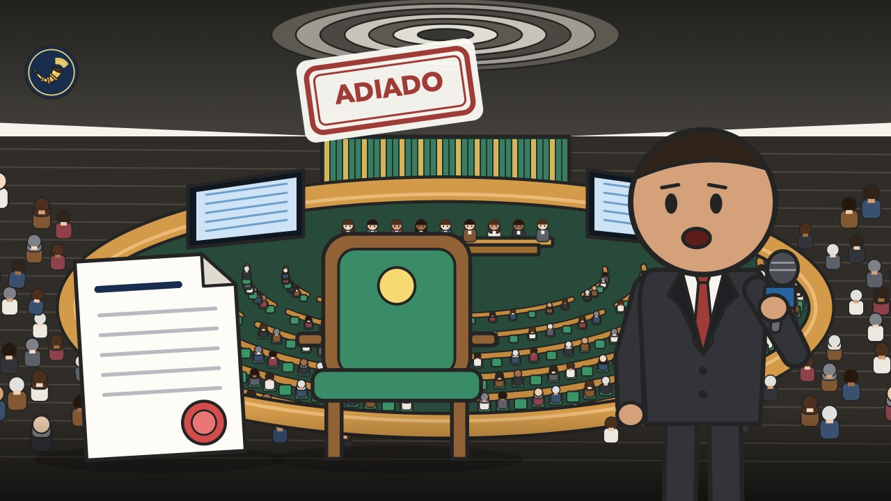
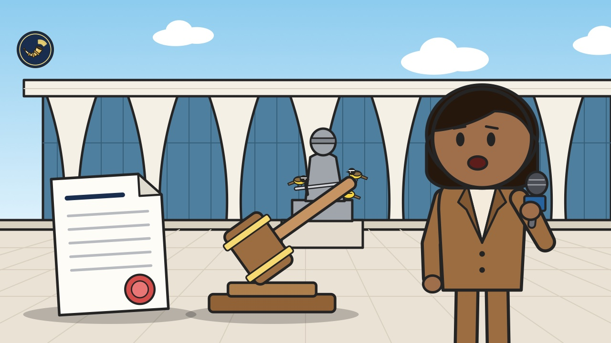
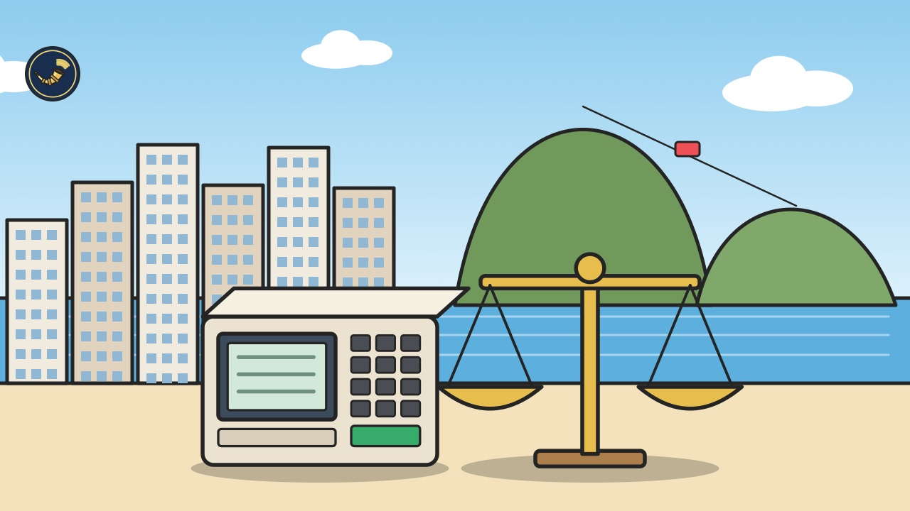

# Heimdall News — quinta-feira, 5 de novembro de 2026

10 assuntos · 19 veículos e fontes

_O vídeo deste briefing ainda não foi postado._

## Assuntos do dia

1. Senado deixa a redução da maioridade penal para a Câmara; líder do Partido Liberal anuncia fim dos acordos com o governo
2. Partido Liberal lança Rogério Marinho à presidência do Senado; Tereza Cristina mantém a candidatura e Alcolumbre busca a reeleição
3. Banco Central interrompe os cortes e mantém os juros básicos em 13,75% ao ano
4. Alcolumbre vai analisar pedido para anular o voto de Flávio Bolsonaro, que votou dos Estados Unidos
5. Democratas ganham as duas casas do Congresso dos Estados Unidos; governo celebra e direita brasileira faz ressalvas
6. Confederações do comércio e da indústria vão ao Supremo contra os prazos do fim da escala 6x1; governo prepara decreto para segunda-feira
7. Partido dos Trabalhadores abre conversas sobre o quarto governo Lula; presidente grava pronunciamento sobre contas públicas
8. Governo publica medida provisória com as alíquotas do Imposto Seletivo para 2027; Ordem dos Advogados pede adiar a reforma tributária
9. Eduardo Paes pede a cassação do governador eleito do Rio; Douglas Ruas também aciona a Justiça Eleitoral
10. Presidente do Supremo dá quinze dias para a Procuradoria-Geral opinar sobre os indiciados do caso Banco Master

---

## 1. Senado deixa a redução da maioridade penal para a Câmara; líder do Partido Liberal anuncia fim dos acordos com o governo

_Ilustração: Heimdall News_

_Cobertura (9): Imprensa mais à esquerda — CartaCapital; Imprensa de centro / grandes veículos — CNN Brasil, Estadão, G1, JOTA, Poder360; Imprensa mais à direita — Gazeta do Povo; Fontes oficiais — Agência Câmara, Agência Senado_

### O que aconteceu

O presidente do Senado, Davi Alcolumbre, disse que vai aguardar a Câmara votar a redução da maioridade penal antes de levar o tema ao Plenário do Senado. [[1]](https://g1.globo.com/politica/noticia/2026/11/04/alcolumbre-decide-aguardar-camara-votar-reducao-da-maioridade-penal-para-pautar-tema-no-senado.ghtml)

Duas emendas à Proposta de Emenda à Constituição da Segurança Pública viraram propostas autônomas. A do líder da oposição fixa 16 anos como regra geral e 14 para crimes graves. A do líder do Partido dos Trabalhadores reduz para 16 anos só nos crimes hediondos. [[2]](https://www.gazetadopovo.com.br/republica/apos-conversa-com-motta-alcolumbre-adia-votacao-da-reducao-da-maioridade-penal-no-senado/)

Na Câmara, a comissão especial aprovou doze pedidos de audiência pública, e o relator disse que entrega o parecer no fim do mês. [[3]](https://www.camara.leg.br/noticias/1316048-relator-da-pec-da-maioridade-penal-deve-apresentar-parecer-no-final-do-mes)

### Como cada campo político se posicionou

**Pró-governo**

- **José Guimarães, ministro da Secretaria de Relações Institucionais**: Disse que o governo não é contra a redução da maioridade, mas quer o tema tratado numa proposta própria. [[4]](https://www.jota.info/newsletters/jota-principal/jota-principal-senado-aprova-pec-da-seguranca-publica-sem-reducao-da-maioridade-penal)
  > “disse que o governo não é contra a redução da maioridade” — [JOTA](https://www.jota.info/newsletters/jota-principal/jota-principal-senado-aprova-pec-da-seguranca-publica-sem-reducao-da-maioridade-penal)
- **Eduardo Braga (MDB-AM), líder do MDB no Senado**: Propôs fixar o dia 1º de dezembro como prazo: se a Câmara não votar até lá, o Senado vota o pedido assinado por mais de cinquenta senadores. [[5]](https://www12.senado.leg.br/noticias/materias/2026/11/04/reducao-da-maioridade-penal-senado-aguardara-votacao-de-pec-da-camara)
  > “há o requerimento assinado por mais de 50 senadores para colocar em votação com quebra de interstício” — [Agência Senado](https://www12.senado.leg.br/noticias/materias/2026/11/04/reducao-da-maioridade-penal-senado-aguardara-votacao-de-pec-da-camara)
- **Bancada do PT no Senado**: Defendeu que a proposta seja discutida na Câmara, com mais tempo de debate. [[6]](https://www.poder360.com.br/poder-congresso/alcolumbre-deixa-maioridade-penal-para-a-camara-apos-acordo-com-motta/)
  > “Integrantes do PT defendem que a proposta seja discutida na Câmara dos Deputados” — [Poder360](https://www.poder360.com.br/poder-congresso/alcolumbre-deixa-maioridade-penal-para-a-camara-apos-acordo-com-motta/)

**Centro pró-governo**

- **Aluisio Mendes (Republicanos-MA), presidente da comissão especial na Câmara**: Criticou a tentativa de votar antes no Senado e disse que a comissão segue o rito normal. [[7]](https://www.estadao.com.br/brasil/e-absurdo-a-camara-ser-atropelada-diz-presidente-de-comissao-sobre-maioridade-penal/)
  > “é um absurdo a Câmara ser atropelada dessa forma” — [Estadão](https://www.estadao.com.br/brasil/e-absurdo-a-camara-ser-atropelada-diz-presidente-de-comissao-sobre-maioridade-penal/)
- **Cid Gomes (PSB-CE), senador**: Apoiou a proposta de Eduardo Braga de marcar a data de 1º de dezembro. [[5]](https://www12.senado.leg.br/noticias/materias/2026/11/04/reducao-da-maioridade-penal-senado-aguardara-votacao-de-pec-da-camara)
  > “disse Braga, apoiado pelo senador Cid Gomes (PSB-CE)” — [Agência Senado](https://www12.senado.leg.br/noticias/materias/2026/11/04/reducao-da-maioridade-penal-senado-aguardara-votacao-de-pec-da-camara)

**Centro**

- **Davi Alcolumbre (União-AP), presidente do Senado**: Disse que considerou razoável o pedido do presidente da Câmara e que não colocaria o tema em votação. [[2]](https://www.gazetadopovo.com.br/republica/apos-conversa-com-motta-alcolumbre-adia-votacao-da-reducao-da-maioridade-penal-no-senado/)
  > “Vou atender a esse pedido, não vou colocar em deliberação, vou aguardar a Câmara” — [Gazeta do Povo](https://www.gazetadopovo.com.br/republica/apos-conversa-com-motta-alcolumbre-adia-votacao-da-reducao-da-maioridade-penal-no-senado/)

**Oposição ao governo**

- **Carlos Portinho (PL-RJ), líder do PL no Senado**: Afirmou que houve quebra de compromisso, disse que o Senado abriu mão de ser a casa revisora e anunciou o fim dos acordos com o governo. [[8]](https://www.poder360.com.br/poder-congresso/pl-critica-manobra-por-maioridade-penal-senado-submetido-a-camara/)
  > “Infelizmente, quero avisar ao governo que acabou o diálogo.” — [Poder360](https://www.poder360.com.br/poder-congresso/pl-critica-manobra-por-maioridade-penal-senado-submetido-a-camara/)
  > “A gente está abrindo mão de ser a casa revisora” — [Poder360](https://www.poder360.com.br/poder-congresso/pl-critica-manobra-por-maioridade-penal-senado-submetido-a-camara/)
- **Mendonça Filho (PL-PE), relator na comissão especial da Câmara**: Defendeu a tramitação na Câmara e disse que a redução atende à expectativa da população. [[7]](https://www.estadao.com.br/brasil/e-absurdo-a-camara-ser-atropelada-diz-presidente-de-comissao-sobre-maioridade-penal/) [[3]](https://www.camara.leg.br/noticias/1316048-relator-da-pec-da-maioridade-penal-deve-apresentar-parecer-no-final-do-mes)
  > “Ninguém atropelou nada” — [Estadão](https://www.estadao.com.br/brasil/e-absurdo-a-camara-ser-atropelada-diz-presidente-de-comissao-sobre-maioridade-penal/)
  > “Com certeza atenderá a expectativa da população brasileira” — [Agência Câmara](https://www.camara.leg.br/noticias/1316048-relator-da-pec-da-maioridade-penal-deve-apresentar-parecer-no-final-do-mes)

_Sem posicionamento encontrado: Centro-oposição, Independente — Missão / MBL, Outros / não classificável._

Referências:

1. [Alcolumbre decide aguardar Câmara votar redução da maioridade penal para pautar tema no Senado](https://g1.globo.com/politica/noticia/2026/11/04/alcolumbre-decide-aguardar-camara-votar-reducao-da-maioridade-penal-para-pautar-tema-no-senado.ghtml) — G1, 04/11 17:15
2. [Após conversa com Motta, Alcolumbre adia votação da redução da maioridade penal no Senado](https://www.gazetadopovo.com.br/republica/apos-conversa-com-motta-alcolumbre-adia-votacao-da-reducao-da-maioridade-penal-no-senado/) — Gazeta do Povo, 04/11 18:12
3. [Relator da PEC da Maioridade Penal deve apresentar parecer no final do mês](https://www.camara.leg.br/noticias/1316048-relator-da-pec-da-maioridade-penal-deve-apresentar-parecer-no-final-do-mes) — Agência Câmara, 04/11 18:10
4. [JOTA Principal: Senado aprova PEC da Segurança Pública sem redução da maioridade penal](https://www.jota.info/newsletters/jota-principal/jota-principal-senado-aprova-pec-da-seguranca-publica-sem-reducao-da-maioridade-penal) — JOTA, 04/11 10:21
5. [Redução da maioridade penal: Senado aguardará votação de PEC da Câmara](https://www12.senado.leg.br/noticias/materias/2026/11/04/reducao-da-maioridade-penal-senado-aguardara-votacao-de-pec-da-camara) — Agência Senado, 04/11 19:03
6. [Alcolumbre deixa maioridade penal para a Câmara após acordo com Motta](https://www.poder360.com.br/poder-congresso/alcolumbre-deixa-maioridade-penal-para-a-camara-apos-acordo-com-motta/) — Poder360, 04/11 18:12
7. [‘É absurdo a Câmara ser atropelada’, diz presidente de comissão sobre maioridade penal](https://www.estadao.com.br/brasil/e-absurdo-a-camara-ser-atropelada-diz-presidente-de-comissao-sobre-maioridade-penal/) — Estadão, 04/11 16:59
8. [PL critica manobra por maioridade penal: “Senado submetido à Câmara”](https://www.poder360.com.br/poder-congresso/pl-critica-manobra-por-maioridade-penal-senado-submetido-a-camara/) — Poder360, 04/11 21:25

Outras matérias sobre o tema:

- [Alcolumbre indica que vai aguardar Câmara votar redução da maioridade](https://www.cartacapital.com.br/politica/alcolumbre-indica-que-vai-aguardar-camara-votar-reducao-da-maioridade/) — CartaCapital, 04/11 17:38
- [Alcolumbre diz que vai aguardar Câmara para debater redução da maioridade](https://www.cnnbrasil.com.br/politica/alcolumbre-diz-que-vai-aguardar-camara-para-debater-reducao-da-maioridade/) — CNN Brasil, 04/11 17:14
- [Alcolumbre nega que haja decisão para votar maioridade nesta quarta](https://www.cnnbrasil.com.br/politica/alcolumbre-nega-que-haja-decisao-para-votar-maioridade-nesta-quarta/) — CNN Brasil, 04/11 16:56
- [Proposta mais avançada na Câmara sobre maioridade é debatida desde 2015](https://www.cnnbrasil.com.br/politica/proposta-mais-avancada-na-camara-sobre-maioridade-e-debatida-desde-2015/) — CNN Brasil, 05/11 03:30

---

## 2. Partido Liberal lança Rogério Marinho à presidência do Senado; Tereza Cristina mantém a candidatura e Alcolumbre busca a reeleição

_Ilustração: Heimdall News_

_Cobertura (9): Imprensa mais à esquerda — Brasil de Fato, CartaCapital; Imprensa de centro / grandes veículos — CNN Brasil, Estadão, Folha, G1, JOTA; Imprensa mais à direita — Gazeta do Povo; Fontes oficiais — Câmara — Plenário no YouTube (TV Câmara)_

### O que aconteceu

A bancada do Partido Liberal lançou o líder da oposição para a eleição de 1º de fevereiro de 2027. O partido terá a maior bancada da Casa, com 29 das 81 cadeiras. [[1]](https://www1.folha.uol.com.br/poder/2026/11/pl-lanca-rogerio-marinho-para-a-presidencia-do-senado.shtml)

A votação é secreta, e o vencedor precisa de pelo menos 41 votos. [[2]](https://g1.globo.com/politica/noticia/2026/11/04/rogerio-marinho-do-pl-lanca-candidatura-a-presidencia-do-senado.ghtml)

Segundo a CartaCapital, Davi Alcolumbre já recebeu manifestações de apoio de quatro partidos ou federações. Marinho conta com os três senadores eleitos pelo Novo. [[3]](https://www.cartacapital.com.br/politica/pl-oficializa-rogerio-marinho-para-disputar-a-presidencia-do-senado-contra-alcolumbre/)

A senadora eleita Michelle Bolsonaro não foi à reunião de lançamento. Procurada pelo Estadão, ela não se manifestou. [[4]](https://www.estadao.com.br/politica/coluna-do-estadao/a-ausencia-que-chamou-atencao-na-reuniao-do-pl-que-lancou-rogerio-marinho-a-presidencia-do-senado/)

### Como cada campo político se posicionou

**Pró-governo**

- **Edinho Silva (PT), presidente do partido**: Tratou da construção de alianças para apoiar a reeleição de Davi Alcolumbre no Senado e de Hugo Motta na Câmara. [[5]](https://www.gazetadopovo.com.br/republica/edinho-silva-descarta-impeachment-de-ministros-e-novos-impostos-no-governo-lula/)
  > “A estratégia política envolve a construção de alianças para apoiar a reeleição de Hugo Motta na Câmara dos Deputados e de Davi Alcolumbre no Senado.” — [Gazeta do Povo](https://www.gazetadopovo.com.br/republica/edinho-silva-descarta-impeachment-de-ministros-e-novos-impostos-no-governo-lula/)

**Centro pró-governo**

- **Renato Casagrande (PSB-ES), senador eleito**: Disse que o partido teve uma conversa inicial com Alcolumbre e que a composição do governo pode influenciar a disputa. [[6]](https://www.cnnbrasil.com.br/politica/psb-teve-conversa-inicial-com-alcolumbre-sobre-reeleicao-diz-casagrande/)
  > “São conversas iniciais que todos nós estamos tendo. Estamos apenas no início” — [CNN Brasil](https://www.cnnbrasil.com.br/politica/psb-teve-conversa-inicial-com-alcolumbre-sobre-reeleicao-diz-casagrande/)

**Oposição ao governo**

- **Rogério Marinho (PL-RN), líder da oposição no Senado**: Disse ter mais de quarenta votos, defendeu o voto aberto e a análise do projeto de anistia, e afirmou que não paralisará o governo. [[7]](https://www.brasildefato.com.br/2026/11/04/pl-oficializa-candidatura-de-rogerio-marinho-a-presidencia-do-senado-para-destravar-anistia-a-golpistas/) [[8]](https://www.estadao.com.br/politica/marinho-confirma-candidatura-ao-comando-do-senado-diz-ter-40-votos-e-busca-apoio-de-tereza-cristina/)
  > “vamos permitir que o projeto da anistia seja apreciado” — [Brasil de Fato](https://www.brasildefato.com.br/2026/11/04/pl-oficializa-candidatura-de-rogerio-marinho-a-presidencia-do-senado-para-destravar-anistia-a-golpistas/)
  > “Não seremos inconsequentes, não paralisaremos governo” — [Estadão](https://www.estadao.com.br/politica/marinho-confirma-candidatura-ao-comando-do-senado-diz-ter-40-votos-e-busca-apoio-de-tereza-cristina/)
- **Tereza Cristina (PP-MS), senadora**: Disse que vai conversar com os 81 senadores e que pedirá até o voto de Alcolumbre. [[9]](https://www.cnnbrasil.com.br/politica/vou-pedir-voto-ate-para-o-alcolumbre-diz-tereza-cristina-a-cnn/)
  > “Vou até pedir voto para o senador Davi Alcolumbre porque eu já disse a ele que ele precisava ter uma mulher como sucessora” — [CNN Brasil](https://www.cnnbrasil.com.br/politica/vou-pedir-voto-ate-para-o-alcolumbre-diz-tereza-cristina-a-cnn/)
- **Carlos Jordy (PL-RJ), deputado e senador eleito**: Disse em Plenário que não há possibilidade de votar em Alcolumbre, a quem chamou de omisso. [[10]](https://www.youtube.com/watch?v=Q5P06vGzyo4&t=92s)
  > “não há possibilidade alguma de votarmos em alcolumbre” — [Câmara — Plenário no YouTube (TV Câmara)](https://www.youtube.com/watch?v=Q5P06vGzyo4&t=92s)

_Sem posicionamento encontrado: Centro, Centro-oposição, Independente — Missão / MBL, Outros / não classificável._

Referências:

1. [PL lança Rogério Marinho para a presidência do Senado com defesa de Flávio e anistia](https://www1.folha.uol.com.br/poder/2026/11/pl-lanca-rogerio-marinho-para-a-presidencia-do-senado.shtml) — Folha, 04/11 13:11
2. [Rogério Marinho, do PL, lança candidatura à presidência do Senado](https://g1.globo.com/politica/noticia/2026/11/04/rogerio-marinho-do-pl-lanca-candidatura-a-presidencia-do-senado.ghtml) — G1, 04/11 13:18
3. [PL oficializa Rogério Marinho para disputar a presidência do Senado contra Alcolumbre](https://www.cartacapital.com.br/politica/pl-oficializa-rogerio-marinho-para-disputar-a-presidencia-do-senado-contra-alcolumbre/) — CartaCapital, 04/11 15:47
4. [A ausência que chamou atenção na reunião do PL que lançou Rogério Marinho à presidência do Senado](https://www.estadao.com.br/politica/coluna-do-estadao/a-ausencia-que-chamou-atencao-na-reuniao-do-pl-que-lancou-rogerio-marinho-a-presidencia-do-senado/) — Estadão, 04/11 16:03
5. [Edinho Silva descarta impeachment de ministros e novos impostos no governo Lula](https://www.gazetadopovo.com.br/republica/edinho-silva-descarta-impeachment-de-ministros-e-novos-impostos-no-governo-lula/) — Gazeta do Povo, 03/11 15:16
6. [PSB teve conversa inicial com Alcolumbre sobre reeleição, diz Casagrande](https://www.cnnbrasil.com.br/politica/psb-teve-conversa-inicial-com-alcolumbre-sobre-reeleicao-diz-casagrande/) — CNN Brasil, 04/11 17:56
7. [PL oficializa candidatura de Rogério Marinho à presidência do Senado para destravar anistia a golpistas](https://www.brasildefato.com.br/2026/11/04/pl-oficializa-candidatura-de-rogerio-marinho-a-presidencia-do-senado-para-destravar-anistia-a-golpistas/) — Brasil de Fato, 04/11 14:32
8. [Marinho confirma candidatura ao comando do Senado, diz ter 40 votos e busca apoio de Tereza Cristina](https://www.estadao.com.br/politica/marinho-confirma-candidatura-ao-comando-do-senado-diz-ter-40-votos-e-busca-apoio-de-tereza-cristina/) — Estadão, 04/11 13:36
9. [Vou pedir voto até para o Alcolumbre, diz Tereza Cristina à CNN](https://www.cnnbrasil.com.br/politica/vou-pedir-voto-ate-para-o-alcolumbre-diz-tereza-cristina-a-cnn/) — CNN Brasil, 04/11 16:37
10. [Aprovada criação de programa para acompanhamento psicossocial de crianças e adolescentes - 04/11/26](https://www.youtube.com/watch?v=Q5P06vGzyo4) — Câmara — Plenário no YouTube (TV Câmara), 04/11 00:00

Outras matérias sobre o tema:

- [Tereza diz estar aberta ao diálogo sobre eventual candidatura de Lira](https://www.cnnbrasil.com.br/politica/tereza-diz-estar-aberta-ao-dialogo-sobre-eventual-candidatura-de-lira/) — CNN Brasil, 04/11 16:06
- [Direita aposta na exposição de votos no Senado para derrotar aliança entre Alcolumbre, Lula e Moraes](https://www.gazetadopovo.com.br/republica/direita-aposta-na-exposicao-de-votos-no-senado-para-derrotar-alianca-entre-alcolumbre-lula-e-moraes/) — Gazeta do Povo, 04/11 21:20
- [PL lança candidatura de Rogério Marinho à presidência do Senado](https://www.jota.info/legislativo/pl-lanca-candidatura-de-rogerio-marinho-a-presidencia-do-senado) — JOTA, 04/11 16:22
- [Com Marinho na disputa à presidência do Senado, PL se divide sobre lançar nome para Câmara](https://g1.globo.com/politica/noticia/2026/11/04/com-marinho-na-disputa-a-presidencia-do-senado-pl-se-divide-sobre-lancar-nome-para-camara.ghtml) — G1, 04/11 15:41

---

## 3. Banco Central interrompe os cortes e mantém os juros básicos em 13,75% ao ano

_Ilustração: Heimdall News_

_Cobertura (5): Imprensa mais à esquerda — Brasil de Fato, CartaCapital; Imprensa de centro / grandes veículos — CNN Brasil, Poder360; Imprensa mais à direita — Gazeta do Povo_

### O que aconteceu

O Comitê de Política Monetária decidiu por unanimidade manter a taxa, depois de cinco reduções seguidas de 0,25 ponto percentual. [[1]](https://www.gazetadopovo.com.br/economia/copom-interrompe-ciclo-de-cortes-e-mantem-selic-em-1375/)

O comitê citou incertezas maiores, expectativas de inflação mais altas e atividade econômica em desaceleração. [[2]](https://www.brasildefato.com.br/2026/11/04/banco-central-surpreende-e-mantem-juros-basicos-em-1375-ao-ano/)

A projeção de inflação do Banco Central para 2027 subiu de 3,9% para 4,7%. O teto da meta é de 4,5%. [[3]](https://www.poder360.com.br/poder-economia/mercado-ve-selic-em-1375-ate-2027-apos-decisao-do-copom/) [[2]](https://www.brasildefato.com.br/2026/11/04/banco-central-surpreende-e-mantem-juros-basicos-em-1375-ao-ano/)

O comitê decide com duas diretorias vagas, porque o presidente ainda não enviou ao Congresso os nomes dos substitutos. [[2]](https://www.brasildefato.com.br/2026/11/04/banco-central-surpreende-e-mantem-juros-basicos-em-1375-ao-ano/)

### Como cada campo político se posicionou

**Pró-governo**

- **Lindbergh Farias (PT-RJ), deputado federal**: Antes da decisão, no dia 2, acusou o mercado de tentar sabotar o governo e pressionou o presidente do Banco Central. [[1]](https://www.gazetadopovo.com.br/economia/copom-interrompe-ciclo-de-cortes-e-mantem-selic-em-1375/)
  > “acusou o mercado de tentar sabotar o governo Lula após a piora dos indicadores” — [Gazeta do Povo](https://www.gazetadopovo.com.br/economia/copom-interrompe-ciclo-de-cortes-e-mantem-selic-em-1375/)
- **Luiz Inácio Lula da Silva (PT), presidente da República**: Disse em entrevista, em 24 de outubro, que confia no presidente do Banco Central. [[1]](https://www.gazetadopovo.com.br/economia/copom-interrompe-ciclo-de-cortes-e-mantem-selic-em-1375/)
  > “Eu confio no Galípolo. É um bom presidente do Banco Central.” — [Gazeta do Povo](https://www.gazetadopovo.com.br/economia/copom-interrompe-ciclo-de-cortes-e-mantem-selic-em-1375/)

**Outros / não classificável**

- **Ricardo Alban, presidente da Confederação Nacional da Indústria**: Disse que a taxa continua muito alta e afeta crédito, investimentos e atividade. A entidade defendeu retomar os cortes em dezembro. [[4]](https://www.poder360.com.br/poder-economia/industria-diz-que-manutencao-da-selic-em-1375-e-injustificavel/)
  > “A Selic permanece muito alta e isso afeta crédito, investimentos e a atividade econômica.” — [Poder360](https://www.poder360.com.br/poder-economia/industria-diz-que-manutencao-da-selic-em-1375-e-injustificavel/)
- **Gustavo Loyola, ex-presidente do Banco Central**: Disse que o comunicado foi menos explícito sobre a política fiscal e apontou dificuldade de gestão do resultado primário. [[5]](https://www.cnnbrasil.com.br/economia/money/macroeconomia/banco-central-foi-menos-explicito-em-relacao-ao-fiscal-diz-loyola/)
  > “O Banco Central foi menos explícito em apontar o dedo para a política fiscal” — [CNN Brasil](https://www.cnnbrasil.com.br/economia/money/macroeconomia/banco-central-foi-menos-explicito-em-relacao-ao-fiscal-diz-loyola/)

_Sem posicionamento encontrado: Centro pró-governo, Centro, Centro-oposição, Oposição ao governo, Independente — Missão / MBL._

Referências:

1. [Copom interrompe ciclo de cortes e mantém Selic em 13,75%](https://www.gazetadopovo.com.br/economia/copom-interrompe-ciclo-de-cortes-e-mantem-selic-em-1375/) — Gazeta do Povo, 04/11 19:09
2. [Banco Central surpreende e mantém juros básicos em 13,75% ao ano](https://www.brasildefato.com.br/2026/11/04/banco-central-surpreende-e-mantem-juros-basicos-em-1375-ao-ano/) — Brasil de Fato, 04/11 20:11
3. [Mercado vê Selic em 13,75% até 2027 após decisão do Copom](https://www.poder360.com.br/poder-economia/mercado-ve-selic-em-1375-ate-2027-apos-decisao-do-copom/) — Poder360, 04/11 20:14
4. [Indústria diz que manutenção da Selic em 13,75% é injustificável](https://www.poder360.com.br/poder-economia/industria-diz-que-manutencao-da-selic-em-1375-e-injustificavel/) — Poder360, 04/11 19:47
5. [Banco Central foi menos explícito em relação ao fiscal, diz Loyola](https://www.cnnbrasil.com.br/economia/money/macroeconomia/banco-central-foi-menos-explicito-em-relacao-ao-fiscal-diz-loyola/) — CNN Brasil, 04/11 20:49

Outras matérias sobre o tema:

- [Waack: Juros elevados antecipam a conta do populismo de Lula](https://www.cnnbrasil.com.br/economia/money/macroeconomia/waack-juros-elevados-antecipam-a-conta-do-populismo-de-lula/) — CNN Brasil, 04/11 22:02
- [Brasil fechará esta quarta com a maior taxa real de juros no mundo](https://www.cartacapital.com.br/cartaexpressa/brasil-fechara-esta-quarta-com-a-maior-taxa-real-de-juros-no-mundo/) — CartaCapital, 04/11 14:44
- [Brasil lidera ranking mundial de juros reais, com 9,49%](https://www.poder360.com.br/poder-economia/brasil-lidera-ranking-mundial-de-juros-reais-com-949/) — Poder360, 04/11 21:22
- [BC vê inflação mais elevada em todo horizonte até 2028](https://www.cnnbrasil.com.br/economia/money/macroeconomia/bc-ve-inflacao-mais-elevada-em-todo-horizonte-ate-2028/) — CNN Brasil, 04/11 20:22
- [Após alívio com manutenção dos juros, mercado não vê novos cortes em breve](https://www.cnnbrasil.com.br/economia/money/macroeconomia/apos-alivio-com-manutencao-dos-juros-mercado-nao-ve-novos-cortes-em-breve/) — CNN Brasil, 04/11 19:32
- [“Bola no chão”: BC sinaliza independência contra pressão, dizem economistas](https://www.cnnbrasil.com.br/economia/money/macroeconomia/bola-no-chao-bc-sinaliza-independencia-contra-pressao-dizem-economistas/) — CNN Brasil, 05/11 04:34
- [Mercado avalia possibilidade de Selic seguir em 13,75% até o final de 2027](https://www.cnnbrasil.com.br/economia/money/macroeconomia/mercado-avalia-possibilidade-de-selic-seguir-em-1375-ate-o-final-de-2027/) — CNN Brasil, 05/11 03:54

---

## 4. Alcolumbre vai analisar pedido para anular o voto de Flávio Bolsonaro, que votou dos Estados Unidos

_Ilustração: Heimdall News_

_Cobertura (8): Imprensa mais à esquerda — CartaCapital; Imprensa de centro / grandes veículos — Estadão, Folha, G1, Poder360; Imprensa mais à direita — Gazeta do Povo, Revista Oeste; Fontes oficiais — Agência Senado_

### O que aconteceu

Flávio Bolsonaro votou de forma remota na sessão de terça-feira, que era semipresencial, e foi favorável à Proposta de Emenda à Constituição da Segurança Pública nos dois turnos. [[1]](https://www.estadao.com.br/politica/entenda-como-flavio-participou-de-votacao-no-senado-mesmo-apos-fugir-para-os-eua-nprp/) [[2]](https://www12.senado.leg.br/noticias/materias/2026/11/04/davi-vai-analisar-questoes-de-randolfe-sobre-situacao-de-flavio-bolsonaro)

O Regimento Interno do Senado manda o senador comunicar à Presidência quando se ausentar do país. [[2]](https://www12.senado.leg.br/noticias/materias/2026/11/04/davi-vai-analisar-questoes-de-randolfe-sobre-situacao-de-flavio-bolsonaro)

O senador é investigado em dois inquéritos no Supremo Tribunal Federal. O ministro Alexandre de Moraes havia determinado a entrega dos passaportes. [[3]](https://www1.folha.uol.com.br/poder/2026/11/alcolumbre-diz-que-analisara-situacao-de-flavio-bolsonaro-que-votou-em-sessao-estando-nos-eua.shtml)

### Como cada campo político se posicionou

**Pró-governo**

- **Randolfe Rodrigues (PT-AP), líder do governo no Congresso**: Apresentou duas questões de ordem: pediu que a Presidência esclareça se houve comunicação da viagem e que o voto seja anulado. [[3]](https://www1.folha.uol.com.br/poder/2026/11/alcolumbre-diz-que-analisara-situacao-de-flavio-bolsonaro-que-votou-em-sessao-estando-nos-eua.shtml) [[2]](https://www12.senado.leg.br/noticias/materias/2026/11/04/davi-vai-analisar-questoes-de-randolfe-sobre-situacao-de-flavio-bolsonaro)
  > “Randolfe pede a anulação do voto de Flávio na PEC (Proposta de Emenda à Constituição) da Segurança Pública” — [Folha](https://www1.folha.uol.com.br/poder/2026/11/alcolumbre-diz-que-analisara-situacao-de-flavio-bolsonaro-que-votou-em-sessao-estando-nos-eua.shtml)
  > “Eu não quero censurar nem vetar o voto de ninguém” — [Agência Senado](https://www12.senado.leg.br/noticias/materias/2026/11/04/davi-vai-analisar-questoes-de-randolfe-sobre-situacao-de-flavio-bolsonaro)

**Centro**

- **Davi Alcolumbre (União-AP), presidente do Senado**: Disse que vai avaliar o caso com a assessoria. Em outro discurso, defendeu as urnas eletrônicas e questionou quem contesta só o segundo turno. [[2]](https://www12.senado.leg.br/noticias/materias/2026/11/04/davi-vai-analisar-questoes-de-randolfe-sobre-situacao-de-flavio-bolsonaro) [[4]](https://www.poder360.com.br/poder-congresso/alcolumbre-rebate-oposicao-no-1o-turno-a-urna-prestou-e-no-2o-nao/)
  > “Vou convocar nossos assessores para avaliar, à luz dos regimentos do Senado Federal e do Congresso Nacional” — [Agência Senado](https://www12.senado.leg.br/noticias/materias/2026/11/04/davi-vai-analisar-questoes-de-randolfe-sobre-situacao-de-flavio-bolsonaro)
  > “E quando abriu no 2º turno não prestou mais a urna?” — [Poder360](https://www.poder360.com.br/poder-congresso/alcolumbre-rebate-oposicao-no-1o-turno-a-urna-prestou-e-no-2o-nao/)

**Oposição ao governo**

- **Carlos Portinho (PL-RJ), líder do PL no Senado**: Defendeu, em discurso, a saída de Flávio Bolsonaro para os Estados Unidos. [[5]](https://g1.globo.com/politica/noticia/2026/11/04/apos-criticas-de-lider-do-pl-alcolumbre-diz-que-lamenta-eleicao-de-quem-se-promove-ofendendo-e-agredindo.ghtml)
  > “Portinho defendeu ainda a fuga de Flávio para os Estados Unidos.” — [G1](https://g1.globo.com/politica/noticia/2026/11/04/apos-criticas-de-lider-do-pl-alcolumbre-diz-que-lamenta-eleicao-de-quem-se-promove-ofendendo-e-agredindo.ghtml)
- **Rogério Marinho (PL-RN), líder da oposição no Senado**: Disse que a polícia está aparelhada e que o aliado não tem Justiça isenta no Brasil. [[6]](https://www1.folha.uol.com.br/poder/2026/11/pl-lanca-rogerio-marinho-para-a-presidencia-do-senado.shtml)
  > “dizendo que a polícia está aparelhada e que o aliado não tem no Brasil uma Justiça isenta” — [Folha](https://www1.folha.uol.com.br/poder/2026/11/pl-lanca-rogerio-marinho-para-a-presidencia-do-senado.shtml)

**Outros / não classificável**

- **Robert Garcia, deputado do Partido Democrata dos Estados Unidos**: Pediu explicações ao governo de Donald Trump e que o senador seja enviado de volta ao Brasil. [[7]](https://www.cartacapital.com.br/politica/deputado-democrata-pede-a-deportacao-de-flavio-bolsonaro-dos-eua/)
  > “Ele deve ser enviado de volta ao Brasil imediatamente para responder perante a Justiça” — [CartaCapital](https://www.cartacapital.com.br/politica/deputado-democrata-pede-a-deportacao-de-flavio-bolsonaro-dos-eua/)

_Sem posicionamento encontrado: Centro pró-governo, Centro-oposição, Independente — Missão / MBL._

Referências:

1. [Entenda como Flávio Bolsonaro participou de votação no Senado mesmo após fugir para os EUA](https://www.estadao.com.br/politica/entenda-como-flavio-participou-de-votacao-no-senado-mesmo-apos-fugir-para-os-eua-nprp/) — Estadão, 04/11 12:56
2. [Davi vai analisar questões de Randolfe sobre situação de Flávio Bolsonaro](https://www12.senado.leg.br/noticias/materias/2026/11/04/davi-vai-analisar-questoes-de-randolfe-sobre-situacao-de-flavio-bolsonaro) — Agência Senado, 04/11 19:46
3. [Alcolumbre diz que analisará situação de Flávio Bolsonaro, que votou em sessão estando nos EUA](https://www1.folha.uol.com.br/poder/2026/11/alcolumbre-diz-que-analisara-situacao-de-flavio-bolsonaro-que-votou-em-sessao-estando-nos-eua.shtml) — Folha, 04/11 23:36
4. [Alcolumbre rebate oposição: “No 1º turno a urna prestou e no 2º não?”](https://www.poder360.com.br/poder-congresso/alcolumbre-rebate-oposicao-no-1o-turno-a-urna-prestou-e-no-2o-nao/) — Poder360, 04/11 22:56
5. [Após críticas de líder do PL, Alcolumbre diz que lamenta eleição de quem se promove 'ofendendo e agredindo'](https://g1.globo.com/politica/noticia/2026/11/04/apos-criticas-de-lider-do-pl-alcolumbre-diz-que-lamenta-eleicao-de-quem-se-promove-ofendendo-e-agredindo.ghtml) — G1, 04/11 19:09
6. [PL lança Rogério Marinho para a presidência do Senado com defesa de Flávio e anistia](https://www1.folha.uol.com.br/poder/2026/11/pl-lanca-rogerio-marinho-para-a-presidencia-do-senado.shtml) — Folha, 04/11 13:11
7. [Deputado democrata pede a deportação de Flávio Bolsonaro dos EUA](https://www.cartacapital.com.br/politica/deputado-democrata-pede-a-deportacao-de-flavio-bolsonaro-dos-eua/) — CartaCapital, 04/11 21:05

Outras matérias sobre o tema:

- [Alcolumbre diz que analisará situação de Flávio Bolsonaro, que registrou presença e voto dos EUA](https://www.estadao.com.br/politica/alcolumbre-diz-que-analisara-situacao-de-flavio-bolsonaro-que-registrou-presenca-e-voto-dos-eua/) — Estadão, 04/11 20:08
- [Alcolumbre diz que vai analisar se Flávio Bolsonaro poderá continuar votando no Senado dos EUA](https://www.cartacapital.com.br/politica/alcolumbre-diz-que-vai-analisar-se-flavio-bolsonaro-podera-continuar-votando-no-senado-dos-eua/) — CartaCapital, 04/11 19:33
- [Alcolumbre diz que Senado avaliará se Flávio Bolsonaro pode votar dos EUA](https://www.gazetadopovo.com.br/republica/alcolumbre-diz-que-senado-avaliara-se-flavio-bolsonaro-pode-votar-dos-eua/) — Gazeta do Povo, 05/11 00:06
- [Após cobrança de líder do PL, Alcolumbre dispara contra oposição](https://www.gazetadopovo.com.br/republica/apos-cobranca-de-lider-do-pl-alcolumbre-dispara-contra-oposicao/) — Gazeta do Povo, 04/11 21:05
- [Davi Alcolumbre lamenta radicalismo e pede foco no país](https://www12.senado.leg.br/noticias/materias/2026/11/04/davi-alcolumbre-lamenta-radicalismo-e-pede-foco-no-pais) — Agência Senado, 04/11 19:07
- [Flávio Bolsonaro articula oposição internacional contra o governo Lula nos EUA](https://www.gazetadopovo.com.br/republica/flavio-bolsonaro-articula-oposicao-internacional-contra-o-governo-lula-nos-eua/) — Gazeta do Povo, 04/11 19:24
- [Flávio Bolsonaro dará entrevista ao The New York Times](https://revistaoeste.com/imprensa/flavio-bolsonaro-dara-entrevista-ao-ithe-new-york-times-i/) — Revista Oeste, 04/11 21:32

---

## 5. Democratas ganham as duas casas do Congresso dos Estados Unidos; governo celebra e direita brasileira faz ressalvas

_Ilustração: Heimdall News_

_Cobertura (7): Imprensa mais à esquerda — Brasil de Fato, CartaCapital; Imprensa de centro / grandes veículos — CNN Brasil, Folha, G1, JOTA; Imprensa mais à direita — Gazeta do Povo_

### O que aconteceu

Com a contagem ainda em andamento, os democratas tinham 228 das 435 cadeiras da Câmara e ao menos 54 dos 100 assentos do Senado. [[1]](https://www1.folha.uol.com.br/poder/2026/11/eleicao-nos-eua-com-reves-de-trump-tem-celebracao-de-lulistas-e-critica-de-nikolas-a-janja.shtml)

Integrantes do governo esperam uma reunião entre Lula e Donald Trump na cúpula do G20, em dezembro, em Miami. Ainda não houve pedido formal. [[2]](https://www.cnnbrasil.com.br/politica/lula-espera-ter-reuniao-bilateral-com-trump-durante-cupula-do-g20/)

O ministro do Desenvolvimento, Márcio Elias Rosa, disse esperar até a próxima semana a proposta dos Estados Unidos para um acordo sobre as tarifas. [[3]](https://www.gazetadopovo.com.br/republica/brasil-deve-receber-proposta-dos-eua-sobre-tarifas-ate-a-proxima-semana-diz-ministro/)

### Como cada campo político se posicionou

**Pró-governo**

- **José Guimarães, ministro da Secretaria de Relações Institucionais**: Disse que as eleições americanas apontam para uma mudança de rumo no mundo. [[4]](https://g1.globo.com/politica/noticia/2026/11/04/eleicoes-nos-eua-politicos-brasileiros-repercutem-resultado-que-deu-aos-democratas-maioria-no-congresso.ghtml)
  > “disse que as eleições americanas apontam para uma "mudança de rumo" no mundo” — [G1](https://g1.globo.com/politica/noticia/2026/11/04/eleicoes-nos-eua-politicos-brasileiros-repercutem-resultado-que-deu-aos-democratas-maioria-no-congresso.ghtml)
- **Lindbergh Farias (PT-RJ), deputado federal**: Afirmou que as urnas mandaram um recado contra grupos radicais. [[4]](https://g1.globo.com/politica/noticia/2026/11/04/eleicoes-nos-eua-politicos-brasileiros-repercutem-resultado-que-deu-aos-democratas-maioria-no-congresso.ghtml)
  > “Derrota acachapante de Trump mostra que os EUA e o mundo estão dispostos a impedir que a extrema-direita destrua o nosso futuro” — [G1](https://g1.globo.com/politica/noticia/2026/11/04/eleicoes-nos-eua-politicos-brasileiros-repercutem-resultado-que-deu-aos-democratas-maioria-no-congresso.ghtml)
- **Erika Hilton (PSOL-SP), deputada federal**: Classificou o resultado como uma derrota para a ideologia de Trump e disse que ele é melhor para o povo brasileiro. [[1]](https://www1.folha.uol.com.br/poder/2026/11/eleicao-nos-eua-com-reves-de-trump-tem-celebracao-de-lulistas-e-critica-de-nikolas-a-janja.shtml)
  > “sustenta que o revés republicano é melhor para o povo brasileiro, para o mundo e para a população americana” — [Folha](https://www1.folha.uol.com.br/poder/2026/11/eleicao-nos-eua-com-reves-de-trump-tem-celebracao-de-lulistas-e-critica-de-nikolas-a-janja.shtml)

**Oposição ao governo**

- **Nikolas Ferreira (PL-MG), deputado federal**: Criticou a primeira-dama pela imagem publicada na comemoração. [[1]](https://www1.folha.uol.com.br/poder/2026/11/eleicao-nos-eua-com-reves-de-trump-tem-celebracao-de-lulistas-e-critica-de-nikolas-a-janja.shtml)
  > “a falta de noção dessa mulher me surpreende ainda” — [Folha](https://www1.folha.uol.com.br/poder/2026/11/eleicao-nos-eua-com-reves-de-trump-tem-celebracao-de-lulistas-e-critica-de-nikolas-a-janja.shtml)
- **Carla Zambelli, ex-deputada**: Disse que a esquerda não deve comemorar cedo e que não haverá extradição de Flávio e Eduardo Bolsonaro. [[1]](https://www1.folha.uol.com.br/poder/2026/11/eleicao-nos-eua-com-reves-de-trump-tem-celebracao-de-lulistas-e-critica-de-nikolas-a-janja.shtml)
  > “Não comemorem tão cedo, esquerdistas. Não vai ter extradição de Flávio Bolsonaro e Eduardo Bolsonaro” — [Folha](https://www1.folha.uol.com.br/poder/2026/11/eleicao-nos-eua-com-reves-de-trump-tem-celebracao-de-lulistas-e-critica-de-nikolas-a-janja.shtml)

**Independente — Missão / MBL**

- **Renan Santos, líder do Partido Missão**: Criticou a condução dos Estados Unidos por Trump e a aproximação dos republicanos com o grupo de Jair Bolsonaro. [[4]](https://g1.globo.com/politica/noticia/2026/11/04/eleicoes-nos-eua-politicos-brasileiros-repercutem-resultado-que-deu-aos-democratas-maioria-no-congresso.ghtml)
  > “criticou tanto a condução dos EUA pelo governo Trump quanto a aproximação dos republicanos com o grupo do ex-presidente Jair Bolsonaro” — [G1](https://g1.globo.com/politica/noticia/2026/11/04/eleicoes-nos-eua-politicos-brasileiros-repercutem-resultado-que-deu-aos-democratas-maioria-no-congresso.ghtml)

_Sem posicionamento encontrado: Centro pró-governo, Centro, Centro-oposição, Outros / não classificável._

Referências:

1. [Eleição nos EUA com revés de Trump tem celebração de lulistas e crítica de Nikolas a Janja](https://www1.folha.uol.com.br/poder/2026/11/eleicao-nos-eua-com-reves-de-trump-tem-celebracao-de-lulistas-e-critica-de-nikolas-a-janja.shtml) — Folha, 04/11 20:05
2. [Lula espera ter reunião bilateral com Trump durante cúpula do G20](https://www.cnnbrasil.com.br/politica/lula-espera-ter-reuniao-bilateral-com-trump-durante-cupula-do-g20/) — CNN Brasil, 04/11 19:59
3. [Brasil deve receber proposta dos EUA sobre tarifas até a próxima semana, diz ministro](https://www.gazetadopovo.com.br/republica/brasil-deve-receber-proposta-dos-eua-sobre-tarifas-ate-a-proxima-semana-diz-ministro/) — Gazeta do Povo, 04/11 08:32
4. [Eleições nos EUA: políticos brasileiros repercutem resultado que deu aos democratas maioria no Congresso](https://g1.globo.com/politica/noticia/2026/11/04/eleicoes-nos-eua-politicos-brasileiros-repercutem-resultado-que-deu-aos-democratas-maioria-no-congresso.ghtml) — G1, 04/11 10:32

Outras matérias sobre o tema:

- [Derrota de Trump e vitória de Lula enfraquecem direita nas Américas e vira oportunidade para presidente brasileiro pacificar país](https://g1.globo.com/politica/blog/valdo-cruz/post/2026/11/04/derrota-de-trump-e-vitoria-de-lula-enfraquecem-direita-nas-americas-e-vira-oportunidade-para-presidente-brasileiro-pacificar-o-pais.ghtml) — G1, 04/11 08:15
- [Revés de Trump no Congresso não altera situação dos Bolsonaro nos EUA nem apoio à direita brasileira](https://www.gazetadopovo.com.br/republica/reves-de-trump-no-congresso-nao-altera-situacao-dos-bolsonaro-nos-eua-nem-apoio-a-direita-brasileira/) — Gazeta do Povo, 04/11 21:10
- [Derrota acachapante de Trump nas midterms cria cenários distintos para relação com o Brasil](https://www.jota.info/internacional/derrota-acachapante-de-trump-nas-midterms-cria-cenarios-distintos-para-relacao-com-o-brasil) — JOTA, 04/11 11:12
- [Democratas conquistam maioria no Senado e na Câmara em vitória histórica contra Trump](https://www.cartacapital.com.br/mundo/democratas-conquistam-maioria-no-senado-e-na-camara-em-vitoria-historica-contra-trump/) — CartaCapital, 04/11 07:46
- [Democratas impõem derrota a Trump e conquistam maioria na Câmara e no Senado dos EUA](https://www.brasildefato.com.br/2026/11/04/democratas-conquistam-maioria-na-camara-e-no-senado-dos-eua-e-impoem-derrota-a-trump/) — Brasil de Fato, 04/11 07:42
- [Trump culpa republicanos após perda da Câmara e do Senado](https://www.gazetadopovo.com.br/republica/trump-culpa-republicanos-apos-perda-da-camara-e-do-senado/) — Gazeta do Povo, 04/11 13:44
- [Com avanço democrata, Trump terá dificuldade em seguir com política externa atual, avaliam integrantes do governo Lula](https://g1.globo.com/politica/noticia/2026/11/04/com-avanco-democrata-trump-tera-dificuldade-em-seguir-com-tarifas-e-doutrina-donroe-avaliam-integrantes-do-governo-lula.ghtml) — G1, 04/11 16:05
- [Derrota parlamentar de Trump preserva alianças com a direita brasileira](https://www.gazetadopovo.com.br/republica/derrota-parlamentar-de-trump-preserva-aliancas-com-a-direita-brasileira/) — Gazeta do Povo, 05/11 01:10

---

## 6. Confederações do comércio e da indústria vão ao Supremo contra os prazos do fim da escala 6x1; governo prepara decreto para segunda-feira

_Ilustração: Heimdall News_

_Cobertura (8): Imprensa de centro / grandes veículos — CNN Brasil, Conjur, Folha, G1, JOTA, Poder360; Imprensa mais à direita — Revista Oeste; Fontes oficiais — STF — notícias oficiais_

### O que aconteceu

A Confederação Nacional do Comércio pediu ao Supremo Tribunal Federal mais prazo para a transição. A ação foi distribuída ao ministro Flávio Dino. [[1]](https://noticias.stf.jus.br/postsnoticias/confederacao-do-comercio-questiona-no-stf-prazo-para-fim-da-escala-6x1/)

A Confederação Nacional da Indústria pediu que as regras não atinjam contratos antigos e que os prazos fiquem suspensos por pelo menos um ano. [[2]](https://www.cnnbrasil.com.br/politica/cni-pede-ao-stf-que-fim-da-escala-6x1-nao-atinja-contratos-antigos/)

Pela emenda, o limite cai para 42 horas semanais em 16 de dezembro, com dois dias de descanso, e para 40 horas em dezembro de 2027. [[2]](https://www.cnnbrasil.com.br/politica/cni-pede-ao-stf-que-fim-da-escala-6x1-nao-atinja-contratos-antigos/)

### Como cada campo político se posicionou

**Pró-governo**

- **Luiz Marinho (PT), ministro do Trabalho**: Disse que o governo planeja regulamentar a mudança na segunda-feira, dia 9, garantindo oito folgas por mês. [[3]](https://www.cnnbrasil.com.br/economia/money/macroeconomia/governo-planeja-divulgar-decreto-do-fim-da-escala-6x1-na-proxima-segunda/)
  > “afirmou nesta quarta-feira (4) que o governo planeja regulamentar o decreto que determina o fim da escala 6×1 na próxima segunda (9)” — [CNN Brasil](https://www.cnnbrasil.com.br/economia/money/macroeconomia/governo-planeja-divulgar-decreto-do-fim-da-escala-6x1-na-proxima-segunda/)

**Oposição ao governo**

- **Carlos Portinho (PL-RJ), líder do PL no Senado**: Disse que não há acordo com o governo sobre mudanças na escala de trabalho. [[4]](https://www.poder360.com.br/poder-congresso/pl-critica-manobra-por-maioridade-penal-senado-submetido-a-camara/)
  > “Não tem acordo em mexer em 5 por 2” — [Poder360](https://www.poder360.com.br/poder-congresso/pl-critica-manobra-por-maioridade-penal-senado-submetido-a-camara/)

**Outros / não classificável**

- **Confederação Nacional do Comércio**: Considerou desproporcional o prazo de 60 dias e propôs a primeira etapa em outubro de 2027 e as 40 horas em outubro de 2028. [[1]](https://noticias.stf.jus.br/postsnoticias/confederacao-do-comercio-questiona-no-stf-prazo-para-fim-da-escala-6x1/)
  > “A CNC considera desproporcional o prazo de 60 dias previsto na emenda” — [STF — notícias oficiais](https://noticias.stf.jus.br/postsnoticias/confederacao-do-comercio-questiona-no-stf-prazo-para-fim-da-escala-6x1/)
- **Alexandre Vitorino, diretor jurídico da Confederação Nacional da Indústria**: Disse que aplicar as novas jornadas a contratos antigos é retroatividade. A entidade estima alta de 11,1% no custo do trabalho formal na indústria. [[2]](https://www.cnnbrasil.com.br/politica/cni-pede-ao-stf-que-fim-da-escala-6x1-nao-atinja-contratos-antigos/)
  > “Isso significa retroatividade, com alteração do que foi livremente pactuado pelos agentes privados” — [CNN Brasil](https://www.cnnbrasil.com.br/politica/cni-pede-ao-stf-que-fim-da-escala-6x1-nao-atinja-contratos-antigos/)
  > “elevará em 11,1% o custo do trabalho formal na indústria” — [CNN Brasil](https://www.cnnbrasil.com.br/politica/cni-pede-ao-stf-que-fim-da-escala-6x1-nao-atinja-contratos-antigos/)

_Sem posicionamento encontrado: Centro pró-governo, Centro, Centro-oposição, Independente — Missão / MBL._

Referências:

1. [Confederação do comércio questiona no STF prazo para fim da escala 6×1](https://noticias.stf.jus.br/postsnoticias/confederacao-do-comercio-questiona-no-stf-prazo-para-fim-da-escala-6x1/) — STF — notícias oficiais, 04/11 17:44
2. [CNI pede ao STF que fim da escala 6×1 não atinja contratos antigos](https://www.cnnbrasil.com.br/politica/cni-pede-ao-stf-que-fim-da-escala-6x1-nao-atinja-contratos-antigos/) — CNN Brasil, 04/11 19:06
3. [Governo planeja divulgar decreto do fim da escala 6×1 na próxima segunda](https://www.cnnbrasil.com.br/economia/money/macroeconomia/governo-planeja-divulgar-decreto-do-fim-da-escala-6x1-na-proxima-segunda/) — CNN Brasil, 04/11 16:14
4. [PL critica manobra por maioridade penal: “Senado submetido à Câmara”](https://www.poder360.com.br/poder-congresso/pl-critica-manobra-por-maioridade-penal-senado-submetido-a-camara/) — Poder360, 04/11 21:25

Outras matérias sobre o tema:

- [CNC vai ao STF para adiar o fim da escala 6×1 e que redução da jornada só comece em 2027](https://www.jota.info/trabalho/cnc-vai-ao-stf-para-adiar-o-fim-da-escala-6x1-e-que-reducao-da-jornada-so-comece-em-2027) — JOTA, 04/11 15:21
- [CNC vai ao Supremo para pedir mais prazo para o fim da escala 6×1](https://conjur.com.br/2026-nov-04/cnc-vai-ao-supremo-para-pedir-mais-prazo-para-o-fim-da-escala-6x1/) — Conjur, 04/11 20:35
- [Comércio recorre ao STF para adiar mudanças na jornada de trabalho](https://revistaoeste.com/economia/comercio-recorre-ao-stf-para-adiar-mudancas-na-jornada-de-trabalho/) — Revista Oeste, 04/11 17:13
- [Decreto do fim da 6 X 1 deve ser publicado na 2ª feira, diz Luiz Marinho](https://www.poder360.com.br/poder-governo/decreto-do-fim-da-6-x-1-deve-ser-publicado-na-2a-feira-diz-luiz-marinho/) — Poder360, 04/11 16:06
- [MTE prevê publicar decreto sobre fim da escala 6×1 na próxima segunda-feira (9/11)](https://www.jota.info/trabalho/mte-preve-publicar-decreto-sobre-fim-da-escala-6x1-na-proxima-segunda-feira-9-11) — JOTA, 04/11 17:53
- [Ministro do Trabalho se reúne com transportadores de cargas após fim da escala 6x1](https://www1.folha.uol.com.br/colunas/painel/2026/11/ministro-do-trabalho-se-reune-com-transportadores-de-cargas-apos-fim-da-escala-6x1.shtml) — Folha, 04/11 21:01
- [Fim da escala 6x1: O que fazer se a empresa não respeitar a nova jornada? Veja como denunciar](https://g1.globo.com/trabalho-e-carreira/noticia/2026/11/05/fim-da-escala-6x1-veja-como-denunciar-empresa-que-nao-respeitar-a-nova-jornada.ghtml) — G1, 05/11 03:00

---

## 7. Partido dos Trabalhadores abre conversas sobre o quarto governo Lula; presidente grava pronunciamento sobre contas públicas

_Ilustração: Heimdall News_

_Cobertura (4): Imprensa mais à esquerda — Brasil de Fato; Imprensa de centro / grandes veículos — CNN Brasil, Folha, G1_

### O que aconteceu

Lula delegou ao presidente do Partido dos Trabalhadores, Edinho Silva, as primeiras conversas com os partidos, que incluem legendas que apoiaram Flávio Bolsonaro. [[1]](https://www.cnnbrasil.com.br/politica/lula-delega-contato-com-centrao-a-edinho-que-inicia-conversas-pelo-mdb/)

Segundo a Folha, os partidos estão sendo chamados a apresentar propostas e uma estimativa de votos no Congresso. A definição dos ministros deve ficar para o fim de novembro. [[2]](https://www1.folha.uol.com.br/poder/2026/11/pt-pede-a-partidos-planos-para-ministerios-e-estimativa-de-votos-para-desenhar-governo-lula-4.shtml)

O pronunciamento em rede de rádio e televisão deve ser gravado nesta quinta-feira e ir ao ar no domingo. Segundo assessores, Lula deve falar em cumprir as metas fiscais e preservar os programas sociais. [[3]](https://www1.folha.uol.com.br/poder/2026/11/lula-deve-defender-cuidado-com-contas-publicas-e-agradecer-por-votos-em-1o-pronunciamento-na-tv-apos-reeleicao.shtml) [[4]](https://g1.globo.com/politica/blog/valdo-cruz/post/2026/11/04/lula-deve-fazer-pronunciamento-no-domingo-garantir-que-nao-havera-estelionato-eleitoral-e-que-fara-ajuste-fiscal.ghtml)

### Como cada campo político se posicionou

**Pró-governo**

- **Edinho Silva (PT), presidente do partido**: Disse aos dirigentes que o governo mudará a forma de construir alianças, com relação institucional entre os partidos e o Planalto. [[2]](https://www1.folha.uol.com.br/poder/2026/11/pt-pede-a-partidos-planos-para-ministerios-e-estimativa-de-votos-para-desenhar-governo-lula-4.shtml)
  > “Edinho tem reforçado aos pares que o governo mudará a forma de construir alianças” — [Folha](https://www1.folha.uol.com.br/poder/2026/11/pt-pede-a-partidos-planos-para-ministerios-e-estimativa-de-votos-para-desenhar-governo-lula-4.shtml)

**Centro pró-governo**

- **Baleia Rossi (MDB-SP), presidente do partido**: Chamou a conversa com Edinho Silva de quebra-gelo e disse que o partido costuma ajudar em pautas relevantes. [[2]](https://www1.folha.uol.com.br/poder/2026/11/pt-pede-a-partidos-planos-para-ministerios-e-estimativa-de-votos-para-desenhar-governo-lula-4.shtml)
  > “O MDB já tem característica de ajudar em pautas relevantes.” — [Folha](https://www1.folha.uol.com.br/poder/2026/11/pt-pede-a-partidos-planos-para-ministerios-e-estimativa-de-votos-para-desenhar-governo-lula-4.shtml)
- **Renato Casagrande (PSB-ES), senador eleito**: Disse que o governo vai buscar partidos que não estiveram na campanha e que a representação do partido está aquém do seu tamanho. [[5]](https://www.cnnbrasil.com.br/politica/lula-4-deve-ampliar-composicao-com-partidos-diz-renato-casagrande-a-cnn/)
  > “Achamos essa representação do partido aquém do tamanho da presença e da importância do PSB” — [CNN Brasil](https://www.cnnbrasil.com.br/politica/lula-4-deve-ampliar-composicao-com-partidos-diz-renato-casagrande-a-cnn/)

**Oposição ao governo**

- **Rogério Marinho (PL-RN), líder da oposição no Senado**: Chamou o presidente de inconsequente e disse que quer modificar propostas vindas do Planalto, sem paralisar a gestão. [[6]](https://www1.folha.uol.com.br/poder/2026/11/pl-lanca-rogerio-marinho-para-a-presidencia-do-senado.shtml)
  > “dar a consciência necessária a um governo sem freios” — [Folha](https://www1.folha.uol.com.br/poder/2026/11/pl-lanca-rogerio-marinho-para-a-presidencia-do-senado.shtml)

_Sem posicionamento encontrado: Centro, Centro-oposição, Independente — Missão / MBL, Outros / não classificável._

Referências:

1. [Lula delega contato com Centrão a Edinho, que inicia conversas pelo MDB](https://www.cnnbrasil.com.br/politica/lula-delega-contato-com-centrao-a-edinho-que-inicia-conversas-pelo-mdb/) — CNN Brasil, 04/11 17:06
2. [PT pede a partidos planos para ministérios e estimativa de votos para desenhar governo Lula 4](https://www1.folha.uol.com.br/poder/2026/11/pt-pede-a-partidos-planos-para-ministerios-e-estimativa-de-votos-para-desenhar-governo-lula-4.shtml) — Folha, 05/11 04:01
3. [Lula deve defender cuidado com contas públicas e agradecer por votos em 1º pronunciamento na TV após reeleição](https://www1.folha.uol.com.br/poder/2026/11/lula-deve-defender-cuidado-com-contas-publicas-e-agradecer-por-votos-em-1o-pronunciamento-na-tv-apos-reeleicao.shtml) — Folha, 04/11 17:04
4. [Lula deve fazer pronunciamento no domingo, garantir que não haverá estelionato eleitoral e que fará ajuste fiscal](https://g1.globo.com/politica/blog/valdo-cruz/post/2026/11/04/lula-deve-fazer-pronunciamento-no-domingo-garantir-que-nao-havera-estelionato-eleitoral-e-que-fara-ajuste-fiscal.ghtml) — G1, 04/11 11:54
5. [Lula 4 deve ampliar composição com partidos, diz Renato Casagrande à CNN](https://www.cnnbrasil.com.br/politica/lula-4-deve-ampliar-composicao-com-partidos-diz-renato-casagrande-a-cnn/) — CNN Brasil, 04/11 17:44
6. [PL lança Rogério Marinho para a presidência do Senado com defesa de Flávio e anistia](https://www1.folha.uol.com.br/poder/2026/11/pl-lanca-rogerio-marinho-para-a-presidencia-do-senado.shtml) — Folha, 04/11 13:11

Outras matérias sobre o tema:

- [Presidente do PT discute formação de Lula 4 com partidos e mapeia convergências com o governo](https://g1.globo.com/politica/noticia/2026/11/04/presidente-do-pt-discute-formacao-de-lula-4-com-partidos-e-mapeia-convergencias-com-o-governo.ghtml) — G1, 04/11 16:41
- [Lula 4 precisa pautar a disputa política no debate público, defende o ex-ministro Franklin Martins](https://www.brasildefato.com.br/2026/11/04/lula-4-precisa-pautar-a-disputa-politica-no-debate-publico-defende-o-ex-ministro-franklin-martins/) — Brasil de Fato, 04/11 12:00
- [Vitória com ruas e redes coloca a comunicação popular no centro da pauta do Lula 4](https://www.brasildefato.com.br/colunista/leonardo-koury-martins/2026/11/04/vitoria-com-ruas-e-redes-coloca-a-comunicacao-popular-no-centro-da-pauta-do-lula-4/) — Brasil de Fato, 04/11 19:41

---

## 8. Governo publica medida provisória com as alíquotas do Imposto Seletivo para 2027; Ordem dos Advogados pede adiar a reforma tributária

_Ilustração: Heimdall News_

_Cobertura (6): Imprensa mais à esquerda — CartaCapital; Imprensa de centro / grandes veículos — CNN Brasil, Conjur, Folha, Poder360; Imprensa mais à direita — Revista Oeste_

### O que aconteceu

A medida provisória saiu em edição extra do Diário Oficial e vale até 31 de dezembro de 2027. Até 31 de maio, o governo deve enviar projeto com as alíquotas de 2028. [[1]](https://www.cartacapital.com.br/politica/governo-lula-publica-medida-provisoria-do-imposto-seletivo/)

O imposto atinge bebidas alcoólicas e açucaradas, cigarros, veículos, aeronaves, embarcações e minérios, estes com alíquota zero até o fim de 2027. [[2]](https://www.poder360.com.br/reforma-tributaria-2027/governo-publica-mp-com-aliquotas-do-imposto-seletivo-para-2027/)

A cobrança deve começar em fevereiro por causa do prazo de noventa dias. A proposta orçamentária estimava arrecadar 41,9 bilhões de reais com o imposto em 2027. [[3]](https://www.cnnbrasil.com.br/politica/governo-envia-mp-do-imposto-do-pecado-ao-congresso-nacional/)

### Como cada campo político se posicionou

**Pró-governo**

- **Dario Durigan, ministro da Fazenda**: Disse ter feito acordo com os setores atingidos para manter a carga do Imposto sobre Produtos Industrializados em janeiro. [[3]](https://www.cnnbrasil.com.br/politica/governo-envia-mp-do-imposto-do-pecado-ao-congresso-nacional/)
  > “Eu fiz um acordo com todos os setores impactados pelo imposto seletivo” — [CNN Brasil](https://www.cnnbrasil.com.br/politica/governo-envia-mp-do-imposto-do-pecado-ao-congresso-nacional/)

**Centro pró-governo**

- **Any Ortiz (PP-RS), deputada federal**: Apresentou proposta para passar a 2028 a cobrança definitiva da nova contribuição e do Imposto Seletivo. [[4]](https://conjur.com.br/2026-nov-04/deputada-protocola-pec-para-adiar-cobrancas-da-reforma-tributaria-para-2028/)
  > “tenha início em 2028” — [Conjur](https://conjur.com.br/2026-nov-04/deputada-protocola-pec-para-adiar-cobrancas-da-reforma-tributaria-para-2028/)
  > “apresentou uma proposta de emenda à Constituição que visa prorrogar para 2027 o período de adaptação à reforma tributária” — [Conjur](https://conjur.com.br/2026-nov-04/deputada-protocola-pec-para-adiar-cobrancas-da-reforma-tributaria-para-2028/)

**Oposição ao governo**

- **Carlos Portinho (PL-RJ), líder do PL no Senado**: Disse que não há acordo com o governo sobre a reforma tributária. [[5]](https://www.poder360.com.br/poder-congresso/pl-critica-manobra-por-maioridade-penal-senado-submetido-a-camara/)
  > “Não tem acordo em reforma tributária.” — [Poder360](https://www.poder360.com.br/poder-congresso/pl-critica-manobra-por-maioridade-penal-senado-submetido-a-camara/)

**Outros / não classificável**

- **Ordem dos Advogados do Brasil**: Defendeu, com as 27 seccionais, adiar para 2028 as etapas da reforma previstas para 2027, por incertezas na implementação. [[6]](https://revistaoeste.com/economia/oab-pede-adiamento-da-reforma-tributaria-para-2028/)
  > “divulgaram nesta quarta-feira, 4, um manifesto conjunto em defesa do adiamento para 1º de janeiro de 2028 das etapas da reforma tributária previstas para entrar em vigor em 2027” — [Revista Oeste](https://revistaoeste.com/economia/oab-pede-adiamento-da-reforma-tributaria-para-2028/)

_Sem posicionamento encontrado: Centro, Centro-oposição, Independente — Missão / MBL._

Referências:

1. [Governo Lula publica medida provisória do Imposto Seletivo](https://www.cartacapital.com.br/politica/governo-lula-publica-medida-provisoria-do-imposto-seletivo/) — CartaCapital, 04/11 22:42
2. [Governo publica MP com alíquotas do imposto seletivo para 2027](https://www.poder360.com.br/reforma-tributaria-2027/governo-publica-mp-com-aliquotas-do-imposto-seletivo-para-2027/) — Poder360, 04/11 22:38
3. [Governo envia MP do “Imposto do Pecado” ao Congresso Nacional](https://www.cnnbrasil.com.br/politica/governo-envia-mp-do-imposto-do-pecado-ao-congresso-nacional/) — CNN Brasil, 04/11 22:11
4. [Deputada apresenta PEC para adiar cobranças da reforma tributária para 2028](https://conjur.com.br/2026-nov-04/deputada-protocola-pec-para-adiar-cobrancas-da-reforma-tributaria-para-2028/) — Conjur, 04/11 17:55
5. [PL critica manobra por maioridade penal: “Senado submetido à Câmara”](https://www.poder360.com.br/poder-congresso/pl-critica-manobra-por-maioridade-penal-senado-submetido-a-camara/) — Poder360, 04/11 21:25
6. [OAB pede adiamento da reforma tributária para 2028](https://revistaoeste.com/economia/oab-pede-adiamento-da-reforma-tributaria-para-2028/) — Revista Oeste, 04/11 23:57

Outras matérias sobre o tema:

- [“Imposto do pecado”: entenda o que muda a partir de 2027](https://www.cnnbrasil.com.br/economia/seu-bolso/meu-dinheiro/imposto-do-pecado-entenda-o-que-muda-a-partir-de-2027/) — CNN Brasil, 04/11 22:21
- [OAB nacional e regionais divulgam manifesto pelo adiamento da reforma tributária para 2028](https://www1.folha.uol.com.br/colunas/painel/2026/11/oab-nacional-e-regionais-divulgam-manifesto-pelo-adiamento-da-reforma-tributaria-para-2028.shtml) — Folha, 04/11 17:13
- [11,3%: o que a alíquota da CBS calculada pelo TCU diz. E o que ela não diz](https://conjur.com.br/2026-nov-04/113-o-que-a-aliquota-da-cbs-calculada-pelo-tcu-diz-e-o-que-ela-nao-diz/) — Conjur, 04/11 21:21

---

## 9. Eduardo Paes pede a cassação do governador eleito do Rio; Douglas Ruas também aciona a Justiça Eleitoral

_Ilustração: Heimdall News_

_Cobertura (7): Imprensa mais à esquerda — CartaCapital; Imprensa de centro / grandes veículos — CNN Brasil, Conjur, Folha, G1, Poder360; Imprensa mais à direita — Gazeta do Povo_

### O que aconteceu

Paes pediu ao Tribunal Regional Eleitoral a cassação da chapa de Ruas e a inelegibilidade por oito anos. As acusações ainda serão analisadas e não representam comprovação. [[1]](https://www.poder360.com.br/poder-eleicoes/paes-pede-cassacao-da-chapa-de-ruas-por-compra-de-votos-no-rio/) [[2]](https://g1.globo.com/politica/blog/julia-duailibi/post/2026/11/04/paes-pede-investigacao-de-douglas-ruas-por-suspeitas-de-compra-de-votos-e-irregularidades-eleitorais.ghtml)

A ação cita 100 mil panfletos pagos com recursos do fundo eleitoral e os 204.309 votos anulados com o número 13 para governador. [[2]](https://g1.globo.com/politica/blog/julia-duailibi/post/2026/11/04/paes-pede-investigacao-de-douglas-ruas-por-suspeitas-de-compra-de-votos-e-irregularidades-eleitorais.ghtml)

Ruas moveu ações contra Paes sobre um site de denúncias e sobre assédio a servidores da educação da capital. No Supremo Tribunal Federal, o ministro Cristiano Zanin relata a ação que pede segundo turno. [[3]](https://www1.folha.uol.com.br/poder/2026/11/douglas-ruas-e-eduardo-paes-movem-acoes-na-justica-eleitoral-por-atuacao-em-disputa-no-rj.shtml) [[4]](https://www.gazetadopovo.com.br/republica/douglas-ruas-se-reune-com-zanin-para-tratar-de-acao-que-pede-segundo-turno-no-rio-de-janeiro/)

### Como cada campo político se posicionou

**Centro pró-governo**

- **Eduardo Paes (PSD), ex-prefeito do Rio de Janeiro**: Classificou os panfletos como golpe e defendeu que a Constituição exige segundo turno quando ninguém alcança a maioria absoluta. [[3]](https://www1.folha.uol.com.br/poder/2026/11/douglas-ruas-e-eduardo-paes-movem-acoes-na-justica-eleitoral-por-atuacao-em-disputa-no-rj.shtml) [[4]](https://www.gazetadopovo.com.br/republica/douglas-ruas-se-reune-com-zanin-para-tratar-de-acao-que-pede-segundo-turno-no-rio-de-janeiro/)
  > “Em suas redes sociais, o ex-prefeito classificou o material como um "golpe de malandrinho".” — [Folha](https://www1.folha.uol.com.br/poder/2026/11/douglas-ruas-e-eduardo-paes-movem-acoes-na-justica-eleitoral-por-atuacao-em-disputa-no-rj.shtml)
  > “E a Constituição é muito clara: sem maioria absoluta, tem segundo turno” — [Gazeta do Povo](https://www.gazetadopovo.com.br/republica/douglas-ruas-se-reune-com-zanin-para-tratar-de-acao-que-pede-segundo-turno-no-rio-de-janeiro/)

**Oposição ao governo**

- **Douglas Ruas (PL), governador eleito do Rio de Janeiro**: Lamentou, ao comentar a ação no Supremo, os movimentos que querem mudar o resultado proclamado. Sua defesa disse que não vai se manifestar sobre o pedido de cassação. [[5]](https://www1.folha.uol.com.br/poder/2026/11/douglas-ruas-critica-movimentos-contra-supremo-mas-diz-nao-julgar-carta-de-flavio-bolsonaro.shtml) [[1]](https://www.poder360.com.br/poder-eleicoes/paes-pede-cassacao-da-chapa-de-ruas-por-compra-de-votos-no-rio/)
  > “a gente tem de lamentar movimentos que tentam insurgir a população contra a Suprema Corte do nosso país” — [Folha](https://www1.folha.uol.com.br/poder/2026/11/douglas-ruas-critica-movimentos-contra-supremo-mas-diz-nao-julgar-carta-de-flavio-bolsonaro.shtml)
  > “a defesa de Douglas Ruas informou que não vai se manifestar sobre o assunto” — [Poder360](https://www.poder360.com.br/poder-eleicoes/paes-pede-cassacao-da-chapa-de-ruas-por-compra-de-votos-no-rio/)

_Sem posicionamento encontrado: Pró-governo, Centro, Centro-oposição, Independente — Missão / MBL, Outros / não classificável._

Referências:

1. [Paes pede cassação da chapa de Ruas por compra de votos no Rio](https://www.poder360.com.br/poder-eleicoes/paes-pede-cassacao-da-chapa-de-ruas-por-compra-de-votos-no-rio/) — Poder360, 04/11 19:30
2. [Paes pede investigação de Douglas Ruas por suspeitas de compra de votos e irregularidades eleitorais](https://g1.globo.com/politica/blog/julia-duailibi/post/2026/11/04/paes-pede-investigacao-de-douglas-ruas-por-suspeitas-de-compra-de-votos-e-irregularidades-eleitorais.ghtml) — G1, 04/11 12:30
3. [Douglas Ruas e Eduardo Paes movem ações na Justiça Eleitoral por atuação em disputa no RJ](https://www1.folha.uol.com.br/poder/2026/11/douglas-ruas-e-eduardo-paes-movem-acoes-na-justica-eleitoral-por-atuacao-em-disputa-no-rj.shtml) — Folha, 04/11 19:54
4. [Douglas Ruas se reúne com Zanin para tratar de ação que pede segundo turno no Rio de Janeiro](https://www.gazetadopovo.com.br/republica/douglas-ruas-se-reune-com-zanin-para-tratar-de-acao-que-pede-segundo-turno-no-rio-de-janeiro/) — Gazeta do Povo, 04/11 11:21
5. [Douglas Ruas critica movimentos contra Supremo, mas diz não julgar carta de Flávio Bolsonaro](https://www1.folha.uol.com.br/poder/2026/11/douglas-ruas-critica-movimentos-contra-supremo-mas-diz-nao-julgar-carta-de-flavio-bolsonaro.shtml) — Folha, 03/11 12:18

Outras matérias sobre o tema:

- [Paes pede cassação de Douglas Ruas por panfletos falsos e compra de votos](https://conjur.com.br/2026-nov-04/eduardo-paes-pede-cassacao-de-douglas-ruas-por-panfletos-falsos-e-compra-de-votos/) — Conjur, 04/11 16:51
- [Eduardo Paes pede ao TRE-RJ cassação de chapa de Douglas Ruas](https://www.cnnbrasil.com.br/eleicoes/eduardo-paes-pede-ao-tre-rj-cassacao-de-chapa-de-douglas-ruas/) — CNN Brasil, 04/11 16:28
- [Paes pede a cassação de Douglas Ruas por suposta compra de votos e desinformação](https://www.cartacapital.com.br/politica/paes-pede-a-cassacao-de-douglas-ruas-por-suposta-compra-de-votos-e-desinformacao/) — CartaCapital, 04/11 15:16
- [Eduardo Paes pede a cassação da chapa de Douglas Ruas](https://www.gazetadopovo.com.br/republica/eduardo-paes-pede-a-cassacao-da-chapa-de-douglas-ruas/) — Gazeta do Povo, 04/11 15:05

---

## 10. Presidente do Supremo dá quinze dias para a Procuradoria-Geral opinar sobre os indiciados do caso Banco Master

_Ilustração: Heimdall News_

_Cobertura (5): Imprensa de centro / grandes veículos — CNN Brasil, Estadão; Imprensa mais à direita — Gazeta do Povo, Revista Oeste; Fontes oficiais — Câmara — Plenário no YouTube (TV Câmara)_

### O que aconteceu

O ministro Edson Fachin deu o prazo para a manifestação sobre o relatório parcial da Polícia Federal, que indiciou Daniel Vorcaro e outras catorze pessoas. [[1]](https://www.cnnbrasil.com.br/politica/fachin-da-15-dias-para-pgr-se-manifestar-sobre-indiciamentos-no-caso-master/)

Os crimes apontados envolvem cerca de 17,5 bilhões de reais em ativos vendidos pelo Banco Master ao Banco de Brasília. A Procuradoria poderá pedir novas diligências ou denunciar. [[1]](https://www.cnnbrasil.com.br/politica/fachin-da-15-dias-para-pgr-se-manifestar-sobre-indiciamentos-no-caso-master/)

Em outra decisão, Fachin deu o mesmo prazo sobre o pedido de mais noventa dias na investigação do financiamento do filme sobre Jair Bolsonaro. [[2]](https://www.gazetadopovo.com.br/republica/fachin-pede-manifestacoes-da-pgr-sobre-indiciamento-de-vorcaro-e-caso-dark-horse/)

A Revista Oeste publicou mensagens sobre um evento em Londres patrocinado pelo banco, em abril de 2024, para o qual o ministro Alexandre de Moraes teria enviado convites. [[3]](https://revistaoeste.com/politica/moraes-convidou-ministros-para-evento-patrocinado-pelo-master-dizem-mensagens/)

### Como cada campo político se posicionou

**Oposição ao governo**

- **Flávio Bolsonaro (PL-RJ), senador**: Confirmou que pediu apoio financeiro para o filme, mas negou irregularidades. [[2]](https://www.gazetadopovo.com.br/republica/fachin-pede-manifestacoes-da-pgr-sobre-indiciamento-de-vorcaro-e-caso-dark-horse/)
  > “O senador confirmou a solicitação de apoio financeiro, mas negou irregularidades.” — [Gazeta do Povo](https://www.gazetadopovo.com.br/republica/fachin-pede-manifestacoes-da-pgr-sobre-indiciamento-de-vorcaro-e-caso-dark-horse/)
- **Carlos Jordy (PL-RJ), deputado e senador eleito**: Criticou Davi Alcolumbre por, segundo ele, ter enterrado a comissão de inquérito sobre o Banco Master. [[4]](https://www.youtube.com/watch?v=Q5P06vGzyo4&t=92s)
  > “Alguém que enterrou a CPMI do Banco Master” — [Câmara — Plenário no YouTube (TV Câmara)](https://www.youtube.com/watch?v=Q5P06vGzyo4&t=92s)

**Outros / não classificável**

- **Márcio Chaer, fundador do site Consultor Jurídico**: Confirmou o patrocínio do banco ao site e disse que as conversas sobre convidados eram tratativas habituais. [[3]](https://revistaoeste.com/politica/moraes-convidou-ministros-para-evento-patrocinado-pelo-master-dizem-mensagens/)
  > “Chaer confirmou o patrocínio do Master ao ConJur” — [Revista Oeste](https://revistaoeste.com/politica/moraes-convidou-ministros-para-evento-patrocinado-pelo-master-dizem-mensagens/)

_Sem posicionamento encontrado: Pró-governo, Centro pró-governo, Centro, Centro-oposição, Independente — Missão / MBL._

Referências:

1. [Fachin dá 15 dias para PGR se manifestar sobre indiciamentos no caso Master](https://www.cnnbrasil.com.br/politica/fachin-da-15-dias-para-pgr-se-manifestar-sobre-indiciamentos-no-caso-master/) — CNN Brasil, 04/11 19:44
2. [Fachin pede manifestações da PGR sobre indiciamento de Vorcaro e caso Dark Horse](https://www.gazetadopovo.com.br/republica/fachin-pede-manifestacoes-da-pgr-sobre-indiciamento-de-vorcaro-e-caso-dark-horse/) — Gazeta do Povo, 05/11 00:36
3. [Moraes convidou ministros para evento patrocinado pelo Master, dizem mensagens](https://revistaoeste.com/politica/moraes-convidou-ministros-para-evento-patrocinado-pelo-master-dizem-mensagens/) — Revista Oeste, 04/11 18:00
4. [Aprovada criação de programa para acompanhamento psicossocial de crianças e adolescentes - 04/11/26](https://www.youtube.com/watch?v=Q5P06vGzyo4) — Câmara — Plenário no YouTube (TV Câmara), 04/11 00:00

Outras matérias sobre o tema:

- [Fachin dá prazo de 15 dias para PGR se manifestar sobre indiciamento de Vorcaro](https://www.estadao.com.br/politica/fachin-da-prazo-de-15-dias-para-pgr-se-manifestar-sobre-indiciamento-de-vorcaro/) — Estadão, 04/11 19:10
- [Fachin aciona PGR depois de PF pedir mais prazo para investigar Vorcaro](https://revistaoeste.com/politica/fachin-da-15-dias-a-pgr-para-se-manifestar-sobre-caso-vorcaro/) — Revista Oeste, 04/11 17:46
- [Vorcaro quis encontro com Moraes depois de viagem do ministro à Espanha](https://revistaoeste.com/politica/vorcaro-quis-encontro-com-moraes-depois-de-viagem-do-ministro-a-espanha/) — Revista Oeste, 04/11 17:20

---

## Atuação dos Poderes

### Supremo Tribunal Federal

#### RE 1093553 — crime de ato obsceno em local público

**Situação:** Em andamento

**Pauta:** O Plenário começou a analisar se o artigo do Código Penal sobre ato obsceno é compatível com a Constituição, com repercussão geral. [[1]](https://noticias.stf.jus.br/postsnoticias/stf-comeca-a-discutir-criterios-para-definir-crime-de-ato-obsceno-em-locais-publicos/)

**Resultado:** O relator e mais quatro ministros votaram por manter o crime. O julgamento foi suspenso, sem data para voltar, e faltam cinco votos. [[2]](https://conjur.com.br/2026-nov-04/supremo-tem-cinco-votos-para-manter-crime-de-ato-obsceno-em-publico/) [[1]](https://noticias.stf.jus.br/postsnoticias/stf-comeca-a-discutir-criterios-para-definir-crime-de-ato-obsceno-em-locais-publicos/)

**Destaques**

- **Ministro Luiz Fux, relator**: Votou pela constitucionalidade e disse que o conceito acompanha os costumes de cada época e lugar. [[1]](https://noticias.stf.jus.br/postsnoticias/stf-comeca-a-discutir-criterios-para-definir-crime-de-ato-obsceno-em-locais-publicos/)
  > “Isso permite que a norma se adapte à mutação dos costumes sem se tornar obsoleta” — [STF — notícias oficiais](https://noticias.stf.jus.br/postsnoticias/stf-comeca-a-discutir-criterios-para-definir-crime-de-ato-obsceno-em-locais-publicos/)
- **Ministro Flávio Dino**: Acompanhou o relator e propôs excluir da punição manifestações culturais, como a nudez no Carnaval. [[1]](https://noticias.stf.jus.br/postsnoticias/stf-comeca-a-discutir-criterios-para-definir-crime-de-ato-obsceno-em-locais-publicos/)
  > “Dino e Zanin propuseram que manifestações culturais e artísticas, como a nudez no Carnaval, sejam expressamente excluídas da punição” — [STF — notícias oficiais](https://noticias.stf.jus.br/postsnoticias/stf-comeca-a-discutir-criterios-para-definir-crime-de-ato-obsceno-em-locais-publicos/)
- **Ministro Cristiano Zanin**: Acompanhou o relator e sugeriu limitar a norma a comportamentos de conotação sexual. [[1]](https://noticias.stf.jus.br/postsnoticias/stf-comeca-a-discutir-criterios-para-definir-crime-de-ato-obsceno-em-locais-publicos/)
  > “a norma se aplica exclusivamente a comportamentos de conotação sexual” — [STF — notícias oficiais](https://noticias.stf.jus.br/postsnoticias/stf-comeca-a-discutir-criterios-para-definir-crime-de-ato-obsceno-em-locais-publicos/)
- **Ministro André Mendonça**: Acompanhou o relator e questionou o uso do critério local para definir o que é obsceno. [[1]](https://noticias.stf.jus.br/postsnoticias/stf-comeca-a-discutir-criterios-para-definir-crime-de-ato-obsceno-em-locais-publicos/)
  > “Zanin e Mendonça questionaram ainda o uso local como critério para definir o que é obsceno” — [STF — notícias oficiais](https://noticias.stf.jus.br/postsnoticias/stf-comeca-a-discutir-criterios-para-definir-crime-de-ato-obsceno-em-locais-publicos/)
- **Ministro Nunes Marques**: Acompanhou o relator sem se manifestar sobre os critérios propostos. [[2]](https://conjur.com.br/2026-nov-04/supremo-tem-cinco-votos-para-manter-crime-de-ato-obsceno-em-publico/)
  > “Nunes Marques, por sua vez, acompanhou Fux sem se manifestar sobre os critérios propostos” — [Conjur](https://conjur.com.br/2026-nov-04/supremo-tem-cinco-votos-para-manter-crime-de-ato-obsceno-em-publico/)

**Outros / não classificável**

- **Ministério Público do Rio Grande do Sul**: Defendeu a validade da norma e disse que a expressão é compreensível sem descrição detalhada. [[1]](https://noticias.stf.jus.br/postsnoticias/stf-comeca-a-discutir-criterios-para-definir-crime-de-ato-obsceno-em-locais-publicos/)
  > “a expressão “ato obsceno” é suficientemente compreensível e não precisa de uma descrição detalhada” — [STF — notícias oficiais](https://noticias.stf.jus.br/postsnoticias/stf-comeca-a-discutir-criterios-para-definir-crime-de-ato-obsceno-em-locais-publicos/)
- **Comitê Latino-Americano e do Caribe para a Defesa dos Direitos das Mulheres**: Defendeu a inconstitucionalidade do artigo e pediu que protestos fiquem fora da punição. [[1]](https://noticias.stf.jus.br/postsnoticias/stf-comeca-a-discutir-criterios-para-definir-crime-de-ato-obsceno-em-locais-publicos/)
  > “defendeu a inconstitucionalidade do artigo” — [STF — notícias oficiais](https://noticias.stf.jus.br/postsnoticias/stf-comeca-a-discutir-criterios-para-definir-crime-de-ato-obsceno-em-locais-publicos/)
  > “manifestações políticas e protestos protegidos pela liberdade de expressão” — [STF — notícias oficiais](https://noticias.stf.jus.br/postsnoticias/stf-comeca-a-discutir-criterios-para-definir-crime-de-ato-obsceno-em-locais-publicos/)

_Sem posicionamento encontrado: Pró-governo, Centro pró-governo, Centro, Centro-oposição, Oposição ao governo, Independente — Missão / MBL._

Referências:

1. [STF começa a discutir critérios para definir crime de ato obsceno em locais públicos](https://noticias.stf.jus.br/postsnoticias/stf-comeca-a-discutir-criterios-para-definir-crime-de-ato-obsceno-em-locais-publicos/) — STF — notícias oficiais, 04/11 20:13
2. [Supremo tem cinco votos para manter crime de ato obsceno em público](https://conjur.com.br/2026-nov-04/supremo-tem-cinco-votos-para-manter-crime-de-ato-obsceno-em-publico/) — Conjur, 04/11 20:58

#### ADPF 1212 — loterias e apostas criadas por municípios

**Situação:** Em andamento

**Pauta:** O Plenário começou a julgar a ação do partido Solidariedade sobre a criação de loterias pelos municípios. [[1]](https://noticias.stf.jus.br/postsnoticias/supremo-ouve-manifestacoes-sobre-leis-que-autorizam-loterias-municipais/)

**Resultado:** O Plenário ouviu as partes e as entidades admitidas no processo. O presidente suspendeu o julgamento antes dos votos, e a suspensão das leis municipais, decidida em liminar, continua. [[1]](https://noticias.stf.jus.br/postsnoticias/supremo-ouve-manifestacoes-sobre-leis-que-autorizam-loterias-municipais/)

**Destaques**

- **Ministro Nunes Marques, relator**: Entendeu, na liminar de dezembro de 2025, que as loterias envolvem fiscalização e regulação em âmbito nacional. [[2]](https://conjur.com.br/2026-nov-04/stf-comeca-a-julgar-se-municipios-podem-criar-e-explorar-loterias-e-servicos-de-apostas/)
  > “a exploração lotérica não se limita a questões de interesse local” — [Conjur](https://conjur.com.br/2026-nov-04/stf-comeca-a-julgar-se-municipios-podem-criar-e-explorar-loterias-e-servicos-de-apostas/)

**Pró-governo**

- **Isadora Cartaxo de Arruda, secretária-geral de Contencioso da Advocacia-Geral da União**: Argumentou que a Constituição permite loterias da União, dos estados e do Distrito Federal, mas não dos municípios. [[1]](https://noticias.stf.jus.br/postsnoticias/supremo-ouve-manifestacoes-sobre-leis-que-autorizam-loterias-municipais/)
  > “a Constituição permite a exploração de loterias pela União, pelos estados e pelo Distrito Federal, mas não pelos municípios” — [STF — notícias oficiais](https://noticias.stf.jus.br/postsnoticias/supremo-ouve-manifestacoes-sobre-leis-que-autorizam-loterias-municipais/)

**Centro pró-governo**

- **Solidariedade, autor da ação**: Sustentou que os municípios invadem a competência da União e permitem empresas sem fiscalização federal. [[1]](https://noticias.stf.jus.br/postsnoticias/supremo-ouve-manifestacoes-sobre-leis-que-autorizam-loterias-municipais/)
  > “os municípios invadem a competência da União para legislar sobre loterias” — [STF — notícias oficiais](https://noticias.stf.jus.br/postsnoticias/supremo-ouve-manifestacoes-sobre-leis-que-autorizam-loterias-municipais/)

**Outros / não classificável**

- **Simone Coutinho, procuradora do Município de São Paulo**: Afirmou que a exploração municipal não é legislar sobre loterias e pode atender ao interesse local. [[1]](https://noticias.stf.jus.br/postsnoticias/supremo-ouve-manifestacoes-sobre-leis-que-autorizam-loterias-municipais/)
  > “a exploração municipal não significa legislar sobre loterias de forma geral e pode atender ao interesse local” — [STF — notícias oficiais](https://noticias.stf.jus.br/postsnoticias/supremo-ouve-manifestacoes-sobre-leis-que-autorizam-loterias-municipais/)
- **Estado de São Paulo e Caixa Econômica Federal**: Defenderam restringir a atividade aos entes autorizados, com fiscalização. [[1]](https://noticias.stf.jus.br/postsnoticias/supremo-ouve-manifestacoes-sobre-leis-que-autorizam-loterias-municipais/)
  > “se posicionaram a favor da restrição da atividade aos entes autorizados, com fiscalização adequada” — [STF — notícias oficiais](https://noticias.stf.jus.br/postsnoticias/supremo-ouve-manifestacoes-sobre-leis-que-autorizam-loterias-municipais/)
- **Associação Nacional pela Segurança Jurídica dos Jogos e Apostas e Associação Brasileira das Secretarias de Finanças das Capitais**: Defenderam a exploração pelos municípios, dentro das regras federais, como fonte de recursos. [[1]](https://noticias.stf.jus.br/postsnoticias/supremo-ouve-manifestacoes-sobre-leis-que-autorizam-loterias-municipais/)
  > “Ambos defenderam a possibilidade de exploração de loterias pelos municípios, dentro das regras federais” — [STF — notícias oficiais](https://noticias.stf.jus.br/postsnoticias/supremo-ouve-manifestacoes-sobre-leis-que-autorizam-loterias-municipais/)

_Sem posicionamento encontrado: Centro, Centro-oposição, Oposição ao governo, Independente — Missão / MBL._

Referências:

1. [Supremo ouve manifestações sobre leis que autorizam loterias municipais](https://noticias.stf.jus.br/postsnoticias/supremo-ouve-manifestacoes-sobre-leis-que-autorizam-loterias-municipais/) — STF — notícias oficiais, 04/11 17:41
2. [STF começa a julgar se municípios podem criar e explorar loterias e serviços de apostas](https://conjur.com.br/2026-nov-04/stf-comeca-a-julgar-se-municipios-podem-criar-e-explorar-loterias-e-servicos-de-apostas/) — Conjur, 04/11 18:38

#### Bets, loterias e jogos de azar — julgamento conjunto das ações

**Situação:** Em andamento

**Pauta:** Ao fim das sustentações sobre loterias municipais, o ministro Flávio Dino perguntou se os julgamentos sobre jogos e apostas poderiam ser unidos. [[1]](https://www.cnnbrasil.com.br/politica/stf-quer-julgamento-conjunto-de-acoes-sobre-bets-loterias-e-jogos-de-azar/)

**Resultado:** O presidente do Supremo sinalizou um julgamento conjunto, ainda sem data, e o relator das ações sobre bets disse que vai precisar de tempo para votar. [[1]](https://www.cnnbrasil.com.br/politica/stf-quer-julgamento-conjunto-de-acoes-sobre-bets-loterias-e-jogos-de-azar/) [[2]](https://g1.globo.com/politica/noticia/2026/11/04/fux-pede-tempo-para-voto-sobre-bets-fachin-indica-julgamento-conjunto-com-acoes-sobre-jogo-do-bicho-bingo-loteria-e-caca-niqueis.ghtml)

**Destaques**

- **Ministro Luiz Fux, relator**: Disse que as ações contra a lei e contra a proibição das bets ampliaram os argumentos do caso. [[2]](https://g1.globo.com/politica/noticia/2026/11/04/fux-pede-tempo-para-voto-sobre-bets-fachin-indica-julgamento-conjunto-com-acoes-sobre-jogo-do-bicho-bingo-loteria-e-caca-niqueis.ghtml)
  > “Nós temos quatro ações que questionavam a lei que autorizou as bets e agora temos quatro ações que questionam a constitucionalidade da supressão das bets” — [G1](https://g1.globo.com/politica/noticia/2026/11/04/fux-pede-tempo-para-voto-sobre-bets-fachin-indica-julgamento-conjunto-com-acoes-sobre-jogo-do-bicho-bingo-loteria-e-caca-niqueis.ghtml)
- **Ministro Flávio Dino**: Disse estar pronto para devolver o pedido de vista sobre a proibição dos jogos de azar, de 1941. [[1]](https://www.cnnbrasil.com.br/politica/stf-quer-julgamento-conjunto-de-acoes-sobre-bets-loterias-e-jogos-de-azar/)
  > “Disse estar pronto para devolver o pedido de vista feito em agosto” — [CNN Brasil](https://www.cnnbrasil.com.br/politica/stf-quer-julgamento-conjunto-de-acoes-sobre-bets-loterias-e-jogos-de-azar/)
- **Ministro Edson Fachin, presidente do Supremo Tribunal Federal**: Disse que pretendia manter os julgamentos separados e mudou de posição depois de ouvir os ministros. [[1]](https://www.cnnbrasil.com.br/politica/stf-quer-julgamento-conjunto-de-acoes-sobre-bets-loterias-e-jogos-de-azar/)
  > “a Presidência pretendia, a princípio, manter os julgamentos separados, mas mudou de posição após ouvir os ministros” — [CNN Brasil](https://www.cnnbrasil.com.br/politica/stf-quer-julgamento-conjunto-de-acoes-sobre-bets-loterias-e-jogos-de-azar/)

**Outros / não classificável**

- **Instituto Brasileiro de Jogo Responsável**: Defendeu a manutenção do mercado regulamentado e afirmou que a proibição empurra o apostador para o mercado ilegal. [[3]](https://www.poder360.com.br/poder-justica/ibjr-critica-proibicao-de-bets-e-pede-seguranca-juridica-no-stf/)
  > “Proibir o mercado regulado não fez o hábito de apostar cessar: apenas empurra o apostador para o mercado ilegal” — [Poder360](https://www.poder360.com.br/poder-justica/ibjr-critica-proibicao-de-bets-e-pede-seguranca-juridica-no-stf/)

_Sem posicionamento encontrado: Pró-governo, Centro pró-governo, Centro, Centro-oposição, Oposição ao governo, Independente — Missão / MBL._

Referências:

1. [STF quer julgamento conjunto de ações sobre bets, loterias e jogos de azar](https://www.cnnbrasil.com.br/politica/stf-quer-julgamento-conjunto-de-acoes-sobre-bets-loterias-e-jogos-de-azar/) — CNN Brasil, 04/11 16:56
2. [Fux pede tempo para voto sobre bets; Fachin indica julgamento conjunto com ações sobre jogo do bicho, bingo, loteria e caça-níqueis](https://g1.globo.com/politica/noticia/2026/11/04/fux-pede-tempo-para-voto-sobre-bets-fachin-indica-julgamento-conjunto-com-acoes-sobre-jogo-do-bicho-bingo-loteria-e-caca-niqueis.ghtml) — G1, 04/11 17:29
3. [IBJR critica proibição de bets e pede segurança jurídica no STF](https://www.poder360.com.br/poder-justica/ibjr-critica-proibicao-de-bets-e-pede-seguranca-juridica-no-stf/) — Poder360, 05/11 00:06

#### Aborto até doze semanas — pedido de informações sobre os votos de Barroso e Rosa Weber

**Situação:** Em andamento

**Pauta:** Entidades pediram a anulação de votos dados no julgamento sobre a descriminalização do aborto voluntário nas primeiras doze semanas. [[1]](https://g1.globo.com/politica/noticia/2026/11/04/dino-pede-informacoes-a-fachin-para-analisar-pedidos-para-anular-votos-de-barroso-e-rosa-weber-em-julgamento-sobre-aborto.ghtml)

**Resultado:** O relator pediu informações às áreas técnicas do Supremo antes de analisar os pedidos. Não há decisão sobre a anulação. [[1]](https://g1.globo.com/politica/noticia/2026/11/04/dino-pede-informacoes-a-fachin-para-analisar-pedidos-para-anular-votos-de-barroso-e-rosa-weber-em-julgamento-sobre-aborto.ghtml)

**Destaques**

- **Ministro Flávio Dino, relator**: Disse que as questões tratam da regularidade dos atos que antecederam a sessão virtual de outubro de 2025. [[1]](https://g1.globo.com/politica/noticia/2026/11/04/dino-pede-informacoes-a-fachin-para-analisar-pedidos-para-anular-votos-de-barroso-e-rosa-weber-em-julgamento-sobre-aborto.ghtml)
  > “dizem respeito à regularidade dos atos que antecederam e determinaram a realização da sessão virtual extraordinária de 17 de outubro de 2025” — [G1](https://g1.globo.com/politica/noticia/2026/11/04/dino-pede-informacoes-a-fachin-para-analisar-pedidos-para-anular-votos-de-barroso-e-rosa-weber-em-julgamento-sobre-aborto.ghtml)

**Outros / não classificável**

- **União dos Juristas Católicos de São Paulo e Instituto Brasileiro de Direito e Religião**: Pediram a invalidação do voto de Barroso e argumentaram que a sessão virtual comprometeu a imparcialidade do julgamento. [[1]](https://g1.globo.com/politica/noticia/2026/11/04/dino-pede-informacoes-a-fachin-para-analisar-pedidos-para-anular-votos-de-barroso-e-rosa-weber-em-julgamento-sobre-aborto.ghtml)
  > “pedem para que o voto de Barroso seja considerado inválido” — [G1](https://g1.globo.com/politica/noticia/2026/11/04/dino-pede-informacoes-a-fachin-para-analisar-pedidos-para-anular-votos-de-barroso-e-rosa-weber-em-julgamento-sobre-aborto.ghtml)
- **Conferência Nacional dos Bispos do Brasil**: Pediu também a anulação do voto de Rosa Weber, inserido no sistema depois de um pedido de julgamento presencial. [[1]](https://g1.globo.com/politica/noticia/2026/11/04/dino-pede-informacoes-a-fachin-para-analisar-pedidos-para-anular-votos-de-barroso-e-rosa-weber-em-julgamento-sobre-aborto.ghtml)
  > “A CNBB também quer anular o voto de Rosa Weber” — [G1](https://g1.globo.com/politica/noticia/2026/11/04/dino-pede-informacoes-a-fachin-para-analisar-pedidos-para-anular-votos-de-barroso-e-rosa-weber-em-julgamento-sobre-aborto.ghtml)

_Sem posicionamento encontrado: Pró-governo, Centro pró-governo, Centro, Centro-oposição, Oposição ao governo, Independente — Missão / MBL._

Referências:

1. [Dino pede informações a Fachin para analisar pedidos para anular votos de Barroso e Rosa Weber em julgamento sobre aborto](https://g1.globo.com/politica/noticia/2026/11/04/dino-pede-informacoes-a-fachin-para-analisar-pedidos-para-anular-votos-de-barroso-e-rosa-weber-em-julgamento-sobre-aborto.ghtml) — G1, 04/11 20:36

### Câmara dos Deputados

#### REQ 4375/2026 — urgência para o PL 2167/2026 (financiamento estudantil em saúde mental)

**Situação:** Aprovado

**Pauta:** Item 4 da sessão de 4 de novembro: pedido de urgência para o projeto do deputado Rodrigo Gambale. [[1]](https://www.camara.leg.br/propostas-legislativas/2621088#evento-83159-item-4) [[2]](https://www.camara.leg.br/proposicoesWeb/prop_mostrarintegra?codteor=3188196)

**Resultado:** Requerimento aprovado por unanimidade. O mérito do projeto ainda não foi votado. [[1]](https://www.camara.leg.br/propostas-legislativas/2621088#evento-83159-item-4)

**Detalhes da proposta**

- Cria uma modalidade do Fundo de Financiamento ao Estudante do Ensino Superior para formar profissionais de saúde mental. [[4]](https://www.camara.leg.br/proposicoesWeb/prop_mostrarintegra?codteor=3122830)
- Quem cumpre a contrapartida no Sistema Único de Saúde tem o saldo devedor quitado. [[4]](https://www.camara.leg.br/proposicoesWeb/prop_mostrarintegra?codteor=3122830)

Argumentos:

- A justificação diz que o Sistema Único de Saúde tem escassez de profissionais de saúde mental. [[4]](https://www.camara.leg.br/proposicoesWeb/prop_mostrarintegra?codteor=3122830)
- O acesso exige renda familiar por pessoa de até três salários mínimos. [[4]](https://www.camara.leg.br/proposicoesWeb/prop_mostrarintegra?codteor=3122830)

> **Ponto de atenção:** A ementa e o artigo primeiro citam numerações diferentes para os artigos acrescentados. [[4]](https://www.camara.leg.br/proposicoesWeb/prop_mostrarintegra?codteor=3122830)

> **Ponto de atenção:** O número de vagas depende da dotação no orçamento. [[4]](https://www.camara.leg.br/proposicoesWeb/prop_mostrarintegra?codteor=3122830)

**Conclusão:** Não há matéria estranha ao tema. Só a urgência foi votada, e o texto ainda pode mudar.

**Centro pró-governo**

- **Rodrigo Gambale (PODE-SP), autor**: Pediu urgência para o projeto de sua autoria. [[2]](https://www.camara.leg.br/proposicoesWeb/prop_mostrarintegra?codteor=3188196)
  > “requeiro regime de urgência na apreciação do PL 2167/2026” — [Câmara — documentos oficiais](https://www.camara.leg.br/proposicoesWeb/prop_mostrarintegra?codteor=3188196)

**Oposição ao governo**

- **Alberto Fraga (PL-DF)**: Disse que o projeto permite a profissionais de saúde mental pagar a dívida trabalhando para o Estado. [[3]](https://www.youtube.com/watch?v=Q5P06vGzyo4&t=5147s)
  > “é uma forma deles pagarem as suas dívidas, contribuindo aí, trabalhando para o estado” — [Câmara — Plenário no YouTube (TV Câmara)](https://www.youtube.com/watch?v=Q5P06vGzyo4&t=5147s)
- **Luiz Lima (NOVO-RJ)**: Disse que o partido é favorável e sugeriu ampliar o projeto para além da saúde mental. [[3]](https://www.youtube.com/watch?v=Q5P06vGzyo4&t=5214s)
  > “O Partido Novo é favorável, mas quando discutimos o mérito, aumentar a o leque de possibilidade de ação” — [Câmara — Plenário no YouTube (TV Câmara)](https://www.youtube.com/watch?v=Q5P06vGzyo4&t=5214s)

_Sem posicionamento encontrado: Pró-governo, Centro, Centro-oposição, Independente — Missão / MBL, Outros / não classificável._

Referências:

1. [Câmara: REQ 4375/2026 — Altera a Lei nº 10.260, de 12 de julho de 2001, que dispõe sobre o Fundo de Financiamento ao Estudante do Ensino Superior – FIES, para insti…](https://www.camara.leg.br/propostas-legislativas/2621088#evento-83159-item-4) — Câmara — pauta do Plenário, 04/11 14:44
2. [REQ 4375/2026 — requerimento de urgência](https://www.camara.leg.br/proposicoesWeb/prop_mostrarintegra?codteor=3188196) — Câmara — documentos oficiais, 04/11 05:19
3. [Aprovada criação de programa para acompanhamento psicossocial de crianças e adolescentes - 04/11/26](https://www.youtube.com/watch?v=Q5P06vGzyo4) — Câmara — Plenário no YouTube (TV Câmara), 04/11 00:00
4. [PL 2167/2026 — texto original (objeto do REQ 4375/2026)](https://www.camara.leg.br/proposicoesWeb/prop_mostrarintegra?codteor=3122830) — Câmara — documentos oficiais, 04/11 05:23

#### PL 3220/2019 — compartilhamento de postes entre energia e telecomunicações

**Situação:** Aprovado

**Pauta:** Item 6 da sessão de 4 de novembro, em regime de urgência, com parecer de Plenário do relator Juscelino Filho. [[1]](https://www.camara.leg.br/propostas-legislativas/2617269#evento-83159-item-6)

**Resultado:** Aprovado o substitutivo, em votação simbólica, e rejeitada a emenda de Plenário. O projeto volta ao Senado. [[1]](https://www.camara.leg.br/propostas-legislativas/2617269#evento-83159-item-6) [[2]](https://www.youtube.com/watch?v=Q5P06vGzyo4&t=7181s)

**Detalhes da proposta**

- A gestão dos postes fica com a distribuidora de energia, e quem quiser usar precisa de contrato. [[5]](https://www.camara.leg.br/proposicoesWeb/prop_mostrarintegra?codteor=3188768)
- As empresas de telecomunicações terão 180 dias para pedir a regularização dos cabos sem contrato. [[5]](https://www.camara.leg.br/proposicoesWeb/prop_mostrarintegra?codteor=3188768)

Argumentos:

- O relator disse que hoje há tarifas de três a quarenta reais e que o preço teto regulariza isso no país. [[2]](https://www.youtube.com/watch?v=Q5P06vGzyo4&t=8695s)
- O deputado Tarcísio Motta afirmou que o fundo de infraestrutura social era para educação, saúde e segurança. [[3]](https://www.camara.leg.br/noticias/1315992-camara-aprova-regras-para-o-uso-de-postes-por-empresas-de-energia-e-teles)

> **Ponto de atenção:** O pedido de regularização feito no prazo afasta a multa administrativa. [[5]](https://www.camara.leg.br/proposicoesWeb/prop_mostrarintegra?codteor=3188768)

> **Ponto de atenção:** O artigo 16 inclui redes de energia e telecomunicações entre os destinos do Fundo de Investimento em Infraestrutura Social. [[5]](https://www.camara.leg.br/proposicoesWeb/prop_mostrarintegra?codteor=3188768)

> **Ponto de atenção:** A emenda rejeitada tornava opcional, e não obrigatória, a ordem para a distribuidora entregar a exploração dos postes a terceiro. [[2]](https://www.youtube.com/watch?v=Q5P06vGzyo4&t=8510s)

**Conclusão:** Não há matéria estranha ao tema. O Senado ainda vai analisar o substitutivo da Câmara.

**Destaques**

- **Juscelino Filho (PSDB-MA), relator**: Defendeu o preço teto e negou risco de aumento de tarifa, dizendo que a discussão é sobre o valor de fixação. [[3]](https://www.camara.leg.br/noticias/1315992-camara-aprova-regras-para-o-uso-de-postes-por-empresas-de-energia-e-teles) [[2]](https://www.youtube.com/watch?v=Q5P06vGzyo4&t=8695s)
  > “O projeto estabelece um preço teto para as tarifas de uso entre as empresas” — [Agência Câmara](https://www.camara.leg.br/noticias/1315992-camara-aprova-regras-para-o-uso-de-postes-por-empresas-de-energia-e-teles)
  > “não há nenhum risco de aumento de tarifa” — [Câmara — Plenário no YouTube (TV Câmara)](https://www.youtube.com/watch?v=Q5P06vGzyo4&t=8695s)

**Pró-governo**

- **Liderança do Governo (orientação em Plenário)**: Orientou voto sim. [[2]](https://www.youtube.com/watch?v=Q5P06vGzyo4&t=9137s)
  > “Governo orienta sim, senhor presidente.” — [Câmara — Plenário no YouTube (TV Câmara)](https://www.youtube.com/watch?v=Q5P06vGzyo4&t=9137s)
- **Helder Salomão (PT-ES), pela Federação PT-PCdoB-PV**: Orientou sim e defendeu que a infraestrutura deixe de ser um monopólio privado. [[2]](https://www.youtube.com/watch?v=Q5P06vGzyo4&t=8830s)
  > “é fundamental que a infraestrutura instalada deixe de ser um monopólio privado” — [Câmara — Plenário no YouTube (TV Câmara)](https://www.youtube.com/watch?v=Q5P06vGzyo4&t=8830s)
- **Tarcísio Motta (PSOL-RJ), pela Federação PSOL-Rede**: Orientou não e disse que o perdão de dívidas pode recair sobre o consumidor. [[2]](https://www.youtube.com/watch?v=Q5P06vGzyo4&t=8959s) [[3]](https://www.camara.leg.br/noticias/1315992-camara-aprova-regras-para-o-uso-de-postes-por-empresas-de-energia-e-teles)
  > “a gente vai se posicionar contrário a esse projeto aqui hoje” — [Câmara — Plenário no YouTube (TV Câmara)](https://www.youtube.com/watch?v=Q5P06vGzyo4&t=8959s)
  > “disse ter medo que o perdão das dívidas de multas caia “sobre as costas do consumidor”” — [Agência Câmara](https://www.camara.leg.br/noticias/1315992-camara-aprova-regras-para-o-uso-de-postes-por-empresas-de-energia-e-teles)

**Oposição ao governo**

- **Alberto Fraga (PL-DF), pelo PL e pela Minoria**: Chamou o projeto de medida em prol do livre mercado e disse que não está descartado aumento de tarifas. [[2]](https://www.youtube.com/watch?v=Q5P06vGzyo4&t=8619s)
  > “é uma excelente medida em prol do livre mercado” — [Câmara — Plenário no YouTube (TV Câmara)](https://www.youtube.com/watch?v=Q5P06vGzyo4&t=8619s)
  > “isso não está descartado” — [Câmara — Plenário no YouTube (TV Câmara)](https://www.youtube.com/watch?v=Q5P06vGzyo4&t=8676s)
- **Cabo Gilberto Silva (PL-PB), líder da oposição**: Orientou sim e disse esperar que o governo não aumente impostos depois da aprovação. [[2]](https://www.youtube.com/watch?v=Q5P06vGzyo4&t=9064s)
  > “pela oposição, senhor presidente, nós orientamos sim” — [Câmara — Plenário no YouTube (TV Câmara)](https://www.youtube.com/watch?v=Q5P06vGzyo4&t=9064s)
- **Luiz Lima (NOVO-RJ)**: Orientou sim e apontou a dúvida sobre os postes quando a empresa perde a concessão. [[2]](https://www.youtube.com/watch?v=Q5P06vGzyo4&t=8889s)
  > “quando essa empresa perde a concessão, o poste, na verdade, é público” — [Câmara — Plenário no YouTube (TV Câmara)](https://www.youtube.com/watch?v=Q5P06vGzyo4&t=8889s)

**Outros / não classificável**

- **Associação Brasileira de Distribuidores de Energia Elétrica**: Manifestou-se a favor, citando a definição de responsabilidades e o procedimento de regularização. [[4]](https://www.jota.info/legislativo/camara-aprova-marco-legal-para-compartilhamento-de-postes-texto-volta-ao-senado)
  > “A proposta representa um avanço importante no enfrentamento de um problema histórico” — [JOTA](https://www.jota.info/legislativo/camara-aprova-marco-legal-para-compartilhamento-de-postes-texto-volta-ao-senado)

_Sem posicionamento encontrado: Centro pró-governo, Centro, Centro-oposição, Independente — Missão / MBL._

Referências:

1. [Câmara: PL 3220/2019 — Dispõe sobre o compartilhamento de infraestrutura física aérea de titularidade de prestadoras de serviços de distribuição de energia elétric…](https://www.camara.leg.br/propostas-legislativas/2617269#evento-83159-item-6) — Câmara — pauta do Plenário, 04/11 14:44
2. [Aprovada criação de programa para acompanhamento psicossocial de crianças e adolescentes - 04/11/26](https://www.youtube.com/watch?v=Q5P06vGzyo4) — Câmara — Plenário no YouTube (TV Câmara), 04/11 00:00
3. [Câmara aprova regras para o uso de postes por empresas de energia e teles](https://www.camara.leg.br/noticias/1315992-camara-aprova-regras-para-o-uso-de-postes-por-empresas-de-energia-e-teles) — Agência Câmara, 04/11 17:35
4. [Câmara aprova marco legal para compartilhamento de postes; texto volta ao Senado](https://www.jota.info/legislativo/camara-aprova-marco-legal-para-compartilhamento-de-postes-texto-volta-ao-senado) — JOTA, 04/11 20:06
5. [PL 3220/2019 — parecer de Plenário (PRLP 2)](https://www.camara.leg.br/proposicoesWeb/prop_mostrarintegra?codteor=3188768) — Câmara — documentos oficiais, 04/11 05:19

#### PL 5902/2023 — crime de sobrevoo de drones em presídios

**Situação:** Aprovado

**Pauta:** Item 11 da sessão de 4 de novembro, em regime de urgência, do deputado Kim Kataguiri, com relatoria do deputado Nikolas Ferreira. [[1]](https://www.camara.leg.br/propostas-legislativas/2410357#evento-83159-item-11)

**Resultado:** Aprovada a subemenda do relator, em votação simbólica. O projeto vai ao Senado. [[1]](https://www.camara.leg.br/propostas-legislativas/2410357#evento-83159-item-11) [[2]](https://www.youtube.com/watch?v=Q5P06vGzyo4&t=7181s)

**Detalhes da proposta**

- Cria no Código Penal o crime de sobrevoo não autorizado de presídios por drones, com reclusão de um a cinco anos e multa. [[4]](https://www.camara.leg.br/proposicoesWeb/prop_mostrarintegra?codteor=3188164)
- A pena aumenta em um terço quando houver risco à segurança do presídio ou ao público. [[4]](https://www.camara.leg.br/proposicoesWeb/prop_mostrarintegra?codteor=3188164)

Argumentos:

- O autor citou mais de setecentas ocorrências em vinte estados desde 2018. [[3]](https://www.camara.leg.br/noticias/1315957-camara-aprova-proposta-que-criminaliza-sobrevoo-nao-autorizado-de-drones-perto-de-presidios)
- O deputado Chico Alencar perguntou se é devido punir o sobrevoo antes de qualquer entrega. [[2]](https://www.youtube.com/watch?v=Q5P06vGzyo4&t=5995s)

> **Pegadinha:** O texto original tratava de entrega de objetos. O aprovado pune o sobrevoo, seja qual for a finalidade. [[2]](https://www.youtube.com/watch?v=Q5P06vGzyo4&t=5382s)

> **Ponto de atenção:** Saiu do texto o parágrafo sobre erro comprovado de navegação. [[4]](https://www.camara.leg.br/proposicoesWeb/prop_mostrarintegra?codteor=3188164)

> **Ponto de atenção:** Os partidos do bloco retiraram o destaque que daria preferência ao texto original. [[1]](https://www.camara.leg.br/propostas-legislativas/2410357#evento-83159-item-11)

**Conclusão:** Não há matéria estranha ao tema. A mudança de fundo é passar da entrega para o sobrevoo.

**Destaques**

- **Nikolas Ferreira (PL-MG), relator**: Disse que, sem dolo, não há crime, e que a retirada do trecho sobre erro foi pedida pelo governo. [[3]](https://www.camara.leg.br/noticias/1315957-camara-aprova-proposta-que-criminaliza-sobrevoo-nao-autorizado-de-drones-perto-de-presidios) [[2]](https://www.youtube.com/watch?v=Q5P06vGzyo4&t=6075s)
  > “se a conduta não for dolosa a pessoa não responderá por um crime porque ele não terá acontecido” — [Agência Câmara](https://www.camara.leg.br/noticias/1315957-camara-aprova-proposta-que-criminaliza-sobrevoo-nao-autorizado-de-drones-perto-de-presidios)
  > “diz respeito a uma alteração que foi inclusive o próprio governo que solicitou” — [Câmara — Plenário no YouTube (TV Câmara)](https://www.youtube.com/watch?v=Q5P06vGzyo4&t=6075s)

**Pró-governo**

- **Reimont (PT-RJ), pelo governo**: Disse que o governo é favorável e que foi atendido pela relatoria. [[2]](https://www.youtube.com/watch?v=Q5P06vGzyo4&t=6727s)
  > “o governo é favorável ao projeto, parabenizar o autor e o relator” — [Câmara — Plenário no YouTube (TV Câmara)](https://www.youtube.com/watch?v=Q5P06vGzyo4&t=6727s)
- **Helder Salomão (PT-ES), pela Federação PT-PCdoB-PV**: Elogiou o acordo que acolheu as sugestões da bancada e evitou excesso na pena. [[2]](https://www.youtube.com/watch?v=Q5P06vGzyo4&t=6625s)
  > “foi importante ter acatado as duas sugestões que nós apresentamos” — [Câmara — Plenário no YouTube (TV Câmara)](https://www.youtube.com/watch?v=Q5P06vGzyo4&t=6625s)
- **Chico Alencar (PSOL-RJ), pela Federação PSOL-Rede**: Questionou a punição de quem erra sem dolo e disse que faltam bloqueadores de sinal nos presídios. [[2]](https://www.youtube.com/watch?v=Q5P06vGzyo4&t=7098s)
  > “Se você não tem bloqueador de celular, de sinais nos presídios, isso pode continuar” — [Câmara — Plenário no YouTube (TV Câmara)](https://www.youtube.com/watch?v=Q5P06vGzyo4&t=7098s)

**Centro pró-governo**

- **Hildo Rocha (MDB-MA)**: Defendeu a aprovação e disse que o projeto preenche uma lacuna no Código Penal. [[2]](https://www.youtube.com/watch?v=Q5P06vGzyo4&t=5464s)
  > “tendo em vista ele vir a preencher uma lacuna no nosso Código Penal” — [Câmara — Plenário no YouTube (TV Câmara)](https://www.youtube.com/watch?v=Q5P06vGzyo4&t=5464s)

**Oposição ao governo**

- **Cabo Gilberto Silva (PL-PB), líder da oposição**: Defendeu o projeto e disse que drones levam drogas e armas aos presídios. [[2]](https://www.youtube.com/watch?v=Q5P06vGzyo4&t=6488s)
  > “esse projeto é importante porque vai atacar um ponto central” — [Câmara — Plenário no YouTube (TV Câmara)](https://www.youtube.com/watch?v=Q5P06vGzyo4&t=6488s)
- **Capitão Alden (PL-BA)**: Pediu voto favorável e disse que o crime organizado usa a tecnologia para desafiar o Estado. [[2]](https://www.youtube.com/watch?v=Q5P06vGzyo4&t=5649s)
  > “O crime organizado não pode continuar utilizando a tecnologia para desafiar o Estado” — [Câmara — Plenário no YouTube (TV Câmara)](https://www.youtube.com/watch?v=Q5P06vGzyo4&t=5649s)
- **Luiz Lima (NOVO-RJ)**: Elogiou o projeto ao encaminhar pelo partido. [[2]](https://www.youtube.com/watch?v=Q5P06vGzyo4&t=7117s)
  > “Parabenizar o projeto, o projeto que teve aí a liderança do Quim Cataguiri” — [Câmara — Plenário no YouTube (TV Câmara)](https://www.youtube.com/watch?v=Q5P06vGzyo4&t=7117s)

**Independente — Missão / MBL**

- **Kim Kataguiri (MISSÃO-SP), autor**: Pediu apoio e disse que o sobrevoo passa a ser crime mesmo sem entrega de objetos. [[2]](https://www.youtube.com/watch?v=Q5P06vGzyo4&t=5382s)
  > “vai passar a existir um tipo penal, o que hoje não é uma conduta típica” — [Câmara — Plenário no YouTube (TV Câmara)](https://www.youtube.com/watch?v=Q5P06vGzyo4&t=5382s)

_Sem posicionamento encontrado: Centro, Centro-oposição, Outros / não classificável._

Referências:

1. [Câmara: PL 5902/2023 — Altera o Decreto-Lei nº 2848, de 07 de dezembro de 1940 – Código Penal, para dispor sobre o uso de drones no espaço aéreo dos presídios.](https://www.camara.leg.br/propostas-legislativas/2410357#evento-83159-item-11) — Câmara — pauta do Plenário, 04/11 14:44
2. [Aprovada criação de programa para acompanhamento psicossocial de crianças e adolescentes - 04/11/26](https://www.youtube.com/watch?v=Q5P06vGzyo4) — Câmara — Plenário no YouTube (TV Câmara), 04/11 00:00
3. [Câmara aprova proposta que criminaliza sobrevoo não autorizado de drones perto de presídios](https://www.camara.leg.br/noticias/1315957-camara-aprova-proposta-que-criminaliza-sobrevoo-nao-autorizado-de-drones-perto-de-presidios) — Agência Câmara, 04/11 16:58
4. [PL 5902/2023 — parecer às emendas de Plenário (PRLE 1)](https://www.camara.leg.br/proposicoesWeb/prop_mostrarintegra?codteor=3188164) — Câmara — documentos oficiais, 04/11 05:19

#### PL 3220/2025 — Dia Nacional da Consolidação da Independência do Brasil

**Situação:** Aprovado

**Pauta:** Item 13 da sessão de 4 de novembro, em regime de urgência: projeto do Poder Executivo, com relatoria da deputada Lídice da Mata. [[1]](https://www.camara.leg.br/propostas-legislativas/2531613#evento-83159-item-13)

**Resultado:** Aprovado em votação simbólica. O projeto vai ao Senado. [[1]](https://www.camara.leg.br/propostas-legislativas/2531613#evento-83159-item-13) [[2]](https://www.youtube.com/watch?v=Q5P06vGzyo4&t=9139s)

**Detalhes da proposta**

- Institui o dia 2 de julho como Dia Nacional da Consolidação da Independência do Brasil. [[4]](https://www.camara.leg.br/proposicoesWeb/prop_mostrarintegra?codteor=2948514)

Argumentos:

- A exposição de motivos diz que a vitória de 2 de julho de 1823 consolidou a independência. [[4]](https://www.camara.leg.br/proposicoesWeb/prop_mostrarintegra?codteor=2948514)
- A data marca o fim da guerra contra as tropas portuguesas que resistiam em Salvador. [[3]](https://www.camara.leg.br/noticias/1315988-camara-aprova-criacao-do-dia-nacional-da-consolidacao-da-independencia-do-brasil)

> **Ponto de atenção:** O texto não cria feriado nacional. A relatora disse que a data é feriado na Bahia. [[2]](https://www.youtube.com/watch?v=Q5P06vGzyo4&t=9907s)

**Conclusão:** Não há matéria estranha ao tema.

**Destaques**

- **Lídice da Mata (PSB-BA), relatora**: Disse que o projeto dá visibilidade à participação do povo e às mulheres na independência. [[3]](https://www.camara.leg.br/noticias/1315988-camara-aprova-criacao-do-dia-nacional-da-consolidacao-da-independencia-do-brasil)
  > “Reconhecer essa data, do ponto de vista cultural, é conferir visibilidade à participação decisiva do povo” — [Agência Câmara](https://www.camara.leg.br/noticias/1315988-camara-aprova-criacao-do-dia-nacional-da-consolidacao-da-independencia-do-brasil)

**Pró-governo**

- **Jorge Solla (PT-BA)**: Defendeu o projeto como resgate da guerra que consolidou a independência. [[2]](https://www.youtube.com/watch?v=Q5P06vGzyo4&t=10300s)
  > “eu quero primeiro reforçar a importância desse projeto de resgate histórico” — [Câmara — Plenário no YouTube (TV Câmara)](https://www.youtube.com/watch?v=Q5P06vGzyo4&t=10300s)
- **Tarcísio Motta (PSOL-RJ)**: Disse que quem lutou pela independência foram os baianos e que votaria com mais gosto se fosse feriado. [[2]](https://www.youtube.com/watch?v=Q5P06vGzyo4&t=10651s)
  > “se fosse feriado eu votava com mais gosto ainda” — [Câmara — Plenário no YouTube (TV Câmara)](https://www.youtube.com/watch?v=Q5P06vGzyo4&t=10651s)

**Oposição ao governo**

- **Alberto Fraga (PL-DF)**: Perguntou se o projeto criava feriado nacional e, ao concluir que não, disse que o partido votaria a favor. [[2]](https://www.youtube.com/watch?v=Q5P06vGzyo4&t=10039s)
  > “Sendo assim, aí eu retiro as minhas colocações” — [Câmara — Plenário no YouTube (TV Câmara)](https://www.youtube.com/watch?v=Q5P06vGzyo4&t=10039s)
  > “o partido vai votar com o projeto” — [Câmara — Plenário no YouTube (TV Câmara)](https://www.youtube.com/watch?v=Q5P06vGzyo4&t=10039s)
- **Cabo Gilberto Silva (PL-PB), líder da oposição**: Disse que a data é histórica e que a preocupação era com o feriado, já esclarecida. [[2]](https://www.youtube.com/watch?v=Q5P06vGzyo4&t=10439s)
  > “A nossa preocupação era essa, mas foi esclarecido” — [Câmara — Plenário no YouTube (TV Câmara)](https://www.youtube.com/watch?v=Q5P06vGzyo4&t=10439s)

_Sem posicionamento encontrado: Centro pró-governo, Centro, Centro-oposição, Independente — Missão / MBL, Outros / não classificável._

Referências:

1. [Câmara: PL 3220/2025 — Institui o Dia Nacional da Consolidação da Independência do Brasil.](https://www.camara.leg.br/propostas-legislativas/2531613#evento-83159-item-13) — Câmara — pauta do Plenário, 04/11 14:44
2. [Aprovada criação de programa para acompanhamento psicossocial de crianças e adolescentes - 04/11/26](https://www.youtube.com/watch?v=Q5P06vGzyo4) — Câmara — Plenário no YouTube (TV Câmara), 04/11 00:00
3. [Câmara aprova criação do Dia Nacional da Consolidação da Independência do Brasil](https://www.camara.leg.br/noticias/1315988-camara-aprova-criacao-do-dia-nacional-da-consolidacao-da-independencia-do-brasil) — Agência Câmara, 04/11 17:50
4. [PL 3220/2025 — texto do Poder Executivo](https://www.camara.leg.br/proposicoesWeb/prop_mostrarintegra?codteor=2948514) — Câmara — documentos oficiais, 04/11 05:19

#### PL 5815/2025 — programa de acompanhamento pediátrico e psicossocial de crianças e adolescentes

**Situação:** Aprovado

**Pauta:** Item 15 da sessão de 4 de novembro, em regime de urgência, da deputada Rosângela Reis, com parecer do relator Waldemar Oliveira lido pelo deputado Helder Salomão. [[1]](https://www.camara.leg.br/propostas-legislativas/2584437#evento-83159-item-15)

**Resultado:** Aprovado o substitutivo, em votação simbólica. O projeto vai ao Senado. [[1]](https://www.camara.leg.br/propostas-legislativas/2584437#evento-83159-item-15) [[2]](https://www.youtube.com/watch?v=Q5P06vGzyo4&t=11948s)

**Detalhes da proposta**

- Cria um programa nacional de acompanhamento periódico da saúde física e psicossocial de crianças e adolescentes. [[3]](https://www.camara.leg.br/proposicoesWeb/prop_mostrarintegra?codteor=3161638)
- Indícios de risco devem ser comunicados ao Conselho Tutelar pelo profissional de saúde. [[3]](https://www.camara.leg.br/proposicoesWeb/prop_mostrarintegra?codteor=3161638)

Argumentos:

- O parecer diz que seria difícil avaliar todos os anos toda a população de crianças e adolescentes. [[2]](https://www.youtube.com/watch?v=Q5P06vGzyo4&t=11293s)
- O texto prevê respeito ao poder familiar e à liberdade religiosa entre as diretrizes do programa. [[3]](https://www.camara.leg.br/proposicoesWeb/prop_mostrarintegra?codteor=3161638)

> **Pegadinha:** Responsáveis que não levarem os filhos, depois de busca ativa, ficam sujeitos à multa do Estatuto da Criança e do Adolescente. [[3]](https://www.camara.leg.br/proposicoesWeb/prop_mostrarintegra?codteor=3161638)

> **Ponto de atenção:** A oferta depende de planejamento, orçamento e pactuação entre União, estados e municípios. [[3]](https://www.camara.leg.br/proposicoesWeb/prop_mostrarintegra?codteor=3161638)

**Conclusão:** Não há matéria estranha ao tema. O Senado ainda vai analisar o texto.

**Destaques**

- **Waldemar Oliveira (AVANTE-PE), relator**: Trocou a avaliação anual pela periódica, segundo o parecer lido em Plenário. [[2]](https://www.youtube.com/watch?v=Q5P06vGzyo4&t=11293s)
  > “optamos por prever a avaliação periódica, ao contrário de anual” — [Câmara — Plenário no YouTube (TV Câmara)](https://www.youtube.com/watch?v=Q5P06vGzyo4&t=11293s)

**Pró-governo**

- **Helder Salomão (PT-ES), pelo Partido dos Trabalhadores**: Orientou voto sim. [[2]](https://www.youtube.com/watch?v=Q5P06vGzyo4&t=11676s)
  > “dizer que nós orientamos sim” — [Câmara — Plenário no YouTube (TV Câmara)](https://www.youtube.com/watch?v=Q5P06vGzyo4&t=11676s)

**Oposição ao governo**

- **Luiz Lima (NOVO-RJ)**: Orientou voto sim pelo partido. [[2]](https://www.youtube.com/watch?v=Q5P06vGzyo4&t=11883s)
  > “O novo orienta assim e ouvindo o deputado que me antecedeu” — [Câmara — Plenário no YouTube (TV Câmara)](https://www.youtube.com/watch?v=Q5P06vGzyo4&t=11883s)

_Sem posicionamento encontrado: Centro pró-governo, Centro, Centro-oposição, Independente — Missão / MBL, Outros / não classificável._

Referências:

1. [Câmara: PL 5815/2025 — Institui e cria o Programa Nacional de Acompanhamento Anual Pediátrico/Médico e Emocional/Psicossocial da Infância e Adolescência - PNAPE, c…](https://www.camara.leg.br/propostas-legislativas/2584437#evento-83159-item-15) — Câmara — pauta do Plenário, 04/11 14:44
2. [Aprovada criação de programa para acompanhamento psicossocial de crianças e adolescentes - 04/11/26](https://www.youtube.com/watch?v=Q5P06vGzyo4) — Câmara — Plenário no YouTube (TV Câmara), 04/11 00:00
3. [PL 5815/2025 — parecer de Plenário (PRLP 1)](https://www.camara.leg.br/proposicoesWeb/prop_mostrarintegra?codteor=3161638) — Câmara — documentos oficiais, 04/11 05:19

### Senado Federal

#### PL 2234/2024 — educação básica obrigatória no Estatuto da Criança e do Adolescente

**Situação:** Aprovado

**Pauta:** Item da sessão de 4 de novembro: discussão em turno único do projeto da deputada Laura Carneiro. [[1]](https://www25.senado.leg.br/web/atividade/materias/-/materia/172593#sessao-594170-item-594228)

**Resultado:** Aprovado com uma emenda de redação. O projeto vai à sanção. [[1]](https://www25.senado.leg.br/web/atividade/materias/-/materia/172593#sessao-594170-item-594228)

**Detalhes da proposta**

- Troca, no Estatuto, as referências ao ensino fundamental pela educação básica obrigatória e gratuita, dos 4 aos 17 anos. [[3]](https://legis.senado.leg.br/sdleg-getter/dadosabertos/documento/481dfaaa-b6b1-41d3-bc5f-933da82165c3)
- Estende às etapas da educação básica os programas de material, transporte, alimentação e saúde. [[4]](https://legis.senado.leg.br/sdleg-getter/dadosabertos/documento/9f9e65b4-d53a-49c5-a3a7-b300d1910d59)

Argumentos:

- O parecer da Comissão de Educação diz que o projeto alinha o Estatuto à Constituição. [[3]](https://legis.senado.leg.br/sdleg-getter/dadosabertos/documento/481dfaaa-b6b1-41d3-bc5f-933da82165c3)
- O dever de comunicar faltas e evasão ao Conselho Tutelar passa a alcançar os estabelecimentos de educação básica. [[2]](https://www12.senado.leg.br/noticias/materias/2026/11/04/senado-aprova-atualizacao-do-estatuto-da-crianca-e-do-adolescente)

**Conclusão:** Não há matéria estranha ao tema. A emenda aprovada é só de redação.

**Destaques**

- **Damares Alves (Republicanos-DF), relatora na Comissão de Direitos Humanos**: Deu parecer favorável, com uma emenda de redação. [[1]](https://www25.senado.leg.br/web/atividade/materias/-/materia/172593#sessao-594170-item-594228)
  > “Relatora: Senadora Damares Alves, favorável ao projeto, com a Emenda n° 1, de redação” — [Senado — pauta do Plenário](https://www25.senado.leg.br/web/atividade/materias/-/materia/172593#sessao-594170-item-594228)
- **Esperidião Amin (PP-SC), relator substituto na Comissão de Educação**: Deu parecer favorável ao projeto e à emenda. [[1]](https://www25.senado.leg.br/web/atividade/materias/-/materia/172593#sessao-594170-item-594228)
  > “Relator "ad hoc": Senador Esperidião Amin, favorável ao projeto e à Emenda nº 1, de redação” — [Senado — pauta do Plenário](https://www25.senado.leg.br/web/atividade/materias/-/materia/172593#sessao-594170-item-594228)

**Centro pró-governo**

- **Laura Carneiro (PSD-RJ), deputada e autora**: Apresentou o projeto, aprovado antes na Câmara. [[2]](https://www12.senado.leg.br/noticias/materias/2026/11/04/senado-aprova-atualizacao-do-estatuto-da-crianca-e-do-adolescente)
  > “A autora da proposta é a deputada federal Laura Carneiro (PSD-RJ)” — [Agência Senado](https://www12.senado.leg.br/noticias/materias/2026/11/04/senado-aprova-atualizacao-do-estatuto-da-crianca-e-do-adolescente)

_Sem posicionamento encontrado: Pró-governo, Centro, Centro-oposição, Oposição ao governo, Independente — Missão / MBL, Outros / não classificável._

Referências:

1. [Senado: Projeto de Lei n° 2234, de 2024 — altera a Lei nº 8.069, de 13 de julho de 1990 (Estatuto da Criança e do Adolescente), para adequar a obrigatoriedade à educação básica à for…](https://www25.senado.leg.br/web/atividade/materias/-/materia/172593#sessao-594170-item-594228) — Senado — pauta do Plenário, 04/11 14:00
2. [Senado aprova atualização do Estatuto da Criança e do Adolescente](https://www12.senado.leg.br/noticias/materias/2026/11/04/senado-aprova-atualizacao-do-estatuto-da-crianca-e-do-adolescente) — Agência Senado, 04/11 17:42
3. [PL 2234/2024 — parecer (Da COMISSÃO DE EDUCAÇÃO E CULTURA, sobre o Pr, 2026-08-12)](https://legis.senado.leg.br/sdleg-getter/dadosabertos/documento/481dfaaa-b6b1-41d3-bc5f-933da82165c3) — Senado — documentos oficiais, 04/11 05:21
4. [PL 2234/2024 — parecer (Da COMISSÃO DE DIREITOS HUMANOS E LEGISLAÇÃO , 2026-04-08)](https://legis.senado.leg.br/sdleg-getter/dadosabertos/documento/9f9e65b4-d53a-49c5-a3a7-b300d1910d59) — Senado — documentos oficiais, 04/11 05:21

#### PDL 344/2024 — acordo de cooperação em educação entre Brasil e Croácia

**Situação:** Aprovado

**Pauta:** Item da sessão de 4 de novembro: discussão em turno único do acordo assinado em Zagreb em 2023. [[1]](https://www25.senado.leg.br/web/atividade/materias/-/materia/168799#sessao-594170-item-594231)

**Resultado:** Aprovado. O projeto vai à promulgação. [[1]](https://www25.senado.leg.br/web/atividade/materias/-/materia/168799#sessao-594170-item-594231)

**Detalhes da proposta**

- Prevê intercâmbio de estudantes, professores e pesquisadores, além de missões de educação e pesquisa. [[2]](https://www12.senado.leg.br/noticias/materias/2026/11/04/senado-confirma-acordo-sobre-educacao-entre-brasil-e-croacia)
- Trata do reconhecimento de diplomas conforme a legislação de cada país. [[2]](https://www12.senado.leg.br/noticias/materias/2026/11/04/senado-confirma-acordo-sobre-educacao-entre-brasil-e-croacia)

Argumentos:

- A exposição de motivos do governo diz que o acordo inclui a Croácia entre os parceiros de mobilidade acadêmica. [[3]](https://legis.senado.leg.br/sdleg-getter/dadosabertos/documento/64f33ee8-b93e-424f-b31d-83d4fb13ba72)
- O acordo permite criar centros de ensino de língua e incentiva a difusão da cultura de cada país. [[2]](https://www12.senado.leg.br/noticias/materias/2026/11/04/senado-confirma-acordo-sobre-educacao-entre-brasil-e-croacia)

> **Ponto de atenção:** Revisões do acordo e ajustes com encargos ainda dependerão do Congresso. [[4]](https://legis.senado.leg.br/sdleg-getter/dadosabertos/documento/1fc7f585-6be2-4219-8270-c781c6c988ba)

**Conclusão:** Não há matéria estranha ao tema.

**Destaques**

- **Carlos Viana (PSD-MG), relator**: Deu parecer favorável na Comissão de Relações Exteriores. [[1]](https://www25.senado.leg.br/web/atividade/materias/-/materia/168799#sessao-594170-item-594231)
  > “Parecer favorável nº 27, de 2026, da Comissão de Relações Exteriores e Defesa Nacional, Relator: Senador Carlos Viana” — [Senado — pauta do Plenário](https://www25.senado.leg.br/web/atividade/materias/-/materia/168799#sessao-594170-item-594231)

_Sem posicionamento encontrado: Pró-governo, Centro pró-governo, Centro, Centro-oposição, Oposição ao governo, Independente — Missão / MBL, Outros / não classificável._

Referências:

1. [Senado: Projeto de Decreto Legislativo n° 344, de 2024 — aprova o texto do Acordo entre o Governo da República Federativa do Brasil e o Governo da República da Croácia sobre Cooperação na Área de E…](https://www25.senado.leg.br/web/atividade/materias/-/materia/168799#sessao-594170-item-594231) — Senado — pauta do Plenário, 04/11 14:00
2. [Senado confirma acordo sobre educação entre Brasil e Croácia](https://www12.senado.leg.br/noticias/materias/2026/11/04/senado-confirma-acordo-sobre-educacao-entre-brasil-e-croacia) — Agência Senado, 04/11 17:10
3. [PDL 344/2024 — parecer (Da COMISSÃO DE RELAÇÕES EXTERIORES E DEFESA N, 2026-08-11)](https://legis.senado.leg.br/sdleg-getter/dadosabertos/documento/64f33ee8-b93e-424f-b31d-83d4fb13ba72) — Senado — documentos oficiais, 04/11 05:21
4. [PDL 344/2024 — texto (Aprova o texto do Acordo entre o Governo da R, 2025-05-26)](https://legis.senado.leg.br/sdleg-getter/dadosabertos/documento/1fc7f585-6be2-4219-8270-c781c6c988ba) — Senado — documentos oficiais, 04/11 05:21

#### PDL 359/2024 — protocolo sobre exposições internacionais

**Situação:** Aprovado

**Pauta:** Item da sessão de 4 de novembro: discussão em turno único do protocolo de 1972 que altera a convenção de Paris sobre exposições. [[1]](https://www25.senado.leg.br/web/atividade/materias/-/materia/171234#sessao-594170-item-594263)

**Resultado:** Aprovado. O projeto vai à promulgação. [[1]](https://www25.senado.leg.br/web/atividade/materias/-/materia/171234#sessao-594170-item-594263)

**Detalhes da proposta**

- Permite que cidades brasileiras voltem a se candidatar a sediar exposições mundiais. [[2]](https://www12.senado.leg.br/noticias/materias/2026/11/04/aprovacao-de-protocolo-pelo-senado-permitira-ao-brasil-sediar-expos-mundiais)
- O Brasil poderá cumprir obrigações financeiras com o organismo e recuperar o direito de voto. [[2]](https://www12.senado.leg.br/noticias/materias/2026/11/04/aprovacao-de-protocolo-pelo-senado-permitira-ao-brasil-sediar-expos-mundiais)

Argumentos:

- A exposição de motivos diz que o protocolo passou a prever o orçamento anual do organismo definido pela Assembleia Geral. [[3]](https://legis.senado.leg.br/sdleg-getter/dadosabertos/documento/761ca4c6-2d51-4b6a-b681-ff4f5d481c37)
- O parecer diz que cidades interessadas poderão se candidatar a sediar exposições internacionais e mundiais. [[3]](https://legis.senado.leg.br/sdleg-getter/dadosabertos/documento/761ca4c6-2d51-4b6a-b681-ff4f5d481c37)

> **Ponto de atenção:** O direito de voto do Brasil está suspenso desde 2015, por contribuições em atraso. [[2]](https://www12.senado.leg.br/noticias/materias/2026/11/04/aprovacao-de-protocolo-pelo-senado-permitira-ao-brasil-sediar-expos-mundiais)

**Conclusão:** Não há matéria estranha ao tema.

**Destaques**

- **Dra. Eudócia (PSDB-AL), relatora**: Afirmou que abrir a possibilidade de sediar esses eventos é benéfico para a imagem do país. [[2]](https://www12.senado.leg.br/noticias/materias/2026/11/04/aprovacao-de-protocolo-pelo-senado-permitira-ao-brasil-sediar-expos-mundiais)
  > “é, a vários títulos, benfazeja tanto para a imagem do país no exterior” — [Agência Senado](https://www12.senado.leg.br/noticias/materias/2026/11/04/aprovacao-de-protocolo-pelo-senado-permitira-ao-brasil-sediar-expos-mundiais)

_Sem posicionamento encontrado: Pró-governo, Centro pró-governo, Centro, Centro-oposição, Oposição ao governo, Independente — Missão / MBL, Outros / não classificável._

Referências:

1. [Senado: Projeto de Decreto Legislativo n° 359, de 2024 — aprova o texto do Protocolo, de 30 de novembro de 1972, para Alterar a Convenção Assinada em Paris em 22 de novembro de 1928 sobre Exposiçõe…](https://www25.senado.leg.br/web/atividade/materias/-/materia/171234#sessao-594170-item-594263) — Senado — pauta do Plenário, 04/11 14:00
2. [Aprovação de protocolo pelo Senado permitirá ao Brasil sediar 'Expos' mundiais](https://www12.senado.leg.br/noticias/materias/2026/11/04/aprovacao-de-protocolo-pelo-senado-permitira-ao-brasil-sediar-expos-mundiais) — Agência Senado, 04/11 18:39
3. [PDL 359/2024 — parecer (Da COMISSÃO DE RELAÇÕES EXTERIORES E DEFESA N, 2026-08-11)](https://legis.senado.leg.br/sdleg-getter/dadosabertos/documento/761ca4c6-2d51-4b6a-b681-ff4f5d481c37) — Senado — documentos oficiais, 04/11 05:21

#### PDL 618/2026 — protocolo sobre compromisso com a democracia no Mercosul

**Situação:** Aprovado

**Pauta:** Item da sessão de 4 de novembro: discussão em turno único do protocolo conhecido como Ushuaia II, assinado em 2011. [[1]](https://www25.senado.leg.br/web/atividade/materias/-/materia/174759#sessao-594170-item-594266)

**Resultado:** Aprovado. O projeto vai à promulgação. [[1]](https://www25.senado.leg.br/web/atividade/materias/-/materia/174759#sessao-594170-item-594266)

**Detalhes da proposta**

- Alcança, além da ruptura da ordem democrática, a ameaça de ruptura. [[3]](https://legis.senado.leg.br/sdleg-getter/dadosabertos/documento/d2c87863-e4cb-4d34-82f0-ea2f9713e7f9)
- Prevê consultas e gestões diplomáticas e, sem resultado, medidas decididas por consenso. [[2]](https://www12.senado.leg.br/noticias/materias/2026/11/04/senado-aprova-protocolo-que-amplia-defesa-da-democracia-no-mercosul)

Argumentos:

- As medidas devem ser proporcionais e não podem pôr em risco o bem-estar da população. [[2]](https://www12.senado.leg.br/noticias/materias/2026/11/04/senado-aprova-protocolo-que-amplia-defesa-da-democracia-no-mercosul)
- O parecer aponta o mecanismo preventivo como uma das principais diferenças em relação ao protocolo de 1998. [[2]](https://www12.senado.leg.br/noticias/materias/2026/11/04/senado-aprova-protocolo-que-amplia-defesa-da-democracia-no-mercosul)

> **Ponto de atenção:** As medidas possíveis incluem fechar fronteiras e limitar comércio, comunicações e energia. [[3]](https://legis.senado.leg.br/sdleg-getter/dadosabertos/documento/d2c87863-e4cb-4d34-82f0-ea2f9713e7f9)

> **Ponto de atenção:** O protocolo só entra em vigor com a ratificação de quatro países do bloco. [[2]](https://www12.senado.leg.br/noticias/materias/2026/11/04/senado-aprova-protocolo-que-amplia-defesa-da-democracia-no-mercosul)

**Conclusão:** Não há matéria estranha ao tema.

**Destaques**

- **Nelsinho Trad (PSD-MS), relator**: Disse que o protocolo amplia a atuação preventiva do bloco diante de ameaças à ordem democrática. [[2]](https://www12.senado.leg.br/noticias/materias/2026/11/04/senado-aprova-protocolo-que-amplia-defesa-da-democracia-no-mercosul)
  > “amplia a atuação preventiva do Mercado Comum do Sul (Mercosul) diante de ameaças à ordem democrática” — [Agência Senado](https://www12.senado.leg.br/noticias/materias/2026/11/04/senado-aprova-protocolo-que-amplia-defesa-da-democracia-no-mercosul)

_Sem posicionamento encontrado: Pró-governo, Centro pró-governo, Centro, Centro-oposição, Oposição ao governo, Independente — Missão / MBL, Outros / não classificável._

Referências:

1. [Senado: Projeto de Decreto Legislativo n° 618, de 2026 — aprova o texto do Protocolo de Montevidéu sobre Compromisso com a Democracia no Mercosul (Ushuaia II), assinado em Montevidéu, em 20 de deze…](https://www25.senado.leg.br/web/atividade/materias/-/materia/174759#sessao-594170-item-594266) — Senado — pauta do Plenário, 04/11 14:00
2. [Senado aprova protocolo que amplia defesa da democracia no Mercosul](https://www12.senado.leg.br/noticias/materias/2026/11/04/senado-aprova-protocolo-que-amplia-defesa-da-democracia-no-mercosul) — Agência Senado, 04/11 18:12
3. [PDL 618/2026 — parecer (Da COMISSÃO DE RELAÇÕES EXTERIORES E DEFESA N, 2026-08-11)](https://legis.senado.leg.br/sdleg-getter/dadosabertos/documento/d2c87863-e4cb-4d34-82f0-ea2f9713e7f9) — Senado — documentos oficiais, 04/11 05:21

#### PRS 50/2026 — renegociação de dívidas nos últimos 120 dias de mandato

**Situação:** Aprovado

**Pauta:** Entrou na sessão de 4 de novembro com urgência aprovada: projeto do senador Renan Filho, aprovado horas antes na Comissão de Assuntos Econômicos. [[1]](https://www25.senado.leg.br/web/atividade/materias/-/materia/175606#sessao-594170-item-595246) [[2]](https://www.cnnbrasil.com.br/politica/senado-aprova-nova-regra-para-reestruturar-dividas-de-estados-e-municipios/)

**Resultado:** Aprovado em votação simbólica, com a Emenda número 2. O projeto vai à promulgação. [[2]](https://www.cnnbrasil.com.br/politica/senado-aprova-nova-regra-para-reestruturar-dividas-de-estados-e-municipios/) [[1]](https://www25.senado.leg.br/web/atividade/materias/-/materia/175606#sessao-594170-item-595246)

**Detalhes da proposta**

- Abre exceção à proibição de crédito nos 120 dias finais do mandato para reestruturar o principal de dívidas. [[5]](https://legis.senado.leg.br/sdleg-getter/dadosabertos/documento/c4b767e4-1e24-4189-893d-509065011375)
- A emenda aprovada exige publicar antes, em site oficial, a metodologia, os cronogramas e as mudanças nas condições e nos riscos. [[5]](https://legis.senado.leg.br/sdleg-getter/dadosabertos/documento/c4b767e4-1e24-4189-893d-509065011375)

Argumentos:

- A justificação diz que a proibição existe para impedir dívidas novas no fim do mandato, com a conta para o sucessor. [[6]](https://legis.senado.leg.br/sdleg-getter/dadosabertos/documento/ed4280e8-c67d-4d0e-8aea-5d4687c14594)
- O parecer diz que os juros oscilam e que as oportunidades de renegociação podem deixar de existir. [[5]](https://legis.senado.leg.br/sdleg-getter/dadosabertos/documento/c4b767e4-1e24-4189-893d-509065011375)

> **Ponto de atenção:** Os limites da operação não estão no texto da resolução: são critérios do Tesouro Nacional reunidos em manual. [[6]](https://legis.senado.leg.br/sdleg-getter/dadosabertos/documento/ed4280e8-c67d-4d0e-8aea-5d4687c14594)

> **Ponto de atenção:** A emenda do senador Izalci Lucas sobre o Banco Regional de Brasília não consta do resultado, que registra só a Emenda número 2. [[1]](https://www25.senado.leg.br/web/atividade/materias/-/materia/175606#sessao-594170-item-595246)

**Conclusão:** Não há jabuti no texto aprovado. A regra é geral, e a senadora Leany Lemos disse que ela será importante para o fechamento do ano em alguns estados.

**Destaques**

- **Eduardo Braga (MDB-AM), relator**: Argumentou que adiar a renegociação pode elevar custos e disse que pelo menos doze estados podem ser beneficiados. [[3]](https://www12.senado.leg.br/noticias/materias/2026/11/04/senado-permite-que-estados-e-municipios-renegociem-dividas-durante-final-de-mandato)
  > “a postergação pode, inclusive, resultar em custos financeiros mais elevados, em prejuízo das contas públicas” — [Agência Senado](https://www12.senado.leg.br/noticias/materias/2026/11/04/senado-permite-que-estados-e-municipios-renegociem-dividas-durante-final-de-mandato)
  > “Braga acrescentou que pelo menos 12 estados poderão ser beneficiados” — [Agência Senado](https://www12.senado.leg.br/noticias/materias/2026/11/04/senado-permite-que-estados-e-municipios-renegociem-dividas-durante-final-de-mandato)

**Pró-governo**

- **Renan Filho (MDB-AL), senador e autor**: Afirmou que a restrição de fim de mandato não deve impedir a troca de dívidas por outras menos onerosas. [[3]](https://www12.senado.leg.br/noticias/materias/2026/11/04/senado-permite-que-estados-e-municipios-renegociem-dividas-durante-final-de-mandato)
  > “substituir dívidas antigas por obrigações menos onerosas e com condições mais favoráveis” — [Agência Senado](https://www12.senado.leg.br/noticias/materias/2026/11/04/senado-permite-que-estados-e-municipios-renegociem-dividas-durante-final-de-mandato)

**Centro pró-governo**

- **Leany Lemos (PSB-DF), senadora**: Apoiou o projeto e disse que alguns estados já estão em negociação. [[3]](https://www12.senado.leg.br/noticias/materias/2026/11/04/senado-permite-que-estados-e-municipios-renegociem-dividas-durante-final-de-mandato)
  > “Alguns estados já estão no processo de negociação, e não é para dívidas novas, é para reestruturação de dívidas” — [Agência Senado](https://www12.senado.leg.br/noticias/materias/2026/11/04/senado-permite-que-estados-e-municipios-renegociem-dividas-durante-final-de-mandato)

**Oposição ao governo**

- **Izalci Lucas (PL-DF), senador**: Apresentou emenda para autorizar crédito do Distrito Federal para capitalizar o Banco Regional de Brasília. [[4]](https://legis.senado.leg.br/sdleg-getter/dadosabertos/documento/17bdda22-649f-41a5-b105-77d726e6c6ea)
  > “Ao Distrito Federal é autorizada a contratação de operação de crédito, para capitalização do Banco Regional de Brasília” — [Senado — documentos oficiais](https://legis.senado.leg.br/sdleg-getter/dadosabertos/documento/17bdda22-649f-41a5-b105-77d726e6c6ea)

_Sem posicionamento encontrado: Centro, Centro-oposição, Independente — Missão / MBL, Outros / não classificável._

Referências:

1. [Senado: Projeto de Resolução do Senado n° 50, de 2026 — altera a Resolução do Senado Federal nº 43, de 2001, para excepcionar da vedação à contratação de operações de crédito nos 120 dias anterior…](https://www25.senado.leg.br/web/atividade/materias/-/materia/175606#sessao-594170-item-595246) — Senado — pauta do Plenário, 04/11 14:00
2. [Senado aprova nova regra para reestruturar dívidas de estados e municípios](https://www.cnnbrasil.com.br/politica/senado-aprova-nova-regra-para-reestruturar-dividas-de-estados-e-municipios/) — CNN Brasil, 04/11 19:36
3. [Senado permite que estados e municípios renegociem dívidas durante final de mandato](https://www12.senado.leg.br/noticias/materias/2026/11/04/senado-permite-que-estados-e-municipios-renegociem-dividas-durante-final-de-mandato) — Agência Senado, 04/11 19:34
4. [PRS 50/2026 — Emenda nº 1](https://legis.senado.leg.br/sdleg-getter/dadosabertos/documento/17bdda22-649f-41a5-b105-77d726e6c6ea) — Senado — documentos oficiais, 05/11 03:16
5. [PRS 50/2026 — parecer nº 59/2026 da Comissão de Assuntos Econômicos](https://legis.senado.leg.br/sdleg-getter/dadosabertos/documento/c4b767e4-1e24-4189-893d-509065011375) — Senado — documentos oficiais, 05/11 03:16
6. [PRS 50/2026 — texto do projeto](https://legis.senado.leg.br/sdleg-getter/dadosabertos/documento/ed4280e8-c67d-4d0e-8aea-5d4687c14594) — Senado — documentos oficiais, 05/11 03:16

---

_Gerado em 05/11/2026 06:15. Cada afirmação tem a fonte citada literalmente._