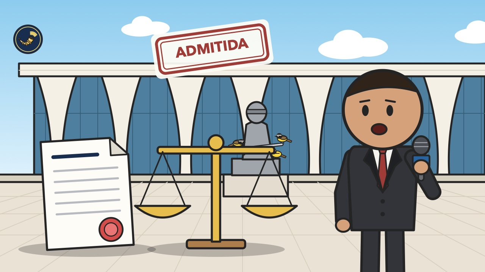

# Heimdall News — sexta-feira, 6 de novembro de 2026

10 assuntos · 17 veículos e fontes

[Assistir ao vídeo deste briefing no YouTube](https://www.youtube.com/watch?v=6vT1jydGQ9c)

## Assuntos do dia

1. Corregedor do Tribunal Superior Eleitoral admite ação do Novo que pede a cassação da chapa Lula-Alckmin
2. Lula anuncia medida provisória para criar o Ministério da Segurança Pública e deve reunir ministros nesta sexta-feira
3. Presidente do Paraguai anuncia renúncia depois do colapso de um banco digital; Senado paraguaio retoma o impeachment nesta sexta-feira
4. Lula reúne equipe econômica depois de o Banco Central manter os juros; ministro da Fazenda diz que medidas ficam para depois das viagens do presidente
5. Rogério Marinho e Tereza Cristina combinam estratégia contra Alcolumbre no Senado; Bolsonaro pede a Moraes para receber os dois
6. Flávio Bolsonaro diz ao New York Times que não teve ajuda para sair do Brasil; Polícia Federal apura a saída do senador
7. Tribunal Superior Eleitoral preserva mandato de deputada do Amapá em chapa com fraude à cota de gênero e muda entendimento de dez anos
8. Bancada bolsonarista aceita reduzir a maioridade penal para 16 anos, e relator na Câmara admite flexibilizar o texto
9. União Brasil oficializa apoio a Hugo Motta, que soma quinze partidos para a presidência da Câmara; Partido Liberal decide na próxima semana
10. Governo aprova lista de 27 minerais críticos e estratégicos, divididos em três níveis de prioridade

---

## 1. Corregedor do Tribunal Superior Eleitoral admite ação do Novo que pede a cassação da chapa Lula-Alckmin

_Ilustração: Heimdall News_

_Cobertura (10): Imprensa mais à esquerda — CartaCapital; Imprensa de centro / grandes veículos — CNN Brasil, Conjur, Estadão, Folha, G1, JOTA, Poder360; Imprensa mais à direita — Gazeta do Povo, Revista Oeste_

### O que aconteceu

O corregedor-geral eleitoral, ministro Ricardo Villas Bôas Cueva, admitiu a ação do Partido Novo contra a chapa do presidente Lula e do vice-presidente Geraldo Alckmin por suposto abuso de poder político. Os dois têm cinco dias para apresentar defesa. [[1]](https://g1.globo.com/politica/noticia/2026/11/05/tse-admite-acao-do-novo-contra-lula-e-alckmin-por-abuso-de-poder-politico.ghtml)

A ação aponta 35 atos normativos editados de 1º de janeiro a 16 de outubro de 2026, entre medidas provisórias e decretos, como o reajuste do Bolsa Família. Segundo o Novo, o impacto estimado é de 73 bilhões de reais. [[1]](https://g1.globo.com/politica/noticia/2026/11/05/tse-admite-acao-do-novo-contra-lula-e-alckmin-por-abuso-de-poder-politico.ghtml)

Depois da defesa, o corregedor decide se encerra o processo ou continua a investigação. A ação pede a cassação e oito anos de inelegibilidade, e admiti-la é o primeiro passo para que tramite: o mérito ainda não foi julgado. [[1]](https://g1.globo.com/politica/noticia/2026/11/05/tse-admite-acao-do-novo-contra-lula-e-alckmin-por-abuso-de-poder-politico.ghtml) [[2]](https://www.jota.info/eleicoes/eleicoes-2026/tse-abre-acao-contra-a-chapa-lula-alckmin-por-uso-de-maquina-publica-em-ano-eleitoral) [[3]](https://www.gazetadopovo.com.br/republica/tse-aceita-acao-do-novo-que-pede-cassacao-de-lula-e-alckmin-por-suposto-abuso-de-poder/)

O corregedor também admitiu uma ação de Flávio Bolsonaro sobre a estrutura pública de comunicação, e outras 13 ações contra a chapa já foram apresentadas. [[1]](https://g1.globo.com/politica/noticia/2026/11/05/tse-admite-acao-do-novo-contra-lula-e-alckmin-por-abuso-de-poder-politico.ghtml)

### Como cada campo político se posicionou

**Pró-governo**

- **Luiz Inácio Lula da Silva (PT), presidente da República**: Defendeu, em entrevista de 19 de outubro, os anúncios feitos na reta final da campanha e disse que não deixaria de dar benefício por causa da eleição. [[4]](https://www.cnnbrasil.com.br/politica/tse-aceita-acao-do-novo-contra-lula-e-alckmin-por-abuso-de-poder-politico/)
  > “Não vou deixar de dar benefício porque tem eleição” — [CNN Brasil](https://www.cnnbrasil.com.br/politica/tse-aceita-acao-do-novo-contra-lula-e-alckmin-por-abuso-de-poder-politico/)
- **Campanha de Lula (defesa em outra ação)**: Sustentou, em outra ação sobre o Bolsa Família, que houve reposição da inflação, sem criar benefício nem ampliar o público atendido. [[4]](https://www.cnnbrasil.com.br/politica/tse-aceita-acao-do-novo-contra-lula-e-alckmin-por-abuso-de-poder-politico/)
  > “a campanha petista sustentou que houve reposição da inflação, sem criação de benefício ou ampliação do público atendido” — [CNN Brasil](https://www.cnnbrasil.com.br/politica/tse-aceita-acao-do-novo-contra-lula-e-alckmin-por-abuso-de-poder-politico/)

**Oposição ao governo**

- **Eduardo Ribeiro, presidente do Novo**: Defendeu que o Tribunal Superior Eleitoral julgue o caso com rigor e disse que o partido levou fatos concretos e documentos. [[3]](https://www.gazetadopovo.com.br/republica/tse-aceita-acao-do-novo-que-pede-cassacao-de-lula-e-alckmin-por-suposto-abuso-de-poder/)
  > “defendeu que o Tribunal Superior Eleitoral (TSE) julgue “com rigor” o caso” — [Gazeta do Povo](https://www.gazetadopovo.com.br/republica/tse-aceita-acao-do-novo-que-pede-cassacao-de-lula-e-alckmin-por-suposto-abuso-de-poder/)
  > “O Novo levou ao TSE fatos concretos e um conjunto de documentos” — [Gazeta do Povo](https://www.gazetadopovo.com.br/republica/tse-aceita-acao-do-novo-que-pede-cassacao-de-lula-e-alckmin-por-suposto-abuso-de-poder/)

**Independente — Missão / MBL**

- **Renan Santos (Missão)**: Apresentou outra ação no tribunal contra a correção do Bolsa Família. [[4]](https://www.cnnbrasil.com.br/politica/tse-aceita-acao-do-novo-contra-lula-e-alckmin-por-abuso-de-poder-politico/)
  > “Em outra ação, apresentada por Renan Santos (Missão) contra a correção do programa” — [CNN Brasil](https://www.cnnbrasil.com.br/politica/tse-aceita-acao-do-novo-contra-lula-e-alckmin-por-abuso-de-poder-politico/)

_Sem posicionamento encontrado: Centro pró-governo, Centro, Centro-oposição, Outros / não classificável._

Referências:

1. [TSE admite ação do Novo contra Lula e Alckmin por abuso de poder político](https://g1.globo.com/politica/noticia/2026/11/05/tse-admite-acao-do-novo-contra-lula-e-alckmin-por-abuso-de-poder-politico.ghtml) — G1, 05/11 18:40
2. [TSE abre ação contra a chapa Lula-Alckmin por uso de máquina pública em ano eleitoral](https://www.jota.info/eleicoes/eleicoes-2026/tse-abre-acao-contra-a-chapa-lula-alckmin-por-uso-de-maquina-publica-em-ano-eleitoral) — JOTA, 05/11 22:46
3. [TSE aceita ação do Novo que pede cassação de Lula e Alckmin por suposto abuso de poder](https://www.gazetadopovo.com.br/republica/tse-aceita-acao-do-novo-que-pede-cassacao-de-lula-e-alckmin-por-suposto-abuso-de-poder/) — Gazeta do Povo, 05/11 20:49
4. [TSE aceita ação do Novo contra Lula e Alckmin por abuso de poder político](https://www.cnnbrasil.com.br/politica/tse-aceita-acao-do-novo-contra-lula-e-alckmin-por-abuso-de-poder-politico/) — CNN Brasil, 05/11 19:29

Outras matérias sobre o tema:

- [TSE admite ação contra chapa Lula-Alckmin para apurar abuso de poder político durante as eleições](https://www1.folha.uol.com.br/colunas/painel/2026/11/tse-admite-acao-contra-chapa-lula-alckmin-para-apurar-abuso-de-poder-politico-durante-as-eleicoes.shtml) — Folha, 05/11 17:08
- [TSE admite ação do Novo contra Lula e Alckmin por suposto abuso de poder político](https://www.cartacapital.com.br/politica/tse-admite-acao-do-novo-contra-lula-e-alckmin-por-suposto-abuso-de-poder-politico/) — CartaCapital, 05/11 20:06
- [TSE admite ação do Novo contra chapa de Lula e Alckmin](https://www.poder360.com.br/poder-justica/tse-admite-acao-do-novo-contra-chapa-de-lula-e-alckmin/) — Poder360, 05/11 21:31
- [TSE admite denúncia do Novo e instaura ação contra chapa Lula e Alckmin](https://www.estadao.com.br/politica/tse-admite-denuncia-do-novo-e-instauracao-acao-contra-chapa-lula-e-alckmin/) — Estadão, 05/11 19:48
- [TSE abre investigação contra Lula e Alckmin por suspeita de abuso de poder político](https://revistaoeste.com/no-ponto/tse-abre-investigacao-contra-lula-e-alckmin-por-suspeita-de-abuso-de-poder-politico/) — Revista Oeste, 05/11 19:37
- [TSE abre investigação contra chapa Lula/Alckmin por abuso de poder político](https://conjur.com.br/2026-nov-05/tse-abre-investigacao-contra-chapa-lula-alckmin-por-suposto-abuso-de-poder-politico/) — Conjur, 05/11 21:11

---

## 2. Lula anuncia medida provisória para criar o Ministério da Segurança Pública e deve reunir ministros nesta sexta-feira

_Ilustração: Heimdall News_

_Cobertura (5): Imprensa mais à esquerda — CartaCapital; Imprensa de centro / grandes veículos — CNN Brasil, Estadão, G1, Poder360_

### O que aconteceu

Em transmissão com o deputado André Janones, o presidente disse que vai enviar uma medida provisória para criar o Ministério da Segurança Pública. [[1]](https://www.poder360.com.br/poder-governo/lula-anuncia-mp-para-criar-ministerio-da-seguranca-publica/) [[2]](https://www.cartacapital.com.br/politica/lula-vai-criar-ministerio-da-seguranca-publica-com-medida-provisoria/)

Lula deve se reunir nesta sexta-feira com os ministros da Justiça, Wellington César Lima e Silva, e da Casa Civil, Miriam Belchior, para discutir o tema. [[3]](https://g1.globo.com/politica/noticia/2026/11/06/lula-faz-reuniao-nesta-sexta-para-discutir-recriacao-do-ministerio-da-seguranca-publica-pasta-existiu-no-governo-temer.ghtml)

A criação da pasta é promessa do presidente e foi reforçada depois de o Senado aprovar, na terça-feira, a Proposta de Emenda à Constituição da Segurança Pública, que seguiu para promulgação. [[3]](https://g1.globo.com/politica/noticia/2026/11/06/lula-faz-reuniao-nesta-sexta-para-discutir-recriacao-do-ministerio-da-seguranca-publica-pasta-existiu-no-governo-temer.ghtml)

Uma medida provisória tem força de lei, mas precisa da aprovação da Câmara e do Senado, com prazo de 60 dias prorrogáveis por mais 60. A pasta já existiu em 2018, no governo Michel Temer. [[3]](https://g1.globo.com/politica/noticia/2026/11/06/lula-faz-reuniao-nesta-sexta-para-discutir-recriacao-do-ministerio-da-seguranca-publica-pasta-existiu-no-governo-temer.ghtml)

### Como cada campo político se posicionou

**Pró-governo**

- **Luiz Inácio Lula da Silva (PT), presidente da República**: Disse que o ministério é uma reivindicação da sociedade e que é preciso separar o dinheiro e fazer acordo com prefeitos e estados. [[4]](https://www.cnnbrasil.com.br/politica/lula-diz-que-discutira-criacao-do-ministerio-da-seguranca-nesta-sexta/)
  > “Temos que criar o ministério, separar o dinheiro, preparar a Polícia Militar, fazer acordo com prefeitos e estados” — [CNN Brasil](https://www.cnnbrasil.com.br/politica/lula-diz-que-discutira-criacao-do-ministerio-da-seguranca-nesta-sexta/)

_Sem posicionamento encontrado: Centro pró-governo, Centro, Centro-oposição, Oposição ao governo, Independente — Missão / MBL, Outros / não classificável._

Referências:

1. [Lula anuncia MP para criar Ministério da Segurança Pública](https://www.poder360.com.br/poder-governo/lula-anuncia-mp-para-criar-ministerio-da-seguranca-publica/) — Poder360, 05/11 21:03
2. [Lula vai criar Ministério da Segurança Pública com Medida Provisória](https://www.cartacapital.com.br/politica/lula-vai-criar-ministerio-da-seguranca-publica-com-medida-provisoria/) — CartaCapital, 05/11 22:57
3. [Lula faz reunião nesta sexta para discutir recriação do Ministério da Segurança Pública; pasta existiu no governo Temer](https://g1.globo.com/politica/noticia/2026/11/06/lula-faz-reuniao-nesta-sexta-para-discutir-recriacao-do-ministerio-da-seguranca-publica-pasta-existiu-no-governo-temer.ghtml) — G1, 06/11 00:00
4. [Lula diz que discutirá criação do Ministério da Segurança nesta sexta](https://www.cnnbrasil.com.br/politica/lula-diz-que-discutira-criacao-do-ministerio-da-seguranca-nesta-sexta/) — CNN Brasil, 05/11 21:02

Outras matérias sobre o tema:

- [Lula anuncia que editará MP para criar Ministério da Segurança Pública](https://www.estadao.com.br/politica/lula-anuncia-que-editara-mp-para-criar-ministerio-da-seguranca-publica/) — Estadão, 05/11 20:19

---

## 3. Presidente do Paraguai anuncia renúncia depois do colapso de um banco digital; Senado paraguaio retoma o impeachment nesta sexta-feira

_Ilustração: Heimdall News_

_Cobertura (7): Imprensa mais à esquerda — Brasil de Fato, CartaCapital; Imprensa de centro / grandes veículos — CNN Brasil, Conjur, Folha, Poder360; Imprensa mais à direita — Revista Oeste_

### O que aconteceu

Santiago Peña anunciou na quinta-feira que vai renunciar à Presidência do Paraguai, em meio ao colapso do Ueno Bank, o maior banco digital do país. A sessão do Congresso sobre a renúncia terminou sem votação, e ele continua formalmente no posto. [[1]](https://www.poder360.com.br/poder-internacional/santiago-pena-renuncia-ao-cargo-de-presidente-do-paraguai/) [[2]](https://revistaoeste.com/no-ponto/crise-no-paraguai-leva-presidente-de-comissao-do-senado-a-acionar-itamaraty/) [[3]](https://www.poder360.com.br/poder-internacional/pena-enfrenta-julgamento-no-senado-paraguaio-nesta-6a-feira/)

A Câmara dos Deputados do Paraguai aprovou o impeachment por 78 votos a zero, e o Senado retoma a sessão nesta sexta-feira, quando Peña deve apresentar a defesa. [[4]](https://www.cnnbrasil.com.br/internacional/camara-do-paraguai-aprova-impeachment-do-presidente-santiago-pena/) [[5]](https://www.cnnbrasil.com.br/internacional/senado-paraguai-sessao-impeachment-santiago-pena/) [[3]](https://www.poder360.com.br/poder-internacional/pena-enfrenta-julgamento-no-senado-paraguaio-nesta-6a-feira/)

Santiago Peña foi acionista até março do ano passado do grupo dono do banco, que tinha cerca de 3 milhões de clientes. A oposição paraguaia o acusa de conflito de interesses, entre outros pontos. [[4]](https://www.cnnbrasil.com.br/internacional/camara-do-paraguai-aprova-impeachment-do-presidente-santiago-pena/) [[6]](https://www.cnnbrasil.com.br/internacional/senado-paraguai-impeachment-santiago-pena/)

Os deputados rejeitaram o impeachment do vice-presidente Pedro Alliana, o nome mais provável para assumir o governo até agosto de 2028. [[3]](https://www.poder360.com.br/poder-internacional/pena-enfrenta-julgamento-no-senado-paraguaio-nesta-6a-feira/)

### Como cada campo político se posicionou

**Pró-governo**

- **Celso Amorim, assessor especial da Presidência para Assuntos Internacionais**: Disse esperar que a mudança aproxime o Paraguai do Mercosul e afirmou que o episódio ocorreu por razões internas. [[7]](https://www.cnnbrasil.com.br/internacional/amorim-vamos-esperar-que-crise-torne-o-paraguai-mais-proximo-do-mercosul/)
  > “Amorim manifestou o desejo de que a mudança política no Paraguai aproxime o país do Mercosul” — [CNN Brasil](https://www.cnnbrasil.com.br/internacional/amorim-vamos-esperar-que-crise-torne-o-paraguai-mais-proximo-do-mercosul/)
  > “Amorim declarou que o fato ocorreu por razões puramente internas” — [CNN Brasil](https://www.cnnbrasil.com.br/internacional/amorim-vamos-esperar-que-crise-torne-o-paraguai-mais-proximo-do-mercosul/)
- **Palácio do Planalto (avaliação relatada pela CNN Brasil)**: Avaliou que a renúncia enfraquece a direita alinhada a Donald Trump na América Latina. [[8]](https://www.cnnbrasil.com.br/politica/planalto-ve-saida-de-pena-como-novo-reves-da-direita-na-regiao/)
  > “avalia que a renúncia do presidente do Paraguai, Santiago Peña, enfraquece a direita alinhada ao presidente dos Estados Unidos, Donald Trump, na América Latina” — [CNN Brasil](https://www.cnnbrasil.com.br/politica/planalto-ve-saida-de-pena-como-novo-reves-da-direita-na-regiao/)
- **Ministério das Relações Exteriores (segundo diplomatas)**: Tratou a crise como assunto interno do Paraguai e não se manifestou oficialmente. [[9]](https://www.cnnbrasil.com.br/internacional/itamaraty-ve-crise-no-paraguai-como-assunto-interno/) [[10]](https://www1.folha.uol.com.br/colunas/painel/2026/11/apesar-de-preocupacao-politica-diplomacia-avalia-que-renuncia-de-pena-e-problema-interno.shtml)
  > “optou por não emitir nenhuma manifestação oficial até o momento” — [CNN Brasil](https://www.cnnbrasil.com.br/internacional/itamaraty-ve-crise-no-paraguai-como-assunto-interno/)
  > “a chancelaria brasileira avalia que a situação precisa ser resolvida internamente” — [Folha](https://www1.folha.uol.com.br/colunas/painel/2026/11/apesar-de-preocupacao-politica-diplomacia-avalia-que-renuncia-de-pena-e-problema-interno.shtml)

**Centro pró-governo**

- **Nelsinho Trad (PSD-MS), presidente da Comissão de Relações Exteriores do Senado**: Manifestou preocupação com a crise e anunciou que buscará informações com o Itamaraty e a Embaixada do Paraguai. [[2]](https://revistaoeste.com/no-ponto/crise-no-paraguai-leva-presidente-de-comissao-do-senado-a-acionar-itamaraty/)
  > “anunciou que buscará informações com o Itamaraty e a Embaixada do Paraguai em Brasília” — [Revista Oeste](https://revistaoeste.com/no-ponto/crise-no-paraguai-leva-presidente-de-comissao-do-senado-a-acionar-itamaraty/)

_Sem posicionamento encontrado: Centro, Centro-oposição, Oposição ao governo, Independente — Missão / MBL, Outros / não classificável._

Referências:

1. [Santiago Peña renuncia ao cargo de presidente do Paraguai](https://www.poder360.com.br/poder-internacional/santiago-pena-renuncia-ao-cargo-de-presidente-do-paraguai/) — Poder360, 05/11 13:32
2. [Crise no Paraguai leva presidente de comissão do Senado a acionar Itamaraty](https://revistaoeste.com/no-ponto/crise-no-paraguai-leva-presidente-de-comissao-do-senado-a-acionar-itamaraty/) — Revista Oeste, 05/11 15:31
3. [Peña enfrenta julgamento no Senado paraguaio nesta 6ª feira](https://www.poder360.com.br/poder-internacional/pena-enfrenta-julgamento-no-senado-paraguaio-nesta-6a-feira/) — Poder360, 06/11 04:35
4. [Câmara do Paraguai aprova impeachment do presidente Santiago Peña](https://www.cnnbrasil.com.br/internacional/camara-do-paraguai-aprova-impeachment-do-presidente-santiago-pena/) — CNN Brasil, 05/11 14:24
5. [Senado do Paraguai retoma amanhã sessão sobre impeachment de Santiago Peña](https://www.cnnbrasil.com.br/internacional/senado-paraguai-sessao-impeachment-santiago-pena/) — CNN Brasil, 05/11 21:37
6. [Senado do Paraguai inicia sessão sobre impeachment de Santiago Peña](https://www.cnnbrasil.com.br/internacional/senado-paraguai-impeachment-santiago-pena/) — CNN Brasil, 05/11 19:58
7. [Amorim: Vamos esperar que crise torne o Paraguai mais próximo do Mercosul](https://www.cnnbrasil.com.br/internacional/amorim-vamos-esperar-que-crise-torne-o-paraguai-mais-proximo-do-mercosul/) — CNN Brasil, 05/11 17:12
8. [Planalto vê saída de Peña como novo revés da direita na região](https://www.cnnbrasil.com.br/politica/planalto-ve-saida-de-pena-como-novo-reves-da-direita-na-regiao/) — CNN Brasil, 05/11 21:03
9. [Itamaraty vê crise no Paraguai como assunto interno](https://www.cnnbrasil.com.br/internacional/itamaraty-ve-crise-no-paraguai-como-assunto-interno/) — CNN Brasil, 05/11 18:19
10. [Apesar de preocupação política, diplomacia avalia que renúncia de Peña é 'problema interno'](https://www1.folha.uol.com.br/colunas/painel/2026/11/apesar-de-preocupacao-politica-diplomacia-avalia-que-renuncia-de-pena-e-problema-interno.shtml) — Folha, 05/11 18:20

Outras matérias sobre o tema:

- [Senadora do Paraguai pede prisão de Peña para evitar fuga e cita Flávio](https://www.poder360.com.br/poder-internacional/senadora-do-paraguai-pede-prisao-de-pena-para-evitar-fuga-e-cita-flavio/) — Poder360, 05/11 23:26
- [Master e Ueno são ‘grupos privados que usam estrutura política para lucrar em cima do país’, diz analista internacional](https://www.brasildefato.com.br/2026/11/05/master-e-ueno-sao-grupos-privados-que-usam-estrutura-politica-para-lucrar-em-cima-do-pais-diz-analista-internacional/) — Brasil de Fato, 05/11 21:23
- [Santiago Peña renuncia à presidência do Paraguai em meio a crise bancária](https://conjur.com.br/2026-nov-05/santiago-pena-renuncia-a-presidencia-do-paraguai-em-meio-a-crise-do-banco-ueno/) — Conjur, 05/11 15:38
- [Santiago Peña renuncia à Presidência do Paraguai em meio a escândalo bancário](https://www.cartacapital.com.br/politica/santiago-pena-renuncia-a-presidencia-do-paraguai-em-meio-a-escandalo-bancario/) — CartaCapital, 05/11 13:47
- [Presidente do Paraguai renuncia após escândalo bancário e pressão no Congresso](https://www.brasildefato.com.br/2026/11/05/presidente-do-paraguai-renuncia-apos-escandalo-bancario-e-pressao-no-congresso/) — Brasil de Fato, 05/11 13:58

---

## 4. Lula reúne equipe econômica depois de o Banco Central manter os juros; ministro da Fazenda diz que medidas ficam para depois das viagens do presidente

_Ilustração: Heimdall News_

_Cobertura (6): Imprensa mais à esquerda — CartaCapital; Imprensa de centro / grandes veículos — CNN Brasil, Folha, G1; Imprensa mais à direita — Gazeta do Povo, Revista Oeste_

### O que aconteceu

O presidente reuniu ministros, ex-ministros e economistas no Palácio da Alvorada na quinta-feira, um dia depois de o Comitê de Política Monetária interromper os cortes e manter os juros básicos em 13,75% ao ano. [[1]](https://revistaoeste.com/politica/reuniao-equipe-economica-lula-durigan/) [[2]](https://www.gazetadopovo.com.br/economia/lula-convoca-equipe-economica-apos-pressao-do-mercado-mas-nao-define-novas-medidas-fiscais/)

Estiveram no encontro o vice-presidente Geraldo Alckmin, os ex-ministros Fernando Haddad e Guido Mantega, o presidente do Banco Nacional de Desenvolvimento Econômico e Social, Aloizio Mercadante, e os economistas Luciano Coutinho, Eduardo Moreira e Laura Carvalho. [[1]](https://revistaoeste.com/politica/reuniao-equipe-economica-lula-durigan/)

O ministro da Fazenda disse que não foram discutidas medidas específicas e que as propostas serão apresentadas depois das viagens do presidente, na segunda metade de novembro. [[2]](https://www.gazetadopovo.com.br/economia/lula-convoca-equipe-economica-apos-pressao-do-mercado-mas-nao-define-novas-medidas-fiscais/) [[3]](https://www.cnnbrasil.com.br/economia/money/macroeconomia/durigan-vamos-enviar-medidas-para-lula-apos-volta-de-viagem-internacional/)

A dívida bruta chegou a 82,9% do Produto Interno Bruto em agosto, segundo o Banco Central. A Instituição Fiscal Independente, do Senado, estima que as medidas da campanha podem custar cerca de 300 bilhões de reais. [[1]](https://revistaoeste.com/politica/reuniao-equipe-economica-lula-durigan/) [[2]](https://www.gazetadopovo.com.br/economia/lula-convoca-equipe-economica-apos-pressao-do-mercado-mas-nao-define-novas-medidas-fiscais/)

### Como cada campo político se posicionou

**Pró-governo**

- **Dario Durigan, ministro da Fazenda**: Disse que não há fórmula mágica e defendeu reforçar as regras fiscais em vigor. [[2]](https://www.gazetadopovo.com.br/economia/lula-convoca-equipe-economica-apos-pressao-do-mercado-mas-nao-define-novas-medidas-fiscais/)
  > “Não nos parece haver fórmula mágica, e sim manutenção dos compromissos fiscais” — [Gazeta do Povo](https://www.gazetadopovo.com.br/economia/lula-convoca-equipe-economica-apos-pressao-do-mercado-mas-nao-define-novas-medidas-fiscais/)
- **Luiz Inácio Lula da Silva (PT), presidente da República**: Disse que é preciso ter a economia arrumada para atrair investimentos. [[4]](https://www.cnnbrasil.com.br/economia/money/macroeconomia/economia-precisa-estar-arrumada-para-atrair-investimento-diz-lula/)
  > “Para a gente atrair tem que ter economia arrumada.” — [CNN Brasil](https://www.cnnbrasil.com.br/economia/money/macroeconomia/economia-precisa-estar-arrumada-para-atrair-investimento-diz-lula/)
- **Lindbergh Farias (PT-RJ), vice-líder do governo na Câmara**: Disse que o Banco Central sucumbiu às pressões do mercado. [[5]](https://g1.globo.com/politica/blog/valdo-cruz/post/2026/11/05/pt-e-parte-da-equipe-de-lula-atacam-bc-apos-copom-interromper-ciclo-de-corte-de-juros-por-duvidas-sobre-ajuste-fiscal.ghtml)
  > “disse que o BC sucumbiu às pressões do mercado” — [G1](https://g1.globo.com/politica/blog/valdo-cruz/post/2026/11/05/pt-e-parte-da-equipe-de-lula-atacam-bc-apos-copom-interromper-ciclo-de-corte-de-juros-por-duvidas-sobre-ajuste-fiscal.ghtml)

**Outros / não classificável**

- **Christopher Garman, diretor-executivo do Eurasia Group**: Avaliou que o debate no governo é reduzir o ritmo do aumento do gasto, e não cortar gastos. [[6]](https://www.cnnbrasil.com.br/economia/money/macroeconomia/nao-existe-um-debate-de-corte-de-gastos-no-governo-lula-diz-eurasia-group/)
  > “O que existe é um debate de implementar medidas para tentar reduzir o ritmo do aumento do gasto” — [CNN Brasil](https://www.cnnbrasil.com.br/economia/money/macroeconomia/nao-existe-um-debate-de-corte-de-gastos-no-governo-lula-diz-eurasia-group/)

_Sem posicionamento encontrado: Centro pró-governo, Centro, Centro-oposição, Oposição ao governo, Independente — Missão / MBL._

Referências:

1. [Lula termina reunião com equipe econômica sem definições](https://revistaoeste.com/politica/reuniao-equipe-economica-lula-durigan/) — Revista Oeste, 05/11 17:49
2. [Lula convoca equipe econômica após pressão do mercado, mas não define novas medidas fiscais](https://www.gazetadopovo.com.br/economia/lula-convoca-equipe-economica-apos-pressao-do-mercado-mas-nao-define-novas-medidas-fiscais/) — Gazeta do Povo, 05/11 17:11
3. [Durigan: Vamos enviar medidas para Lula após volta de viagem internacional](https://www.cnnbrasil.com.br/economia/money/macroeconomia/durigan-vamos-enviar-medidas-para-lula-apos-volta-de-viagem-internacional/) — CNN Brasil, 05/11 16:55
4. [Economia precisa estar “arrumada” para atrair investimento, diz Lula](https://www.cnnbrasil.com.br/economia/money/macroeconomia/economia-precisa-estar-arrumada-para-atrair-investimento-diz-lula/) — CNN Brasil, 05/11 19:05
5. [PT e parte da equipe de Lula atacam BC após Copom interromper ciclo de corte de juros por dúvidas sobre ajuste fiscal](https://g1.globo.com/politica/blog/valdo-cruz/post/2026/11/05/pt-e-parte-da-equipe-de-lula-atacam-bc-apos-copom-interromper-ciclo-de-corte-de-juros-por-duvidas-sobre-ajuste-fiscal.ghtml) — G1, 05/11 10:24
6. [Não existe um debate de corte de gastos no governo Lula, diz Eurasia Group](https://www.cnnbrasil.com.br/economia/money/macroeconomia/nao-existe-um-debate-de-corte-de-gastos-no-governo-lula-diz-eurasia-group/) — CNN Brasil, 06/11 04:42

Outras matérias sobre o tema:

- [Após reunião com Lula, Durigan fala em reforçar regras fiscais vigentes](https://www.cnnbrasil.com.br/economia/money/macroeconomia/apos-reuniao-com-lula-durigan-fala-em-reforcar-regras-fiscais-vigentes/) — CNN Brasil, 05/11 17:09
- [Quem investe terá previsibilidade, diz Durigan após reunião com Lula](https://www.cnnbrasil.com.br/economia/money/macroeconomia/quem-investe-tera-previsibilidade-diz-durigan-apos-reuniao-com-lula/) — CNN Brasil, 05/11 17:25
- [Lula convoca ministro da Fazenda e economistas do PT para discutir medidas para economia após BC parar corte de juros](https://g1.globo.com/politica/blog/valdo-cruz/post/2026/11/05/lula-convoca-ministro-da-fazenda-e-economistas-do-pt-para-discutir-medidas-para-economia-apos-bc-parar-corte-de-juros.ghtml) — G1, 05/11 10:33
- [Lula convoca reunião com economistas próximos ao PT e quer ampliar discussão sobre cenário econômico](https://www1.folha.uol.com.br/mercado/2026/11/lula-convoca-reuniao-com-economistas-proximos-ao-pt-e-quer-ampliar-discussao-sobre-cenario-economico.shtml) — Folha, 05/11 10:13
- [Durigan diz que governo tem de criar condições para reduzir juros e classifica Selic como ‘muito alta’](https://www.cartacapital.com.br/politica/durigan-diz-que-governo-tem-de-criar-condicoes-para-reduzir-juros-e-classifica-selic-como-muito-alta/) — CartaCapital, 05/11 11:12

---

## 5. Rogério Marinho e Tereza Cristina combinam estratégia contra Alcolumbre no Senado; Bolsonaro pede a Moraes para receber os dois

_Ilustração: Heimdall News_

_Cobertura (9): Imprensa mais à esquerda — Brasil de Fato; Imprensa de centro / grandes veículos — CNN Brasil, Estadão, Folha, G1, Poder360; Imprensa mais à direita — Gazeta do Povo, Revista Oeste; Partidos e movimentos — PSB (site oficial)_

### O que aconteceu

O ex-presidente Jair Bolsonaro pediu ao ministro Alexandre de Moraes autorização para receber os senadores Rogério Marinho e Tereza Cristina, pré-candidatos à presidência do Senado. [[1]](https://www1.folha.uol.com.br/blogs/brasilia-hoje/2026/11/bolsonaro-pede-a-moraes-autorizacao-para-visita-de-candidatos-da-direita-a-presidencia-do-senado.shtml)

Marinho diz ter um acordo com Tereza Cristina para unificar as candidaturas até a eleição, marcada para 1º de fevereiro de 2027, contra o atual presidente, Davi Alcolumbre. [[1]](https://www1.folha.uol.com.br/blogs/brasilia-hoje/2026/11/bolsonaro-pede-a-moraes-autorizacao-para-visita-de-candidatos-da-direita-a-presidencia-do-senado.shtml)

Para vencer são necessários 41 dos 81 votos, numa votação secreta. Segundo a Folha de S.Paulo, os aliados de Marinho contam 38 votos sólidos. [[2]](https://www.gazetadopovo.com.br/republica/rogerio-marinho-e-tereza-cristina-lancam-estrategia-para-vencer-alcolumbre/) [[3]](https://www1.folha.uol.com.br/poder/2026/11/marinho-viajara-o-pais-e-aposta-em-pressao-de-bolsonaristas-por-votos-para-presidencia-do-senado.shtml)

O presidente do Senado oficializou o senador Eduardo Gomes, do Partido Liberal, na relatoria da Lei de Diretrizes Orçamentárias de 2027. Segundo a CNN Brasil, a escolha é interpretada nos bastidores como busca de votos nessa bancada. [[4]](https://www.cnnbrasil.com.br/politica/alcolumbre-articula-apoio-do-pl-em-disputa-no-senado/)

### Como cada campo político se posicionou

**Centro pró-governo**

- **Cid Gomes (PSB-CE), líder do PSB no Senado**: Assinou a nota em que o partido anuncia que deve formalizar apoio à reeleição de Alcolumbre. [[5]](https://psb40.org.br/psb-reune-bancada-eleita-no-senado-e-deve-apoiar-reeleicao-de-alcolumbre/)
  > “em nota assinada pelo líder da bancada, senador Cid Gomes (CE), o PSB anunciou que deve formalizar apoio à reeleição de Alcolumbre” — [PSB (site oficial)](https://psb40.org.br/psb-reune-bancada-eleita-no-senado-e-deve-apoiar-reeleicao-de-alcolumbre/)

**Centro**

- **Davi Alcolumbre (União-AP), presidente do Senado**: Disse que a situação no Brasil estava impossível por causa de ofensas, agressões e ameaças contra ele. [[6]](https://www.poder360.com.br/poder-congresso/nikolas-rebate-alcolumbre-apos-senador-criticar-protesto-no-amapa/)
  > “a situação no Brasil estava “impossível” por causa de ofensas, agressões e ameaças contra ele” — [Poder360](https://www.poder360.com.br/poder-congresso/nikolas-rebate-alcolumbre-apos-senador-criticar-protesto-no-amapa/)

**Oposição ao governo**

- **Tereza Cristina (PP-MS), senadora**: Disse que a estratégia do campo dela é ganhar o Senado e que não pretende enfrentar Marinho diretamente na eleição. [[7]](https://g1.globo.com/politica/noticia/2026/11/05/tereza-cristina-disputa-presidencia-senado-jair-bolsonaro.ghtml)
  > “A estratégia do nosso campo é ganhar o Senado” — [G1](https://g1.globo.com/politica/noticia/2026/11/05/tereza-cristina-disputa-presidencia-senado-jair-bolsonaro.ghtml)
  > “não pretende enfrentar Marinho diretamente na eleição” — [G1](https://g1.globo.com/politica/noticia/2026/11/05/tereza-cristina-disputa-presidencia-senado-jair-bolsonaro.ghtml)
- **Carlos Portinho (PL-RJ), líder do PL no Senado**: Disse que Alcolumbre descumpriu um acordo sobre a maioridade penal e que o adiamento da votação criou uma crise de confiança entre os senadores. [[8]](https://revistaoeste.com/politica/lider-do-pl-fala-que-alcolumbre-descumpriu-acordo/)
  > “O Senado criou uma crise de confiança entre os seus pares. Isso é inadmissível” — [Revista Oeste](https://revistaoeste.com/politica/lider-do-pl-fala-que-alcolumbre-descumpriu-acordo/)
- **Nikolas Ferreira (PL-MG), deputado federal**: Rebateu as críticas de Alcolumbre e disse que participou de um ato pacífico no Amapá. [[6]](https://www.poder360.com.br/poder-congresso/nikolas-rebate-alcolumbre-apos-senador-criticar-protesto-no-amapa/)
  > “afirmou que não o ofendeu nem o ameaçou durante a manifestação e disse que participou de um ato pacífico” — [Poder360](https://www.poder360.com.br/poder-congresso/nikolas-rebate-alcolumbre-apos-senador-criticar-protesto-no-amapa/)

_Sem posicionamento encontrado: Pró-governo, Centro-oposição, Independente — Missão / MBL, Outros / não classificável._

Referências:

1. [Bolsonaro pede a Moraes autorização para visita de candidatos da direita à presidência do Senado](https://www1.folha.uol.com.br/blogs/brasilia-hoje/2026/11/bolsonaro-pede-a-moraes-autorizacao-para-visita-de-candidatos-da-direita-a-presidencia-do-senado.shtml) — Folha, 05/11 18:32
2. [Rogério Marinho e Tereza Cristina lançam estratégia para vencer Alcolumbre](https://www.gazetadopovo.com.br/republica/rogerio-marinho-e-tereza-cristina-lancam-estrategia-para-vencer-alcolumbre/) — Gazeta do Povo, 06/11 01:21
3. [Marinho viajará o país e aposta em pressão de bolsonaristas por votos para presidência do Senado](https://www1.folha.uol.com.br/poder/2026/11/marinho-viajara-o-pais-e-aposta-em-pressao-de-bolsonaristas-por-votos-para-presidencia-do-senado.shtml) — Folha, 06/11 04:00
4. [Alcolumbre articula apoio do PL em disputa no Senado](https://www.cnnbrasil.com.br/politica/alcolumbre-articula-apoio-do-pl-em-disputa-no-senado/) — CNN Brasil, 05/11 17:31
5. [PSB reúne bancada eleita no Senado e deve apoiar reeleição de Alcolumbre](https://psb40.org.br/psb-reune-bancada-eleita-no-senado-e-deve-apoiar-reeleicao-de-alcolumbre/) — PSB (site oficial), 05/11 10:41
6. [Nikolas rebate Alcolumbre após senador criticar protesto no Amapá](https://www.poder360.com.br/poder-congresso/nikolas-rebate-alcolumbre-apos-senador-criticar-protesto-no-amapa/) — Poder360, 05/11 17:25
7. [Tereza Cristina diz que pretende discutir disputa pela presidência do Senado com Jair Bolsonaro: 'explicar o que está acontecendo'](https://g1.globo.com/politica/noticia/2026/11/05/tereza-cristina-disputa-presidencia-senado-jair-bolsonaro.ghtml) — G1, 05/11 20:41
8. [Líder do PL fala que Alcolumbre descumpriu acordo](https://revistaoeste.com/politica/lider-do-pl-fala-que-alcolumbre-descumpriu-acordo/) — Revista Oeste, 05/11 21:57

Outras matérias sobre o tema:

- [Alcolumbre critica falta de bandeiras da oposição, mas qual a proposta dele para o País?](https://www.estadao.com.br/politica/carlos-andreazza/alcolumbre-critica-falta-de-bandeiras-da-oposicao-mas-qual-a-proposta-dele-para-o-pais/) — Estadão, 05/11 20:00
- [Bolsonaro pede a Moraes autorização para receber Marinho e Tereza, pré-candidatos à presidência do Senado](https://g1.globo.com/politica/noticia/2026/11/05/bolsonaro-pede-a-moraes-autorizacao-para-receber-marinho-e-tereza-que-devem-disputar-presidencia-do-senado.ghtml) — G1, 05/11 11:33
- [Bolsonaro pede a Moraes autorização para receber Rogério Marinho e Tereza Cristina](https://www.gazetadopovo.com.br/republica/bolsonaro-pede-a-moraes-autorizacao-para-receber-rogerio-marinho-e-tereza-cristina/) — Gazeta do Povo, 05/11 13:08
- [Bolsonaro pede para receber Marinho e Tereza Cristina em casa em meio a articulações no Senado](https://www.estadao.com.br/politica/bolsonaro-pede-para-receber-marinho-e-tereza-cristina-em-casa-em-meio-a-articulacoes-no-senado/) — Estadão, 05/11 11:56
- [Rogério Marinho e Tereza Cristina articulam estratégia para derrotar Alcolumbre no Senado](https://www.gazetadopovo.com.br/republica/rogerio-marinho-e-tereza-cristina-articulam-estrategia-para-derrotar-alcolumbre-no-senado/) — Gazeta do Povo, 05/11 21:20
- [PSB teve conversa inicial com Alcolumbre sobre reeleição, diz Casagrande](https://www.cnnbrasil.com.br/politica/psb-teve-conversa-inicial-com-alcolumbre-sobre-reeleicao-diz-casagrande/) — CNN Brasil, 04/11 17:56
- [Alcolumbre entendeu que seu meio de sobrevivência é pela composição, analisa cientista política](https://www.brasildefato.com.br/2026/11/05/alcolumbre-entendeu-que-seu-meio-de-sobrevivencia-e-pela-composicao-analisa-cientista-politica/) — Brasil de Fato, 05/11 21:09

---

## 6. Flávio Bolsonaro diz ao New York Times que não teve ajuda para sair do Brasil; Polícia Federal apura a saída do senador

_Ilustração: Heimdall News_

_Cobertura (6): Imprensa mais à esquerda — Brasil de Fato; Imprensa de centro / grandes veículos — CNN Brasil, Estadão, Folha, Poder360; Imprensa mais à direita — Gazeta do Povo_

### O que aconteceu

Em entrevista ao jornal New York Times, o senador Flávio Bolsonaro negou ter recebido ajuda de algum governo para ir aos Estados Unidos. Segundo o Brasil de Fato, ele repetiu a tese de fraude na eleição, e o New York Times destacou que são alegações já desmentidas. [[1]](https://www1.folha.uol.com.br/poder/2026/11/flavio-diz-ao-nyt-que-levara-para-o-tumulo-segredo-sobre-como-fugiu-do-brasil-e-chegou-aos-eua.shtml) [[2]](https://www.brasildefato.com.br/2026/11/05/the-new-york-times-minimiza-entrevista-de-flavio-bolsonaro-e-desmente-teses-de-fraude-na-eleicao-e-perseguicao/)

Ele chegou aos Estados Unidos em 28 de outubro, depois de perder a eleição e de receber ordem para entregar os passaportes, numa investigação sobre suspeitas de lavagem de dinheiro envolvendo o advogado Willer Tomaz, amigo dele. [[1]](https://www1.folha.uol.com.br/poder/2026/11/flavio-diz-ao-nyt-que-levara-para-o-tumulo-segredo-sobre-como-fugiu-do-brasil-e-chegou-aos-eua.shtml)

A Polícia Federal apura as circunstâncias da saída, o possível descumprimento de decisões judiciais e a participação de terceiros. Segundo a Gazeta do Povo, o senador não é foragido e não há condenações contra ele no Brasil. [[3]](https://www.gazetadopovo.com.br/republica/saida-de-flavio-do-brasil-com-acao-de-agentes-internacionais-e-linha-de-investigacao-da-pf/)

O líder do governo no Congresso, Randolfe Rodrigues, pediu a anulação do voto que Flávio Bolsonaro registrou dos Estados Unidos na Proposta de Emenda à Constituição da Segurança Pública, e o presidente do Senado disse que vai analisar. [[4]](https://www.cnnbrasil.com.br/politica/alcolumbre-diz-que-vai-avaliar-pedido-para-anular-voto-remoto-de-flavio/)

### Como cada campo político se posicionou

**Pró-governo**

- **Luiz Inácio Lula da Silva (PT), presidente da República**: Disse que o senador foi aos Estados Unidos buscar proteção e que vai ter de voltar ao Brasil para responder aos processos. [[5]](https://www.cnnbrasil.com.br/politica/lula-diz-que-flavio-e-pe-frio-e-que-senador-foi-aos-eua-buscar-protecao/)
  > “Vai ter que voltar para o Brasil para receber os processos que tem” — [CNN Brasil](https://www.cnnbrasil.com.br/politica/lula-diz-que-flavio-e-pe-frio-e-que-senador-foi-aos-eua-buscar-protecao/)
- **Randolfe Rodrigues (PT-AP), líder do governo no Congresso**: Disse que não quer vetar voto de ninguém, mas questionou o senador votar de fora do país. [[4]](https://www.cnnbrasil.com.br/politica/alcolumbre-diz-que-vai-avaliar-pedido-para-anular-voto-remoto-de-flavio/)
  > “Eu não quero censurar e vetar voto de ninguém” — [CNN Brasil](https://www.cnnbrasil.com.br/politica/alcolumbre-diz-que-vai-avaliar-pedido-para-anular-voto-remoto-de-flavio/)

**Centro**

- **Davi Alcolumbre (União-AP), presidente do Senado**: Disse que vai convocar os assessores para avaliar o pedido à luz dos regimentos. [[4]](https://www.cnnbrasil.com.br/politica/alcolumbre-diz-que-vai-avaliar-pedido-para-anular-voto-remoto-de-flavio/)
  > “Vou convocar nossos assessores para avaliar, à luz dos regimentos do Senado Federal e do Congresso Nacional” — [CNN Brasil](https://www.cnnbrasil.com.br/politica/alcolumbre-diz-que-vai-avaliar-pedido-para-anular-voto-remoto-de-flavio/)

**Oposição ao governo**

- **Flávio Bolsonaro (PL-RJ), senador**: Afirmou que fez tudo por conta própria, sem ajuda de nenhum governo, e que levará para o túmulo como chegou aos Estados Unidos. [[1]](https://www1.folha.uol.com.br/poder/2026/11/flavio-diz-ao-nyt-que-levara-para-o-tumulo-segredo-sobre-como-fugiu-do-brasil-e-chegou-aos-eua.shtml)
  > “Não houve ajuda de absolutamente ninguém, de nenhum governo” — [Folha](https://www1.folha.uol.com.br/poder/2026/11/flavio-diz-ao-nyt-que-levara-para-o-tumulo-segredo-sobre-como-fugiu-do-brasil-e-chegou-aos-eua.shtml)
  > “levarei isso para o túmulo comigo” — [Folha](https://www1.folha.uol.com.br/poder/2026/11/flavio-diz-ao-nyt-que-levara-para-o-tumulo-segredo-sobre-como-fugiu-do-brasil-e-chegou-aos-eua.shtml)
- **Eduardo Bolsonaro (PL-SP), ex-deputado federal**: Disse não ter medo de deixar os Estados Unidos e que a situação dele e a do irmão são legais. [[6]](https://www.poder360.com.br/poder-internacional/eduardo-bolsonaro-diz-nao-temer-expulsao-dos-eua-apos-vitoria-democrata/)
  > “Não estou com medo. Minha situação é 100% legal, assim como a do meu irmão e de sua família” — [Poder360](https://www.poder360.com.br/poder-internacional/eduardo-bolsonaro-diz-nao-temer-expulsao-dos-eua-apos-vitoria-democrata/)

**Outros / não classificável**

- **Marco Rubio, secretário de Estado dos Estados Unidos**: Negou que o governo americano tenha participado da saída do senador do Brasil. [[3]](https://www.gazetadopovo.com.br/republica/saida-de-flavio-do-brasil-com-acao-de-agentes-internacionais-e-linha-de-investigacao-da-pf/)
  > “negou que o governo americano tenha participado da saída de Flávio do Brasil” — [Gazeta do Povo](https://www.gazetadopovo.com.br/republica/saida-de-flavio-do-brasil-com-acao-de-agentes-internacionais-e-linha-de-investigacao-da-pf/)

_Sem posicionamento encontrado: Centro pró-governo, Centro-oposição, Independente — Missão / MBL._

Referências:

1. [Flávio diz ao NYT que levará para o túmulo segredo sobre como fugiu do Brasil e chegou aos EUA](https://www1.folha.uol.com.br/poder/2026/11/flavio-diz-ao-nyt-que-levara-para-o-tumulo-segredo-sobre-como-fugiu-do-brasil-e-chegou-aos-eua.shtml) — Folha, 05/11 15:44
2. [The New York Times minimiza entrevista de Flávio Bolsonaro e desmente teses de fraude na eleição e perseguição](https://www.brasildefato.com.br/2026/11/05/the-new-york-times-minimiza-entrevista-de-flavio-bolsonaro-e-desmente-teses-de-fraude-na-eleicao-e-perseguicao/) — Brasil de Fato, 05/11 16:17
3. [Saída de Flávio do Brasil com ação de agentes internacionais é linha de investigação da PF](https://www.gazetadopovo.com.br/republica/saida-de-flavio-do-brasil-com-acao-de-agentes-internacionais-e-linha-de-investigacao-da-pf/) — Gazeta do Povo, 05/11 12:05
4. [Alcolumbre diz que vai avaliar pedido para anular voto remoto de Flávio](https://www.cnnbrasil.com.br/politica/alcolumbre-diz-que-vai-avaliar-pedido-para-anular-voto-remoto-de-flavio/) — CNN Brasil, 05/11 15:21
5. [Lula diz que Flávio é “pé-frio” e que senador foi aos EUA buscar “proteção”](https://www.cnnbrasil.com.br/politica/lula-diz-que-flavio-e-pe-frio-e-que-senador-foi-aos-eua-buscar-protecao/) — CNN Brasil, 05/11 21:01
6. [Eduardo Bolsonaro diz não temer expulsão dos EUA após vitória democrata](https://www.poder360.com.br/poder-internacional/eduardo-bolsonaro-diz-nao-temer-expulsao-dos-eua-apos-vitoria-democrata/) — Poder360, 05/11 23:02

Outras matérias sobre o tema:

- [Polícia Federal investiga se agentes estrangeiros ajudaram Flávio Bolsonaro](https://www.gazetadopovo.com.br/republica/policia-federal-investiga-se-agentes-estrangeiros-ajudaram-flavio-bolsonaro/) — Gazeta do Povo, 05/11 16:06
- [Flávio Bolsonaro nomeia assessores para gabinete no Senado após fuga para EUA](https://www1.folha.uol.com.br/poder/2026/11/flavio-bolsonaro-nomeia-assessores-para-gabinete-no-senado-apos-fuga-para-os-eua.shtml) — Folha, 05/11 17:53
- [‘Vou levar para o túmulo’, diz Flávio Bolsonaro ao NYT sobre como fugiu do Brasil](https://www.estadao.com.br/politica/vou-levar-para-o-tumulo-diz-flavio-bolsonaro-ao-nyt-sobre-como-fugiu-do-brasil/) — Estadão, 05/11 15:28
- [Lula diz que Flávio Bolsonaro foi pé-frio nos EUA e ‘derrotou Trump’](https://www.estadao.com.br/politica/lula-diz-que-flavio-bolsonaro-foi-pe-frio-nos-eua-e-derrotou-trump/) — Estadão, 05/11 21:37
- [Eleitores de Flávio rejeitam contestação de derrota e pedem que ele volte ao trabalho como senador](https://www1.folha.uol.com.br/colunas/painel/2026/11/eleitores-de-flavio-rejeitam-contestacao-de-derrota-e-pedem-que-ele-volte-ao-trabalho-como-senador.shtml) — Folha, 05/11 12:30
- [‘Não tenho medo’, diz Eduardo Bolsonaro após eleição de maioria democrata](https://www.estadao.com.br/politica/eleicoes/nao-tenho-medo-diz-eduardo-apos-eleicao-de-maioria-democrata-nprp/) — Estadão, 05/11 18:41

---

## 7. Tribunal Superior Eleitoral preserva mandato de deputada do Amapá em chapa com fraude à cota de gênero e muda entendimento de dez anos

_Ilustração: Heimdall News_

_Cobertura (8): Imprensa de centro / grandes veículos — CNN Brasil, Conjur, Estadão, Folha, G1, JOTA, Poder360; Imprensa mais à direita — Gazeta do Povo_

### O que aconteceu

O Tribunal Superior Eleitoral decidiu que mulheres eleitas sem envolvimento direto na fraude à cota de gênero podem manter os mandatos. O placar foi de 6 a 1. [[1]](https://g1.globo.com/politica/noticia/2026/11/05/tse-permite-manter-mandato-de-mulher-eleita-em-chapa-com-fraude-a-cota-de-genero.ghtml) [[2]](https://www.gazetadopovo.com.br/republica/tse-muda-entendimento-sobre-fraude-a-cota-de-genero-e-mantem-mandato-de-deputada-sem-envolvimento/)

Nos últimos dez anos, o entendimento do tribunal foi o de que a fraude derruba toda a chapa e anula todos os votos. [[1]](https://g1.globo.com/politica/noticia/2026/11/05/tse-permite-manter-mandato-de-mulher-eleita-em-chapa-com-fraude-a-cota-de-genero.ghtml)

O caso é do Podemos no Amapá, em 2022: 25 candidaturas, sendo oito de mulheres e três delas consideradas fictícias. A deputada estadual Zeneide Costa, que não participou da fraude, manteve o mandato. [[2]](https://www.gazetadopovo.com.br/republica/tse-muda-entendimento-sobre-fraude-a-cota-de-genero-e-mantem-mandato-de-deputada-sem-envolvimento/)

A decisão vale para o caso concreto, porque o tribunal adiou a fixação de uma tese geral, mas abre precedente. [[3]](https://www.jota.info/justica/tse-inova-e-preserva-mandato-de-parlamentar-apesar-de-fraude-as-cotas-de-genero-pelo-partido) [[4]](https://www1.folha.uol.com.br/blogs/brasilia-hoje/2026/11/tse-flexibiliza-regra-para-poupar-eleitas-no-ap-em-chapa-com-fraude-a-cota-de-genero-mas-adia-analise-geral.shtml)

### Como cada campo político se posicionou

**Outros / não classificável**

- **André Mendonça, ministro do Tribunal Superior Eleitoral, relator**: Votou para reconhecer a fraude e preservar o mandato da deputada, por entender que ela não participou da irregularidade. [[5]](https://www.poder360.com.br/poder-eleicoes-2026/tse-mantem-mandato-de-mulheres-em-chapas-com-fraude-a-cota-no-amapa/)
  > “votou para preservar o mandato de Zeneide Costa ao entender que ela não participou da irregularidade” — [Poder360](https://www.poder360.com.br/poder-eleicoes-2026/tse-mantem-mandato-de-mulheres-em-chapas-com-fraude-a-cota-no-amapa/)
- **Estela Aranha, ministra do Tribunal Superior Eleitoral**: Votou contra e afirmou que preservar mandatos nesses casos significa premiar quem burlou a lei. [[2]](https://www.gazetadopovo.com.br/republica/tse-muda-entendimento-sobre-fraude-a-cota-de-genero-e-mantem-mandato-de-deputada-sem-envolvimento/)
  > “preservar mandatos por mecanismo de fraudes significa premiar quem burlou a lei” — [Gazeta do Povo](https://www.gazetadopovo.com.br/republica/tse-muda-entendimento-sobre-fraude-a-cota-de-genero-e-mantem-mandato-de-deputada-sem-envolvimento/)
- **Nunes Marques, presidente do Tribunal Superior Eleitoral**: Disse temer que o novo entendimento crie uma evasão para que os partidos concentrem o esforço numa só candidata. [[4]](https://www1.folha.uol.com.br/blogs/brasilia-hoje/2026/11/tse-flexibiliza-regra-para-poupar-eleitas-no-ap-em-chapa-com-fraude-a-cota-de-genero-mas-adia-analise-geral.shtml)
  > “podemos estar criando uma evasão para que os diretórios partidários não se animem a realizar uma distribuição equânime de recursos” — [Folha](https://www1.folha.uol.com.br/blogs/brasilia-hoje/2026/11/tse-flexibiliza-regra-para-poupar-eleitas-no-ap-em-chapa-com-fraude-a-cota-de-genero-mas-adia-analise-geral.shtml)

_Sem posicionamento encontrado: Pró-governo, Centro pró-governo, Centro, Centro-oposição, Oposição ao governo, Independente — Missão / MBL._

Referências:

1. [TSE permite manter mandato de mulher eleita em chapa com fraude à cota de gênero](https://g1.globo.com/politica/noticia/2026/11/05/tse-permite-manter-mandato-de-mulher-eleita-em-chapa-com-fraude-a-cota-de-genero.ghtml) — G1, 05/11 12:00
2. [TSE muda entendimento sobre fraude à cota de gênero e mantém mandato de deputada sem envolvimento](https://www.gazetadopovo.com.br/republica/tse-muda-entendimento-sobre-fraude-a-cota-de-genero-e-mantem-mandato-de-deputada-sem-envolvimento/) — Gazeta do Povo, 05/11 13:58
3. [TSE inova e preserva mandato de parlamentar apesar de fraude às cotas de gênero pelo partido](https://www.jota.info/justica/tse-inova-e-preserva-mandato-de-parlamentar-apesar-de-fraude-as-cotas-de-genero-pelo-partido) — JOTA, 05/11 15:54
4. [TSE flexibiliza regra para poupar eleitas no AP em chapa com fraude à cota de gênero, mas adia análise geral](https://www1.folha.uol.com.br/blogs/brasilia-hoje/2026/11/tse-flexibiliza-regra-para-poupar-eleitas-no-ap-em-chapa-com-fraude-a-cota-de-genero-mas-adia-analise-geral.shtml) — Folha, 05/11 13:40
5. [TSE mantém mandato de mulheres em chapas com fraude à cota no Amapá](https://www.poder360.com.br/poder-eleicoes-2026/tse-mantem-mandato-de-mulheres-em-chapas-com-fraude-a-cota-no-amapa/) — Poder360, 05/11 13:57

Outras matérias sobre o tema:

- [Fraude à cota de gênero não retira mandato de mulheres eleitas, decide TSE](https://conjur.com.br/2026-nov-05/partido-que-frauda-cota-de-genero-pode-manter-votos-e-mulheres-eleitas/) — Conjur, 05/11 13:31
- [TSE volta a julgar suposta fraude na cota de gênero em eleição do Amapá](https://www.estadao.com.br/politica/tse-volta-a-julgar-suposta-fraude-na-cota-de-genero-em-eleicao-do-amapa-nprp/) — Estadão, 05/11 14:04
- [TSE retoma julgamento sobre candidaturas laranjas nas eleições](https://www.cnnbrasil.com.br/eleicoes/tse-retoma-julgamento-sobre-candidaturas-laranjas-nas-eleicoes/) — CNN Brasil, 05/11 07:44

---

## 8. Bancada bolsonarista aceita reduzir a maioridade penal para 16 anos, e relator na Câmara admite flexibilizar o texto

_Ilustração: Heimdall News_

_Cobertura (5): Imprensa mais à esquerda — Brasil de Fato; Imprensa de centro / grandes veículos — CNN Brasil, Folha, G1; Imprensa mais à direita — Gazeta do Povo_

### O que aconteceu

Segundo a Folha de S.Paulo, a bancada bolsonarista aceita aprovar a redução para 16 anos, embora defenda oficialmente 14 anos para crimes hediondos. [[1]](https://www1.folha.uol.com.br/colunas/painel/2026/11/bancada-bolsonarista-ve-maioridade-penal-de-14-anos-como-irreal-e-aceita-reducao-para-16.shtml)

O relator na Câmara, deputado Mendonça Filho, pretende propor que jovens de 16 e 17 anos respondam por qualquer crime, com pena em centro especial, separado dos adultos. [[2]](https://www.cnnbrasil.com.br/politica/maioridade-penal-entenda-as-diferencas-entre-as-propostas-do-congresso/)

O impasse é se os 16 anos valerão para todos os crimes ou só para os listados no parecer. [[2]](https://www.cnnbrasil.com.br/politica/maioridade-penal-entenda-as-diferencas-entre-as-propostas-do-congresso/)

Para aprovar uma Proposta de Emenda à Constituição são necessários 308 votos na Câmara e 49 no Senado. [[3]](https://www.gazetadopovo.com.br/republica/relator-admite-flexibilizar-reducao-da-maioridade-penal-apos-impasse-no-congresso/)

### Como cada campo político se posicionou

**Pró-governo**

- **Governistas no Congresso (segundo a Gazeta do Povo)**: Defenderam manter os 18 anos como regra e baixar para 16 nos crimes hediondos. [[3]](https://www.gazetadopovo.com.br/republica/relator-admite-flexibilizar-reducao-da-maioridade-penal-apos-impasse-no-congresso/)
  > “Já os governistas querem manter o patamar em 18 anos e baixar para 16 nos casos de crimes hediondos.” — [Gazeta do Povo](https://www.gazetadopovo.com.br/republica/relator-admite-flexibilizar-reducao-da-maioridade-penal-apos-impasse-no-congresso/)

**Centro pró-governo**

- **Aluisio Mendes (Republicanos-MA), presidente da comissão especial na Câmara**: Disse que o acordo com o relator prevê votar o parecer no Plenário no mesmo dia em que a comissão o aprovar, em dois turnos. [[2]](https://www.cnnbrasil.com.br/politica/maioridade-penal-entenda-as-diferencas-entre-as-propostas-do-congresso/)
  > “o acordo firmado com o relator prevê que o parecer seja votado no plenário no mesmo dia em que for aprovado pela comissão, em dois turnos” — [CNN Brasil](https://www.cnnbrasil.com.br/politica/maioridade-penal-entenda-as-diferencas-entre-as-propostas-do-congresso/)

**Oposição ao governo**

- **Mendonça Filho (PL-PE), relator**: Disse que a missão do relator é convencer e ter abertura mínima, sem comprometer as convicções. [[3]](https://www.gazetadopovo.com.br/republica/relator-admite-flexibilizar-reducao-da-maioridade-penal-apos-impasse-no-congresso/)
  > “A missão do relator é convencer e, ao mesmo tempo, ter abertura mínima, sem comprometer suas convicções” — [Gazeta do Povo](https://www.gazetadopovo.com.br/republica/relator-admite-flexibilizar-reducao-da-maioridade-penal-apos-impasse-no-congresso/)
- **Parlamentar da bancada bolsonarista (sob reserva, à Folha de S.Paulo)**: Admitiu que não há ambiente na sociedade para uma mudança tão drástica na lei. [[1]](https://www1.folha.uol.com.br/colunas/painel/2026/11/bancada-bolsonarista-ve-maioridade-penal-de-14-anos-como-irreal-e-aceita-reducao-para-16.shtml)
  > “admite que não há ambiente na sociedade para uma mudança na lei tão drástica” — [Folha](https://www1.folha.uol.com.br/colunas/painel/2026/11/bancada-bolsonarista-ve-maioridade-penal-de-14-anos-como-irreal-e-aceita-reducao-para-16.shtml)

_Sem posicionamento encontrado: Centro, Centro-oposição, Independente — Missão / MBL, Outros / não classificável._

Referências:

1. [Bancada bolsonarista vê maioridade penal de 14 anos como irreal e aceita redução para 16](https://www1.folha.uol.com.br/colunas/painel/2026/11/bancada-bolsonarista-ve-maioridade-penal-de-14-anos-como-irreal-e-aceita-reducao-para-16.shtml) — Folha, 05/11 23:00
2. [Maioridade penal: entenda as diferenças entre as propostas do Congresso](https://www.cnnbrasil.com.br/politica/maioridade-penal-entenda-as-diferencas-entre-as-propostas-do-congresso/) — CNN Brasil, 05/11 17:38
3. [Relator admite flexibilizar redução da maioridade penal após impasse no Congresso](https://www.gazetadopovo.com.br/republica/relator-admite-flexibilizar-reducao-da-maioridade-penal-apos-impasse-no-congresso/) — Gazeta do Povo, 05/11 07:15

Outras matérias sobre o tema:

- [Homicídio, estupro e tortura: crimes que motivam debate sobre maioridade penal são minoria entre atos de adolescentes internados](https://g1.globo.com/politica/noticia/2026/11/05/maioridade-penal-crimes.ghtml) — G1, 05/11 09:58
- [Alcolumbre retira maioridade penal da pauta e vai aguardar Câmara](https://www.brasildefato.com.br/2026/11/05/alcolumbre-retira-maioridade-penal-da-pauta-e-vai-aguardar-camara/) — Brasil de Fato, 05/11 09:21

---

## 9. União Brasil oficializa apoio a Hugo Motta, que soma quinze partidos para a presidência da Câmara; Partido Liberal decide na próxima semana

_Ilustração: Heimdall News_

_Cobertura (4): Imprensa mais à esquerda — CartaCapital; Imprensa de centro / grandes veículos — CNN Brasil, Estadão; Imprensa mais à direita — Gazeta do Povo_

### O que aconteceu

O União Brasil oficializou o apoio à reeleição do deputado Hugo Motta para a presidência da Câmara dos Deputados. [[1]](https://www.cartacapital.com.br/politica/uniao-brasil-oficializa-apoio-a-hugo-motta-que-ja-reune-361-deputados-para-reeleicao-na-camara/)

Os partidos que declararam apoio somam 361 deputados eleitos, cerca de 70% da Câmara, mas o apoio partidário não significa que todos votem nele. [[2]](https://www.estadao.com.br/politica/partidos-que-declararam-apoio-a-reeleicao-de-motta-representam-70-dos-eleitos-do-proximo-mandato-nprp/)

O Partido Liberal, que terá a maior bancada, com 121 deputados, adiou a decisão para 11 de novembro. [[2]](https://www.estadao.com.br/politica/partidos-que-declararam-apoio-a-reeleicao-de-motta-representam-70-dos-eleitos-do-proximo-mandato-nprp/) [[1]](https://www.cartacapital.com.br/politica/uniao-brasil-oficializa-apoio-a-hugo-motta-que-ja-reune-361-deputados-para-reeleicao-na-camara/)

O Novo, que elegeu dez deputados, anunciou que pretende lançar candidatura própria. [[1]](https://www.cartacapital.com.br/politica/uniao-brasil-oficializa-apoio-a-hugo-motta-que-ja-reune-361-deputados-para-reeleicao-na-camara/)

### Como cada campo político se posicionou

**Pró-governo**

- **Bancadas do PT, do PCdoB, do PV, do PSB e do PDT na Câmara**: Declararam apoio à reeleição de Hugo Motta. [[2]](https://www.estadao.com.br/politica/partidos-que-declararam-apoio-a-reeleicao-de-motta-representam-70-dos-eleitos-do-proximo-mandato-nprp/)
  > “15 partidos já declararam apoio a Motta: a federação PT-PCdoB-PV, PSB, PDT” — [Estadão](https://www.estadao.com.br/politica/partidos-que-declararam-apoio-a-reeleicao-de-motta-representam-70-dos-eleitos-do-proximo-mandato-nprp/)

**Centro pró-governo**

- **Pedro Lucas Fernandes (União-MA), líder do União Brasil na Câmara**: Confirmou o apoio e disse que o campo político do partido está nas ideias que Motta representa. [[3]](https://www.gazetadopovo.com.br/republica/uniao-brasil-anuncia-apoio-a-reeleicao-de-hugo-motta-na-presidencia-da-camara/)
  > “O nosso campo político está aqui nas ideias que o Hugo Motta representa” — [Gazeta do Povo](https://www.gazetadopovo.com.br/republica/uniao-brasil-anuncia-apoio-a-reeleicao-de-hugo-motta-na-presidencia-da-camara/)
- **Hugo Motta (Republicanos-PB), presidente da Câmara**: Defendeu tratar do que importa para a vida das pessoas que elegeram os deputados. [[3]](https://www.gazetadopovo.com.br/republica/uniao-brasil-anuncia-apoio-a-reeleicao-de-hugo-motta-na-presidencia-da-camara/)
  > “tratar daquilo que realmente importa que é a vida das pessoas que nos colocaram aqui” — [Gazeta do Povo](https://www.gazetadopovo.com.br/republica/uniao-brasil-anuncia-apoio-a-reeleicao-de-hugo-motta-na-presidencia-da-camara/)

**Centro**

- **Cidadania na Câmara**: Declarou apoio à reeleição de Hugo Motta. [[2]](https://www.estadao.com.br/politica/partidos-que-declararam-apoio-a-reeleicao-de-motta-representam-70-dos-eleitos-do-proximo-mandato-nprp/)
  > “Republicanos, MDB, PSDB, Cidadania, Podemos, PRD e Solidariedade” — [Estadão](https://www.estadao.com.br/politica/partidos-que-declararam-apoio-a-reeleicao-de-motta-representam-70-dos-eleitos-do-proximo-mandato-nprp/)

**Centro-oposição**

- **PRD na Câmara**: Declarou apoio à reeleição de Hugo Motta. [[2]](https://www.estadao.com.br/politica/partidos-que-declararam-apoio-a-reeleicao-de-motta-representam-70-dos-eleitos-do-proximo-mandato-nprp/)
  > “Republicanos, MDB, PSDB, Cidadania, Podemos, PRD e Solidariedade” — [Estadão](https://www.estadao.com.br/politica/partidos-que-declararam-apoio-a-reeleicao-de-motta-representam-70-dos-eleitos-do-proximo-mandato-nprp/)

**Oposição ao governo**

- **Sóstenes Cavalcante (PL-RJ), líder do PL na Câmara**: Disse que vai reunir a bancada para ouvir também os novos eleitos antes de decidir. [[1]](https://www.cartacapital.com.br/politica/uniao-brasil-oficializa-apoio-a-hugo-motta-que-ja-reune-361-deputados-para-reeleicao-na-camara/)
  > “A gente precisa ouvir todo mundo” — [CartaCapital](https://www.cartacapital.com.br/politica/uniao-brasil-oficializa-apoio-a-hugo-motta-que-ja-reune-361-deputados-para-reeleicao-na-camara/)
- **Bancada do Novo na Câmara**: Anunciou que pretende lançar candidatura própria. [[1]](https://www.cartacapital.com.br/politica/uniao-brasil-oficializa-apoio-a-hugo-motta-que-ja-reune-361-deputados-para-reeleicao-na-camara/)
  > “já anunciou que pretende lançar candidatura própria” — [CartaCapital](https://www.cartacapital.com.br/politica/uniao-brasil-oficializa-apoio-a-hugo-motta-que-ja-reune-361-deputados-para-reeleicao-na-camara/)

_Sem posicionamento encontrado: Independente — Missão / MBL, Outros / não classificável._

Referências:

1. [União Brasil oficializa apoio a Hugo Motta, que já reúne 361 deputados para reeleição na Câmara](https://www.cartacapital.com.br/politica/uniao-brasil-oficializa-apoio-a-hugo-motta-que-ja-reune-361-deputados-para-reeleicao-na-camara/) — CartaCapital, 05/11 09:03
2. [Partidos que declararam apoio à reeleição de Motta representam 70% dos eleitos do próximo mandato](https://www.estadao.com.br/politica/partidos-que-declararam-apoio-a-reeleicao-de-motta-representam-70-dos-eleitos-do-proximo-mandato-nprp/) — Estadão, 05/11 17:55
3. [União Brasil anuncia apoio à reeleição de Hugo Motta na presidência da Câmara](https://www.gazetadopovo.com.br/republica/uniao-brasil-anuncia-apoio-a-reeleicao-de-hugo-motta-na-presidencia-da-camara/) — Gazeta do Povo, 05/11 11:05

Outras matérias sobre o tema:

- [União Brasil oficializa apoio à reeleição de Hugo Motta na presidência da Câmara](https://www.estadao.com.br/politica/uniao-brasil-oficializa-apoio-a-reeleicao-de-hugo-motta-na-presidencia-da-camara-nprp/) — Estadão, 05/11 09:55
- [União Brasil anuncia apoio à reeleição de Hugo na presidência da Câmara](https://www.cnnbrasil.com.br/politica/uniao-brasil-anuncia-apoio-a-reeleicao-de-hugo-na-presidencia-da-camara/) — CNN Brasil, 05/11 07:48

---

## 10. Governo aprova lista de 27 minerais críticos e estratégicos, divididos em três níveis de prioridade

_Ilustração: Heimdall News_

_Cobertura (4): Imprensa mais à esquerda — Brasil de Fato; Imprensa de centro / grandes veículos — CNN Brasil, G1, Poder360_

### O que aconteceu

O Conselho Nacional para Industrialização de Minerais Críticos e Estratégicos aprovou a lista oficial na primeira reunião, com a presença do presidente Lula. [[1]](https://www.poder360.com.br/poder-governo/governo-aprova-lista-com-27-minerais-criticos-e-prioridade-alta-para-9/)

Os minerais foram divididos em três níveis de prioridade: alta, média e baixa, e a lista reúne 27 itens. [[2]](https://www.brasildefato.com.br/2026/11/05/governo-define-27-minerais-estrategicos-para-impulsionar-a-industrializacao-do-brasil/)

Entre eles estão terras raras, grafita, níquel, potássio e nióbio. [[3]](https://g1.globo.com/economia/noticia/2026/11/05/governo-define-lista-de-minerais-criticos-e-estrategicos-veja-quais-sao.ghtml)

O conselho terá o poder de avaliar e homologar operações estratégicas no setor, como transferência de controle societário e contratos internacionais. [[1]](https://www.poder360.com.br/poder-governo/governo-aprova-lista-com-27-minerais-criticos-e-prioridade-alta-para-9/)

### Como cada campo político se posicionou

**Pró-governo**

- **Miriam Belchior, ministra da Casa Civil**: Disse que a classificação sinaliza a prioridade para o fomento e para a análise de transferências societárias e contratos de venda. [[1]](https://www.poder360.com.br/poder-governo/governo-aprova-lista-com-27-minerais-criticos-e-prioridade-alta-para-9/)
  > “essas classes sinalizam essa prioridade para o fomento e para análise de transferências societárias e contratos de venda” — [Poder360](https://www.poder360.com.br/poder-governo/governo-aprova-lista-com-27-minerais-criticos-e-prioridade-alta-para-9/)
- **Márcio Elias Rosa, ministro do Desenvolvimento, Indústria, Comércio e Serviços**: Disse que o país exportou essa riqueza em estado bruto por muito tempo e que quer romper esse ciclo. [[2]](https://www.brasildefato.com.br/2026/11/05/governo-define-27-minerais-estrategicos-para-impulsionar-a-industrializacao-do-brasil/)
  > “Queremos romper esse ciclo e definir uma estratégia para o desenvolvimento aqui” — [Brasil de Fato](https://www.brasildefato.com.br/2026/11/05/governo-define-27-minerais-estrategicos-para-impulsionar-a-industrializacao-do-brasil/)

_Sem posicionamento encontrado: Centro pró-governo, Centro, Centro-oposição, Oposição ao governo, Independente — Missão / MBL, Outros / não classificável._

Referências:

1. [Governo aprova lista com 27 minerais críticos e dá prioridade alta a 9](https://www.poder360.com.br/poder-governo/governo-aprova-lista-com-27-minerais-criticos-e-prioridade-alta-para-9/) — Poder360, 05/11 18:01
2. [Governo define 27 minerais estratégicos para impulsionar a industrialização do Brasil](https://www.brasildefato.com.br/2026/11/05/governo-define-27-minerais-estrategicos-para-impulsionar-a-industrializacao-do-brasil/) — Brasil de Fato, 05/11 20:58
3. [Governo define lista de minerais críticos e estratégicos; veja quais são](https://g1.globo.com/economia/noticia/2026/11/05/governo-define-lista-de-minerais-criticos-e-estrategicos-veja-quais-sao.ghtml) — G1, 05/11 18:26

Outras matérias sobre o tema:

- [Governo cria três níveis de prioridade para minerais críticos](https://www.cnnbrasil.com.br/infra/governo-cria-tres-niveis-de-prioridade-para-minerais-criticos/) — CNN Brasil, 05/11 15:23

---

## Atuação dos Poderes

### Supremo Tribunal Federal

#### ADI 2039 — poderes de investigação do Ministério Público do Rio Grande do Sul

**Situação:** Julgado

**Pauta:** O Plenário retomou o julgamento de normas gaúchas de 1999 sobre a organização e as atribuições do Ministério Público estadual. [[1]](https://noticias.stf.jus.br/postsnoticias/confira-a-pauta-do-stf-desta-quinta-feira-5-3/)

**Resultado:** Por maioria, o Supremo invalidou as normas, entre elas as que deixavam o procurador-geral de Justiça assumir inquéritos policiais em andamento e determinar investigações sumárias. [[2]](https://noticias.stf.jus.br/postsnoticias/stf-invalida-normas-sobre-organizacao-e-poderes-de-investigacao-do-ministerio-publico-do-rs/)

**Destaques**

- **Ministra Rosa Weber (aposentada), relatora**: Votou pela inconstitucionalidade das leis porque o tema exigia lei complementar, e não lei ordinária. [[2]](https://noticias.stf.jus.br/postsnoticias/stf-invalida-normas-sobre-organizacao-e-poderes-de-investigacao-do-ministerio-publico-do-rs/)
  > “quando a Constituição Federal exige lei complementar” — [STF — notícias oficiais](https://noticias.stf.jus.br/postsnoticias/stf-invalida-normas-sobre-organizacao-e-poderes-de-investigacao-do-ministerio-publico-do-rs/)
- **Ministro Cristiano Zanin**: Seguiu a divergência e disse que a investigação sumária não é compatível com julgamentos do Supremo. [[3]](https://www.jota.info/stf/do-supremo/stf-derruba-norma-que-dava-ao-chefe-do-mp-gaucho-poder-para-abrir-investigacao-sumaria)
  > “Ele disse que a hipótese de investigação “sumária” não é compatível com julgamentos da Corte” — [JOTA](https://www.jota.info/stf/do-supremo/stf-derruba-norma-que-dava-ao-chefe-do-mp-gaucho-poder-para-abrir-investigacao-sumaria)
- **Ministro Alexandre de Moraes, redator do acórdão**: Acrescentou que as investigações do Ministério Público devem seguir os parâmetros fixados no julgamento sobre o juiz das garantias. [[4]](https://conjur.com.br/2026-nov-05/stf-invalida-regra-sobre-investigacoes-sumarias-do-mp-rs/)
  > “acrescentou que as investigações conduzidas pelo MP devem respeitar os parâmetros estabelecidos pelo STF no julgamento sobre o juiz das garantias” — [Conjur](https://conjur.com.br/2026-nov-05/stf-invalida-regra-sobre-investigacoes-sumarias-do-mp-rs/)

_Sem posicionamento encontrado: Pró-governo, Centro pró-governo, Centro, Centro-oposição, Oposição ao governo, Independente — Missão / MBL, Outros / não classificável._

Referências:

1. [Confira a pauta do STF desta quinta-feira (5)](https://noticias.stf.jus.br/postsnoticias/confira-a-pauta-do-stf-desta-quinta-feira-5-3/) — STF — notícias oficiais, 05/11 08:53
2. [STF invalida normas sobre organização e poderes de investigação do Ministério Público do RS](https://noticias.stf.jus.br/postsnoticias/stf-invalida-normas-sobre-organizacao-e-poderes-de-investigacao-do-ministerio-publico-do-rs/) — STF — notícias oficiais, 05/11 18:40
3. [STF derruba norma que dava ao chefe do MP gaúcho poder para abrir investigação ‘sumária’](https://www.jota.info/stf/do-supremo/stf-derruba-norma-que-dava-ao-chefe-do-mp-gaucho-poder-para-abrir-investigacao-sumaria) — JOTA, 05/11 17:43
4. [STF veta investigações sumárias e avocação de inquéritos pelo Ministério Público](https://conjur.com.br/2026-nov-05/stf-invalida-regra-sobre-investigacoes-sumarias-do-mp-rs/) — Conjur, 05/11 18:45

#### AP 618 — condenação de Washington Reis por crime ambiental

**Situação:** Julgado

**Pauta:** Recurso da defesa do ex-prefeito de Duque de Caxias Washington Reis contra a condenação por danos ambientais e parcelamento irregular do solo. [[1]](https://noticias.stf.jus.br/postsnoticias/stf-rejeita-recurso-de-ex-prefeito-de-duque-de-caxias-rj-condenado-por-crime-ambiental/)

**Resultado:** Por seis votos a três, o Plenário manteve a condenação a sete anos, dois meses e quinze dias de reclusão, em regime inicial semiaberto. [[1]](https://noticias.stf.jus.br/postsnoticias/stf-rejeita-recurso-de-ex-prefeito-de-duque-de-caxias-rj-condenado-por-crime-ambiental/) [[2]](https://conjur.com.br/2026-nov-05/stf-mantem-condenacao-do-ex-prefeito-washington-reis-mdb-por-crimes-ambientais/)

**Destaques**

- **Ministro Flávio Dino, relator**: Votou pela manutenção e disse que, mesmo com a mudança das normas, a conduta continuou a ser crime ambiental. [[1]](https://noticias.stf.jus.br/postsnoticias/stf-rejeita-recurso-de-ex-prefeito-de-duque-de-caxias-rj-condenado-por-crime-ambiental/)
  > “Ele entendeu que, mesmo com a alteração das normas, a conduta de Reis continuou a ser crime ambiental” — [STF — notícias oficiais](https://noticias.stf.jus.br/postsnoticias/stf-rejeita-recurso-de-ex-prefeito-de-duque-de-caxias-rj-condenado-por-crime-ambiental/)
- **Ministra Cármen Lúcia**: Salientou que a prova técnica mostra danos a apenas trezentos metros da reserva biológica. [[1]](https://noticias.stf.jus.br/postsnoticias/stf-rejeita-recurso-de-ex-prefeito-de-duque-de-caxias-rj-condenado-por-crime-ambiental/)
  > “a prova técnica apresentada nos autos demonstra que foram causados danos a apenas 300 metros da Rebio Tinguá” — [STF — notícias oficiais](https://noticias.stf.jus.br/postsnoticias/stf-rejeita-recurso-de-ex-prefeito-de-duque-de-caxias-rj-condenado-por-crime-ambiental/)
- **Ministro Luiz Fux**: Afirmou, em voto vencido, que a redução da área fez a conduta deixar de ser crime, o que deve beneficiar o réu. [[1]](https://noticias.stf.jus.br/postsnoticias/stf-rejeita-recurso-de-ex-prefeito-de-duque-de-caxias-rj-condenado-por-crime-ambiental/)
  > “Fux afirmou que, com a redução da área em que a intervenção era proibida, a conduta deixou de ser considerada crime” — [STF — notícias oficiais](https://noticias.stf.jus.br/postsnoticias/stf-rejeita-recurso-de-ex-prefeito-de-duque-de-caxias-rj-condenado-por-crime-ambiental/)

**Outros / não classificável**

- **Defesa de Washington Reis**: Sustentou que mudanças nas normas do Conselho Nacional do Meio Ambiente deveriam retroagir para beneficiá-lo. [[2]](https://conjur.com.br/2026-nov-05/stf-mantem-condenacao-do-ex-prefeito-washington-reis-mdb-por-crimes-ambientais/)
  > “deveriam retroagir para beneficiá-lo” — [Conjur](https://conjur.com.br/2026-nov-05/stf-mantem-condenacao-do-ex-prefeito-washington-reis-mdb-por-crimes-ambientais/)

_Sem posicionamento encontrado: Pró-governo, Centro pró-governo, Centro, Centro-oposição, Oposição ao governo, Independente — Missão / MBL._

Referências:

1. [STF rejeita recurso de ex-prefeito de Duque de Caxias (RJ) condenado por crime ambiental](https://noticias.stf.jus.br/postsnoticias/stf-rejeita-recurso-de-ex-prefeito-de-duque-de-caxias-rj-condenado-por-crime-ambiental/) — STF — notícias oficiais, 05/11 20:42
2. [STF mantém condenação de ex-prefeito de Duque de Caxias por crimes ambientais](https://conjur.com.br/2026-nov-05/stf-mantem-condenacao-do-ex-prefeito-washington-reis-mdb-por-crimes-ambientais/) — Conjur, 05/11 20:07

#### ADPF 1183 — limites para acordos no Tribunal de Contas da União

**Situação:** Pedido de vista

**Pauta:** O Plenário retomou a ação do Partido Novo contra a norma de 2022 que criou a secretaria de solução consensual de conflitos no Tribunal de Contas da União. [[1]](https://noticias.stf.jus.br/postsnoticias/stf-suspende-julgamento-sobre-limites-para-atuacao-do-tcu-na-solucao-consensual-de-conflitos/)

**Resultado:** O julgamento foi suspenso por pedido de vista do ministro Dias Toffoli, com quatro votos para limitar os acordos e dois para uma atuação mais ampla. [[1]](https://noticias.stf.jus.br/postsnoticias/stf-suspende-julgamento-sobre-limites-para-atuacao-do-tcu-na-solucao-consensual-de-conflitos/) [[2]](https://www.cnnbrasil.com.br/infra/stf-tem-quatro-votos-para-limitar-acordos-no-tcu-e-toffoli-pede-vista/)

**Destaques**

- **Ministro Cristiano Zanin**: Acompanhou o relator e disse que negociar fora da competência de fiscalização pode comprometer a independência do órgão. [[1]](https://noticias.stf.jus.br/postsnoticias/stf-suspende-julgamento-sobre-limites-para-atuacao-do-tcu-na-solucao-consensual-de-conflitos/)
  > “poderia comprometer a independência necessária à atuação do órgão de controle” — [STF — notícias oficiais](https://noticias.stf.jus.br/postsnoticias/stf-suspende-julgamento-sobre-limites-para-atuacao-do-tcu-na-solucao-consensual-de-conflitos/)
- **Ministro Luiz Fux**: Considerou constitucional uma atuação mais ampla, com a Advocacia-Geral da União e a aprovação do Plenário do tribunal. [[1]](https://noticias.stf.jus.br/postsnoticias/stf-suspende-julgamento-sobre-limites-para-atuacao-do-tcu-na-solucao-consensual-de-conflitos/)
  > “Ele considerou constitucional essa atuação mais ampla, desde que haja participação da Advocacia-Geral da União (AGU) e aprovação dos acordos pelo Plenário do TCU” — [STF — notícias oficiais](https://noticias.stf.jus.br/postsnoticias/stf-suspende-julgamento-sobre-limites-para-atuacao-do-tcu-na-solucao-consensual-de-conflitos/)
- **Ministro Dias Toffoli**: Disse que tinha voto favorável a uma conciliação mais ampla, mas que os argumentos do julgamento exigem análise mais aprofundada. [[1]](https://noticias.stf.jus.br/postsnoticias/stf-suspende-julgamento-sobre-limites-para-atuacao-do-tcu-na-solucao-consensual-de-conflitos/)
  > “já havia preparado seu voto, favorável a uma possibilidade mais ampla de conciliação” — [STF — notícias oficiais](https://noticias.stf.jus.br/postsnoticias/stf-suspende-julgamento-sobre-limites-para-atuacao-do-tcu-na-solucao-consensual-de-conflitos/)
  > “exigem análise mais aprofundada da matéria” — [STF — notícias oficiais](https://noticias.stf.jus.br/postsnoticias/stf-suspende-julgamento-sobre-limites-para-atuacao-do-tcu-na-solucao-consensual-de-conflitos/)

**Oposição ao governo**

- **Partido Novo, autor da ação**: Argumentou que a norma ampliou indevidamente as competências constitucionais do tribunal de contas. [[3]](https://conjur.com.br/2026-nov-05/stf-tem-quatro-votos-para-restringir-acordos-feitos-pela-secexconsenso-do-tcu/)
  > “O partido argumenta que a norma ampliou indevidamente as competências constitucionais do Tribunal de Contas” — [Conjur](https://conjur.com.br/2026-nov-05/stf-tem-quatro-votos-para-restringir-acordos-feitos-pela-secexconsenso-do-tcu/)

_Sem posicionamento encontrado: Pró-governo, Centro pró-governo, Centro, Centro-oposição, Independente — Missão / MBL, Outros / não classificável._

Referências:

1. [STF suspende julgamento sobre limites para atuação do TCU na solução consensual de conflitos](https://noticias.stf.jus.br/postsnoticias/stf-suspende-julgamento-sobre-limites-para-atuacao-do-tcu-na-solucao-consensual-de-conflitos/) — STF — notícias oficiais, 05/11 19:52
2. [STF tem quatro votos para limitar acordos no TCU e Toffoli pede vista](https://www.cnnbrasil.com.br/infra/stf-tem-quatro-votos-para-limitar-acordos-no-tcu-e-toffoli-pede-vista/) — CNN Brasil, 05/11 19:50
3. [Supremo tem quatro votos para restringir acordos em processos do TCU](https://conjur.com.br/2026-nov-05/stf-tem-quatro-votos-para-restringir-acordos-feitos-pela-secexconsenso-do-tcu/) — Conjur, 05/11 20:53

#### Pedido de afastamento de Paulo Gonet — Fachin nega seguimento

**Situação:** Julgado

**Pauta:** O deputado Nikolas Ferreira pediu o afastamento cautelar do procurador-geral da República, depois de mensagens do celular de Daniel Vorcaro citarem Paulo Gonet. [[1]](https://www.gazetadopovo.com.br/republica/fachin-rejeita-pedido-de-nikolas-ferreira-para-afastar-paulo-gonet-da-pgr/)

**Resultado:** O ministro Edson Fachin negou seguimento ao pedido, em decisão assinada na quarta-feira, 4 de novembro. [[1]](https://www.gazetadopovo.com.br/republica/fachin-rejeita-pedido-de-nikolas-ferreira-para-afastar-paulo-gonet-da-pgr/)

**Destaques**

- **Ministro Edson Fachin, presidente do Supremo Tribunal Federal**: Apontou que o deputado não tem legitimidade para o pedido e que faltam indícios mínimos para abrir uma investigação. [[1]](https://www.gazetadopovo.com.br/republica/fachin-rejeita-pedido-de-nikolas-ferreira-para-afastar-paulo-gonet-da-pgr/)
  > “aponta que o parlamentar não tem legitimidade para exigir que a Corte processe uma notícia de crime” — [Gazeta do Povo](https://www.gazetadopovo.com.br/republica/fachin-rejeita-pedido-de-nikolas-ferreira-para-afastar-paulo-gonet-da-pgr/)
  > “não existem indícios mínimos para justificar a abertura de uma investigação” — [Gazeta do Povo](https://www.gazetadopovo.com.br/republica/fachin-rejeita-pedido-de-nikolas-ferreira-para-afastar-paulo-gonet-da-pgr/)

**Oposição ao governo**

- **Nikolas Ferreira (PL-MG)**: Pediu o afastamento imediato de Gonet, com base no Código de Processo Penal. [[1]](https://www.gazetadopovo.com.br/republica/fachin-rejeita-pedido-de-nikolas-ferreira-para-afastar-paulo-gonet-da-pgr/)
  > “O deputado pediu o afastamento imediato de Gonet com fundamento no artigo 319, inciso VI, do Código de Processo Penal” — [Gazeta do Povo](https://www.gazetadopovo.com.br/republica/fachin-rejeita-pedido-de-nikolas-ferreira-para-afastar-paulo-gonet-da-pgr/)

_Sem posicionamento encontrado: Pró-governo, Centro pró-governo, Centro, Centro-oposição, Independente — Missão / MBL, Outros / não classificável._

Referências:

1. [Fachin rejeita pedido de Nikolas Ferreira para afastar Paulo Gonet da PGR](https://www.gazetadopovo.com.br/republica/fachin-rejeita-pedido-de-nikolas-ferreira-para-afastar-paulo-gonet-da-pgr/) — Gazeta do Povo, 05/11 17:22

#### ADI 8041 — prazos de transição do fim da escala 6x1

**Situação:** Em andamento

**Pauta:** A Confederação Nacional do Comércio pediu a suspensão do prazo de dois meses para a primeira etapa da emenda que acabou com a escala 6x1. [[1]](https://conjur.com.br/2026-nov-05/dino-marca-conciliacao-no-stf-sobre-implementacao-do-fim-da-escala-6x1/)

**Resultado:** O ministro Flávio Dino não concedeu a medida cautelar e marcou audiência de conciliação para terça-feira, 10 de novembro. A Câmara e o Senado têm cinco dias para prestar informações. [[1]](https://conjur.com.br/2026-nov-05/dino-marca-conciliacao-no-stf-sobre-implementacao-do-fim-da-escala-6x1/) [[2]](https://noticias.stf.jus.br/postsnoticias/escala-6x1-stf-marca-audiencia-de-conciliacao-para-debater-implementacao-da-mudanca/) [[3]](https://www.cnnbrasil.com.br/politica/dino-marca-audiencia-para-discutir-prazo-para-implementar-fim-da-escala-6x1/)

**Destaques**

- **Ministro Flávio Dino, relator**: Disse que a redução da jornada e o repouso não estão em negociação e que o prazo de dois meses não parece, de início, inviável. [[3]](https://www.cnnbrasil.com.br/politica/dino-marca-audiencia-para-discutir-prazo-para-implementar-fim-da-escala-6x1/)
  > “A redução da jornada e a ampliação do repouso semanal não estão em negociação” — [CNN Brasil](https://www.cnnbrasil.com.br/politica/dino-marca-audiencia-para-discutir-prazo-para-implementar-fim-da-escala-6x1/)
  > “o prazo de dois meses não se revela, a princípio, inviável” — [CNN Brasil](https://www.cnnbrasil.com.br/politica/dino-marca-audiencia-para-discutir-prazo-para-implementar-fim-da-escala-6x1/)

**Outros / não classificável**

- **Confederação Nacional do Comércio de Bens, Serviços e Turismo**: Argumentou que dois meses são insuficientes para reorganizar escalas, contratar e renegociar acordos coletivos. [[3]](https://www.cnnbrasil.com.br/politica/dino-marca-audiencia-para-discutir-prazo-para-implementar-fim-da-escala-6x1/)
  > “A entidade argumenta que o prazo de dois meses é insuficiente para que as empresas reorganizem escalas, contratem funcionários e renegociem acordos coletivos” — [CNN Brasil](https://www.cnnbrasil.com.br/politica/dino-marca-audiencia-para-discutir-prazo-para-implementar-fim-da-escala-6x1/)
- **Confederação Nacional da Indústria**: Pediu que a norma seja considerada inconstitucional para contratos e convenções coletivas já em vigor. [[4]](https://www.jota.info/trabalho/dino-marca-audiencia-de-conciliacao-em-acao-que-discute-fim-da-escala-6x1)
  > “O principal é que a norma é inconstitucional para contratos trabalhistas vigentes e convenções coletivas já firmadas” — [JOTA](https://www.jota.info/trabalho/dino-marca-audiencia-de-conciliacao-em-acao-que-discute-fim-da-escala-6x1)

_Sem posicionamento encontrado: Pró-governo, Centro pró-governo, Centro, Centro-oposição, Oposição ao governo, Independente — Missão / MBL._

Referências:

1. [Flávio Dino rejeita pedido da CNC para adiar mudanças da escala 6×1](https://conjur.com.br/2026-nov-05/dino-marca-conciliacao-no-stf-sobre-implementacao-do-fim-da-escala-6x1/) — Conjur, 05/11 17:45
2. [Escala 6×1: STF marca audiência de conciliação para debater implementação da mudança](https://noticias.stf.jus.br/postsnoticias/escala-6x1-stf-marca-audiencia-de-conciliacao-para-debater-implementacao-da-mudanca/) — STF — notícias oficiais, 05/11 18:09
3. [Dino marca audiência para discutir prazo para implementar fim da escala 6×1](https://www.cnnbrasil.com.br/politica/dino-marca-audiencia-para-discutir-prazo-para-implementar-fim-da-escala-6x1/) — CNN Brasil, 05/11 16:49
4. [Dino marca audiência de conciliação em ação que discute fim da escala 6×1](https://www.jota.info/trabalho/dino-marca-audiencia-de-conciliacao-em-acao-que-discute-fim-da-escala-6x1) — JOTA, 05/11 17:34

Outras matérias sobre o tema:

- [Dino marca audiência para discutir o fim da 6 X 1](https://www.poder360.com.br/poder-justica/dino-marca-audiencia-para-discutir-o-fim-da-6-x-1/) — Poder360, 05/11 18:16

#### Caso Banco Master — Fachin mantém a prisão de Fabiano Zettel e consulta a Procuradoria sobre Daniel Vorcaro

**Situação:** Em andamento

**Pauta:** A defesa de Fabiano Zettel, cunhado de Daniel Vorcaro, pediu a revogação da prisão preventiva ou a prisão domiciliar. A de Vorcaro também pediu a revogação da preventiva. [[1]](https://www.gazetadopovo.com.br/republica/fachin-consulta-pgr-sobre-soltura-de-vorcaro/) [[2]](https://www.cnnbrasil.com.br/politica/fachin-pede-parecer-da-pgr-sobre-soltura-de-vorcaro-no-caso-master/)

**Resultado:** O ministro Edson Fachin manteve a prisão de Zettel e pediu manifestação da Procuradoria-Geral da República sobre a liberdade de Vorcaro, que ainda não tem decisão. [[3]](https://g1.globo.com/politica/noticia/2026/11/05/fachin-mantem-prisao-de-cunhado-de-vorcaro-e-pede-manifestacao-da-pgr-sobre-liberdade-de-ex-banqueiro.ghtml) [[2]](https://www.cnnbrasil.com.br/politica/fachin-pede-parecer-da-pgr-sobre-soltura-de-vorcaro-no-caso-master/)

**Destaques**

- **Ministro Edson Fachin, presidente do Supremo Tribunal Federal**: Considerou a prisão necessária para a ordem pública, a aplicação da lei penal e a instrução criminal. [[1]](https://www.gazetadopovo.com.br/republica/fachin-consulta-pgr-sobre-soltura-de-vorcaro/)
  > “a manutenção da prisão cautelar é necessária para assegurar a ordem pública, a aplicação da lei penal e a instrução criminal” — [Gazeta do Povo](https://www.gazetadopovo.com.br/republica/fachin-consulta-pgr-sobre-soltura-de-vorcaro/)

**Outros / não classificável**

- **Defesa de Daniel Vorcaro**: Afirmou que a prisão se tornou injustificável, pela falta de fatos novos e pela demora em concluir as investigações. [[2]](https://www.cnnbrasil.com.br/politica/fachin-pede-parecer-da-pgr-sobre-soltura-de-vorcaro-no-caso-master/)
  > “tornou-se injustificável pela suposta falta de fatos novos e pela demora em concluir as investigações” — [CNN Brasil](https://www.cnnbrasil.com.br/politica/fachin-pede-parecer-da-pgr-sobre-soltura-de-vorcaro-no-caso-master/)
- **Fabiano Zettel, investigado no caso Banco Master**: Afirmou à Polícia Federal nunca ter ouvido falar do grupo conhecido como A Turma. [[4]](https://revistaoeste.com/no-ponto/zettel-depoe-pela-primeira-vez-depois-de-prisao-e-nega-conhecer-a-turma/)
  > “Zettel afirmou nunca ter ouvido falar do grupo” — [Revista Oeste](https://revistaoeste.com/no-ponto/zettel-depoe-pela-primeira-vez-depois-de-prisao-e-nega-conhecer-a-turma/)

_Sem posicionamento encontrado: Pró-governo, Centro pró-governo, Centro, Centro-oposição, Oposição ao governo, Independente — Missão / MBL._

Referências:

1. [Fachin consulta PGR sobre soltura de Vorcaro](https://www.gazetadopovo.com.br/republica/fachin-consulta-pgr-sobre-soltura-de-vorcaro/) — Gazeta do Povo, 06/11 00:20
2. [Fachin pede parecer da PGR sobre soltura de Vorcaro no caso Master](https://www.cnnbrasil.com.br/politica/fachin-pede-parecer-da-pgr-sobre-soltura-de-vorcaro-no-caso-master/) — CNN Brasil, 05/11 18:35
3. [Fachin mantém prisão de cunhado de Vorcaro e pede manifestação da PGR sobre liberdade de ex-banqueiro](https://g1.globo.com/politica/noticia/2026/11/05/fachin-mantem-prisao-de-cunhado-de-vorcaro-e-pede-manifestacao-da-pgr-sobre-liberdade-de-ex-banqueiro.ghtml) — G1, 05/11 19:09
4. [Zettel depõe pela primeira vez depois de prisão e nega conhecer ‘A Turma’](https://revistaoeste.com/no-ponto/zettel-depoe-pela-primeira-vez-depois-de-prisao-e-nega-conhecer-a-turma/) — Revista Oeste, 05/11 17:49

Outras matérias sobre o tema:

- [Fachin mantém preso cunhado de Vorcaro](https://revistaoeste.com/no-ponto/fachin-mantem-preso-fabiano-zettel/) — Revista Oeste, 05/11 18:38

#### Fraudes no INSS — Mendonça troca a prisão preventiva de Maurício Camisotti por domiciliar

**Situação:** Em andamento

**Pauta:** A defesa do empresário Maurício Camisotti, investigado nas fraudes do Instituto Nacional do Seguro Social, pediu o fim da prisão preventiva. [[1]](https://g1.globo.com/politica/noticia/2026/11/05/fraudes-no-inss-mendonca-substitui-prisao-preventiva-de-empresario-mauricio-camisotti-por-prisao-domiciliar.ghtml)

**Resultado:** O ministro André Mendonça substituiu a prisão preventiva por prisão domiciliar com tornozeleira eletrônica. A decisão está sob sigilo. [[2]](https://www.estadao.com.br/politica/mendonca-manda-para-prisao-domiciliar-empresario-suspeito-de-desvios-no-inss-encarcerado-ha-13-meses/)

**Destaques**

- **Ministro André Mendonça**: Entendeu que há excesso de prazo na prisão e que os motivos que a justificaram não permaneciam. [[1]](https://g1.globo.com/politica/noticia/2026/11/05/fraudes-no-inss-mendonca-substitui-prisao-preventiva-de-empresario-mauricio-camisotti-por-prisao-domiciliar.ghtml)
  > “O ministro entendeu que há excesso de prazo na prisão” — [G1](https://g1.globo.com/politica/noticia/2026/11/05/fraudes-no-inss-mendonca-substitui-prisao-preventiva-de-empresario-mauricio-camisotti-por-prisao-domiciliar.ghtml)

**Outros / não classificável**

- **Defesa de Maurício Camisotti**: Afirmou em nota que a prisão não se justificava mais e que ele nunca atrapalhou as investigações. [[2]](https://www.estadao.com.br/politica/mendonca-manda-para-prisao-domiciliar-empresario-suspeito-de-desvios-no-inss-encarcerado-ha-13-meses/)
  > “Maurício jamais atrapalhou o andamento das investigações” — [Estadão](https://www.estadao.com.br/politica/mendonca-manda-para-prisao-domiciliar-empresario-suspeito-de-desvios-no-inss-encarcerado-ha-13-meses/)

_Sem posicionamento encontrado: Pró-governo, Centro pró-governo, Centro, Centro-oposição, Oposição ao governo, Independente — Missão / MBL._

Referências:

1. [Fraudes no INSS: Mendonça substitui prisão preventiva de empresário Maurício Camisotti por domiciliar](https://g1.globo.com/politica/noticia/2026/11/05/fraudes-no-inss-mendonca-substitui-prisao-preventiva-de-empresario-mauricio-camisotti-por-prisao-domiciliar.ghtml) — G1, 05/11 19:12
2. [Mendonça manda para prisão domiciliar empresário suspeito de desvios no INSS encarcerado há 13 meses](https://www.estadao.com.br/politica/mendonca-manda-para-prisao-domiciliar-empresario-suspeito-de-desvios-no-inss-encarcerado-ha-13-meses/) — Estadão, 05/11 19:02

### Câmara dos Deputados

#### PL 2879/2011 — segurança nas travessias de pedestres

**Situação:** Aprovado

**Pauta:** Item 1 da sessão de 5 de novembro, só na fase de redação final. [[1]](https://www.camara.leg.br/propostas-legislativas/530513#evento-83188-item-1)

**Resultado:** Aprovada a redação final, sem orientações de bancada registradas. O projeto vai ao Senado. [[1]](https://www.camara.leg.br/propostas-legislativas/530513#evento-83188-item-1) [[2]](https://www.youtube.com/watch?v=10aURokQfEU&t=63s)

**Detalhes da proposta**

- Cada órgão de trânsito terá de fixar e divulgar critérios para avaliar outros recursos de segurança nas travessias, além da faixa. [[3]](https://www.camara.leg.br/proposicoesWeb/prop_mostrarintegra?codteor=3176049)
- Associações de moradores ou profissionais poderão pedir audiência pública sobre recurso adicional de segurança. [[3]](https://www.camara.leg.br/proposicoesWeb/prop_mostrarintegra?codteor=3176049)
- Onde houver semáforo, uma placa deverá alertar os pedestres a respeitar a indicação luminosa. [[3]](https://www.camara.leg.br/proposicoesWeb/prop_mostrarintegra?codteor=3176049)

Argumentos:

- A justificação original citava o apoio à travessia de pessoas com deficiência visual e de idosos. [[4]](https://www.camara.leg.br/proposicoesWeb/prop_mostrarintegra?codteor=948745)
- A lei entra em vigor cento e vinte dias depois de publicada. [[3]](https://www.camara.leg.br/proposicoesWeb/prop_mostrarintegra?codteor=3176049)

> **Pegadinha:** O projeto original previa semáforos com sinal sonoro e contador regressivo, e o resumo da sessão na TV Câmara citou esses semáforos, mas a redação final aprovada não os traz. [[4]](https://www.camara.leg.br/proposicoesWeb/prop_mostrarintegra?codteor=948745) [[5]](https://www.youtube.com/watch?v=vFgp91zWNbU&t=19s)

> **Ponto de atenção:** A redação final também passa a dizer que o pedestre indica a intenção de atravessar, de preferência com um gesto do braço. [[3]](https://www.camara.leg.br/proposicoesWeb/prop_mostrarintegra?codteor=3176049)

**Conclusão:** Não há matéria estranha ao tema. O texto final é bem mais enxuto que o original: troca a obrigação de instalar semáforos por critérios e audiência pública.

_Sem posicionamento encontrado: Pró-governo, Centro pró-governo, Centro, Centro-oposição, Oposição ao governo, Independente — Missão / MBL, Outros / não classificável._

Referências:

1. [Câmara: PL 2879/2011 — Altera a Lei nº 9.503, de 23 de setembro de 1997, que institui o Código de Trânsito Brasileiro, para dispor sobre a sinalização vertical da…](https://www.camara.leg.br/propostas-legislativas/530513#evento-83188-item-1) — Câmara — pauta do Plenário, 05/11 11:07
2. [Câmara aprova ações de educação em saúde no SUS com foco na família - 05/11/2026](https://www.youtube.com/watch?v=10aURokQfEU) — Câmara — Plenário no YouTube (TV Câmara), 05/11 00:00
3. [PL 2879/2011 — redação final (Comissão de Constituição e Justiça)](https://www.camara.leg.br/proposicoesWeb/prop_mostrarintegra?codteor=3176049) — Câmara — documentos oficiais, 04/11 05:19
4. [PL 2879/2011 — texto original](https://www.camara.leg.br/proposicoesWeb/prop_mostrarintegra?codteor=948745) — Câmara — documentos oficiais, 06/11 03:07
5. [Plenário - Resumo do Dia - Veja como Foi - 05/11/2026](https://www.youtube.com/watch?v=vFgp91zWNbU) — Câmara — Plenário no YouTube (TV Câmara), 05/11 00:00

#### PL 1932/2021 — sistema integrado de estoque de medicamentos do Sistema Único de Saúde

**Situação:** Aprovado

**Pauta:** Item 2 da sessão de 5 de novembro, só na fase de redação final. O projeto veio do Senado. [[1]](https://www.camara.leg.br/propostas-legislativas/2305879#evento-83188-item-2)

**Resultado:** Aprovada a redação final, sem orientações de bancada registradas. O projeto vai à sanção. [[1]](https://www.camara.leg.br/propostas-legislativas/2305879#evento-83188-item-2) [[2]](https://www.youtube.com/watch?v=10aURokQfEU&t=90s)

**Detalhes da proposta**

- O abastecimento de medicamentos será controlado por um sistema com acompanhamento em tempo real do consumo e do estoque. [[3]](https://www.camara.leg.br/proposicoesWeb/prop_mostrarintegra?codteor=3175537)
- A população terá acesso, pela internet, aos estoques de medicamentos, fórmulas nutricionais e outros produtos. [[4]](https://www.camara.leg.br/proposicoesWeb/prop_mostrarintegra?codteor=2100771)

Argumentos:

- A justificação cita relatório do Tribunal de Contas da União sobre os medicamentos do kit intubação na pandemia. [[5]](https://www.camara.leg.br/proposicoesWeb/prop_mostrarintegra?codteor=2178777)
- O parecer da Comissão de Seguridade Social e Família diz que a medida busca evitar o desabastecimento. [[5]](https://www.camara.leg.br/proposicoesWeb/prop_mostrarintegra?codteor=2178777)
- A lei entra em vigor cento e oitenta dias depois de publicada. [[3]](https://www.camara.leg.br/proposicoesWeb/prop_mostrarintegra?codteor=3175537)

**Conclusão:** Não há matéria estranha ao tema. A redação final mantém o conteúdo do texto do Senado, e só ela foi votada nesta sessão.

_Sem posicionamento encontrado: Pró-governo, Centro pró-governo, Centro, Centro-oposição, Oposição ao governo, Independente — Missão / MBL, Outros / não classificável._

Referências:

1. [Câmara: PL 1932/2021 — Altera a Lei nº 8.080, de 19 de setembro de 1990, para determinar que o abastecimento de medicamentos e de produtos para a saúde nos entes d…](https://www.camara.leg.br/propostas-legislativas/2305879#evento-83188-item-2) — Câmara — pauta do Plenário, 05/11 11:07
2. [Câmara aprova ações de educação em saúde no SUS com foco na família - 05/11/2026](https://www.youtube.com/watch?v=10aURokQfEU) — Câmara — Plenário no YouTube (TV Câmara), 05/11 00:00
3. [PL 1932/2021 — redação final (Comissão de Constituição e Justiça)](https://www.camara.leg.br/proposicoesWeb/prop_mostrarintegra?codteor=3175537) — Câmara — documentos oficiais, 04/11 05:19
4. [PL 1932/2021 — texto do Senado](https://www.camara.leg.br/proposicoesWeb/prop_mostrarintegra?codteor=2100771) — Câmara — documentos oficiais, 06/11 03:07
5. [PL 1932/2021 — parecer da Comissão de Seguridade Social e Família](https://www.camara.leg.br/proposicoesWeb/prop_mostrarintegra?codteor=2178777) — Câmara — documentos oficiais, 06/11 03:07

Outras matérias sobre o tema:

- [Plenário - Resumo do Dia - Veja como Foi - 05/11/2026](https://www.youtube.com/watch?v=vFgp91zWNbU) — Câmara — Plenário no YouTube (TV Câmara), 05/11 00:00

#### REQ 4377/2026 — urgência para o PRC 113/2023 (túnel José Richa)

**Situação:** Aprovado

**Pauta:** Item 4 da sessão de 5 de novembro: pedido de urgência para o projeto que dá nome a um túnel da Câmara. [[1]](https://www.camara.leg.br/propostas-legislativas/2389679#evento-83188-item-4) [[2]](https://www.camara.leg.br/proposicoesWeb/prop_mostrarintegra?codteor=3188542)

**Resultado:** Requerimento aprovado por unanimidade. [[1]](https://www.camara.leg.br/propostas-legislativas/2389679#evento-83188-item-4)

**Detalhes da proposta**

- Pede regime de urgência para votar em Plenário o projeto que dá ao túnel entre os anexos dois e quatro o nome de José Richa. [[2]](https://www.camara.leg.br/proposicoesWeb/prop_mostrarintegra?codteor=3188542)

Argumentos:

- O requerimento foi apresentado em 3 de novembro, dois dias antes da votação. [[2]](https://www.camara.leg.br/proposicoesWeb/prop_mostrarintegra?codteor=3188542)
- O Plenário aprovou a urgência e votou o projeto logo em seguida, na mesma sessão. [[3]](https://www.youtube.com/watch?v=10aURokQfEU&t=183s)

**Conclusão:** Não há matéria estranha ao tema. O requerimento trata só do regime de votação.

**Centro pró-governo**

- **Adolfo Viana (PSDB-BA), líder de bloco parlamentar**: Apresentou o pedido de urgência para o projeto. [[2]](https://www.camara.leg.br/proposicoesWeb/prop_mostrarintegra?codteor=3188542)
  > “requeremos urgência para apreciação do Projeto de Resolução 113/2023” — [Câmara — documentos oficiais](https://www.camara.leg.br/proposicoesWeb/prop_mostrarintegra?codteor=3188542)

_Sem posicionamento encontrado: Pró-governo, Centro, Centro-oposição, Oposição ao governo, Independente — Missão / MBL, Outros / não classificável._

Referências:

1. [Câmara: REQ 4377/2026 — Dá ao túnel que conecta os anexos II e IV da Câmara dos Deputados a denominação José Richa.](https://www.camara.leg.br/propostas-legislativas/2389679#evento-83188-item-4) — Câmara — pauta do Plenário, 05/11 11:07
2. [REQ 4377/2026 — requerimento de urgência](https://www.camara.leg.br/proposicoesWeb/prop_mostrarintegra?codteor=3188542) — Câmara — documentos oficiais, 06/11 03:07
3. [Câmara aprova ações de educação em saúde no SUS com foco na família - 05/11/2026](https://www.youtube.com/watch?v=10aURokQfEU) — Câmara — Plenário no YouTube (TV Câmara), 05/11 00:00

#### PL 3507/2026 — artesanato do Maranhão como manifestação da cultura nacional

**Situação:** Aprovado

**Pauta:** Item 12 da sessão de 5 de novembro, em regime de urgência, com parecer de Plenário do relator Hildo Rocha. [[1]](https://www.camara.leg.br/propostas-legislativas/2637478#evento-83188-item-12)

**Resultado:** Aprovados o projeto e a redação final, sem orientações de bancada registradas. O projeto vai ao Senado. [[1]](https://www.camara.leg.br/propostas-legislativas/2637478#evento-83188-item-12) [[2]](https://www.youtube.com/watch?v=10aURokQfEU&t=1026s)

**Detalhes da proposta**

- Reconhece o artesanato tradicional do Maranhão como manifestação da cultura nacional. [[4]](https://www.camara.leg.br/proposicoesWeb/prop_mostrarintegra?codteor=3157723)

Argumentos:

- A justificação cita mais de quatro mil artesãos cadastrados no estado. [[4]](https://www.camara.leg.br/proposicoesWeb/prop_mostrarintegra?codteor=3157723)
- A justificação cita comunidades indígenas e quilombolas entre os produtores. [[4]](https://www.camara.leg.br/proposicoesWeb/prop_mostrarintegra?codteor=3157723)

> **Ponto de atenção:** As medidas de apoio são facultativas: o texto diz que o governo poderá adotá-las. [[4]](https://www.camara.leg.br/proposicoesWeb/prop_mostrarintegra?codteor=3157723)

**Conclusão:** É um reconhecimento de três artigos, sem matéria estranha.

**Destaques**

- **Hildo Rocha (MDB-MA), relator**: Recomendou a aprovação e destacou que as mulheres são 88,1% dos artesãos cadastrados no estado. [[3]](https://www.camara.leg.br/noticias/1316407-camara-aprova-projeto-que-reconhece-artesanato-do-maranhao-como-cultura-nacional)
  > “que correspondem a 88,1% dos artesãos cadastrados no estado” — [Agência Câmara](https://www.camara.leg.br/noticias/1316407-camara-aprova-projeto-que-reconhece-artesanato-do-maranhao-como-cultura-nacional)

**Pró-governo**

- **Erika Kokay (PT-DF)**: Defendeu o projeto e disse que valorizar esse artesanato é falar da construção de saberes e das raízes do país. [[2]](https://www.youtube.com/watch?v=10aURokQfEU&t=1475s)
  > “nós estamos falando da construção de saberes” — [Câmara — Plenário no YouTube (TV Câmara)](https://www.youtube.com/watch?v=10aURokQfEU&t=1475s)
  > “das raízes desse país” — [Câmara — Plenário no YouTube (TV Câmara)](https://www.youtube.com/watch?v=10aURokQfEU&t=1475s)

**Centro pró-governo**

- **Pedro Lucas Fernandes (União-MA), autor do projeto**: Argumentou que a produção artesanal maranhense tem mais de quatrocentos anos e ligação com festejos populares. [[3]](https://www.camara.leg.br/noticias/1316407-camara-aprova-projeto-que-reconhece-artesanato-do-maranhao-como-cultura-nacional)
  > “a produção artesanal maranhense possui mais de 400 anos de história” — [Agência Câmara](https://www.camara.leg.br/noticias/1316407-camara-aprova-projeto-que-reconhece-artesanato-do-maranhao-como-cultura-nacional)

_Sem posicionamento encontrado: Centro, Centro-oposição, Oposição ao governo, Independente — Missão / MBL, Outros / não classificável._

Referências:

1. [Câmara: PL 3507/2026 — Reconhece o artesanato tradicional do Estado do Maranhão como manifestação da cultura nacional.](https://www.camara.leg.br/propostas-legislativas/2637478#evento-83188-item-12) — Câmara — pauta do Plenário, 05/11 11:07
2. [Câmara aprova ações de educação em saúde no SUS com foco na família - 05/11/2026](https://www.youtube.com/watch?v=10aURokQfEU) — Câmara — Plenário no YouTube (TV Câmara), 05/11 00:00
3. [Câmara aprova projeto que reconhece artesanato do Maranhão como cultura nacional](https://www.camara.leg.br/noticias/1316407-camara-aprova-projeto-que-reconhece-artesanato-do-maranhao-como-cultura-nacional) — Agência Câmara, 05/11 12:06
4. [PL 3507/2026 — texto original](https://www.camara.leg.br/proposicoesWeb/prop_mostrarintegra?codteor=3157723) — Câmara — documentos oficiais, 04/11 08:34

#### PRC 113/2023 — túnel da Câmara com o nome de José Richa

**Situação:** Aprovado

**Pauta:** Item 14 da sessão de 5 de novembro, em regime de urgência. O deputado Sargento Fahur leu o parecer do relator Aécio Neves. [[1]](https://www.camara.leg.br/propostas-legislativas/2389679#evento-83188-item-14)

**Resultado:** Aprovados o projeto e a redação final, sem orientações de bancada registradas. A resolução foi promulgada. [[1]](https://www.camara.leg.br/propostas-legislativas/2389679#evento-83188-item-14) [[2]](https://www.youtube.com/watch?v=10aURokQfEU&t=628s)

**Detalhes da proposta**

- O túnel entre os anexos dois e quatro da Câmara passa a se chamar Túnel José Richa. [[4]](https://www.camara.leg.br/proposicoesWeb/prop_mostrarintegra?codteor=3190273)

Argumentos:

- O parecer lembra a participação de José Richa na campanha das Diretas Já e na fundação do Movimento Democrático Brasileiro. [[3]](https://www.camara.leg.br/noticias/1316228-deputados-aprovam-proposta-que-da-o-nome-de-jose-richa-a-tunel-da-camara)
- O autor sustenta que, com o nome, o túnel deixa de ser só uma conexão entre prédios e evoca o legado de quem veio antes. [[4]](https://www.camara.leg.br/proposicoesWeb/prop_mostrarintegra?codteor=3190273)

> **Ponto de atenção:** O relator registrou no parecer que é correligionário e amigo de Beto Richa, filho do homenageado. [[4]](https://www.camara.leg.br/proposicoesWeb/prop_mostrarintegra?codteor=3190273)

**Conclusão:** Não há matéria estranha ao tema: o texto tem dois artigos e trata só do nome do túnel.

**Destaques**

- **Aécio Neves (PSDB-MG), relator**: Disse que dar nome aos espaços da Casa preserva a memória de quem os dignificou e votou pela aprovação. [[3]](https://www.camara.leg.br/noticias/1316228-deputados-aprovam-proposta-que-da-o-nome-de-jose-richa-a-tunel-da-camara)
  > “A denominação dos espaços desta Casa é forma de preservar a memória daqueles que a dignificaram” — [Agência Câmara](https://www.camara.leg.br/noticias/1316228-deputados-aprovam-proposta-que-da-o-nome-de-jose-richa-a-tunel-da-camara)

**Pró-governo**

- **Pompeo de Mattos (PDT-RS), autor do projeto**: Argumentou que o nome de José Richa merece ser eternizado nos espaços da Casa. [[3]](https://www.camara.leg.br/noticias/1316228-deputados-aprovam-proposta-que-da-o-nome-de-jose-richa-a-tunel-da-camara)
  > “é um nome que merece e que clamamos ser eternizado em nossas memórias e espaços institucionais” — [Agência Câmara](https://www.camara.leg.br/noticias/1316228-deputados-aprovam-proposta-que-da-o-nome-de-jose-richa-a-tunel-da-camara)

_Sem posicionamento encontrado: Centro pró-governo, Centro, Centro-oposição, Oposição ao governo, Independente — Missão / MBL, Outros / não classificável._

Referências:

1. [Câmara: PRC 113/2023 — Dá ao túnel que conecta os anexos II e IV da Câmara dos Deputados a denominação José Richa.](https://www.camara.leg.br/propostas-legislativas/2389679#evento-83188-item-14) — Câmara — pauta do Plenário, 05/11 11:07
2. [Câmara aprova ações de educação em saúde no SUS com foco na família - 05/11/2026](https://www.youtube.com/watch?v=10aURokQfEU) — Câmara — Plenário no YouTube (TV Câmara), 05/11 00:00
3. [Deputados aprovam proposta que dá o nome de José Richa a túnel da Câmara](https://www.camara.leg.br/noticias/1316228-deputados-aprovam-proposta-que-da-o-nome-de-jose-richa-a-tunel-da-camara) — Agência Câmara, 05/11 11:20
4. [PRC 113/2023 — parecer de Plenário (PRLP 1)](https://www.camara.leg.br/proposicoesWeb/prop_mostrarintegra?codteor=3190273) — Câmara — documentos oficiais, 06/11 03:07

#### PL 565/2020 — educação em saúde no Sistema Único de Saúde, com foco na família

**Situação:** Aprovado

**Pauta:** Item 15 da sessão de 5 de novembro, em regime de prioridade. A deputada Erika Kokay discutiu a matéria. [[1]](https://www.camara.leg.br/propostas-legislativas/2238560#evento-83188-item-15)

**Resultado:** Aprovados o projeto e a emenda de redação, sem orientações de bancada registradas. O texto vai à Comissão de Constituição e Justiça para a redação final. [[1]](https://www.camara.leg.br/propostas-legislativas/2238560#evento-83188-item-15)

**Detalhes da proposta**

- Profissionais da atenção básica do Sistema Único de Saúde terão de atuar em ações de educação em saúde, com enfoque na família. [[3]](https://www.camara.leg.br/proposicoesWeb/prop_mostrarintegra?codteor=1864114)

Argumentos:

- A justificação diz que as equipes de Saúde da Família já fazem educação sanitária e que a obrigação deve constar da lei. [[3]](https://www.camara.leg.br/proposicoesWeb/prop_mostrarintegra?codteor=1864114)
- O projeto partiu de uma nota técnica levada à Subcomissão de Família, Adoção e Pedofilia. [[3]](https://www.camara.leg.br/proposicoesWeb/prop_mostrarintegra?codteor=1864114)

> **Ponto de atenção:** A emenda de redação troca promover por atuar em: para o relator, impulsionar as ações é tarefa da administração, e não de cada profissional. [[4]](https://www.camara.leg.br/proposicoesWeb/prop_mostrarintegra?codteor=2263755)

**Conclusão:** Não há matéria estranha ao tema. O projeto acrescenta um artigo à Lei Orgânica da Saúde.

**Pró-governo**

- **Erika Kokay (PT-DF)**: Defendeu o projeto, disse que saúde é qualidade de vida e que a educação em saúde deve entrar na lei orgânica da área. [[2]](https://www.youtube.com/watch?v=10aURokQfEU&t=697s)
  > “Saúde é qualidade de vida” — [Câmara — Plenário no YouTube (TV Câmara)](https://www.youtube.com/watch?v=10aURokQfEU&t=697s)
  > “nós estamos aqui lidando com colocar na lei orgânica da saúde” — [Câmara — Plenário no YouTube (TV Câmara)](https://www.youtube.com/watch?v=10aURokQfEU&t=788s)

_Sem posicionamento encontrado: Centro pró-governo, Centro, Centro-oposição, Oposição ao governo, Independente — Missão / MBL, Outros / não classificável._

Referências:

1. [Câmara: PL 565/2020 — Altera a Lei nº 8.080, de 19 de setembro de 1990, para tratar de ações de educação em saúde executadas pelos profissionais do Sistema Único…](https://www.camara.leg.br/propostas-legislativas/2238560#evento-83188-item-15) — Câmara — pauta do Plenário, 05/11 11:07
2. [Câmara aprova ações de educação em saúde no SUS com foco na família - 05/11/2026](https://www.youtube.com/watch?v=10aURokQfEU) — Câmara — Plenário no YouTube (TV Câmara), 05/11 00:00
3. [PL 565/2020 — texto original](https://www.camara.leg.br/proposicoesWeb/prop_mostrarintegra?codteor=1864114) — Câmara — documentos oficiais, 04/11 05:20
4. [PL 565/2020 — parecer (Comissão de Constituição e Justiça)](https://www.camara.leg.br/proposicoesWeb/prop_mostrarintegra?codteor=2263755) — Câmara — documentos oficiais, 04/11 05:19

Outras matérias sobre o tema:

- [Câmara aprova ações de educação em saúde no SUS com foco na família](https://www.camara.leg.br/noticias/1316367-camara-aprova-acoes-de-educacao-em-saude-no-sus-com-foco-na-familia) — Agência Câmara, 05/11 11:48

#### PL 5974/2023 — adaptação de obras em Linguagem Simples para pessoas com deficiência

**Situação:** Aprovado

**Pauta:** Item 16 da sessão de 5 de novembro, em regime de prioridade. A deputada Erika Kokay discutiu a matéria. [[1]](https://www.camara.leg.br/propostas-legislativas/2412504#evento-83188-item-16)

**Resultado:** Aprovados o substitutivo e as duas subemendas, sem orientações de bancada registradas. O texto vai à Comissão de Constituição e Justiça para a redação final. [[1]](https://www.camara.leg.br/propostas-legislativas/2412504#evento-83188-item-16)

**Detalhes da proposta**

- A reprodução adaptada de obras, sem fins comerciais, deixa de ofender direitos autorais quando feita para pessoas com deficiência. [[4]](https://www.camara.leg.br/proposicoesWeb/prop_mostrarintegra?codteor=2426144)

Argumentos:

- A lei de direitos autorais já tem exceção parecida para pessoas com deficiência visual, com o sistema Braille. [[4]](https://www.camara.leg.br/proposicoesWeb/prop_mostrarintegra?codteor=2426144)
- O parecer da Comissão de Constituição e Justiça diz que a regra pondera a proteção do direito autoral e a educação. [[5]](https://www.camara.leg.br/proposicoesWeb/prop_mostrarintegra?codteor=3016156)

> **Ponto de atenção:** O projeto original valia só para pessoas com deficiência intelectual; o substitutivo alcança todas as pessoas com deficiência. [[6]](https://www.camara.leg.br/proposicoesWeb/prop_mostrarintegra?codteor=2374424) [[4]](https://www.camara.leg.br/proposicoesWeb/prop_mostrarintegra?codteor=2426144)

> **Ponto de atenção:** A subemenda da Comissão de Cultura acrescentou a expressão outro procedimento congênere, além da Linguagem Simples. [[5]](https://www.camara.leg.br/proposicoesWeb/prop_mostrarintegra?codteor=3016156)

**Conclusão:** Não há matéria estranha ao tema. O texto mexe só na lista de exceções da lei de direitos autorais.

**Destaques**

- **Aureo Ribeiro (Solidariedade-RJ), relator na Comissão de Pessoas com Deficiência**: Comparou a proposta à regra que já existe para pessoas com deficiência visual. [[3]](https://www.camara.leg.br/noticias/1316422-deputados-aprovam-projeto-que-permite-adaptar-obras-em-linguagem-simples-para-pessoas-com-deficiencia)
  > “comparou a proposta à regra existente para pessoas com deficiência visual” — [Agência Câmara](https://www.camara.leg.br/noticias/1316422-deputados-aprovam-projeto-que-permite-adaptar-obras-em-linguagem-simples-para-pessoas-com-deficiencia)

**Pró-governo**

- **Erika Kokay (PT-DF), relatora na Comissão de Cultura**: Defendeu o projeto e disse que a adaptação sem finalidade comercial não deve pagar direito autoral. [[2]](https://www.youtube.com/watch?v=10aURokQfEU&t=2191s)
  > “não há que se pagar direito autoral na obra que será adaptada” — [Câmara — Plenário no YouTube (TV Câmara)](https://www.youtube.com/watch?v=10aURokQfEU&t=2191s)
  > “desde que isso não tenha uma finalidade comercial” — [Câmara — Plenário no YouTube (TV Câmara)](https://www.youtube.com/watch?v=10aURokQfEU&t=2191s)

_Sem posicionamento encontrado: Centro pró-governo, Centro, Centro-oposição, Oposição ao governo, Independente — Missão / MBL, Outros / não classificável._

Referências:

1. [Câmara: PL 5974/2023 — Dispõe sobre a permissão de reprodução adaptada de obras para pessoas com deficiência intelectual.](https://www.camara.leg.br/propostas-legislativas/2412504#evento-83188-item-16) — Câmara — pauta do Plenário, 05/11 11:07
2. [Câmara aprova ações de educação em saúde no SUS com foco na família - 05/11/2026](https://www.youtube.com/watch?v=10aURokQfEU) — Câmara — Plenário no YouTube (TV Câmara), 05/11 00:00
3. [Deputados aprovam projeto que permite adaptar obras em Linguagem Simples para pessoas com deficiência](https://www.camara.leg.br/noticias/1316422-deputados-aprovam-projeto-que-permite-adaptar-obras-em-linguagem-simples-para-pessoas-com-deficiencia) — Agência Câmara, 05/11 12:24
4. [PL 5974/2023 — parecer e substitutivo (Comissão de Pessoas com Deficiência)](https://www.camara.leg.br/proposicoesWeb/prop_mostrarintegra?codteor=2426144) — Câmara — documentos oficiais, 04/11 05:20
5. [PL 5974/2023 — parecer (Comissão de Constituição e Justiça)](https://www.camara.leg.br/proposicoesWeb/prop_mostrarintegra?codteor=3016156) — Câmara — documentos oficiais, 04/11 05:20
6. [PL 5974/2023 — texto original](https://www.camara.leg.br/proposicoesWeb/prop_mostrarintegra?codteor=2374424) — Câmara — documentos oficiais, 06/11 03:07

### Senado Federal

Os dados abertos do Senado não registram item com movimentação no Plenário em 5 de novembro.

---

_Gerado em 06/11/2026 06:30. Cada afirmação tem a fonte citada literalmente._